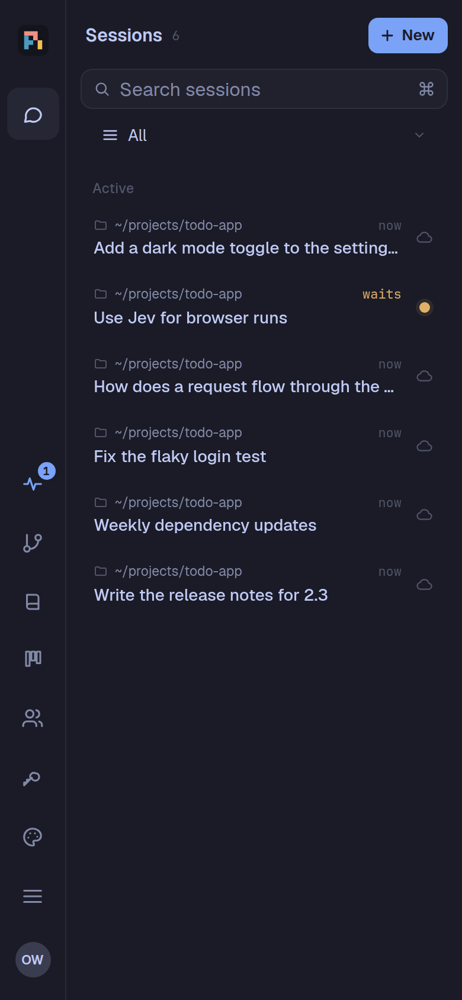
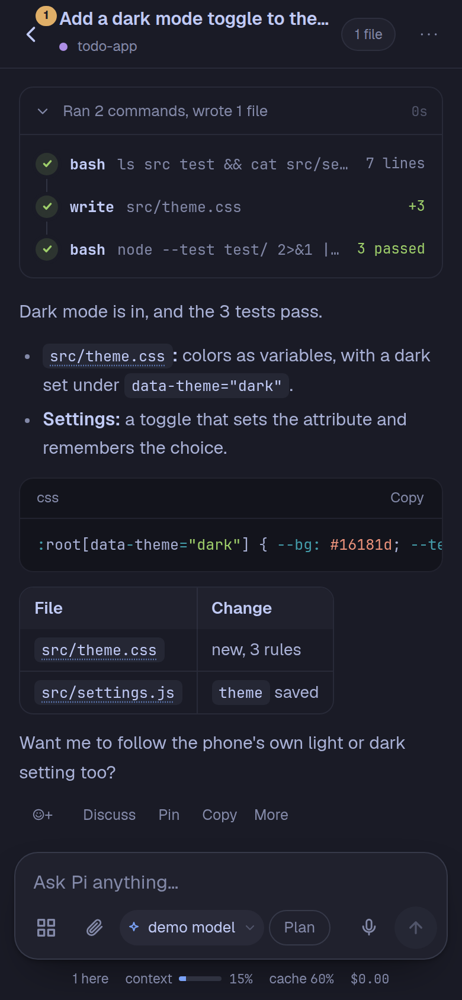
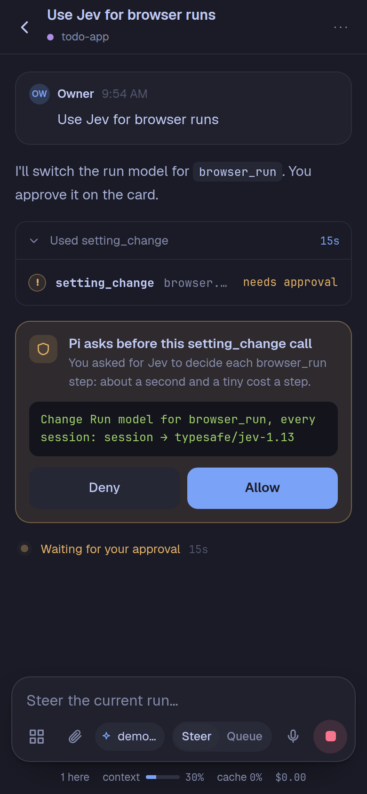
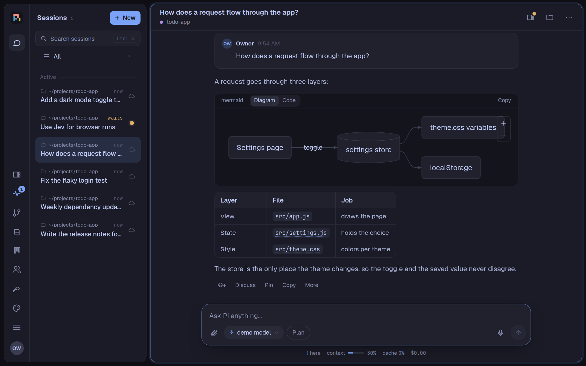
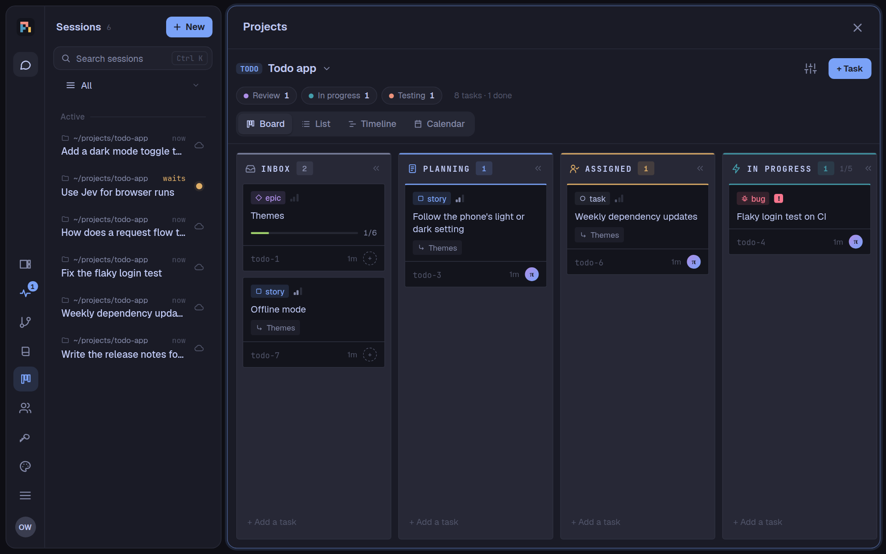
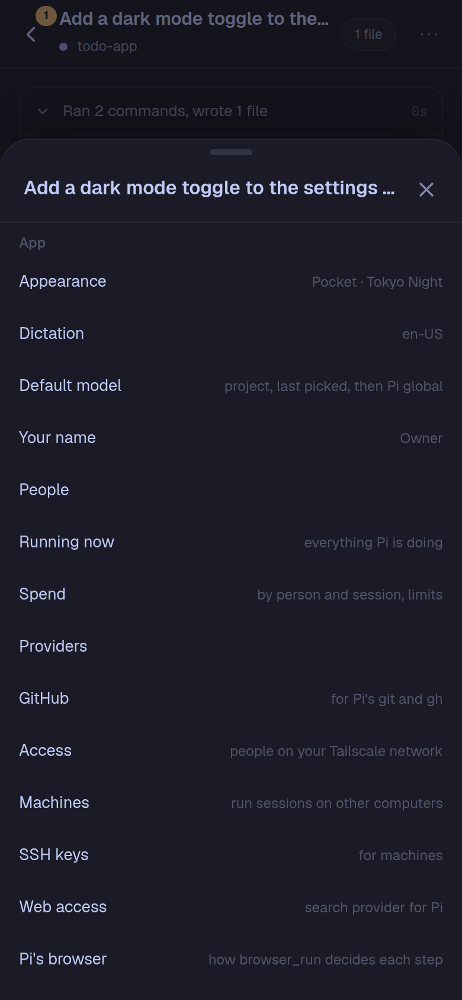

English | [简体中文](README.zh-CN.md)

# pi-phone

A coding agent that lives on your Android phone. pi-phone is one app: it carries its own Linux userland (Node.js,
bash, git, gh, ssh, ripgrep, fd, npm), runs the [Pi](https://github.com/earendil-works/pi) agent on
[Pi Durable](https://github.com/earendil-works/pi/tree/main/packages/durable), and shows a mobile web UI in a WebView.
No Termux, no laptop, no cloud VM.

> **Status:** a personal project, built and tested on a Galaxy Z Fold 8 (Android 17). Sideload only (it targets
> Android SDK 28, see [DESIGN.md](DESIGN.md)). Expect rough edges.

<p align="center">
  
  
  
</p>
<p align="center">
  
</p>

<sub>Made with a demo app and a scripted model (`scripts/readme-shots.ts`): no real sessions, accounts, or projects.</sub>

## What it does

### The agent
- **A durable agent on the phone.** Sessions, subagents, and tool calls are stored as they happen (SQLite). Kill the
  app or update it mid-run and the work continues where it stopped.
- **Subagents at a glance.** A peek tile lists the subagents at work in its session (3 at most, 1 in the phone's
  strip; **N more** opens the board there), and the subagents board shows a sub-tile for each (6 a session, 3 on a
  phone). An approval on a tile names the subagent that asks.
- **A session list after T3 Code.** A scope picker (All, each project, each folder, Archived) instead of tabs; Pinned,
  Active (a project's running task sessions under its main session), and a folded **Settled** shelf. A session settles
  by itself after a day idle, when its task run ends, or when its branch is merged, and comes back with new activity;
  Settle and Un-settle by hand too (and `session_settle` for Pi). Rows show where, the time (or how long it has been
  working), the title, the branch or task, and the status.
- **Edits you can review.** Pi changes files with its edit and write tools, so every change shows as a diff; a bash
  command that writes files by script (`sed -i`, `cat > file`, `writeFileSync`, `tee`) still runs, with a reminder in
  its result to use edit.
- **Auto-compact when you want.** A session compacts its context by itself just before the model's limit; it can
  happen sooner, at a percentage of the context you pick (10–95%), for every session or one (Menu › Compact context).
  The context meter marks where. Pi changes both on a card (`sessions.compactAt`, `sessions.sessionCompactAt`).
- **Folder groups in the session list.** Make your own groups (**+ New group**) and move chats into them: Move to
  group… from a chat's long press, its row, its menu, or a selection's **Move…**, or drag on a desktop. A chat is in one
  group at most; a group can be pinned (under the pinned chats), folded, renamed, reordered, or deleted (its chats go
  back to Active). They're yours, kept on the server and the same on every device; under a project or folder scope each
  shows only that scope's chats, and searching finds chats by their group's name. For many groups: the Move sheet finds
  a group as you type (recent ones first) or makes the one you typed, the scope picker shows a single group, a
  **Groups** heading folds them all on this device, and Fold all / Unfold all is in any group's menu. Empty groups
  stay hidden until **Show {n} empty**, under the groups. Pi can do all of it
  (`session_groups`, `session_group_create`, `_rename`, `_pin`, `_fold`, `_order`, `_move`; deleting asks on a card).
- **Real tools.** `bash`, `read` (text and images), `write`, `edit`, and `codemode` (scripts that call the tools),
  with git, gh, ssh, Node, npm, ripgrep, and fd in the bundled userland.
- **Sign in once.** Claude Pro/Max, other providers' OAuth, or API keys, from the Providers sheet. GitHub through a
  device code (Settings › GitHub), used by the agent's `git` and `gh`.
- **More than one account.** Add a second (or third) Claude, Codex, or Copilot account in Providers; each has its
  own sign-in, and its models are listed per account ("Claude Opus · Work"). A session uses the account of the
  model you pick for it, so you can start a session on any account or move one to another.
- **Plan usage.** Each Claude, Codex, and Copilot account's limits as its own app shows them: the 5-hour and weekly
  windows (Copilot: the month's premium requests), with reset times, as bars in Providers, in the model menu, and as a
  meter in the session's top bar that opens to every window. At 90% of a window the session says so, with **Switch to** your other
  accounts; a request that fails on the limit offers **Continue on** another account. pi-phone never switches by itself.
- **Wait out provider limits.** A run that hits a 429, an overload, or a Claude or ChatGPT plan window waits inside
  its request until the provider's own reset (its headers, else the account's usage bars, else growing gaps), then goes
  on by itself, a restart included. The live line says whose limit and when it tries again, with **Retry now** and
  **Stop**; the session's row, peek tile, and the subagents board show an amber square. When other accounts of the
  same provider have room, the card's dropdown lists every one, with how much of the window that ran out it has used:
  yours first, then a team server's shared accounts, marked *(team)* as they spend the team's subscription, each the
  emptiest first (the first is picked until you pick another). You choose: **Move** sends the waiting request to the
  account picked (checked again
  at that moment; one that filled up meanwhile is refused, with why, and the card refreshes), and the session uses it
  from then on; a subagent's card moves the subagent and its session. Or **Wait until** the reset. While the card is up, the usage banner over the message box
  steps aside. A reset further away (a weekly window), billing, or an expired sign-in fails at once, with the reset time.
  **Providers › Wait for a limit**: off, 1, 6 (the default), 12, or 24 hours at most, and one phone notification for a
  wait of 10 minutes or more (on unless you turn it off; a browser's push says the time on that browser's clock).
  Titles never wait.
  From pi-pocket 0.21.0 (named windows: #128 by @piromagnus).
- **Spend.** What Pi spent, by person and by session, with limits the owner sets (past one, Pi takes no new
  messages there). The wiki's search by meaning has a line of its own: its remote embeddings (indexing and queries),
  with requests and tokens, in the total and in nobody's limit.
- **Plan mode.** The Plan button by the message box: Pi reads and plans before it changes anything (it still records
  decisions and findings in the wiki, and uses its browser in full to look at the live app or a site), and a long plan
  comes as a reviewable HTML page.
- **Interview.** Pi asks several questions at once in a form (choices with its recommendation, text, photos), and waits
  for the answers, or carries on and gets them later.
- **Schedules and goals.** Pi messages itself later or on repeat (`schedule`), and a session can keep working toward a
  goal it checks.
- **Other sessions.** Pi can list, read, start, message, wait for, and stop the app's other sessions, as the person it
  works for. It can also get a stuck session going again, each time after you say yes on a card: fork it before the
  message that stopped it (`session_fork`), start a new context there (`session_new_context`), or compact it
  (`session_compact`). Never its own session, except a fork: Pi can branch off its own work and hand the fork its
  task. A session Pi starts is linked to the one that started it: it shows under that one in the list (a pill with
  how many folds them away, with a dot when one waits for you or failed), "Started from" and "Linked session" links
  above the transcripts lead from one to the other, and its spend counts toward the starter's limit.
- **Projects** (an extension, off until you turn it on in Settings › Extensions): boards of tasks that keep work from
  being forgotten. Pi asks once before it tracks a session's work on a board ("Track this on the board?"), then keeps
  its tasks current with `task_create`, `task_update`, and `task_comment`. Epics, Stories, Tasks, Bugs, and Sub-tasks;
  Inbox → Planning → Assigned → In Progress → Testing → Review → Done, and Blocked. Only a person approves a task that
  needs it, and Pi never approves its own work. Shared with the people you choose. The Projects page (rail) shows a
  board in ACS's look: drag cards between states on a desktop; on a phone, swipe between states and long-press a card to
  move it. **List** groups tasks by state, assignee, priority, or label (a table on a desktop, rows on a phone);
  **Timeline** shows open tasks with dates as bars from start to due (dashed without a start), by week or month, with
  today marked; **Calendar** shows tasks by due date in a month (the month's days as a list on a phone), with the
  unscheduled beside it, and on a desktop you drag a task to another day. A card opens its task: its state in a pill, a run card that says what to do (review and merge with the
  diff size, open the working session, run it), quiet property rows, the checklist with its progress, relations, the
  sessions that led or worked on it, comments (or all activity, a run in one line), and a comment box at the foot. A
  merge is kept on the run (who, when, the commit), so a merged branch is not offered again.
  The session menu's "Board for this session" turns board mode on or off, and sets who moves tasks to Done there (you on the
  board, Pi once you approve in chat, or Pi once it verified the work itself: live and measured) and its board rules (the project's, Full, or Light; each project has Full or
  Light too; `board_settings` and `project_update` for Pi). `#task:PP-3` links open a task anywhere.
  **An agent team per project:** its main session leads (plans, asks before a task runs, reviews, never writes code);
  a task given to Pi runs in a task session of its own, in a git worktree on `task/PP-12`, at the place (the phone or a
  machine) with room, as many at once as each place allows. Its end is reported to the main session; you see the
  branch's diff and merge it from the task. Task and main sessions do not notify the phone when they finish; approvals
  and failures do. The team checks on its task sessions each minute: an end it missed (a restart) is still reported,
  a task whose session was deleted fails, and one working over 30 minutes is flagged to the main session.
  Pi has a tool for every action (`project_create`, `project_update`, `project_share`, `project_team`, `task_create`,
  `task_update`, `task_comment`, `task_run`, `task_diff`, `task_link_session`, …); making a board (from any session),
  deleting, and merging ask you on a card.

  

### Web, documents, and answers
- **Pi's browser.** Pi opens pages in a browser of its own (a WebView of the app, driven over its DevTools socket) and
  reads them as numbered controls and visible text (icons named by their tooltip, sprite, picture, or where they go;
  things clickable only by their look, like a pop-up's buttons, too); it clicks, types, chooses, hovers, scrolls, presses
  keys, goes back, reads a whole page, or looks at it (`browser_open`, `browser_click`, …). Lists a page draws itself
  (a select with its own scroll area) work too: every option is listed, a click scrolls it into view, `browser_select`
  opens the list and picks by name, `browser_scroll` scrolls the list, and a letter jumps by type-ahead.
  `browser_screenshot` can save its picture as a PNG or JPEG in the session's folder (for `doc_image` or a report),
  and picture only the dialog, menu or list a control is in. It marks pictures up for runbooks: a box, a numbered
  badge, a label and an arrow on a control or a text, the rest dimmed, and secrets hidden (a solid box for keys and
  passwords, a heavy blur for names); `image_markup` does the same on any picture file, and `screenshot` saves its
  pictures with `save`. It uploads files from where
  the session works (`browser_upload`, to a file field or its Upload button), saves a page as a PDF there
  (`browser_save_pdf`), and keeps up to six tabs (`browser_new_tab`, `browser_tabs`; the panel shows them as a strip).
  **Each session has its own tabs**, and its panel shows only those; sign-ins are shared by every session on the phone
  (or on a machine). A session's tabs close after 30 minutes unused (not while you watch or have taken over), and at once
  when it is archived or deleted; the sign-ins stay. Pages are laid out as a phone's, or as a desktop's (1280 px, a
  desktop Chrome, no touch) with **Phone / Desktop** in the panel or `browser_size`.
  Each click is checked first: the element as read, still in view, nothing over it. You watch it live in the Browser panel (beside the conversation on wide screens, where
  it opens by itself when Pi starts browsing; on a phone, a small live preview above the message box opens it), and can
  **Take over** and **Hand back**: taken over, tap the page and type on your keyboard, and your keys go straight to it;
  swipe (or use the wheel) to scroll what is under your finger, an open list's own scroll area included.
  Nothing you type stays in the panel, and over a password field the keyboard is in password mode, so it does not
  learn what you type. It never opens this phone or its local network,
  keeps its cookies and sign-ins in a WebView profile of its own (apart from the app's), and only works for what the owner asks.
  **`browser_run`** carries out a whole goal on its own, a step at a time: each step is decided by the run model you
  pick in Settings › Pi's browser (the session's own model, or Jev, TypeSafe's decision model through OpenRouter:
  about a second and $0.00003 a step), for every session or one. It types only values Pi supplies, stops with
  a reason Pi can act on (a value it needs, blocked, stuck, not visibly done), and Jev's cost counts in Spend. A live card in the
  conversation shows its goal, each step as it happens, the time and cost, and Watch.
  **Passwords from Secrets:** a sign-in you saved in Secrets (and allowed in that folder), Pi types by name
  (`browser_type` with `secret`, or `browser_run` values `{ secret }`): the value goes into the page, never to Pi or the run
  model, and an "ask first" secret still asks you on a card. **Otherwise signing in stays yours:** Pi never types a password
  or a code as text. `browser_sign_in` puts a card in the
  conversation where you type the username and password (or use one kept in Secrets with Remember), and they go
  straight into the page (the card names the fields in its own words, never the page's); `browser_ask_code` does the same for a one-time code; `browser_ask_user` hands you the page
  for a CAPTCHA or an approval on your phone, and Pi goes on when you say Done. Passkeys are not possible there
  (Android allows them only in allowlisted browsers): Pi takes the site's other way, or asks you.
- **Web access.** `web_search` through the provider you pick (37 of them, DeepSeek included), and `fetch_content` for
  pages, PDFs and Office files, GitHub repositories, issues, and pull requests.
- **Documents.** `file_to_markdown` reads PDF, Word, PowerPoint, Excel, EPUB, notebooks, and more
  ([markit](https://github.com/picassio/markit)).
- **Office files.** [OfficeCLI](https://github.com/iOfficeAI/OfficeCLI) is built in: Pi creates and edits `.docx`,
  `.xlsx`, and `.pptx` from bash, with skills for decks, dashboards, financial models, papers, and forms, and the Files
  viewer previews them.
- **Rich replies.** Math (KaTeX), Mermaid diagrams and charts, HTML artifacts in a sandbox (with
  [effective-html](https://github.com/plannotator/effective-html)'s design skills), and **interactive answers**: a
  trip with a map, a calculator, a checklist, drawn as a working UI that keeps its state.
- **Pi sees its work.** `screenshot` renders an artifact, an HTML or Office file, or a web page in the phone's own
  WebView, at phone and desktop widths, even with the screen off, so Pi checks a page before calling it done. An HTML
  file loads its stylesheets, scripts and pictures from its own folder, so a page linking the app's CSS shows styled.
- **Measured screenshots.** Every `screenshot` width comes with a layout check the page runs before it is drawn: what spills
  out of its box or its parent, and whether the page is wider than the screen, with sizes. Pi goes by the numbers.

### Secrets and the wiki
- **Secrets.** API keys and tokens in Settings › Secrets, used by name (`$NPM_TOKEN`) and never shown: output that
  contains one shows `[secret NAME]`. Pi asks for a missing one through a hidden field. To keep a value a command
  makes (`gh auth token`), Pi shows you the whole command on a card first (**Run and save**), and a failed command's
  output is never shown. Pi's browser gives Pi a page's text fenced as the page's, not instructions, and a sign-in you
  type hides your username in what Pi reads afterwards, as it does the password.
- **Drop-in extensions.** Your own extension modules, added with **Add drop-in…** in Settings › Extensions (a `.ts`
  file, or a `.zip` holding one) or by Pi with `extension_install` once you approve its card (files and first lines
  shown), each off until you turn it on. They can use pi-pocket 0.22's `host.ask` (a card whose values reach only the extension), `host.hide`
  and `host.commandEnv`, not `host.browser` yet; one whose tool has a built-in tool's name is refused, with why.
- **A PARA wiki** ([pi-para](https://github.com/picassio/pi-para)): Pi consults and writes it as it works, with qmd's
  search, tracks its open questions until they are answered, and captures idle sessions into it.
- **Documents** (rail › Documents): your documents in folders, as markdown pages rendered like the wiki.
  - **The page:** the place (Mine, Team, a board) is its header, with **+ Page** and a ⋯ for a new folder, deleted
    pages and the settings; search has a row of its own. Folders are sections with their page count, each with a ⋯
    (a page or folder in it, rename, delete). On a wide screen the folders and the open page sit side by side.
  - **Pages:** `[[links]]` between pages, the pages that link back, every saved version to look at and restore,
    deleted pages to bring back, and search across all of them.
  - **Where:** Mine, and each board's (a board's **Docs** opens them). On the team server there are Team documents
    too, edited by roles with "Edit team documents".
  - **Search by meaning:** pages are found by what they say, not only their words, merged with keyword matches.
    Yours use the wiki's embedding model with your OpenRouter sign-in; the team's use a model and an OpenRouter key
    the owner sets on the gateway's Server page. Its cost shows in Spend (or on the Server page).
  - **Images:** add PNG, JPEG, WebP or GIF (10 MB at most) with the editor's **Image** button or by pasting. Location,
    camera and other metadata are removed (a photo keeps its orientation). A vision model you choose in Menu › Settings ›
    Documents describes each image once, so search finds pages by what their pictures show; on the team server the owner
    sets the team's on the Server page.
  - **Pi** searches, reads, writes, edits and moves documents for you, adds images from files, and deletes or restores them on a card.

### Other machines
- **Work on other machines.** Add an SSH key and a machine (Settings › SSH keys, Machines). A session on a machine
  runs its tools there through [pi-env](https://github.com/earendil-works/pi/tree/main/packages/env)'s small daemon;
  the conversation and your logins stay on the phone. The Files panel, viewer, Changes, and the terminal follow the
  session there. Linux, macOS, Termux, and **Windows** (through its OpenSSH Server and Git Bash; the app gives you a
  PowerShell script that sets it up).
- **Machine tools.** OfficeCLI, ripgrep, fd, Chrome (headless, for Pi's browser where a machine has no Chrome), and
  Computer use (ocu, for Pi to operate desktop apps there; on Linux it needs a desktop session) installed on a machine
  from the app (Windows included), checked by their SHA-256. They are listed, ticked, when you add a machine, in
  **Install tools**, and on the `machine_add` card.
- **Pi's browser on a machine.** A session on a machine browses in a headless Chrome there (its own Chrome, Chromium or
  Edge, else the machine tool), watched in the same panel ("Pi's browser on <machine>"). It opens the machine's own
  addresses, so Pi can try the web app you run there (`localhost:3000`), and uploads and PDFs use the machine's files.
  Its sign-ins stay in `~/.pi/mobile/browser` there.
- **From any session.** `machine_run` and `machine_copy` run a command or copy a file on a machine, and `pi-ssh`
  gives bash ssh, rsync, scp, and tunnels with the app's keys, which nothing can read out. Pi adds a machine itself with
  `machine_add` (a VM it just made, say): one card shows the address, the SSH key and the host key, checked against the
  one Pi read on the machine when it could, and the tools to install (all ticked); **Approve and connect** adds it,
  installs pi-env, connects, and installs the ticked tools; Deny saves nothing.
- **Ports** of a machine (a dev server there) open in the phone's browser.
- **Continue Pi sessions.** Pick up a session from Pi on this phone, a `.jsonl` file, or a machine's
  `~/.pi/agent/sessions`, with its history; or send a session to `pi` on a machine and bring back what was done there.
  Pi can do both itself (`pi_sessions`, `pi_session_import`, `continue_in_pi`, `pi_bring_back`).

### This phone's apps
- **Pi uses your apps.** In a control session you approve on one card (the apps it names, and the home screen to open
  them, for 15 minutes or what the card says, 5 to 60), Pi reads the screen as numbered elements and taps, types,
  swipes, scrolls, presses back or home, opens the apps and takes screenshots (`phone_control`, `phone_screen`,
  `phone_act`, `phone_screenshot`), through pi-phone's own accessibility service: no developer mode, no adb. A banner
  and a notification on the phone say Pi is using it, with **Stop**, as does a line in the session; it ends at its
  time too, and soon after Pi's turn ends, so the banner going means Pi is done. Another app needs a new card, unless the card follows along: then an app the named ones open (on a
  Samsung, Settings' Battery is Device care, an app of its own) joins as it comes, one step only, and the card says so.
  Password fields read as hidden and Pi never types into them: a password or
  code is yours to type on the phone. pi-phone itself, banking and payment apps, password managers and the apps on
  your Never list are never read or touched. Set it up in Menu › Phone control (Allow restricted settings on Android
  13+, turn on pi-phone in Accessibility, let it run in the background), where you also keep the Never list. The owner's
  alone; not on the team server.

### Your machines' apps
- **Pi uses desktop apps on your machines** (Linux for now; Windows next). In a control session you approve on one card
  (the machine, the apps it names by their windows, for the minutes Pi asks for, 5 to 60; for more it asks again), Pi
  reads a window as numbered elements and clicks, sets values, types, presses keys and scrolls, and takes pictures of
  it (`computer_control`, `computer_screen`, `computer_act`, `computer_screenshot`), through Computer use (ocu, a
  machine tool) running there over the app's own ssh. A small window on the machine says Pi is using it, with **Stop**;
  the session ends at its time, soon after Pi's turn ends, or on Stop. Following along (when Pi asks) lets an app the
  named ones open join. Password fields are marked in what Pi reads, and Pi never types a password as text: it fills one
  with a saved secret by name (`computer_act` with `secret`, the same folder and ask-first rules as everywhere; the value
  goes into the field, Pi reads `[secret NAME]`), or you type it on Take over.
  pi-phone itself, banking and payment apps, password managers and authenticators, and the apps on your Never list are
  never read or touched.
- **Pi's computer**, a panel like Pi's browser: the top bar's monitor button opens it beside the conversation (on a
  phone it covers the screen, and a small live preview sits above the message box while Pi acts). The session's windows
  are its tabs; the picture is the window as ocu sees it, after each of Pi's actions and every few seconds, with a box on
  what Pi acted on; the foot has the minutes left and Stop. **Take over**: Pi waits; tap the picture to click there, and
  your keys go to the field in focus, a password field too (the keyboard is in password mode there, and what you type
  is never shown to Pi, kept in the panel, or logged), until you **Hand back**.
- **Menu › Computer control**: each machine and where it stands, a line run before ocu starts for a machine whose
  desktop needs its environment set (with **Check**, what ocu reads there), the Never list, and how cards work. The
  owner's alone; not on the team server.

### People and devices
- **Other devices and people** over your Tailscale network (Settings › Access): your laptop's browser signs in as you
  (People › Sign in as me), and invited people steer or watch sessions, all of them or one.
- **Settings by tool.** Pi lists the app's settings with their values (`settings`), changes one (`setting_change`), or takes a
  one-off action (`app_action`), each after you approve the usual card showing the value now and the new one, through the
  same code as the app's screens: models, approvals, Pi's browser, web search, the wiki, spend limits, themes, extensions,
  secrets (their flags; deleting one), machines (names, tools, ports, removing), SSH keys, provider accounts, GitHub
  sign-out, a backup, a restart, invited people (role, sessions, removing), Tailscale, the Claude Code billing patch, favorite
  folders, and one session's model, instructions, trust, and limits. A command that reaches into the app instead (its API,
  your token in its config, its WebView's DevTools) is refused, naming the tools.
- **Devices.** Each sign-in is a device of its own, so People lists every signed-in device (open now or not, where it
  was last seen) and signs any one out; invited people see and sign out their own. **Sign out every device** signs out
  all your others at once. A **recovery code** (break glass), made in People in the phone's app only and kept off the phone, signs a
  browser in as you once if no device can; the phone notifies you when it is used. Pi lists devices too (`devices`), and signs one or
  all out (`device_sign_out`, `sign_out_everywhere`) after you say yes on a card.
- **Dictation** with Android's speech recognizer, in the language you choose.
- **Voice calls with Pi** on your ChatGPT (Codex) sign-in: the waveform button beside the mic starts a call in the
  session, full screen on a phone and a panel at the right on a wide screen. In "Pi works" (the default) the voice
  talks and hands real work to the session's Pi, then tells you Pi's answer; "Chat only" just chats; "Pi thinks" sends
  what you say to Pi as it is and reads Pi's words out as written, with the live model's voice or your device's own
  (Android's text-to-speech in the app, the browser's elsewhere; Settings › Voice's reader). Set it in the call or in the model chip's menu. Talk any time
  (talking over the voice stops it), tap to talk (a tap opens the mic for one turn, and it closes itself when you stop
  talking, so people near you are not heard), or hold to talk; a big Mute that says "Mic off" in red while off; end.
  The mic can also mute itself after a quiet spell once the voice has answered (hands-free), turn off and on with a
  headset's button or the volume keys, and stay off unless the phone is at your ear (Settings › Voice).
  What you say to Pi shows as your message marked voice,
  and the rest of the talk as quiet voice rows. Approvals stay a tap in the chat. In the app the call goes on with the
  screen off or another app in front, with a call notification (Mute, End; a tap shows the call); music pauses, and a
  connected headset is used, else the speaker. pi asks Android for the microphone the first time.
- **Settings › Voice.** The live models your ChatGPT (Codex) sign-in has, as checked with OpenAI (**Check again**),
  each with how its calls are set up: a short-lived key, through pi-phone, or Codex's own `gpt-live` (ChatGPT's private
  endpoint, only when you pick it). Also the voice and the language (checked when picked), noise reduction on the mic
  (phone at your face, speaker or table, or off) and how soon hands-free takes your turn as ended (waits longer helps in
  a noisy room), who thinks and turn-taking (hands-free, tap to talk, hold to talk)
  for new sessions, the mic in a call (mute after so many quiet seconds, off by default; a headset's button, the
  volume keys, both or neither as a mute key, the headset's by default; mute unless the phone is at your ear, off by
  default as it would mute a speakerphone call), what the voice says while Pi works (Pi's words as they come, or only the answer, and a short cue on
  what Pi runs at most every 20 s), who reads Pi's answers in "Pi thinks", the dictation engine and model, and an
  optional daily limit. Minutes of voice show in Spend, counted on your ChatGPT plan. The sign-in's token stays on the
  server.
- **Codex dictation**: Settings › Dictation can let Codex (`gpt-4o-transcribe` on your ChatGPT sign-in) listen to the
  mic instead of Android's recognizer; words still show in the box as they are heard, and nothing is sent by itself.
- **The phone's assistant.** Pick pi as the digital assistant (Menu › Assistant walks you through it), then hold the
  side key in any app: a pi sheet comes up over it, already listening. Your words show as you speak, then wait for
  Send, or go by themselves after 3 seconds. They go to the last session you were in, a new session, or one session
  you pick (for this time from the sheet, or for good in Menu › Assistant), with the app you were in noted ("From
  Chrome", a chip you can drop) so Pi can offer phone control for it (approve it in the sheet, which then steps aside
  while Pi uses the app). The reply streams in the sheet and approvals are answered there; **Open** takes you to the session. While pi is the assistant, apps that ask the phone's default
  speech recognizer still reach the phone's own: pi only passes it on. Not from the lock screen. The sheet can also
  start a **voice call** with the session's Pi (its waveform button, or by itself when Menu › Assistant says "Start a
  voice call"); when you leave the sheet the call goes on in pi-phone, with its notification.
- **Voice beside New** in the session list (and on the desktop's home): a new session named Voice, opened talking.

### The app
- **A terminal.** A real shell inside the app, on the phone or on a machine, with Esc, Tab, Ctrl, and arrow keys
  above the keyboard.
- **Changes** of the session's folder (only its own, even inside a bigger repository), with diffs and undo.
- **Notifications** when a session finishes, fails, or asks for approval: from the app on the phone, and as push
  notifications in a browser at an HTTPS address (the team server, a desktop, an iPhone with pi-phone on its Home Screen),
  even with no tab open. Menu › **Notifications** turns them on for that browser, lists the others, and sends a test;
  a browser with pi-phone open in front gets none. **Downloads** of any file Pi made or
  named (tap its path, then Download), and of any image in a conversation (tap it, then Download): to the phone's Downloads in the app, or as the browser's download elsewhere; **backup and
  restore** of everything. Scheduled messages and CI watches sleep durably: they hold nothing while they wait, and a
  restart keeps their time.
- **A safety copy before a one-way upgrade.** Pi 1.4 moves the database to a new format that older builds cannot
  open. On the first start of a build with it, pi-phone first copies the database whole to
  `pocket.sqlite.before-pi-1.4` in its data folder and checks the copy; without a good copy (not enough space, a write
  that fails), it does not start and says why, with your data unchanged. The copy is removed after 14 days and left
  out of backups.
- **CI in the loop.** The agent's `watch_ci` tool watches GitHub Actions runs in the background and reports when
  they finish, so it pushes, ends its turn, and is woken by the result.
- **In English or Chinese.** Appearance › Language: *Auto* follows the phone or browser, or pick English or 简体中文
  (Simplified Chinese). The choice is kept with you, so every device of yours follows it, and Pi, told your app is in
  Chinese, answers in Chinese until you write in another language. The whole app is translated: the session list,
  conversation, menus, launcher, every sheet, the Projects, Wiki, Documents and Sharing pages (extensions get
  `pocket.t` for theirs), the team server's sign-in and admin pages, the server's errors and notices, and the phone's
  notifications (with Auto, in the phone's language). This README is in Chinese too: [README.zh-CN.md](README.zh-CN.md).
- **Quick on a phone.** A streaming answer redraws only its last block, and only what changed in it crosses the wire;
  text and the event stream go compressed, and web files are cached (ETag, 304) and fetched at once (modulepreload).
- **Updates from GitHub.** Every passing build on `master` is a release, with release notes. The app checks it (at
  start, or Settings › Check for app updates): server and UI changes swap in within seconds; a new Android shell is a
  one-tap install.
- **It builds itself.** The agent works on a clone of this repository inside the app, pushes, and CI ships the release
  the app then installs.

## Install

1. Download `pi-phone.apk` from the [latest release](https://github.com/picassio/pi-phone/releases/latest).
2. Open it on an arm64 Android phone and allow the install (sideloading).
3. The first start unpacks the runtime (about a minute), then signs in by itself.
4. Sign in to a model provider: ⋯ (the session menu) › Providers. Then see [Use it](#use-it).

Updates come through the app afterwards; uninstalling deletes its sessions and logins.

**On a Linux server instead:** the same app runs in Docker behind Caddy (HTTPS), with Pi's browser and `screenshot` on a
headless Chrome inside it, built on the machine itself; see [deploy/README.md](deploy/README.md). There are two ways to run it:
- **For one owner.**
- **For a team** (6 to 15 people). It has:
  - **Accounts:** by invite, with passkeys and two-factor.
  - **A pi-phone per person**, each in its own container.
  - **Custom roles**, which set features, models, monthly spend, memory and CPU.
  - **An audit log**, failed and blocked sign-ins included.
  - **People & account in the app:** the rail's People & account opens the team pages (Account, Shared with me, People,
    Roles, Audit log, Server) in the main panel, in the app's theme; a new invite's link shows in place, copied.
  - **Idle pi-phones stop**, with **Always on** per person.
  - **Rolling updates**, with data kept.
  - **Downloads:** each person's data, and a whole-server backup.
  - **Sharing sessions** (⋯ › Share this session): a teammate opens one of your sessions from Shared with me, in
    their browser, and either watches or writes (on your providers; they read its files, never use the terminal or
    allow calls, and Pi uses your machines and secrets for them only if you say so). Unsharing ends it at once.
    **Continue in mine** copies a shared session into their own pi-phone. Pi shares on a card, too.
  - **Team accounts** (Providers › Add team account, with "Add, sign in and remove the team's provider accounts" in
    one's role): a provider's key or subscription sign-in, set up once for the team. It sits under its provider in
    everyone's Providers sheet, marked TEAM; the key or sign-in stays on the team server, never in anyone's pi-phone.
    Roles say which team accounts their people may use; their models show in the model menu ("openrouter · Team Work
    account"), and each answer comes through the team server, checked against the person's role at every call.
    What each person spends on them is counted per account and month: a role can have a team spend limit apart from its
    own (empty for none), and the Server page lists this month's spend by person. A team Claude, Codex or Copilot
    subscription shows its plan's usage bars to everyone who can use it, and Claude requests get the Claude Code
    billing patch on the team server, as each person's setting says. Pi lists them, and adds one, says which roles
    use it or removes it on a card; signing in stays a person's, on the account's row.
  - **Team machines** (Machines › Add team machine, with "Add, change and remove the team's machines" in one's role):
    a computer added once for the team, reached from the server's own network. Its SSH key is made and kept on the team
    server, never in anyone's pi-phone; you put its public half in the machine's `authorized_keys` and accept its host
    key. Roles say who may use it (Roles › Team machines they may use). It shows under Team machines in their Machines
    sheet and in the folder picker, with everything a machine has: sessions, the terminal, ports, `machine_run`. Each
    person starts in a folder of their own there (`~/team/<name>`), on the machine's one account. Taking a machine off
    a role closes its people's connections at once. Pi lists them, and adds one (giving you its public half), says
    which roles use it or removes it on a card; accepting its host key stays yours, on its row.
  - **Hardened:** only ports 80 and 443 open, sign-in limits that people's containers can't get around, no
    cross-site changes, and security headers. See deploy/README.md › Security.

## Use it

### Every day
- **Start a session:** **+ New** in the session list, then pick a folder on the phone or on a machine; inside a
  session the picker opens in that session's folder, and the launcher's **New session here** starts one there at once.
  The model menu under the message box picks the model and how hard it thinks.
- **Talk to Pi** by typing or with the microphone (dictation). Enter sends and Shift+Enter makes a new line on a computer,
  and on a phone or tablet with a physical keyboard (Bluetooth), where Ctrl+Enter or Alt+Enter make a new line too (for
  input methods such as Sogou, which keep Shift); the on-screen keyboard's Enter makes a new line, and the send button
  sends. Attach files and photos with the paperclip. **Plan**
  makes Pi read and plan first, changing nothing until you approve. While Pi works, a message can **Steer** (read between steps),
  **Queue** (after the run), or **Interrupt** (stop the run now, its tool call too, then send).
- **Approve or deny** the cards Pi puts in the conversation: risky commands, settings changes, sign-ins, questions.
- **The session menu** (⋯ in the session's top bar) has the session's own things: rename, folder, terminal, context,
  instructions, schedules, board. Below them, under **App**, are the app's settings, listed in the next part.
- **The rail** (left edge on a wide screen) opens Sessions, Projects, and the Wiki. A session's **Places** open its Files,
  Changes, Artifacts, Find, and Branch. The **Browser panel** opens when Pi browses: beside the chat on a wide screen, or
  from the small preview above the message box on a phone.

### Settings, and asking Pi instead
Every setting below is in the session menu (⋯) under **App**. You can also just tell Pi, for example "use Jev for browser
runs": it changes the setting with its `setting_change` tool after you tap **Allow** on a card that shows the value now
and the new one. Ask "what can you change?" and Pi lists every setting with its value (`settings`).

| What | Where | Ask Pi? |
|---|---|---|
| Model providers (Claude, Codex, Copilot, OpenRouter, …) | **Providers**: sign in, or **API key**; **Add account** for a second one | No for signing in, which is yours. Yes for removing an extra account or signing out |
| Default model for new sessions | **Default model** | "Set the default model to anthropic/claude-opus-… high" |
| Waiting for a provider's limit | **Providers › Wait for a limit**: the longest wait, and the notice of a long one; a waiting session's **Retry now**, **Stop**, and its account card | "Wait at most 12 hours for limits", "Retry session 12 now", "Move session 12 to the Work account" |
| GitHub for Pi's `git` and `gh` | **GitHub**: a device code | No for signing in. Yes for signing out |
| **OpenRouter** (needed for Jev, the wiki's search by meaning, and OpenRouter web search) | **Providers › OpenRouter**: sign in, or **API key** | No, signing in is yours |
| **Jev** as the model for `browser_run` | **Pi's browser › Run model**: *Jev*, id `typesafe/jev-1.13`, for every session or only this one (*Session model* uses each session's own model) | "Use Jev for browser runs" (or "…in this session only") |
| **Wiki** search by meaning | **Wiki** (or *Wiki settings* from the search launcher) **› Search by meaning**: pick an OpenRouter embedding model, such as `openai/text-embedding-3-small`. Off means keyword search only | "Set the wiki embedding model to openai/text-embedding-3-small" |
| Wiki capture and prompt context | **Wiki**: minutes idle before a session is captured, the model that writes captures, tokens of wiki in each prompt, lint options | "Capture idle sessions after 30 minutes", "use claude-haiku for wiki captures" |
| Web search | **Web access**: a provider, and its key (typed there or kept in Secrets) | "Switch web search to exa". The key itself is yours to type |
| API keys and tokens | **Secrets**. Pi asks for a missing one with a hidden field on a card, never in the chat | Pi can ask for one, change a secret's flags, or delete one. You type the value |
| Other computers | **SSH keys**, then **Machines** (**Install tools** there adds OfficeCLI, ripgrep, fd, Chrome, Computer use) | Yes for renaming, installing tools, ports, or removing. Accepting a new host key is yours |
| Extensions (Projects, Wiki, Pi's browser, …) | **Extensions** | "Turn on Projects" |
| Spend and limits | **Spend** | "Limit this session to $5" |
| When sessions compact by themselves | **Menu › Compact context**, for this session or every session | "Compact this session at 60%" |
| Other devices and people | **Access** (Tailscale), **People** (devices, invites, recovery code) | Yes for listing devices, signing one or all out, or changing a person's role. The recovery code is yours |
| Push notifications in a browser | **Notifications**: Turn on, Send a test, Remove another browser's | No: a browser asks you itself, on that device |
| Notifications, screen off, backup | **This phone** | Yes for making a backup. Restoring one is yours |
| The app's language (Auto, English, 简体中文) | **Appearance › Language**, kept with you on every device | "Switch my app to Chinese" |
| Appearance, dictation language | **Appearance** and **Dictation**, per browser tab | Only the theme new browsers start with ("make lantern the default theme") |
| The side key's assistant | **Assistant**: where your words go, whether they wait for Send, whether the app you were in is noted | "Make the assistant send by itself". Picking pi as the phone's assistant is yours, in Android's settings |
| Voice calls and Codex dictation | **Voice** (and **Dictation**'s engine): live and dictation model, voice, language, noise reduction, how soon hands-free answers, who thinks, turn-taking, progress, reader, daily minutes; a session's voice mode in its model menu | "Use gpt-realtime-mini for voice", "Let Codex listen to the mic", "Check the voice models", "I'm on speakerphone in a noisy room", "Let me tap to talk", "Mute the mic after 10 quiet seconds". Models, voice and language are checked with OpenAI first |
| App updates | **Check for app updates**. New builds also offer themselves in an update sheet. Tap **Install** | No |

What stays yours: typing secrets and passwords, signing in to providers and GitHub, the recovery code, accepting a
machine's host key, restoring a backup, and turning on plan mode. Pi says so and tells you where to do it.

<p align="center"></p>

## How it is built

```
android/   Android shell (Java): WebView, foreground service running node, runtime installer, updater
src/server pi-pocket's server, cut down, plus pi-phone's parts (machines, places, SSH keys, secrets, web access,
           documents, interview, wiki, screenshots, CI watch, GitHub login, Claude Code billing patch)
web/       pi-pocket's web app (Preact + htm, no build step)
scripts/   Termux rootfs and runtime packaging, OfficeCLI, versions, release notes, web import check, the README's
           pictures (readme-shots.ts: a demo app shot in Chrome, run on a computer)
test/      node:test
```

[DESIGN.md](DESIGN.md) explains the design and its decisions; [HANDOVER.md](HANDOVER.md) the current state and next
steps; [AGENTS.md](AGENTS.md) the rules for working on it (for people and agents).

```bash
npm install --ignore-scripts
npm run check   # tsc + web import check
npm test        # node:test; UI tests need Chromium
node src/server/main.ts --port 8788 --data /tmp/pi-data --cwd /tmp   # the server, without the Android shell
```

The APK is built by GitHub Actions only ([.github/workflows/build-apk.yml](.github/workflows/build-apk.yml)).

## Credits

pi-phone is mostly other people's work, put together for a phone. Thank you to everyone below.

### Built from

- **[Pi Pocket](https://github.com/TannerMidd/pi-pocket)** by Tanner Middleton (MIT). The server and the whole web UI
  started from pi-pocket 0.14 (commit `e5456a8`) and were cut down for a single-user phone app. Its design, its
  durable-first architecture, and most of the UI you see are pi-pocket's. License: [LICENSE-pi-pocket](LICENSE-pi-pocket).
- **[pi-termux-mobile](https://github.com/badlogic/pi-termux-mobile)** by Mario Zechner (badlogic). The idea and the
  first working version of an Android app that embeds Termux-built binaries and runs Pi: the Android shell (WebView,
  foreground service, runtime installer), the Termux package resolver behind `scripts/package-rootfs.ts`, and the
  APK workflow started from it (commit `a36765b`). The repository has no license file; its code is used here with
  credit, and permission should be confirmed with its author.
- **[Pi](https://github.com/earendil-works/pi)** by Earendil (MIT): `pi-durable` (the durable harness, tools,
  codemode, image reads), `pi-ai` (models and providers), `pi-coding-agent` (sign-ins, settings, sessions, skills),
  `pi-codemode` (the QuickJS sandbox), `pi-env` (remote execution over SSH), and `chord`. pi-phone is an app around
  them.
  The app's icon is Pi's logo ([pi.dev/logo.svg](https://pi.dev/logo.svg)), which belongs to the Pi project;
  pi-phone is an unofficial app, not affiliated with or endorsed by Earendil or the Pi project.
- **[pi-para](https://github.com/picassio/pi-para)** and **[qmd-engine](https://github.com/picassio/qmd-1)** (MIT): the
  PARA wiki, its tools and context, and its search.
- **[pi-cc-patch](https://github.com/picassio/pi-cc-patch)** (MIT): the Claude Code billing transform, ported to
  `src/server/cc-patch.ts` with its tests.
- **[sim-use](https://github.com/lycorp-jp/sim-use)** by LY Corporation (Apache-2.0, Copyright 2026 LY Corporation):
  phone control's outline of the screen (`src/server/phone-outline.ts`, from its `AndroidOutlineRenderer` and
  classifiers) and its accessibility service (`PiAccessibility.java`, `PhoneControl.java`, from its device bridge's
  tree, gesture, input and capture handlers), ported and changed; see `third_party/sim-use/` (its license and NOTICE).
- **[jev-ultrafast](https://github.com/browser-use/jev-ultrafast)** by Browser Use (MIT, Copyright (c) 2026 Browser Use):
  Pi's browser reads pages with its `snapshot.js` (adapted in `src/server/browser/snapshot.js`), and acts with its
  act-time checks (the element as observed, in view, not covered). Ideas also from
  [jev-ra](https://github.com/brnyxx/jev-ra) (MIT) and [browser-use](https://github.com/browser-use/browser-use) (MIT);
  the browser panel's design from [Kuvo Code](https://github.com/serhatandic/kuvo-code) (ideas only, no code).

### Contributed

- **[@yichan002](https://github.com/yichan002)** ([#3](https://github.com/picassio/pi-phone/pull/3)): the idea and a
  first version of pi-phone as the phone's digital assistant, opening with the message box listening. The assistant
  sheet grew from it.

### Bundled and used

- **[Termux](https://termux.dev)**: every binary in the app's userland is a [termux-packages](https://github.com/termux/termux-packages)
  build (Node.js, bash, coreutils, git, gh, OpenSSH, ripgrep, fd, npm, and their libraries), downloaded from the Termux
  repository and checked against its SHA-256 index; [termux-exec](https://github.com/termux/termux-exec) makes their
  scripts run. Each package keeps its own license; the build's `termux-packages.json` lists the exact packages and
  versions.
- **[xterm.js](https://github.com/xtermjs/xterm.js)** (MIT): the terminal.
- **[Preact](https://preactjs.com)** (MIT), **[htm](https://github.com/developit/htm)** (Apache-2.0),
  **[marked](https://github.com/markedjs/marked)** (MIT), **[DOMPurify](https://github.com/cure53/DOMPurify)**
  (MPL-2.0 or Apache-2.0), **[node-qrcode](https://github.com/soldair/node-qrcode)** (MIT): the web app.
- **[OfficeCLI](https://github.com/iOfficeAI/OfficeCLI)** by iOfficeAI (Apache-2.0): Office files, built for Android
  (NativeAOT) in our fork [picassio/OfficeCLI](https://github.com/picassio/OfficeCLI), with its skills in
  `third_party/officecli/`.
- **[effective-html](https://github.com/plannotator/effective-html)** by plannotator (MIT): the HTML design skills in
  `third_party/effective-html/`.
- **[ripgrep](https://github.com/BurntSushi/ripgrep)** (MIT or Unlicense) and **[fd](https://github.com/sharkdp/fd)**
  (MIT or Apache-2.0): installed on machines from their own releases.
- **[open-computer-use](https://github.com/iFurySt/open-computer-use)** by Leo (iFurySt) (MIT, Copyright (c) 2026
  Leo): computer use on machines (ocu), built in our fork
  [picassio/open-computer-use](https://github.com/picassio/open-computer-use) (password fields marked and refused) and
  installed as a machine tool; its license and notices in `third_party/open-computer-use/`.
- **agent-board** and **ACS (agent-crew)** by Picassio (MIT): the task types, states, and task
  protocol of Projects, and the board's design.
- **[pi-web-access](https://github.com/nicobailon/pi-web-access)** by Nico Bailon (MIT): `web_search` and `fetch_content`,
  and the 37 search providers ported from it to `src/server/web/providers/`.
- **[markit](https://github.com/shift-labs-ai/markit)** by Shift Labs (MIT): documents to Markdown, through our fork
  [picassio/markit](https://github.com/picassio/markit) (npm `markit-engine`), which adds the Android build.
- **[Readability](https://github.com/mozilla/readability)** (Apache-2.0), **[linkedom](https://github.com/WebReflection/linkedom)**
  (ISC), and **[Turndown](https://github.com/mixmark-io/turndown)** (MIT): web pages to Markdown.
- **[pi-interview](https://github.com/nicobailon/pi-interview-tool)** by Nico Bailon (MIT): the `interview` tool's question
  format, its checks, and its answers to Pi, ported to `src/server/interviews.ts`; the form is pi-phone's own.
- **[KaTeX](https://katex.org)** (MIT): math in replies and wiki pages.
- **[Open Intelligent UI](https://github.com/thesysdev/open-intelligent-ui)** by Thesys (MIT): the component library for
  interactive answers, in `third_party/open-intelligent-ui/`, on **[OpenUI](https://github.com/thesysdev/openui)**
  (`@openuidev/react-lang`, MIT), **[React](https://react.dev)** (MIT), **[MapLibre GL JS](https://maplibre.org)**
  (BSD-3-Clause), **[Lucide](https://lucide.dev)** (ISC), and **[Zod](https://zod.dev)** (MIT). Maps use
  [OpenFreeMap](https://openfreemap.org) tiles of [OpenStreetMap](https://www.openstreetmap.org/copyright) data and the
  public [OSRM](https://project-osrm.org) server; photos come from Wikipedia and Wikimedia Commons, under their own
  licenses.
- **[pele](https://github.com/obsidianmd/pele)** by kepano (MIT): Mermaid diagrams and charts in replies and wiki pages.
- **[Photon](https://github.com/silvia-odwyer/photon)** (Apache-2.0): image resizing, in WebAssembly.
- **[quickjs-wasi](https://github.com/vercel-labs/quickjs-wasi)** (MIT): the codemode sandbox.
- **[jiti](https://github.com/unjs/jiti)**, **[undici](https://github.com/nodejs/undici)**,
  **[ws](https://github.com/websockets/ws)** (MIT).
- Fonts: **[JetBrains Mono](https://github.com/JetBrains/JetBrainsMono)** and **[Geist](https://vercel.com/font)**
  (SIL Open Font License 1.1; see `web/fonts/`).

### Learned from

- **[pi-subagent](https://github.com/badlogic/pi-subagent)** by Mario Zechner: named in the first design as the
  subagent experience to mirror (the subagents here are pi-pocket's).

## License

pi-phone's own code is [MIT](LICENSE). The parts above keep their own licenses: pi-pocket's code here stays under
its MIT license ([LICENSE-pi-pocket](LICENSE-pi-pocket)), and the bundled Termux packages under theirs. Pi's logo,
used as the icon, is the Pi project's and is not covered by pi-phone's license.
