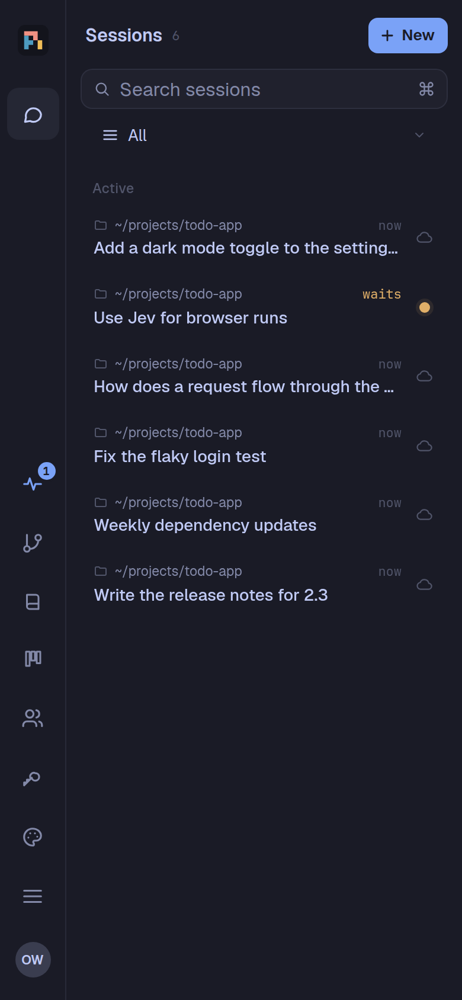
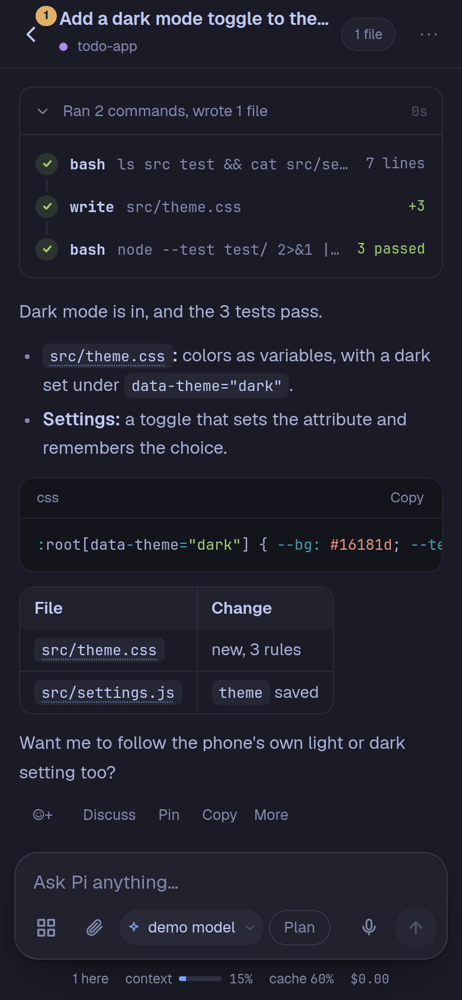
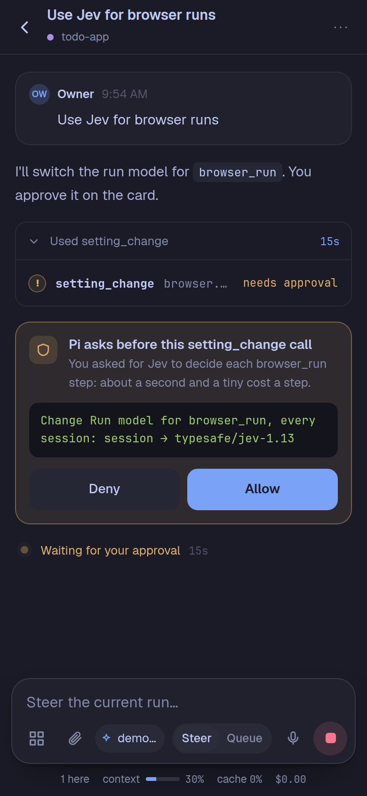
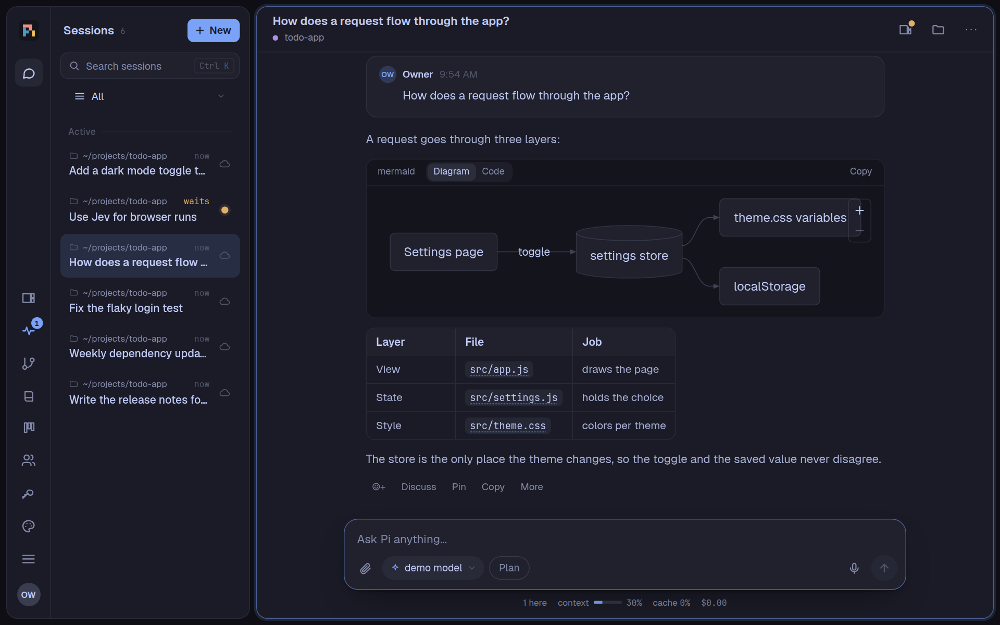
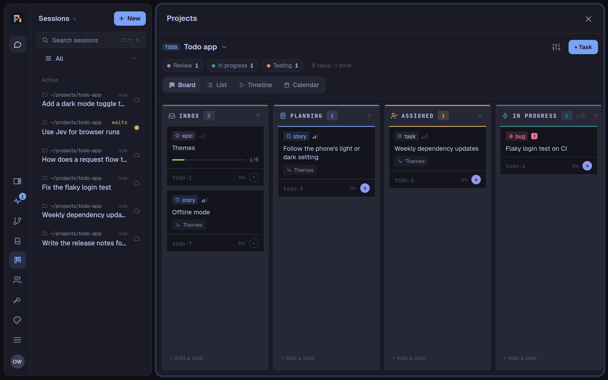
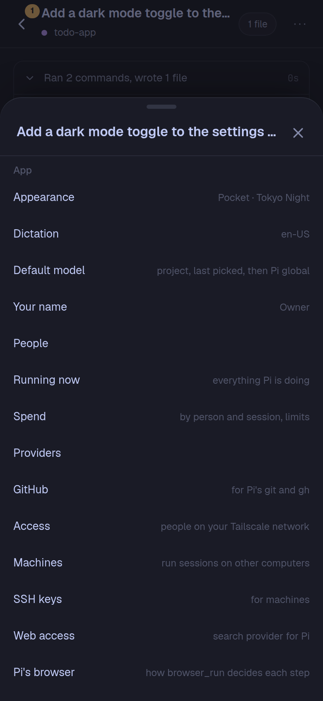

English | [简体中文](README.zh-CN.md) | [Tiếng Việt](README.vi.md)

# pi-phone

A coding agent that lives on your Android phone. pi-phone is one app: it carries its own Linux userland (Node.js,
bash, git, gh, ssh, ripgrep, fd, npm), runs the [Pi](https://github.com/earendil-works/pi) agent on
[Pi Durable](https://github.com/earendil-works/pi/tree/main/packages/durable), and shows a mobile web UI in a WebView.
No Termux, no laptop, no cloud VM.

> **Status:** a personal project, built and tested on a Galaxy Z Fold 8 (Android 17). Sideload only (it targets
> Android SDK 28, see [DESIGN.md](DESIGN.md)). Expect rough edges.

<p align="center">
  
  
  
</p>
<p align="center">
  
</p>

<sub>Made with a demo app and a scripted model (`scripts/readme-shots.ts`): no real sessions, accounts, or projects.</sub>

## What it does

### The agent
- **A durable agent on the phone.** Sessions, subagents, and tool calls are stored as they happen (SQLite). Kill the
  app or update it mid-run and the work continues where it stopped.
- **Subagents at a glance.** A peek tile lists the subagents at work in its session (3 at most, 1 in the phone's
  strip; **N more** opens the board there), and the subagents board shows a sub-tile for each (6 a session, 3 on a
  phone). An approval on a tile names the subagent that asks. A subagent's own session names its model in the top bar,
  beside "subagent of …" (on a phone the message box hides it while Pi works); a tap opens the model sheet.
- **What Pi does, from any app.** The always-on pi notification is a progress board: its title counts the sessions at
  work, waiting for you, and done in the last hour; expanded, a row per session with what it does now ("editing …",
  "running npm test"), each opening its session, and Approve for a simple card. Turn on the floating board (This phone ›
  Floating board over other apps; Android asks once to let pi display over other apps): the pi logo in a bubble over any
  app, a ring turning while Pi works, a count, and a badge when something waits; tap it for the board. Double-tap it
  (or Voice on the board) for pi-phone's Voice over any app: the app's voice view in the panel, a small Voice chip (the
  wave, mic, end) when folded, talking to the session Menu › Assistant names, another a tap away on its title (pi must
  be the phone's digital assistant app, which Android requires to use the microphone from behind other apps). Its Done tab
  lists the sessions finished in the last 24 hours with the start of Pi's last answer (or failed), a blue dot on those
  you have not opened yet, and a blue count on the bubble of those finished since you last looked. A slider there
  (Panel opacity, 50 to 100%) lets the app under the panel show through. Pi changes these on a card
  (`notifications.progress`, `notifications.bubble`, `notifications.bubbleHide`, `notifications.bubbleOpacity`). From
  GitHub issue #5.
- **Decisions you cannot miss.** Every card that waits for you (Pi's questions, a call to allow, an install, a setting
  or app action to approve, a drop-in Pi made waiting to be switched on or kept) is pinned in an amber bar at the top
  of its session while it is scrolled out of view. A row's tap scrolls to its card and lights its border a moment; you
  answer on the card. More than two fold to one line, "3 cards wait for you", and stay folded or open as you left them
  in that session. The session list marks a question "Pi asks you", and its scope Waits for you lists the sessions
  that wait for you. The phone notifies you as for any approval.
- **Subagents on the model you pick.** Menu › Subagents sets the model and thinking level Pi starts subagents on, for
  every session; a session's menu (Subagents' model) sets its own over that. The model is picked as a session's is:
  every account with its plan figures (an account near its limit with when it resets), search and favorites, with
  *As every session* and *The session's own* first. Pi uses another only when you ask in the
  chat: from the models you allow there (added several at once, each shown with its context and plan limit), or after
  you allow it on a card. Pi's `models` tool lists the models that are ready, their limits and what is left. The spawn
  line says what each subagent runs on and why. Pi changes these on a card (`subagents.model`, `subagents.thinking`,
  `subagents.sessionModel`, `subagents.sessionThinking`). A subagent's status line shows what it cost itself, with no
  limit: the limit is its session's.
- **Code review by a subagent.** `/review` (or "review this PR") has a subagent with a fresh context and read-only
  tools review the folder's uncommitted changes, the branch against a base, a commit, a GitHub pull request (by number
  or link: fetched, never checked out), or folders, with pi-review's rubric (P0 to P3 findings, a verdict, what a person
  should check) and the project's `REVIEW_GUIDELINES.md`. `/review` alone opens a sheet with the open pull requests. The
  report is a card: Fix these puts the fix message in the message box, unsent; Post to GitHub posts a pull request's
  review with line comments ("Request changes" for a P0 or P1, else "Comment") after you allow it on a card.
- **Comments in Review, and Since last review.** In Changes, a tap on a line number (new or old side) opens a comment
  box under the line, and a file's note button comments on the whole file. Send review puts them in the message box as
  feedback for Pi ("Please address the following review feedback: 1. path:line (current) …"), unsent, and checkpoints
  the folder: "Since last review" then shows only what changed after it, and vs HEAD marks the files not changed since
  as reviewed. Comments and checkpoints stay with the session, on every device and on machines.
- **A session list after T3 Code.** A scope picker (All, each project, each folder, Archived) instead of tabs; Pinned,
  Active (a project's running task sessions under its main session), and a folded **Settled** shelf. A session settles
  by itself after a day idle, when its task run ends, or when its branch is merged, and comes back with new activity;
  Settle and Un-settle by hand too (and `session_settle` for Pi). Rows show where, the time (or how long it has been
  working), the title, the branch or task, and the status. The scope **Priority** sorts them by what they ask of you:
  Needs you (a call to answer, with Deny and Allow in its row; a failed run or failed subagents, with Dismiss), Ready to
  read (Mark all read), Working, and a folded Quiet; Dismiss and Mark all read say so in a notice that undoes them, and
  the rail's Sessions button counts what needs you. Appearance › Session list opens on picks what shows when the app
  opens: the last view used on the device, All, or Priority (`sessions.listOpens`).
- **Edits you can review.** Pi changes files with its edit and write tools, so every change shows as a diff; a bash
  command that writes project files by script (`sed -i`, `cat > file`, `writeFileSync`, `tee`) still runs, with a
  reminder in its result to use edit; scratch files get none (under /tmp or $TMPDIR, named `*.local.*`, or ignored by
  git there).
- **Auto-compact when you want.** A session compacts its context by itself just before the model's limit; it can
  happen sooner, at a percentage of the context you pick (10–95%), for every session or one (Menu › Compact context).
  The context meter marks where. Pi changes both on a card (`sessions.compactAt`, `sessions.sessionCompactAt`).
- **A prompt that does not fill the context.** Text in Pi's prompt that changes is sent again, and each copy stays until
  the session compacts. So by default the wiki's index stays out: a short, fixed wiki section, and Pi searches the wiki
  with `wiki_query` when it needs to (or, if you pick relevant, the pages that match each of your messages come with
  it); secrets are found with `secrets_list` (with a search) instead of a list in the prompt; the skills list is
  sent again only when skills come or go; and the rarer tools (documents, session groups, devices, the screen tools of
  phone and computer control, …) are offered once Pi loads them with `tool_search`, which cuts the tools every request
  carries by about 45%. Each is a choice in Menu › Compact context, for every session or one (the wiki: tool, relevant,
  frozen, live; secrets: tool, list; skills: frozen, live; tools: load, all), and Pi changes them on a card
  (`context.wiki`, `context.sessionWiki`, `context.tools`, …).
- **Folder groups in the session list.** Make your own groups (**+ New group**) and move chats into them: Move to
  group… from a chat's long press, its row, its menu, or a selection's **Move…**, or drag on a desktop. A chat is in one
  group at most; a group can be pinned (under the pinned chats), folded, renamed, reordered, or deleted (its chats go
  back to Active). They're yours, kept on the server and the same on every device; under a project or folder scope each
  shows only that scope's chats, and searching finds chats by their group's name. For many groups: the Move sheet finds
  a group as you type (recent ones first) or makes the one you typed, the scope picker shows a single group, a
  **Groups** heading folds them all on this device, and Fold all / Unfold all is in any group's menu. Empty groups
  stay hidden until **Show {n} empty**, under the groups. Pi can do all of it
  (`session_groups`, `session_group_create`, `_rename`, `_pin`, `_fold`, `_order`, `_move`; deleting asks on a card).
- **Real tools.** `bash`, `read` (text and images), `write`, `edit`, and `codemode` (scripts that call the tools),
  with git, gh, ssh, Node, npm, ripgrep, and fd in the bundled userland. Menu › Compact context › **How Pi calls its
  tools** (every session; setting `codemode.mode`): directly or from scripts (the default), or only from scripts, where
  Pi is offered codemode and the few tools whose cards read their call (artifact, subagent, pictures, video, audio, a
  browser run, a screen, the Creator) and calls the rest from scripts. A test keeps pi-phone's own part of a new
  session's prompt under 85,000 characters. A picture Pi reads (often one you just sent) shows once, inside its `read`
  call when you open it; a picture a call makes (a screenshot, `fetch_content`'s image) shows under the call's line.
- **Sign in once.** Claude Pro/Max, other providers' OAuth, or API keys, from the Providers sheet. GitHub through a
  device code (Settings › GitHub), used by the agent's `git` and `gh`.
- **Your own OpenAI-compatible server.** Providers › **Add an OpenAI-compatible provider**: a name, a base URL
  (LM Studio, Ollama, vLLM, OpenRouter, a proxy), an API key or none for a local server, and extra headers. **Find
  models** asks the server's `/models` and you tick the ones you want, or type ids; each takes a context window, the
  most output, image input and reasoning. Its models join every model picker. The key is kept in Secrets: Pi's model
  configuration only names it. Edit or remove it there later; Pi can too, on a card, but the key is always yours to type.
- **Favorite models.** Providers › **Favorite models** lists every model you can pick, each with a star: a starred
  model comes right after the current one in your model picker, which gets a **Favorites** filter. Stars are yours, on
  every device; they allow nothing (subagents' models are in Menu › Subagents). Pi sees them in its `models` tool
  (`favorites: true` lists only them) and changes them on a card (`models.favorites`).
- **More than one account.** Add a second (or third) Claude, Codex, or Copilot account in Providers; each has its
  own sign-in, and its models are listed per account ("Claude Opus · Work"). A session uses the account of the
  model you pick for it, so you can start a session on any account or move one to another.
- **Plan usage.** Each Claude, Codex, and Copilot account's limits as its own app shows them: the 5-hour and weekly
  windows (Copilot: the month's premium requests), with reset times, as bars in Providers, in the model menu, and as a
  meter in the session's top bar that opens to every window. At 90% of a window the session says so, with **Switch to** your other
  accounts; a request that fails on the limit offers **Continue on** another account. pi-phone never switches by itself.
- **Wait out provider limits.** A run that hits a 429, an overload, or a Claude or ChatGPT plan window waits inside
  its request until the provider's own reset (its headers, else the account's usage bars, else growing gaps), then goes
  on by itself, a restart included. The live line says whose limit and when it tries again, with **Retry now** and
  **Stop**; the session's row, peek tile, and the subagents board show an amber square. When other accounts of the
  same provider have room, the card's dropdown lists every one, with how much of the window that ran out it has used:
  yours first, then a team server's shared accounts, marked *(team)* as they spend the team's subscription, each the
  emptiest first (the first is picked until you pick another). You choose: **Move** sends the waiting request to the
  account picked (checked again
  at that moment; one that filled up meanwhile is refused, with why, and the card refreshes), and the session uses it
  from then on; a subagent's card moves the subagent and its session. Or **Wait until** the reset. While the card is up, the usage banner over the message box
  steps aside. A reset further away (a weekly window), billing, or an expired sign-in fails at once, with the reset time.
  **Providers › Wait for a limit**: off, 1, 6 (the default), 12, or 24 hours at most, and one phone notification for a
  wait of 10 minutes or more (on unless you turn it off; a browser's push says the time on that browser's clock).
  Titles never wait.
  From pi-pocket 0.21.0 (named windows: #128 by @piromagnus).
- **Spend.** What Pi spent, by person and by session, with limits the owner sets (past one, Pi takes no new
  messages there). The wiki's search by meaning has a line of its own: its remote embeddings (indexing and queries),
  with requests and tokens, in the total and in nobody's limit.
- **Plan mode.** The Plan button by the message box: Pi reads and plans before it changes anything (it still records
  decisions and findings in the wiki, and uses its browser in full to look at the live app or a site), and a long plan
  comes as a reviewable HTML page.
- **Interview.** Pi asks several questions at once in a form (choices with its recommendation, text, photos), and waits
  for the answers, or carries on and gets them later. A key question is framed in the accent and tagged Key decision.
- **Schedules and goals.** Pi messages itself later or on repeat (`schedule`), and a session can keep working toward a
  goal it checks. Archiving a session cancels none of its schedules: a notice says how many repeating ones keep
  running there and opens them (Pi's `session_archive` says so too), and its Schedules mark each "Session archived".
- **Running now.** The rail's pulse opens everything at work across sessions: each session's model, spend, the call it
  waits on and the message it works on (a tap shows it whole), each task with how long it has been at work, and Stop;
  then every scheduled message on a timeline (the next 24 hours or 8 days, a lane per session, a mark each time one goes
  out), with a countdown, its repeat, who set it, Cancel, and a held one saying why and that it is cancelled at its time
  unless that changes first. Times move each second.
- **Other sessions.** Pi can list, read, start, message, wait for, and stop the app's other sessions, as the person it
  works for. It can also get a stuck session going again, each time after you say yes on a card: fork it before the
  message that stopped it (`session_fork`), start a new context there (`session_new_context`), or compact it
  (`session_compact`). Never its own session, except a fork: Pi can branch off its own work and hand the fork its
  task. A session Pi starts is linked to the one that started it: it shows under that one in the list (a pill with
  how many folds them away, with a dot when one waits for you or failed), "Started from" and "Linked session" links
  above the transcripts lead from one to the other, and its spend counts toward the starter's limit. While a linked
  session works (at any depth), the one that started it shows as working too: it waits for the report. A message from
  another session shows as an agent's card, not as yours: that session's name, **Open**, its text as Markdown, and a
  long one folded to **Show all**.
- **Projects** (an extension, off until you turn it on in Settings › Extensions): boards of tasks that keep work from
  being forgotten. Pi asks once before it tracks a session's work on a board ("Track this on the board?"), then keeps
  its tasks current with `task_create`, `task_update`, and `task_comment`. Boards (and the app's SSH keys) are kept in
  the data folder's `app.sqlite`, apart from the sessions' database, so a board change never waits on Pi's work there
  (with Pi 1.5 several at once failed with "database is locked"); a tool's database error goes to the server's log. Epics, Stories, Tasks, Bugs, and Sub-tasks;
  Inbox → Planning → Assigned → In Progress → Testing → Review → Done, and Blocked. Only a person approves a task that
  needs it, and Pi never approves its own work. Shared with the people you choose. The Projects page (rail) shows a
  board in ACS's look: drag cards between states on a desktop; on a phone, swipe between states and long-press a card to
  move it. **List** groups tasks by state, assignee, priority, or label (a table on a desktop, rows on a phone);
  **Timeline** shows open tasks with dates as bars from start to due (dashed without a start), by week or month, with
  today marked; **Calendar** shows tasks by due date in a month (the month's days as a list on a phone), with the
  unscheduled beside it, and on a desktop you drag a task to another day. A card opens its task: its state in a pill, a run card that says what to do (review and merge with the
  diff size, open the working session, run it), quiet property rows, the checklist with its progress, relations, the
  sessions that led or worked on it, comments (or all activity, a run in one line), and a comment box at the foot. A
  merge is kept on the run (who, when, the commit), so a merged branch is not offered again.
  The session menu's "Board for this session" turns board mode on or off, and sets who moves tasks to Done there (you on the
  board, Pi once you approve in chat, or Pi once it verified the work itself: live and measured) and its board rules (the project's, Full, or Light; each project has Full or
  Light too; `board_settings` and `project_update` for Pi). Subagents of a session on a board work on that board with
  its settings. `#task:PP-3` links open a task anywhere.
  **An agent team per project:** its main session leads (plans, asks before a task runs, reviews, never writes code);
  a task given to Pi runs in a task session of its own, in a git worktree on `task/PP-12`, at the place (the phone or a
  machine) with room, as many at once as each place allows. Its end is reported to the main session, and to the session
  that ran it when that is another (a project worked from one session hears its tasks finish); you see the
  branch's diff and merge it from the task. Task and main sessions do not notify the phone when they finish; approvals
  and failures do. The team checks on its task sessions each minute: an end it missed (a restart) is still reported,
  a task whose session was deleted fails, and one working over 30 minutes is flagged to the main session.
  **Review in Review** (a switch in the project's settings, off by default; `project_update` reviews for Pi): when a
  task session sets its task to Review, a reviewer session reads the branch against where it started, in plan mode
  (it reads and reports, and changes nothing), with `/review`'s rubric, and comments its verdict and findings on the
  task. P0 or P1 findings go back to the task session to fix, then it reviews again, 2 rounds at most; the main
  session hears once the review is clean, or, with P0 or P1 still left after the second round, that you decide.
  Pi has a tool for every action (`project_create`, `project_update`, `project_share`, `project_team`, `task_create`,
  `task_update`, `task_comment`, `task_run`, `task_diff`, `task_link_session`, …); making a board (from any session),
  deleting, and merging ask you on a card.

  

### Web, documents, and answers
- **Pi's browser.** Pi opens pages in a browser of its own (a WebView of the app, driven over its DevTools socket) and
  reads them as numbered controls and visible text (icons named by their tooltip, sprite, picture, or where they go;
  things clickable only by their look, like a pop-up's buttons, too); it clicks, types, chooses, hovers, scrolls, presses
  keys, goes back, reads a whole page, or looks at it (`browser_open`, `browser_click`, …). Controls inside frames (a
  payment form's card fields, an embedded sign-in, a consent banner in a frame, another site's frames too) and inside
  web components' open shadow roots are read and used as the page's own, each named with its frame, and their text is
  in the page's; sign-in cards and saved secrets work there, and what you type on a card stays hidden there too.
  `browser_drag` drags a control onto another or by an offset (a slider, a kanban card, a sortable list, a map), with
  the pointer moving in steps and a page's own drag and drop getting its drag events and data; the read marks what can
  be dragged, and `browser_run` drags too. `browser_press` presses chords as well (Ctrl+A, Ctrl+Enter, Shift+Tab,
  Ctrl+K, Meta+K for a macOS page), and never a character into a password field. `browser_focus` puts the focus on a
  control without clicking it, and the read marks the control that has the focus (in a frame too). `browser_click`
  double-clicks, right-clicks (a page's own context menu) and long-presses for as long as asked (a finger's while
  pages are laid out as a phone's, the mouse's at desktop size). `browser_select_text` selects a text on the page (in
  frames too) or in a control, everything in a field, or a field's characters by position, for an editor's formatting
  or a page that acts on a selection; no clipboard, and never in a password field or what you typed on a card.
  Lists a page draws itself
  (a select with its own scroll area) work too: every option is listed, a click scrolls it into view, `browser_select`
  opens the list and picks by name, `browser_scroll` scrolls the list, and a letter jumps by type-ahead.
  `browser_screenshot` can save its picture as a PNG or JPEG in the session's folder (for `doc_image` or a report),
  and picture only the dialog, menu or list a control is in, or the whole page past the view (`full_page`, its first
  4,000 CSS pixels; on a machine's browser or an attached one, as the phone's pictures come from its screen a view at
  a time). It marks pictures up for runbooks: a box, a numbered
  badge, a label and an arrow on a control or a text, the rest dimmed, and secrets hidden (a solid box for keys and
  passwords, a heavy blur for names); `image_markup` does the same on any picture file, and `screenshot` saves its
  pictures with `save`. It uploads files from where
  the session works (`browser_upload`, to a file field or its Upload button), saves a page as a PDF there
  (`browser_save_pdf`). A file a page downloads on a machine's browser (or the server edition's) is saved in the
  session's `downloads/` folder (on its machine, for a session working there; 25 MB at most, a bigger one is cancelled)
  and the answer names it; the phone's browser keeps no downloads (Pi says so: browse on a machine for them), and a
  browser Pi attached to saves them as it does itself. It keeps up to six tabs (`browser_new_tab`, `browser_tabs`; the panel shows them as a strip).
  A window a page opens (a sign-in popup such as Microsoft's on Teams, a link to a new window) becomes a tab in front
  that still talks to its page, and Pi is told; when it closes itself, the page comes back to the front. **Settings ›
  Pi's browser › Windows pages open** (`browser.popups`): *Allow*, *Ask* (a card first) or *Off* (pages get none).
  A page that asks for your location, the camera, the microphone, notifications or reading the clipboard is denied,
  and Pi is told; Pi can ask you on a card to allow one for that site (`browser_permission`, until the browser closes).
  **Settings › Pi's browser › Permissions** (`browser.permissions`): *Deny* (the default) or *Ask* (a card as a page
  asks). On a machine's browser or an attached one; the phone's browser allows none.
  A machine's Chrome opens a window a click opens, as Chrome does.
  **`browser_eval`** runs a JavaScript expression that reads the page and gives its value as JSON (computed colours,
  fonts and spacing for a brand, DOM queries; about 50 KB at most, 10 seconds at most). It runs in an isolated world
  that shares the page's DOM but not its scripts, and only reads: no cookies, storage, network, timers, listeners,
  workers or windows there, nothing it sets or calls changes the page, and the page's own scripts pause while it runs.
  Password fields and what you typed on a card read as empty, and your card values are taken out of its answer.
  **Settings › Pi's browser › Scripts** (`browser.eval`): *On* (the default) or *Off*.
  **Each session has its own tabs**, and its panel shows only those; sign-ins are shared by every session on the phone
  (or on a machine). A session's tabs close after 30 minutes unused (not while you watch or have taken over), and at once
  when it is archived or deleted; the sign-ins stay. Pages are laid out as a phone's, or as a desktop's (1280 px, a
  desktop Chrome, no touch) with **Phone / Desktop** in the panel or `browser_size`.
  Each click is checked first: the element as read, still in view, nothing over it. You watch it live in the Browser panel (beside the conversation on wide screens, where
  it opens by itself when Pi starts browsing; on a phone, a small live preview above the message box opens it), and can
  **Take over** and **Hand back**: taken over, tap the page and type on your keyboard, and your keys go straight to it;
  swipe (or use the wheel) to scroll what is under your finger, an open list's own scroll area included.
  Nothing you type stays in the panel, and over a password field the keyboard is in password mode, so it does not
  learn what you type. It never opens this phone or its local network,
  keeps its cookies and sign-ins in a WebView profile of its own (apart from the app's), and only works for what the owner asks.
  **`browser_run`** carries out a whole goal on its own, a step at a time: each step is decided by the run model you
  pick in Settings › Pi's browser (the session's own model, or Jev, TypeSafe's decision model through OpenRouter:
  about a second and $0.00003 a step), for every session or one. Each step sends the run model the goal, the values Pi
  gave (a secret by its name only), the page's address, title and visible text, and its controls with their values:
  with Jev, to OpenRouter with your OpenRouter key; with the session's model, to its provider. A run clicks and types
  without asking, on pages you may be signed in to. It types only values Pi supplies, stops with
  a reason Pi can act on (a value it needs, blocked, stuck, not visibly done), and Jev's cost counts in Spend. A live card in the
  conversation shows its goal, each step as it happens, the time and cost, and Watch.
  **Passwords from Secrets:** a sign-in you saved in Secrets (and allowed in that folder), Pi types by name
  (`browser_type` with `secret`, or `browser_run` values `{ secret }`): the value goes into the page, never to Pi or the run
  model, and an "ask first" secret still asks you on a card. **Otherwise signing in stays yours:** Pi never types a password
  or a code as text. `browser_sign_in` puts a card in the
  conversation where you type the username and password (or use one kept in Secrets with Remember), and they go
  straight into the page (the card names the fields in its own words, never the page's); `browser_ask_code` does the same for a one-time code.
  What you type there never reaches Pi: its reads of the page show it as `[typed by the person]`, its pictures have
  those fields (and anywhere the value shows) blacked out, and a value too short to hide (one or two characters) gives
  Pi no page at all until it is submitted. `browser_ask_user` hands you the page
  for a CAPTCHA or an approval on your phone, and Pi goes on when you say Done. Passkeys are not possible there
  (Android allows them only in allowlisted browsers): Pi takes the site's other way, or asks you.
- **Web access.** `web_search` through the provider you pick (37 of them, DeepSeek included), and `fetch_content` for
  pages, PDFs and Office files, GitHub repositories, issues, and pull requests.
- **Documents.** `file_to_markdown` reads PDF, Word, PowerPoint, Excel, EPUB, notebooks, and more
  ([markit](https://github.com/picassio/markit)).
- **Office files.** [OfficeCLI](https://github.com/iOfficeAI/OfficeCLI) is built in: Pi creates and edits `.docx`,
  `.xlsx`, and `.pptx` from bash, with skills for decks, dashboards, financial models, papers, and forms, and the Files
  viewer previews them.
- **Rich replies.** Math (KaTeX), Mermaid diagrams and charts, HTML artifacts in a sandbox (with
  [effective-html](https://github.com/plannotator/effective-html)'s design skills), and **interactive answers**: a
  trip with a map, a calculator, a checklist, drawn as a working UI that keeps its state.
- **Design systems.** 152 looks from [OpenDesign](https://github.com/nexu-io/open-design) (brands' public styles such
  as Stripe or Linear, and styles such as editorial or brutalist), each a DESIGN.md and its CSS tokens: name one, or
  pick a default in **Menu › Design system**, and Pi uses its colours, fonts, and spacing in pages, artifacts, and
  Office decks and documents. **Your own from a website:** give Pi a site's address ("make a design system from
  coral.example") and it opens the site in Pi's browser, measures its colours, fonts, type scale, spacing, radii and
  shadows with `browser_eval`, writes the system into your own (listed first), shows a sample page, and says which
  values it chose rather than measured.
- **Deck templates and motion.** Five HTML slide deck templates and GSAP's animation skills from
  [OpenDesign](https://github.com/nexu-io/open-design), each under its own MIT licence: Pi starts a deck from one and
  publishes it as an artifact.
- **Business motion films.** [Motion Video Kit](https://github.com/echris6/motion-video-kit)'s skill for short
  launch-style commercials in code-built motion (HTML, GSAP, Three.js), judged by fresh critic subagents; Pi renders
  them on one of your machines with the HyperFrames machine tool (with ffmpeg, numpy and scipy there). Before each
  render Pi runs `hyperframes check` and draws the same moments twice in two shuffled orders, so a frame that depends
  on what was drawn before it is caught before anyone watches the film.
- **Unslop.** [heydamir's unslop](https://github.com/heydamir/unslop) skill (by Damir Sokolovsky, CC BY 4.0): ask Pi
  to unslop, polish or clean up a screen and it audits it against a list of AI-UI tells (glows, gradient text, emoji
  labels, uneven spacing, shouting copy), proposes a direction on a card and waits for your answer, then fixes spacing,
  colour, icons, copy, type, layout, details, visuals and motion, and checks the result with `screenshot`. Its floor
  includes selection, scrollbars and focus rings in the page's own colours, real shadows and more space above
  headings than below. Pi also goes
  through its sign list before calling an HTML page or artifact done.
- **Design & video.** The four above are one extension, on by default: turn it off in **Extensions** (or ask Pi), and
  sessions carry none of its skills and Menu › Design system goes away until it is on again.
- **Formal checks.** pstack's [statechart](https://github.com/cursor/plugins/tree/main/pstack/skills/statechart)
  skill: Pi writes a TLA+ model of something that moves between states (a checkout, a protocol, a service), TLC
  checks every rule in it, and the reply shows it as a Mermaid statechart in your words, with the shortest path to each
  broken rule highlighted (exit 1 is a broken rule, reported with its numbered path). It runs where Java is: a machine
  with the **TLC** machine tool, or the server edition. On the phone Pi only sketches an unchecked chart, says so, and
  offers to check it on a machine. Four worked examples (statechart-art's boba shop) come with it. Its own extension,
  on by default: turn it off in **Extensions** (or ask Pi), and no session lists the skill.
- **Pi sees its work.** `screenshot` renders an artifact, an HTML or Office file, or a web page in the phone's own
  WebView, at a phone's, a desktop's and a large screen's width (390, 1280 and 1920 px), even with the screen off,
  so Pi checks a page before calling it done. An HTML file loads its stylesheets, scripts and pictures from its own folder, so a page linking the app's CSS shows styled.
- **Measured screenshots.** Every `screenshot` width comes with a layout check the page runs before it is drawn: what spills
  out of its box or its parent, and whether the page is wider than the screen, with sizes. It also finds what makes a
  page look unfinished: text cut by its box (an ellipsis, a clipped line), an element covering another's text or
  control, tap targets under 40 px on a phone (a hit area laid past a small control counts, and a stretched link takes its whole card, whose words under it are
  not covered; a phone page wider than the
  screen still counts as a phone's), padding, gaps, corners and control heights off the 4 px grid or not
  whole pixels, text under WCAG AA contrast (over a gradient too, measured where the words sit) or under 12 px, emoji and symbols used as icons, gradient text, uppercase
  labels, tight tracking and long lines, and nine tells adapted from Impeccable's detector (broken images, skipped
  heading levels, cards inside cards, side-tab stripes, glows, pulsing dots, narrow justified text, tight leading and
  the same words repeated in one card; a spinner is no pulsing dot), and the rules auton-ui proved: corners of a
  surface nested in another that are not concentric or that poke out of a rounded parent that does not clip them (a
  progress fill in a rounded bar), numbers in cells, timers and live regions without tabular figures,
  gradient surfaces (`data-allow-gradient` marks one the design asks for), side stripes drawn as an inset shadow or a
  `::before`/`::after` bar, and static CSS tells (`transition: all`, line height 1 on wrapping text, a field under 16 px
  on a phone, a scrolling dialog without `overscroll-behavior: contain`, a viewport that blocks zoom, `tnum` instead of
  `tabular-nums`), grouped with their numbers, and says when a page uses too many font sizes,
  text colours or icon sizes. Content hidden for screen readers (a chart's data table in a 1 px box) is left out. Pi's
  browser gives the same check with `browser_screenshot`, and alone with
  `browser_layout_check`. Pi goes by the numbers.
- **Steps before the shot.** `screenshot` and `redline` take `steps` that run in the page before each width's picture
  and layout check (tap an element, type into a field, press a key, wait for a time or an element), so a menu, a picker
  or a dialog that shows only after a tap is pictured and measured open; a step that cannot be done fails the call,
  naming the step and why (nothing matches, not visible).
- **Pixel compare.** For pixel-perfect work, `image_compare` compares a new screenshot with a reference picture (a
  mockup, or a screenshot Pi kept once it was right): the share of changed pixels, the changed areas with their
  positions and sizes, and a diff picture saved beside it with the changes in red and the areas framed and numbered.
  Anti-aliased edges are left out unless asked; pictures of different sizes are compared only when asked, scaled to the
  reference's size.
- **Redlines.** `redline` measures a page from its DOM (an artifact, an HTML file, a web page or the live app, rendered
  as `screenshot` renders it) and draws the numbers on its picture, as a designer's redlines: padding as green strips
  and gaps between blocks as magenta ones with their pixels, corner radii as blue tags, control sizes (tap targets
  under 40 px on a phone in red), type (size, line height, weight, colour) in purple, and a legend of the values used
  under the picture. It measures the main blocks (with a sheet or dialog open, only that top layer), or the elements a
  selector finds; given a spec (a design system's
  tokens.css, or a plain list such as "padding 16, radius 24/12/20, font 22/13/12") it marks what is off it in red with
  the spec's value ("gap 23, spec 24") and lists it. `browser_redline` does the same on the page in front of Pi's
  browser (a phone page wider than its screen still counts as a phone's). A picture file has no DOM: compare it with `image_compare`.
- **UI checked before it is done.** The built-in `ui-verify` skill has Pi verify every artifact, HTML page and app
  screen with numbers before calling it done: the layout check at 390, 1280 and 1920 px, redlines against the design
  system's tokens, the mockup or the 4 px rules, `image_compare` against a reference, fixing until there is no cut
  text, overlap, low contrast, text under 12 px, emoji icon, small tap target, broken image, skipped heading or card
  inside a card left, and a report with the counts
  before and after and the redline or diff picture. The HTML, design-system and unslop skills end with it.
- **Hooks.** **Menu › Hooks** lists the checks pi-phone runs around Pi's work by itself, so they happen even when Pi
  forgets them, each with a switch (Pi turns one on or off with `setting_change hooks.<id>`, after your card, and opens the page for you with
  `show_screen hooks`). **Check
  artifacts on publish**: when Pi publishes an HTML, SVG or interactive artifact, the app renders it at 390, 1280 and
  1920 px and the artifact tool's own result carries the layout check's findings (cut text, overlaps, small tap
  targets, low contrast), so Pi sees them in the same call; a width the phone could not render says why, and the
  artifact is published all the same. **Remind to check UI before finishing**: when Pi ends a turn having changed UI
  files (HTML, CSS, SVG, components, a `web/` folder's scripts) after its last screenshot or redline, the app sends it
  one follow-up naming them and asking it to check them at 390, 1280 and 1920 px, or say why not; once a turn, in
  subagents too, and the session shows it as sent by the hook. Beside them, the automatic behaviours that keep
  settings of their own (capturing idle sessions into the wiki, compacting a full context) show their value now.
- **Images.** `image_generate` makes and edits images (up to five to edit at once; 1 to 4 at a time; 1:1, 16:9, 9:16,
  4:3 or 3:4) with the model you pick in **Menu › Images** (`image.model`): GPT Image 2.5 on your ChatGPT sign-in (on
  the plan, counted in Spend as images), an OpenRouter image model such as Nano Banana (`google/gemini-*-image`; its
  price per million image tokens shown, its cost in the session's spend), or a model of your own provider marked
  **Makes images** in Providers. *Automatic* is ChatGPT's when you are signed in, else OpenRouter's first. Pi may name
  another model for one image. The pictures are saved where the session works (on a machine too) in `images/`, named
  from the prompt, the first also as `images/latest.png`, and show in the chat; Pi gets their paths and the cost, not the
  pictures, so they cost no context. A picture of a real person (a photo of someone, a named person's likeness) asks
  you on a card first. When the session's own model can write images, Pi is told that the chat shows only a model's
  text, so it still makes them with `image_generate` (naming its own model if you like).
- **Media.** Pi's `media` tool works on images and video with ffmpeg where the session runs. On the phone it uses the
  slim build the app carries; in the server edition, the image's; on a machine, its ffmpeg tool (Menu › Machines ›
  Install tools) or its own. It can say what a file is (size, length, width and height, codecs); fit, crop, turn, flip,
  convert (JPEG, PNG, WebP) and compress an image; take a video's frames (at given seconds, every few seconds, or spread
  over it) or one contact sheet; and cut an mp4 clip, trimmed, shrunk to 720p and muted if you like. What it makes goes
  in `media/` where the session works. `ffmpeg` and `ffprobe` are on the PATH of the phone's sessions too.
- **Making videos.** `video_generate` makes a video through OpenRouter on your key, from a prompt or from images it
  starts and ends on, with the length, shape, resolution and sound the model takes (checked before anything is paid). It
  takes a minute or two; the video is saved in `videos/` where the session works and plays in the chat, with its length
  and cost. Menu › Videos picks the model (`video.model`), each with its price a second.
- **Transcribing audio.** `audio_transcribe` turns speech in an audio or video file where the session works (a
  meeting recording, a voice note, a video) into text, SRT or VTT subtitles, or JSON with each utterance's times, on
  your ChatGPT (Codex) sign-in with no API key (gpt-4o-transcribe by default). Long files go in ten-minute parts; the
  transcript is saved in `transcripts/`. Settings › Voice's language and words to listen for help it.
- **Reading aloud.** `audio_speak` reads a text into an audio file (m4a or wav) in any language, Vietnamese included,
  on the same sign-in: voice-overs, read-aloud reports, audio summaries, with a voice (marin, cedar and eight more) and
  a style (calm, cheerful, slow...). Long text is read in parts, and each part is checked against what the voice says
  it said; one read wrong is read again. Saved in `audio/`, it plays in the chat with its waveform; a transcript shows
  its first lines with their times, Copy and Open file. Menu › Audio picks the transcription model, the reading model
  and the default voice (each a dropdown; the voice with a sample in your language).
- **Watching videos.** `video_ask` asks a model that watches video about a video file where the session works, or a
  YouTube address, through OpenRouter on your key (Gemini 3.5 Flash-Lite by default, about a cent a minute): what
  happens, with times, what is said. A large or tall video is shrunk to a 720p mp4 first. Menu › Videos picks the model
  (`video.askModel`); the cost is in Spend.

### Secrets and the wiki
- **Secrets.** API keys and tokens in Settings › Secrets, used by name (`$NPM_TOKEN`) and never shown: output that
  contains one shows `[secret NAME]`. Pi asks for a missing one through a hidden field. To keep a value a command
  makes (`gh auth token`), Pi shows you the whole command on a card first (**Run and save**), and a failed command's
  output is never shown. Pi's browser gives Pi a page's text fenced as the page's, not instructions, and a sign-in you
  type hides your username in what Pi reads afterwards, as it does the password.
- **Drop-in extensions.** Your own extension modules, added with **Add drop-in…** in Settings › Extensions (a `.ts`
  file, or a `.zip` holding one) or by Pi with `extension_install` once you approve its card (files and first lines
  shown), each off until you turn it on. They can use pi-pocket 0.22's `host.ask` (a card whose values reach only the extension), `host.hide`
  and `host.commandEnv`, pi-pocket 0.27's `host.roleOf` (a person's role by id), and pi-pocket 0.28's `host.sessions.start` (a new ordinary session for the person Pi works
  for, with their checks, once for a key), not `host.browser` yet; one whose tool has a built-in tool's name is refused, with why. Tool
  schemas are built with `@earendil-works/pi-schema` (`obj`, `str`, `opt`, …); one built with TypeBox's `Type` (from
  `@earendil-works/pi-ai` before Pi 1.5, or `typebox`) is refused, saying so.
  **Remove** takes one away (Settings › Extensions, after a confirm in its row, or ask Pi: `app_action
  extensions.remove` on your card): it is switched off and its files go (`<name>.ts`, `<name>.js`, `<name>/`); its
  data in `extension-data/<name>/` stays unless you ask for that to go too.
  Besides rail buttons, menu rows, launcher actions, pages and sheets, a drop-in can show a one-line strip right above
  the message box (in every session or the ones it picks; two drop-ins' at most, the newest), a small floating panel you
  drag anywhere and close with × (kept where you put it; on a phone, clear of the message box and the keyboard), a tab
  in the side panel beside Pi's browser and computer (full screen on a phone), a row in a session's menu, and its own
  colours over the app's while it is on (the newest drop-in's win where two set one). Safe mode (`?noext=1`) and
  turning it off take all of them away.
- **Extension builder.** Ask Pi for a new page, panel, tracker or tool in pi-phone itself and it makes a drop-in for
  you: a small first version from one of four templates (a tool; a rail button with a page; a menu row with a sheet; a
  tool and a page that share data, so what you do on the page Pi can do too), checked by the skill's own script,
  installed once you approve its card, switched on by you, then looked at in the live app at phone and desktop widths
  and fixed in place. It keeps your UI rules: the app's line icons and dropdowns, states as a word and a dot, no emoji,
  whole pixels, every word in your language. Drop-ins' pages can use the app's multi-select list too
  (`pocket.MultiChoice`). Pi checks its work with `extension_inspect`, which only reads (plan mode too): the names
  the drop-in API has (what a page can add, `pocket`'s members, icons, the theme's colours) and those a drop-in may not
  take, and for one drop-in whether it loaded, why it was refused or failed, what it added, the pages and sheets your
  tab saw it add, and its newest error in a tab (each tab tells the server when an extension's page fails), never a
  file's contents. Adapted in part from DeepSeek Harness's plugin skill (MIT). Its own extension, on by default: turn
  it off in **Extensions** (or ask Pi), and no session lists the skill or the tool.
- **Pi makes the drop-in for you (the Creator).** Ask for something in the app ("make me a pomodoro timer on the
  rail") and Pi first shows a card, **Make a drop-in: Pomodoro**, with what it will be and where it shows: **Make it**
  or **Not now**. On Make it, a subagent of the session (on your subagents' model) writes it as `made-pomodoro` and
  says when it is ready; pi-phone checks it without running it (one module, nothing outside its folder, no built-in
  tool names, 1 MB and 200 files at most, the skill's own check), then you install it on the usual card. One card in
  the chat follows it: written, checks, installed switched off, waiting for you to switch it on (**Switch it on**),
  checked in the app at phone and desktop widths, with **Open the subagent**. Each fix is a new version on the same
  card; at the end **Keep**, **Undo** (back one version, or removed if it was the first) or **Restore…** any version
  kept. Settings › Extensions lists the drop-ins Pi made with their versions, Undo and Restore…. A made drop-in has
  the same rights as any drop-in: what keeps you safe is that you approve each card, it installs switched off, and
  only you switch it on. Names starting with `made-` are the Creator's. Part of the Extension builder: off with it.
  **`/make <what>`** starts it from the message box (`/make a pomodoro timer in the side rail`): the same card, subagent,
  checks and Keep/Undo/Restore; `/make` alone stays in the box with an example. Offered to the owner while the
  Extension builder is on.
- **A PARA wiki** ([pi-para](https://github.com/picassio/pi-para)): Pi consults and writes it as it works, with qmd's
  search, tracks its open questions until they are answered, and captures idle sessions into it. With OpenRouter signed
  in, **Jev ranks the search** (Menu › Wiki › Rank with Jev): it reads each page the search found (by keyword, by
  meaning, and pages holding the message's words, Vietnamese syllables too) and keeps those that help with your message
  or Pi's `wiki_query`, best first; about 0.5 s and $0.0001 a search, counted in Spend. Off, the search keeps its own
  order; when Jev fails, the search's order is kept and the log and `wiki_query`'s answer say why. For `wiki_query`,
  Jev also reads a long page's later lines that hold the question's words, so a section added at its end counts; a
  query in a session's scope also names the good pages in other scopes ("Also in other scopes").
- **Documents** (rail › Documents): your documents in folders, as markdown pages rendered like the wiki.
  - **The page:** the place (Mine, Team, a board) is its header, with **+ Page** and a ⋯ for a new folder, deleted
    pages and the settings; search has a row of its own. Folders are sections with their page count, each with a ⋯
    (a page or folder in it, rename, delete). On a wide screen the folders and the open page sit side by side.
  - **Pages:** `[[links]]` between pages, the pages that link back, every saved version to look at and restore,
    deleted pages to bring back, and search across all of them.
  - **Where:** Mine, and each board's (a board's **Docs** opens them). On the team server there are Team documents
    too, edited by roles with "Edit team documents".
  - **Search by meaning:** pages are found by what they say, not only their words, merged with keyword matches.
    Yours use the wiki's embedding model with your OpenRouter sign-in; the team's use a model and an OpenRouter key
    the owner sets on the gateway's Server page. Its cost shows in Spend (or on the Server page).
  - **Images:** add PNG, JPEG, WebP or GIF (10 MB at most) with the editor's **Image** button or by pasting. Location,
    camera and other metadata are removed (a photo keeps its orientation). A vision model you choose in Menu › Settings ›
    Documents describes each image once, so search finds pages by what their pictures show; on the team server the owner
    sets the team's on the Server page.
  - **Pi** searches, reads, writes, edits and moves documents for you, adds images from files, and deletes or restores them on a card.

### Other machines
- **Work on other machines.** Add an SSH key and a machine (Settings › SSH keys, Machines). A session on a machine
  runs its tools there through [pi-env](https://github.com/earendil-works/pi/tree/main/packages/env)'s small daemon;
  the conversation and your logins stay on the phone. The Files panel, viewer, Changes, and the terminal follow the
  session there. Linux, macOS, Termux, and **Windows** (through its OpenSSH Server and Git Bash; the app gives you a
  PowerShell script that sets it up). The app's skills that work there (html-plan and the other HTML skills, ui-verify,
  and Design & video's but design-system and brand-extract) are copied to `~/.pi/mobile/skills` on the session's first
  request and listed at that place, so Pi reads them, and runs their scripts, there.
- **Machine tools.** OfficeCLI, ripgrep, fd, Chrome (headless, for Pi's browser where a machine has no Chrome), and
  Computer use (ocu, for Pi to operate desktop apps there; on Linux it needs a desktop session) installed on a machine
  from the app (Windows included), checked by their SHA-256. They are listed, ticked, when you add a machine, in
  **Install tools**, and on the `machine_add` card. Two more are listed unticked, as they are big: **ffmpeg** (with
  ffprobe; static GPL builds, about 350 MB) and **HyperFrames** (Linux and macOS), which renders HTML and GSAP
  compositions to MP4 there and installs Chrome (headless) and ffmpeg with it (about 920 MB in all). Pi renders with
  `hyperframes render <folder> -o film.mp4` and checks the file with ffprobe; HyperFrames' telemetry, update checks and
  self-installs are always off. **TLC** (Linux, macOS, Windows x64; unticked, about 165 MB): Temurin's Java 21 and the
  TLA+ model checker, for Formal checks; sessions on that machine get `TLA2TOOLS` and `JAVA`, and the statechart skill
  goes with it. Pi does it too with `machine_tools`: it shows each machine's tools (installed version, current version,
  size), and installs, updates or removes them after you approve one card with the machine and each tool's version from
  and to and its size, the same install as Install tools; it says each tool's version line, or the step that failed,
  and offers an update when a tool is behind.
- **Pi's browser on a machine.** A session on a machine browses in a headless Chrome there (its own Chrome, Chromium or
  Edge, else the machine tool), watched in the same panel ("Pi's browser on <machine>"). It opens the machine's own
  addresses, so Pi can try the web app you run there (`localhost:3000`), and uploads and PDFs use the machine's files.
  Its sign-ins stay in `~/.pi/mobile/browser` there.
  - **As a window on the machine's screen**: **Settings › Machines › Pi's browser here** (`browser.machineMode`:
    *Headless*, the default, or *A window on its screen*) starts the machine's own Chrome, Chromium or Edge with a
    window, on the same profile, so you can watch it and use it at the machine too; it keeps drawing when covered or
    minimised. On Linux it opens in the desktop the desktop setup line names (Menu › Computer control, which sets
    `DISPLAY`), and is refused without one; on Windows it opens in your signed-in, unlocked desktop through a one-shot
    scheduled task as you (no password, not elevated, removed once Chrome runs), and says so when nobody is signed in
    or the screen is locked. The headless machine tool has no window; macOS comes later. When someone clicks, types or
    scrolls in that window (not Pi, not the panel), the panel says the window is in use on the machine, and Pi is told.
  - **From a session on the phone**: `browser_open` and `browser_new_tab` with `machine` (or **Browse on** in the
    panel) move a session's browsing to one of your machines, or back to the phone; its tabs stay its own.
  - **Attach to a browser running there**: `browser_attach` (a port, or the path of a DevToolsActivePort file) drives
    a browser already running on a machine with its DevTools on that machine's 127.0.0.1: Playwright's,
    agent-browser's, a Chrome Pi started with `--remote-debugging-port`, or your own Chrome, through the app's ssh (no
    other host). For your own, turn remote debugging on at `chrome://inspect/#remote-debugging` (Chrome, Edge, Brave),
    and Pi finds it in its profile with no port named; allow it there if Chrome asks. Unless it is pi-phone's own Chrome
    there, you approve it first on a card with the machine, the port, the browser's version, its profile (it carries
    that profile's sign-ins) and which tabs Pi gets. Pi gets only the tabs it opens there (in the background, so your
    tab stays in front; a screenshot brings Pi's forward) and windows their pages open; your tabs are left alone,
    unless Pi asks for the open ones too (`tabs: "all"`, for a browser it started). Which tabs are Pi's is kept while
    that browser runs. Those tabs show in the panel, and every browser tool, Take over, the sign-in and code cards and
    windows its pages open work there; Close closes only the tabs Pi opened; `browser_detach` (or **Detach** in the
    panel) lets go and leaves it running. An attachment lasts until the server restarts.
- **From any session.** `machine_run` and `machine_copy` run a command or copy a file on a machine (with **Pi asks
  before each command** ticked for a machine in Settings › Machines, each `machine_run` there waits for you to allow it
  on a card that shows the command; off by default, as bash on the phone), and `pi-ssh`
  gives bash ssh, rsync, scp, and tunnels with the app's keys, which nothing can read out. Pi adds a machine itself with
  `machine_add` (a VM it just made, say): one card shows the address, the SSH key and the host key, checked against the
  one Pi read on the machine when it could, and the tools to install (ticked, but for ffmpeg, HyperFrames and TLC); **Approve and connect** adds it,
  installs pi-env, connects, and installs the ticked tools; Deny saves nothing.
- **Ports** of a machine (a dev server there) open in the phone's browser.
- **Continue Pi sessions.** Pick up a session from Pi on this phone, a `.jsonl` file, or a machine's
  `~/.pi/agent/sessions`, with its history; or send a session to `pi` on a machine and bring back what was done there.
  Pi can do both itself (`pi_sessions`, `pi_session_import`, `continue_in_pi`, `pi_bring_back`).

### This phone's apps
- **Pi uses your apps.** In a control session you approve on one card (the apps it names, and the home screen to open
  them, for 15 minutes or what the card says, 5 to 60), Pi reads the screen as numbered elements and taps, types,
  swipes, scrolls, presses back or home, opens the apps and takes screenshots (`phone_control`, `phone_screen`,
  `phone_act`, `phone_screenshot`), through pi-phone's own accessibility service: no developer mode, no adb. A banner
  and a notification on the phone say Pi is using it, with **Stop**, as does a line in the session; it ends at its
  time too, and soon after Pi's turn ends, so the banner going means Pi is done. Another app needs a new card, unless the card follows along: then an app the named ones open (on a
  Samsung, Settings' Battery is Device care, an app of its own) joins as it comes, one step only, and the card says so.
  Password fields read as hidden and Pi never types into them: a password or
  code is yours to type on the phone. pi-phone itself, banking and payment apps, password managers and the apps on
  your Never list are never read or touched. Set it up in Menu › Phone control (Allow restricted settings on Android
  13+, turn on pi-phone in Accessibility, let it run in the background), where you also keep the Never list. The owner's
  alone; not on the team server.

### Your machines' apps
- **Pi uses desktop apps on your machines** (Linux and Windows). In a control session you approve on one card
  (the machine, the apps it names by their windows, for the minutes Pi asks for, 5 to 60; for more it asks again), Pi
  reads a window as numbered elements and clicks, sets values, types, presses keys and scrolls, and takes pictures of
  it (`computer_control`, `computer_screen`, `computer_act`, `computer_screenshot`, `computer_sign_in`), through
  Computer use (ocu, a machine tool) running there over the app's own ssh. For one concrete goal in an app ("turn on
  Dark mode in Settings") Pi can hand the steps to `computer_run`, which decides each with the same run model as
  `browser_run` (Settings › Pi's browser) and stops with a reason when it cannot go on. A small window on the machine says Pi is using it, with **Stop**;
  the session ends at its time, soon after Pi's turn ends, or on Stop. Following along (when Pi asks) lets an app the
  named ones open join. Password fields are marked in what Pi reads, and Pi never types a password as text: it fills one
  with a saved secret by name (`computer_act` with `secret`, the same folder and ask-first rules as everywhere; the value
  goes into the field, Pi reads `[secret NAME]`), or it asks you to sign in (`computer_sign_in`): a card with the app
  and the machine and fixed fields (Username, Password, Code), where you type them (or use a sign-in you kept), each
  straight into the field Pi named; **Not now** fills nothing, and **Remember in Secrets** keeps the sign-in (asking
  before each use). Pi never sees what you type: it reads `[username for <app>]`, `[password for <app>]` and so on,
  the field is blacked out of the pictures Pi gets, and a value too short to hide keeps the window from Pi while it
  shows. You can also type it yourself on Take over.
  Pi reads each element's state too (checked, focused, disabled…), and acts on elements by their number: if the window
  changed since Pi read it, nothing is done and Pi reads it again. Parts of the window under another window are black
  in the pictures; a minimised or hidden window has none until you bring it back. Clicking a point of the picture is
  yours alone for now, on Take over.
  pi-phone itself, banking and payment apps, password managers and authenticators, and the apps on your Never list are
  never read or touched.
- **Pi's computer**, a panel like Pi's browser: the top bar's monitor button opens it beside the conversation (on a
  phone it covers the screen, and a small live preview sits above the message box while Pi acts). The session's windows
  are its tabs; the picture is the window as ocu sees it, after each of Pi's actions and every few seconds, with a box on
  what Pi acted on (a line says when another window covers part of it); the foot has the minutes left and Stop. **Take over**: Pi waits; tap the picture to click there, and
  your keys go to the field in focus, a password field too (the keyboard is in password mode there, and what you type
  is never shown to Pi, kept in the panel, or logged), until you **Hand back**.
- **Computer control on Windows.** Windows' ssh has no desktop, so ocu runs in your signed-in desktop through
  **pi-phone's task**: a scheduled task as you, "pi-phone ocu", run only while you are signed in (no password, never as
  administrator or SYSTEM), at your sign-in and when a session starts. It runs a small bridge (Windows PowerShell, in
  `~/.pi/mobile/computer`) that listens on 127.0.0.1 only, with a new random token in a file only you can read; pi-phone
  reaches it through its own ssh. The window that says Pi is using the computer, with **Stop**, is the bridge's, on top.
  **Set up** and **Remove** are in Menu › Computer control; Pi asks with `computer_control setup` (`task: install` or
  `remove`) on a card that shows what is made. A machine shows as ready, not set up, or not logged on (nobody signed in:
  sign in on the computer first); with its screen locked, ocu reads windows but clicks and keys do not reach them.
- **Chrome Remote Desktop: unlock and see a Windows machine from your phone** (Windows x64 for now; Linux and macOS
  later). Pi's computer use cannot pass the Windows lock screen; Google's Chrome Remote Desktop host, a service, can.
  Tick it under Settings › Machines › Install tools (or on the `machine_add` card; it is not ticked by default): the
  machine downloads Google's installer itself (pi-phone does not pass it on), checks it is signed by Google (its address
  always gives the newest build, so the signature is the check instead of a pinned sha256), and installs it silently
  with msiexec (pi-phone's account there must be an administrator), its log in `~/.pi/mobile/crd`. The machine's row then
  shows it as not installed, installed but not connected, or connected. **Connect to your Google account**: open
  remotedesktop.google.com/headless on your phone (a link with **Copy link**), tap Begin, Next, Authorize, paste the
  "Windows (PowerShell)" command into the card's hidden field and choose a PIN of 6+ digits twice. Only the code and the
  redirect (on remotedesktop.google.com alone) are taken from it; they and the PIN go to the machine, are not kept or
  logged, and Pi never sees them. An expired code says to get a new one. Then unlock the machine from the Chrome Remote
  Desktop app with your PIN. **Remove** stops and uninstalls it. Pi asks with `computer_control setup` (`crd: install`,
  `connect` or `remove`), each on a card; when Pi finds a Windows screen locked, it asks you to unlock it this way, or
  offers to set it up.
- **Menu › Computer control**: each machine and where it stands, a line run before ocu starts for a Linux machine whose
  desktop needs its environment set (with **Check**, what ocu reads there), Windows' **Set up** and **Remove**, the Never
  list, and how cards work. The owner's alone; not on the team server.

### People and devices
- **Other devices and people** over your Tailscale network (Settings › Access): your laptop's browser signs in as you
  (People › Sign in as me), and invited people steer or watch sessions, all of them or one.
- **Profile pictures.** Tap your avatar (the rail, or Menu › your name) › **Add photo**: the picture is cropped to a
  square and shrunk on your device, then shows instead of your initials on your messages, in People, the chat and the
  rail, for everyone who can see you; **Remove photo** brings the initials back. Each person has their own (on the team
  server too: each account). Pi sets or removes one from a file on the phone on a card (`people.photo`). From pi-pocket.
- **Settings by tool.** Pi lists the app's settings with their values (`settings`), changes one (`setting_change`), or takes a
  one-off action (`app_action`), each after you approve the usual card showing the value now and the new one, through the
  same code as the app's screens: models, approvals, Pi's browser, web search, the wiki, spend limits, themes, extensions,
  secrets (their flags; deleting one), machines (names, tools, ports, removing), SSH keys, provider accounts, GitHub
  sign-out, a backup, a restart, invited people (role, sessions, removing), Tailscale, the Claude Code billing patch, favorite
  folders, and one session's model, instructions, trust, and limits. A command that reaches into the app instead (its API,
  your token in its config, its WebView's DevTools) is refused, naming the tools.
- **Devices.** Each sign-in is a device of its own, so People lists every signed-in device (open now or not, where it
  was last seen) and signs any one out; invited people see and sign out their own. **Sign out every device** signs out
  all your others at once. A **recovery code** (break glass), made in People in the phone's app only and kept off the phone, signs a
  browser in as you once if no device can; the phone notifies you when it is used. Pi lists devices too (`devices`), and signs one or
  all out (`device_sign_out`, `sign_out_everywhere`) after you say yes on a card.
- **Dictation** with Android's speech recognizer, in the language you choose. The mic beside Send is off by default
  (your keyboard's own voice input works too, and the box's buttons keep the room): turn on **Mic button in the message
  box** in Menu › Dictation, for you on every device. Alt+V dictates either way. Pi can turn it on or off
  (`dictation.micButton`).
- **Voice calls with Pi** on your ChatGPT (Codex) sign-in: the waveform button beside Send starts a call in the
  session, full screen on a phone and a panel at the right on a wide screen. In "Pi works" (the default) the voice
  talks and hands real work to the session's Pi, then tells you Pi's answer; "Chat only" just chats; "Pi thinks" sends
  what you say to Pi as it is and reads Pi's words out as written, with the live model's voice or your device's own
  (Android's text-to-speech in the app, the browser's elsewhere; Settings › Voice's reader). Set it in the call or in the model chip's menu. Talk any time
  (talking over the voice stops it), tap to talk (a tap opens the mic for one turn, and it closes itself when you stop
  talking, so people near you are not heard), or hold to talk; a big Mute that says "Mic off" in red while off; end.
  The mic can also mute itself after a quiet spell once the voice has answered (hands-free), turn off and on with a
  headset's button or the volume keys, and stay off unless the phone is at your ear (Settings › Voice).
  What you say to Pi shows as your message marked voice,
  and the rest of the talk as quiet voice rows. Approvals stay a tap in the chat. In the app the call goes on with the
  screen off or another app in front, with a call notification (Mute, End; a tap shows the call); music pauses, and a
  connected headset is used, else the speaker. pi asks Android for the microphone the first time.
- **Settings › Voice.** The live models your ChatGPT (Codex) sign-in has, as checked with OpenAI (**Check again**),
  each with how its calls are set up: a short-lived key, through pi-phone, or Codex's own `gpt-live` (ChatGPT's private
  endpoint, only when you pick it). Also the voice and the language (checked when picked), noise reduction on the mic
  (phone at your face, speaker or table, or off), turn detection (smart, by what you say, with how soon your turn counts
  as ended, waits longer helping in a noisy room; or by loudness, with how loud you must be and the pause before it
  answers, so people talking further away do not start a turn), words to listen for (a hint the dictation model reads:
  the language you speak, words you mix in, names; empty until you write it, with the session's names added), who thinks and turn-taking (hands-free, tap to talk, hold to talk)
  for new sessions, the mic in a call (mute after so many quiet seconds, off by default; a headset's button, the
  volume keys, both or neither as a mute key, the headset's by default; mute unless the phone is at your ear, off by
  default as it would mute a speakerphone call), what the voice says while Pi works (Pi's words as they come, or only the answer, and a short cue on
  what Pi runs at most every 20 s), who reads Pi's answers in "Pi thinks", the dictation engine and model, and an
  optional daily limit. Minutes of voice show in Spend, counted on your ChatGPT plan. The sign-in's token stays on the
  server.
- **Codex dictation**: Settings › Dictation can let Codex (`gpt-4o-transcribe` on your ChatGPT sign-in) listen to the
  mic instead of Android's recognizer; words still show in the box as they are heard, and nothing is sent by itself.
  Its language is Settings › Voice's, one setting for Voice and dictation: Auto (Codex hears the language you speak;
  Android's recognizer picks among the phone's languages, Android 14 and later) or a language.
- **The phone's assistant.** Pick pi as the digital assistant (Menu › Assistant walks you through it), then hold the
  side key in any app: a pi sheet comes up over it, already listening. Your words show as you speak, then wait for
  Send, or go by themselves after 3 seconds. They go to the last session you were in, a new session, or one session
  you pick (for this time from the sheet, or for good in Menu › Assistant), with the app you were in noted ("From
  Chrome", a chip you can drop) so Pi can offer phone control for it (approve it in the sheet, which then steps aside
  while Pi uses the app). The reply streams in the sheet and approvals are answered there; **Open** takes you to the session. While pi is the assistant, apps that ask the phone's default
  speech recognizer still reach the phone's own: pi only passes it on. Not from the lock screen. The sheet can also
  start a **voice call** with the session's Pi (its waveform button, or by itself when Menu › Assistant says "Start a
  voice call"); when you leave the sheet the call goes on in pi-phone, with its notification.
- **Voice beside New** in the session list (and on the desktop's home): a new session named Voice, opened talking.

### The app
- **A terminal.** A real shell inside the app, on the phone or on a machine, with Esc, Tab, Ctrl, and arrow keys
  above the keyboard.
- **Changes** of the session's folder (only its own, even inside a bigger repository), with diffs and undo. Opening a
  file that the viewer already shows (a path in a reply, Open on a call) reads it again, so you see what it says now.
- **Notifications** when a session finishes, fails, or asks for approval: from the app on the phone, and as push
  notifications in a browser at an HTTPS address (the team server, a desktop, an iPhone with pi-phone on its Home Screen),
  even with no tab open. Menu › **Notifications** turns them on for that browser, lists the others, and sends a test;
  a browser with pi-phone open in front gets none. **Downloads** of any file Pi made or
  named (tap its path, then Download), and of any image in a conversation (tap it, then Download): to the phone's Downloads in the app, or as the browser's download elsewhere; **backup and
  restore** of everything. Scheduled messages and CI watches sleep durably: they hold nothing while they wait, and a
  restart keeps their time.
- **A safety copy before a one-way upgrade.** Pi 1.4 moves the database to a new format that older builds cannot
  open. On the first start of a build with it, pi-phone first copies the database whole to
  `pocket.sqlite.before-pi-1.4` in its data folder and checks the copy; without a good copy (not enough space, a write
  that fails), it does not start and says why, with your data unchanged. The copy is removed after 14 days and left
  out of backups. Pi 1.5 is one way too, without that copy: once a session runs on it, an older pi-phone no longer
  opens the data (it stops at start with "has newer version 3 than 1"). Before you install the first build with Pi
  1.5, make a backup (Menu › This phone › Back up), and do not go back to an older build with the same data. A drop-in
  whose tool schemas use TypeBox's `Type` is refused from then on: ask Pi to rewrite it with pi-schema (the Extension
  builder does it).
- **CI in the loop.** The agent's `watch_ci` tool watches GitHub Actions runs in the background and reports when
  they finish, so it pushes, ends its turn, and is woken by the result.
- **In English, Chinese or Vietnamese.** Appearance › Language: *Auto* follows the phone or browser, or pick English,
  简体中文 (Simplified Chinese) or Tiếng Việt (Vietnamese). The choice is kept with you, so every device of yours follows
  it, and Pi, told your app's language, answers in it until you write in another language. Pi also writes to the
  sessions it starts or messages and to its subagents in your language, and asks them to answer in it, so a session Pi
  worked in reads in your language when you open it. The whole app is translated: the session list,
  conversation, menus, launcher, every sheet, the Projects, Wiki, Documents and Sharing pages (extensions get
  `pocket.t` for theirs), the team server's sign-in and admin pages, the server's errors and notices, and the phone's
  notifications (with Auto, in the phone's language). This README is in Chinese and Vietnamese too: [README.zh-CN.md](README.zh-CN.md),
  [README.vi.md](README.vi.md).
- **Reply to a passage.** Select words in one of Pi's replies, and a **Reply** button shows: by the selection with a
  mouse; on a phone, docked at the bottom or top edge of the conversation, clear of the selection, its handles, and
  Android's selection toolbar. It puts the passage in a quote strip above the message box (× drops it); your next
  message goes to Pi with the passage first as a Markdown quote (up to 1,500 characters), and shows with a quote block
  above your words. On by default; Appearance › Conversation › Reply to a passage turns it off, on all your devices,
  and Pi changes it on a card (`appearance.quoteReply`). From pi-pocket.
- **Code in your messages.** What you write in backticks (`` `npm test` ``) shows as code in the conversation, and a
  ``` fence as a code block, colored when it names its language; the rest of your message stays as you typed it.
  From pi-pocket.
- **Says why it did not start.** When a file of the app does not load (a content blocker in a browser, the network) or
  fails as it runs, the start screen stops and says "could not start" and why, in your language, instead of staying on
  "starting". Before that, the phone app's own screen says when the server is unpacking, starting, or failed.
- **Quick on a phone.** A streaming answer redraws only its last block, and only what changed in it crosses the wire;
  text and the event stream go compressed, and web files are cached (ETag, 304) and fetched at once (modulepreload).
  A picture you attach is made ready for the model as it uploads, one at a time, so the message goes at once; an
  iPhone's HEIC or HEIF photo reaches Pi as a JPEG, and its line in your message says so.
- **Updates from GitHub.** Every passing build on `master` is a release, with release notes. The app checks it (at
  start, or Settings › Check for app updates): server and UI changes swap in within seconds; a new Android shell is a
  one-tap install.
- **It builds itself.** The agent works on a clone of this repository inside the app, pushes, and CI ships the release
  the app then installs.

## Install

1. Download `pi-phone.apk` from the [latest release](https://github.com/picassio/pi-phone/releases/latest).
2. Open it on an arm64 Android phone and allow the install (sideloading).
3. The first start unpacks the runtime (about a minute), then signs in by itself.
4. Sign in to a model provider: ⋯ (the session menu) › Providers. Then see [Use it](#use-it).

Updates come through the app afterwards; uninstalling deletes its sessions and logins.

**On a Linux server instead:** the same app runs in Docker behind Caddy (HTTPS), with Pi's browser and `screenshot` on a
headless Chrome inside it, built on the machine itself; see [deploy/README.md](deploy/README.md). There are two ways to run it:
- **For one owner.**
- **For a team** (6 to 15 people). It has:
  - **Accounts:** by invite, with passkeys and two-factor.
  - **A pi-phone per person**, each in its own container.
  - **Custom roles**, which set features, models, monthly spend, memory and CPU.
  - **An audit log**, failed and blocked sign-ins included.
  - **People & account in the app:** the rail's People & account opens the team pages (Account, Shared with me, People,
    Roles, Audit log, Server) in the main panel, in the app's theme; a new invite's link shows in place, copied.
  - **Idle pi-phones stop**, with **Always on** per person.
  - **Rolling updates**, with data kept.
  - **Downloads:** each person's data, and a whole-server backup.
  - **Sharing sessions** (⋯ › Share this session): a teammate opens one of your sessions from Shared with me, in
    their browser, and either watches or writes (on your providers; they read its files, never use the terminal or
    allow calls, and Pi uses your machines and secrets for them only if you say so). Unsharing ends it at once.
    **Continue in mine** copies a shared session into their own pi-phone. Pi shares on a card, too.
  - **Team accounts** (Providers › Add team account, with "Add, sign in and remove the team's provider accounts" in
    one's role): a provider's key or subscription sign-in, set up once for the team. It sits under its provider in
    everyone's Providers sheet, marked TEAM; the key or sign-in stays on the team server, never in anyone's pi-phone.
    Roles say which team accounts their people may use; their models show in the model menu ("openrouter · Team Work
    account"), and each answer comes through the team server, checked against the person's role at every call.
    What each person spends on them is counted per account and month: a role can have a team spend limit apart from its
    own (empty for none), and the Server page lists this month's spend by person. A team Claude, Codex or Copilot
    subscription shows its plan's usage bars to everyone who can use it, and Claude requests get the Claude Code
    billing patch on the team server, as each person's setting says. Pi lists them, and adds one, says which roles
    use it or removes it on a card; signing in stays a person's, on the account's row.
  - **Team machines** (Machines › Add team machine, with "Add, change and remove the team's machines" in one's role):
    a computer added once for the team, reached from the server's own network. Its SSH key is made and kept on the team
    server, never in anyone's pi-phone; you put its public half in the machine's `authorized_keys` and accept its host
    key. Roles say who may use it (Roles › Team machines they may use). It shows under Team machines in their Machines
    sheet and in the folder picker, with everything a machine has: sessions, the terminal, ports, `machine_run`. Each
    person starts in a folder of their own there (`~/team/<name>`), on the machine's one account. Taking a machine off
    a role closes its people's connections at once. Pi lists them, and adds one (giving you its public half), says
    which roles use it or removes it on a card; accepting its host key stays yours, on its row.
  - **Hardened:** only ports 80 and 443 open, sign-in limits that people's containers can't get around, no
    cross-site changes, and security headers. See deploy/README.md › Security.

## Use it

### The first time
A new pi-phone opens with a short welcome, three steps you can each skip: the app's language, signing in to a model
(Claude, ChatGPT, GitHub Copilot, OpenRouter, or an API key; on a team server, the models your team gives you), and the
phone's permissions (notifications, running with the screen off, the microphone, the side key), or in a browser,
notifications and installing the app. It needs no model. Pi can show it again: ask it, or set `onboarding.welcome`.
Then **Getting started** (the welcome's last step, or Menu › Getting started any time): a session where Pi asks what
you want to cover (the basics, the app's look and language, voice, Pi's browser, machines, phone control, secrets and
backup, boards and the wiki), shows you only those, changes settings on cards you approve, and ticks a checklist under
the session's header as it goes. Where you must act yourself (Android's Accessibility, the microphone, a sign-in), Pi
puts a card with an **Open** button in the chat; nothing opens until you tap it. After a big update, a **What's new**
card on the session list (and the home screen on a wide screen) offers a tour of it in the same session.

### Every day
- **Start a session:** **+ New** in the session list, then pick a folder on the phone or on a machine; inside a
  session the picker opens in that session's folder, and the launcher's **New session here** starts one there at once.
  The model menu under the message box picks the model and how hard it thinks.
- **Talk to Pi** by typing or with the microphone (dictation: its button is off until you turn it on in Menu ›
  Dictation). Enter sends and Shift+Enter makes a new line on a computer,
  and on a phone or tablet with a physical keyboard (Bluetooth), where Ctrl+Enter or Alt+Enter make a new line too (for
  input methods such as Sogou, which keep Shift); the on-screen keyboard's Enter makes a new line, and the send button
  sends. Attach files and photos with the paperclip. The **⋯** button left of it opens a small menu: **Commands** (the
  command list without typing `/`: type to filter it, and a pick goes into the box with the caret after it, ready for its
  arguments or Send; a draft already there stays after it), then the session's places as rows (Files, Changes,
  Artifacts, Find and the rest the Places sheet has) and the session menu, one tap each. Arrow keys move in it and Escape
  closes it; a swipe up from the message box still opens the Places sheet. **Plan**
  makes Pi read and plan first, changing nothing until you approve. While Pi works, a message can **Steer** (read between steps),
  **Queue** (after the run), or **Interrupt** (stop the run now, its tool call too, then send). A message of yours that
  waits in the queue has **Edit**: it takes it back into the message box with its files, to change and send again.
  Pi takes back one it sent another session with `session_unsend`.
- **Approve or deny** the cards Pi puts in the conversation: risky commands, settings changes, sign-ins, questions.
- **The session menu** (⋯ in the session's top bar) has the session's own things: rename, folder, terminal, context,
  instructions, schedules, board. Below them, under **App**, are the app's settings, listed in the next part.
- **The rail** (left edge on a wide screen) opens Sessions, Projects, and the Wiki. A session's **Places** open its Files,
  Changes, Artifacts, Find, and Branch.
- **Keep an artifact as a page.** **`/page <what>`** (`/page a currency converter VND/USD`) has Pi build it as an
  artifact, check it, and offer to keep it as a page on a card; `/page` alone opens Settings › Pages. A prompt template
  named `make` or `page` wins over the app's command, as with `/review`.
  **Keep as a page** on an artifact's card in the chat (or in the artifact viewer) puts
  it on your rail (in the drawer on a phone) as a page of your own: it opens in the conversation's place, in the same
  sandbox artifacts run in (no app data, no cookies), and follows the artifact's newest version. The one thing a page
  can do in the app is put text into the message box of the session you are in, for you to send
  (`parent.postMessage({ type: "pi-compose", text }, "*")`; an artifact in the viewer can too). **Settings › Pages**
  lists your pages, orders them, and removes them from the rail. Each person's pages are their own, and a page whose
  session you cannot see is not shown to you. **All artifacts** (the rail's grid, or the launcher) lists every artifact
  in every session you can see, by session, with its current version: a tap opens that version in its session, and
  Keep as a page works from its row; Pi lists them with `artifacts_list`. The **Browser panel** opens when Pi browses: beside the chat on a wide screen, or
  from the small preview above the message box on a phone.

### Settings, and asking Pi instead
Every setting below is in the session menu (⋯) under **App**. You can also just tell Pi, for example "use Jev for browser
runs": it changes the setting with its `setting_change` tool after you tap **Allow** on a card that shows the value now
and the new one. Ask "what can you change?" and Pi lists every setting with its value (`settings`).

| What | Where | Ask Pi? |
|---|---|---|
| Model providers (Claude, Codex, Copilot, OpenRouter, …) | **Providers**: sign in, or **API key**; **Add account** for a second one | No for signing in, which is yours. Yes for removing an extra account or signing out |
| An OpenAI-compatible server (LM Studio, Ollama, vLLM, a proxy) | **Providers › Add an OpenAI-compatible provider**: name, base URL, key (kept in Secrets) or none, headers, **Find models** | "Add my LM Studio at http://192.168.1.20:1234/v1 with qwen3-coder". Pi asks you to type the key on a secret card |
| Default model for new sessions | **Default model** | "Set the default model to anthropic/claude-opus-… high" |
| Waiting for a provider's limit | **Providers › Wait for a limit**: the longest wait, and the notice of a long one; a waiting session's **Retry now**, **Stop**, and its account card | "Wait at most 12 hours for limits", "Retry session 12 now", "Move session 12 to the Work account" |
| GitHub for Pi's `git` and `gh` | **GitHub**: a device code | No for signing in. Yes for signing out |
| **OpenRouter** (needed for Jev, the wiki's search by meaning, and OpenRouter web search) | **Providers › OpenRouter**: sign in, or **API key** | No, signing in is yours |
| **Jev** as the model for `browser_run` | **Pi's browser › Run model**: pick a Jev model OpenRouter offers (such as *TypeSafe: Jev 1.14*) from the list, for every session or only this one (*The session's own model* uses each session's own model); *Test* asks it one decision | "Use Jev for browser runs" (or "…in this session only") |
| Scripts that read the page in Pi's browser (`browser_eval`) | **Pi's browser › Scripts**: *On* (the default) or *Off* | "Turn off browser scripts" |
| Artifacts kept as pages on the rail | **Pages**: your pages (order, *Remove from the rail*); the owner turns pages *On* (the default) or *Off* for everyone | "Keep the paper reader as a page", "Put the budget page first", "Turn off pages" |
| Permissions pages ask for in Pi's browser (location, camera, microphone, notifications, clipboard) | **Pi's browser › Permissions**: *Deny* (the default; Pi is told and may ask you) or *Ask* (a card as a page asks) | "Ask me when a page wants my location" |
| Windows pages open in Pi's browser on the phone (sign-in popups) | **Pi's browser › Windows pages open**: *Allow* (a tab in front, the default), *Ask* (a card first), *Off* | "Ask me before a page opens a window" |
| **Wiki** search by meaning | **Wiki** (or *Wiki settings* from the search launcher) **› Search by meaning**: pick an OpenRouter embedding model, such as `openai/text-embedding-3-small`. Off means keyword search only | "Set the wiki embedding model to openai/text-embedding-3-small" |
| **Wiki** search ranked by Jev | **Wiki › Rank with Jev**: a Jev model OpenRouter offers (`typesafe/jev-1.14` by default when OpenRouter is signed in), or *Off* for the search's own order | "Rank the wiki search with jev-1.13", "turn off Jev ranking for the wiki" |
| Wiki capture and prompt context | **Wiki**: minutes idle before a session is captured, the model that writes captures (picked as a session's model is: every account with its plan figures, so one at its limit shows before you pick it, and *The default model for new sessions*), tokens of wiki in each prompt, lint options | "Capture idle sessions after 30 minutes", "use claude-haiku for wiki captures" |
| Web search | **Web access**: a provider, and its key (typed there or kept in Secrets) | "Switch web search to exa". The key itself is yours to type |
| The design system Pi designs with | **Design system**: search, pick one, or *None* | "Design in the Stripe style from now on", "No default design system" |
| The model `image_generate` makes images with | **Images**: *Automatic*, ChatGPT's GPT Image 2.5, an OpenRouter image model (with its price), or your provider's model marked *Makes images* | "Make images with Nano Banana from now on", "Use gpt-image-2.5 for this one" |
| API keys and tokens | **Secrets**. Pi asks for a missing one with a hidden field on a card, never in the chat | Pi can ask for one, change a secret's flags, or delete one. You type the value |
| Other computers | **SSH keys**, then **Machines** (**Install tools** there adds OfficeCLI, ripgrep, fd, Chrome, Computer use, ffmpeg, HyperFrames, TLC) | Yes for renaming, installing tools, ports, or removing. Accepting a new host key is yours |
| Extensions (Projects, Wiki, Pi's browser, Design & video, Formal checks, Extension builder, …) | **Extensions** | "Turn on Projects", "Turn off Design & video" |
| Spend and limits | **Spend** | "Limit this session to $5" |
| When sessions compact by themselves | **Menu › Compact context**, for this session or every session | "Compact this session at 60%" |
| What of the wiki, secrets and skills goes into the prompt | **Menu › Compact context** | "Put the wiki's index back in this session's prompt" |
| Other devices and people | **Access** (Tailscale), **People** (devices, invites, recovery code) | Yes for listing devices, signing one or all out, or changing a person's role. The recovery code is yours |
| Push notifications in a browser | **Notifications**: Turn on, Send a test, Remove another browser's | No: a browser asks you itself, on that device |
| Notifications, screen off, backup | **This phone** | Yes for making a backup. Restoring one is yours |
| The app's language (Auto, English, 简体中文, Tiếng Việt) | **Appearance › Language**, kept with you on every device | "Switch my app to Chinese", "Switch my app to Vietnamese" |
| Appearance, dictation language | **Appearance** and **Dictation**, per browser tab | Only the theme new browsers start with ("make lantern the default theme") |
| The mic button in the message box (off by default) | **Dictation**, kept with you on every device | "Show the mic button in my message box" |
| The side key's assistant | **Assistant**: where your words go, whether they wait for Send, whether the app you were in is noted | "Make the assistant send by itself". Picking pi as the phone's assistant is yours, in Android's settings |
| Voice calls and Codex dictation | **Voice** (and **Dictation**'s engine): live and dictation model, voice, language, noise reduction, how soon hands-free answers, who thinks, turn-taking, progress, reader, daily minutes; a session's voice mode in its model menu | "Use gpt-realtime-mini for voice", "Let Codex listen to the mic", "Check the voice models", "I'm on speakerphone in a noisy room", "Let me tap to talk", "Mute the mic after 10 quiet seconds", "Only hear me when I talk loud and close". Models, voice and language are checked with OpenAI first |
| App updates | **Check for app updates**. New builds also offer themselves in an update sheet. Tap **Install** | No |

What stays yours: typing secrets and passwords, signing in to providers and GitHub, the recovery code, accepting a
machine's host key, restoring a backup, and turning on plan mode. Pi says so and tells you where to do it.

<p align="center"></p>

## How it is built

```
android/   Android shell (Java): WebView, foreground service running node, runtime installer, updater
src/server pi-pocket's server, cut down, plus pi-phone's parts (machines, places, SSH keys, secrets, web access,
           documents, interview, wiki, screenshots, CI watch, GitHub login, Claude Code billing patch)
web/       pi-pocket's web app (Preact + htm, no build step)
scripts/   Termux rootfs and runtime packaging, OfficeCLI, versions, release notes, web import check, the README's
           pictures (readme-shots.ts: a demo app shot in Chrome, run on a computer)
test/      node:test
```

[DESIGN.md](DESIGN.md) explains the design and its decisions; [HANDOVER.md](HANDOVER.md) the current state and next
steps; [AGENTS.md](AGENTS.md) the rules for working on it (for people and agents).

```bash
npm install --ignore-scripts
npm run check   # tsc + web import check
npm test        # node:test; UI tests need Chromium
node src/server/main.ts --port 8788 --data /tmp/pi-data --cwd /tmp   # the server, without the Android shell
```

The APK is built by GitHub Actions only ([.github/workflows/build-apk.yml](.github/workflows/build-apk.yml)).

## Credits

pi-phone is mostly other people's work, put together for a phone. Thank you to everyone below.

### Built from

- **[Pi Pocket](https://github.com/TannerMidd/pi-pocket)** by Tanner Middleton (MIT). The server and the whole web UI
  started from pi-pocket 0.14 (commit `e5456a8`) and were cut down for a single-user phone app. Its design, its
  durable-first architecture, and most of the UI you see are pi-pocket's. License: [LICENSE-pi-pocket](LICENSE-pi-pocket).
- **[pi-termux-mobile](https://github.com/badlogic/pi-termux-mobile)** by Mario Zechner (badlogic). The idea and the
  first working version of an Android app that embeds Termux-built binaries and runs Pi: the Android shell (WebView,
  foreground service, runtime installer), the Termux package resolver behind `scripts/package-rootfs.ts`, and the
  APK workflow started from it (commit `a36765b`). The repository has no license file; its code is used here with
  credit, and permission should be confirmed with its author.
- **[Pi](https://github.com/earendil-works/pi)** by Earendil (MIT): `pi-durable` (the durable harness, tools,
  codemode, image reads), `pi-ai` (models and providers), `pi-coding-agent` (sign-ins, settings, sessions, skills),
  `pi-codemode` (the QuickJS sandbox), `pi-env` (remote execution over SSH), and `chord`. pi-phone is an app around
  them.
  The app's icon is Pi's logo ([pi.dev/logo.svg](https://pi.dev/logo.svg)), which belongs to the Pi project;
  pi-phone is an unofficial app, not affiliated with or endorsed by Earendil or the Pi project.
- **[pi-para](https://github.com/picassio/pi-para)** and **[qmd-engine](https://github.com/picassio/qmd-1)** (MIT): the
  PARA wiki, its tools and context, and its search.
- **[pi-cc-patch](https://github.com/picassio/pi-cc-patch)** (MIT): the Claude Code billing transform, ported to
  `src/server/cc-patch.ts` with its tests.
- **[pi-codex-imagegen](https://github.com/IgorWarzocha/howaboua-pi-stuff/tree/main/packages/pi-codex-imagegen)** by
  Igor Warzocha (MIT, Copyright (c) 2026 Igor Warzocha): `image_generate`'s ChatGPT (Codex) route, its images
  endpoint, request and headers, ported to `src/server/image-gen.ts`; see `third_party/pi-codex-imagegen/`.
- **[sim-use](https://github.com/lycorp-jp/sim-use)** by LY Corporation (Apache-2.0, Copyright 2026 LY Corporation):
  phone control's outline of the screen (`src/server/phone-outline.ts`, from its `AndroidOutlineRenderer` and
  classifiers) and its accessibility service (`PiAccessibility.java`, `PhoneControl.java`, from its device bridge's
  tree, gesture, input and capture handlers), ported and changed; see `third_party/sim-use/` (its license and NOTICE).
- **[jev-ultrafast](https://github.com/browser-use/jev-ultrafast)** by Browser Use (MIT, Copyright (c) 2026 Browser Use):
  Pi's browser reads pages with its `snapshot.js` (adapted in `src/server/browser/snapshot.js`), and acts with its
  act-time checks (the element as observed, in view, not covered). Ideas also from
  [jev-ra](https://github.com/brnyxx/jev-ra) (MIT) and [browser-use](https://github.com/browser-use/browser-use) (MIT);
  the browser panel's design from [Kuvo Code](https://github.com/serhatandic/kuvo-code) (ideas only, no code).

### Contributed

- **[@yichan002](https://github.com/yichan002)** ([#3](https://github.com/picassio/pi-phone/pull/3)): the idea and a
  first version of pi-phone as the phone's digital assistant, opening with the message box listening. The assistant
  sheet grew from it.

### Bundled and used

- **[Termux](https://termux.dev)**: every binary in the app's userland is a [termux-packages](https://github.com/termux/termux-packages)
  build (Node.js, bash, coreutils, git, gh, OpenSSH, ripgrep, fd, npm, and their libraries), downloaded from the Termux
  repository and checked against its SHA-256 index; [termux-exec](https://github.com/termux/termux-exec) makes their
  scripts run. Each package keeps its own license; the build's `termux-packages.json` lists the exact packages and
  versions.
- **[xterm.js](https://github.com/xtermjs/xterm.js)** (MIT): the terminal.
- **[Preact](https://preactjs.com)** (MIT), **[htm](https://github.com/developit/htm)** (Apache-2.0),
  **[marked](https://github.com/markedjs/marked)** (MIT), **[DOMPurify](https://github.com/cure53/DOMPurify)**
  (MPL-2.0 or Apache-2.0), **[node-qrcode](https://github.com/soldair/node-qrcode)** (MIT): the web app.
- **[OfficeCLI](https://github.com/iOfficeAI/OfficeCLI)** by iOfficeAI (Apache-2.0): Office files, built for Android
  (NativeAOT) in our fork [picassio/OfficeCLI](https://github.com/picassio/OfficeCLI), with its skills in
  `third_party/officecli/`.
- **[effective-html](https://github.com/plannotator/effective-html)** by plannotator (MIT): the HTML design skills in
  `third_party/effective-html/`.
- **[OpenDesign](https://github.com/nexu-io/open-design)** by nexu-io (Apache-2.0): its design systems and five deck
  templates (by Zara Zhang, MIT) and GSAP's skills (by GreenSock, MIT), in `third_party/open-design/` with their
  licences.
- **[motion-video-kit](https://github.com/echris6/motion-video-kit)** by echris6 (MIT): the `business-motion-film`
  skill in `third_party/motion-video-kit/`.
- **[unslop](https://github.com/heydamir/unslop)** by Damir Sokolovsky ([@heydamir](https://x.com/heydamir), CC BY
  4.0): the `unslop` skill in `third_party/heydamir-unslop/`, with one note added by pi-phone.
- **[Impeccable](https://github.com/pbakaus/impeccable)** by Paul Bakaus (Apache 2.0): nine of its detector's rules,
  reimplemented in the screenshot layout check, and three lines of its craft floor, adapted in the unslop note;
  licence and list in `third_party/impeccable/`.
- **[jakubkrehel/skills](https://github.com/jakubkrehel/skills)** by Jakub Krehel (MIT): the better-ui and
  better-typography checks (concentric radii, tabular figures, static CSS tells) that auton-ui proved, reimplemented in
  the screenshot layout check with unslop's stripe and gradient signs; licence and list in `third_party/jakubkrehel-skills/`.
- **[pi-review](https://github.com/earendil-works/pi-review)** by Earendil (MIT): its review rubric, as written, in
  `third_party/pi-review/`, which `/review`'s subagent follows.
- **[pstack](https://github.com/cursor/plugins/tree/main/pstack)** by Lauren Tan ([@poteto](https://github.com/poteto),
  MIT): the `statechart` skill in `third_party/pstack-statechart/`, with the four boba models of
  **[statechart-art](https://github.com/kevintngo/statechart-art)** by Kevin T. Ngo (MIT) as its examples.
- **[TLA+ tools](https://github.com/tlaplus/tlaplus)** (MIT): TLC, and **[Eclipse Temurin](https://adoptium.net)** (GPLv2
  with the Classpath Exception): its Java, installed on machines from their releases and built into the server
  edition's image.
- **[ripgrep](https://github.com/BurntSushi/ripgrep)** (MIT or Unlicense) and **[fd](https://github.com/sharkdp/fd)**
  (MIT or Apache-2.0): installed on machines from their own releases.
- **[FFmpeg](https://ffmpeg.org)** (these builds GPL): installed on machines, downloaded by each machine from
  [BtbN's FFmpeg-Builds](https://github.com/BtbN/FFmpeg-Builds) (Linux, Windows; GPLv3) and
  [Martin Riedl's builds](https://ffmpeg.martin-riedl.de) (macOS; GPL, built with `--enable-nonfree`, so for the
  machine's own use only). pi-phone does not carry or pass them on.
- **[HyperFrames](https://github.com/heygen-com/hyperframes)** by HeyGen (Apache-2.0): rendering HTML to video,
  installed on machines from npm with its pinned lockfile in `third_party/hyperframes/`, run by
  **[Node.js](https://nodejs.org)** (MIT) from nodejs.org.
- **[libheif-js](https://github.com/catdad-experiments/libheif-js)** by Kiril Vatev (LGPL-3.0; libheif by Dirk Farin and
  struktur AG, LGPL-3.0): HEIC and HEIF photos decoded to JPEG, as WebAssembly. It is not MIT: it ships as its own npm
  package (`node_modules/libheif-js`, its license beside it), loaded from there and not changed, so it can be replaced
  with another build of it; its source is at the link. With **[heic-convert](https://github.com/catdad-experiments/heic-convert)**
  and heic-decode by Kiril Vatev (ISC), **[jpeg-js](https://github.com/jpeg-js/jpeg-js)** (BSD-3-Clause) and
  **[pngjs](https://github.com/pngjs/pngjs)** (MIT).
- **[open-computer-use](https://github.com/iFurySt/open-computer-use)** by Leo (iFurySt) (MIT, Copyright (c) 2026
  Leo): computer use on machines (ocu), built in our fork
  [picassio/open-computer-use](https://github.com/picassio/open-computer-use) (password fields marked and refused) and
  installed as a machine tool; its license and notices in `third_party/open-computer-use/`.
- **agent-board** and **ACS (agent-crew)** by Picassio (MIT): the task types, states, and task
  protocol of Projects, and the board's design.
- **[pi-web-access](https://github.com/nicobailon/pi-web-access)** by Nico Bailon (MIT): `web_search` and `fetch_content`,
  and the 37 search providers ported from it to `src/server/web/providers/`.
- **[markit](https://github.com/shift-labs-ai/markit)** by Shift Labs (MIT): documents to Markdown, through our fork
  [picassio/markit](https://github.com/picassio/markit) (npm `markit-engine`), which adds the Android build.
- **[Readability](https://github.com/mozilla/readability)** (Apache-2.0), **[linkedom](https://github.com/WebReflection/linkedom)**
  (ISC), and **[Turndown](https://github.com/mixmark-io/turndown)** (MIT): web pages to Markdown.
- **[pi-interview](https://github.com/nicobailon/pi-interview-tool)** by Nico Bailon (MIT): the `interview` tool's question
  format, its checks, and its answers to Pi, ported to `src/server/interviews.ts`; the form is pi-phone's own.
- **[KaTeX](https://katex.org)** (MIT): math in replies and wiki pages.
- **[Open Intelligent UI](https://github.com/thesysdev/open-intelligent-ui)** by Thesys (MIT): the component library for
  interactive answers, in `third_party/open-intelligent-ui/`, on **[OpenUI](https://github.com/thesysdev/openui)**
  (`@openuidev/react-lang`, MIT), **[React](https://react.dev)** (MIT), **[MapLibre GL JS](https://maplibre.org)**
  (BSD-3-Clause), **[Lucide](https://lucide.dev)** (ISC), and **[Zod](https://zod.dev)** (MIT). Maps use
  [OpenFreeMap](https://openfreemap.org) tiles of [OpenStreetMap](https://www.openstreetmap.org/copyright) data and the
  public [OSRM](https://project-osrm.org) server; photos come from Wikipedia and Wikimedia Commons, under their own
  licenses.
- **[pele](https://github.com/obsidianmd/pele)** by kepano (MIT): Mermaid diagrams and charts in replies and wiki pages.
- **[Photon](https://github.com/silvia-odwyer/photon)** (Apache-2.0): image resizing, in WebAssembly.
- **[quickjs-wasi](https://github.com/vercel-labs/quickjs-wasi)** (MIT): the codemode sandbox.
- **[jiti](https://github.com/unjs/jiti)**, **[undici](https://github.com/nodejs/undici)**,
  **[ws](https://github.com/websockets/ws)** (MIT).
- Fonts: **[JetBrains Mono](https://github.com/JetBrains/JetBrainsMono)** and **[Geist](https://vercel.com/font)**
  (SIL Open Font License 1.1; see `web/fonts/`).

### Learned from

- **[pi-subagent](https://github.com/badlogic/pi-subagent)** by Mario Zechner: named in the first design as the
  subagent experience to mirror (the subagents here are pi-pocket's).
- **[pi-browser](https://github.com/IgorWarzocha/howaboua-pi-stuff/tree/main/packages/pi-browser)** by Igor Warzocha
  (howaboua, MIT): `browser_attach`'s tab ownership (Pi's tabs open in the background, windows they open are Pi's by
  Chrome's opener, the owner's tabs are left alone), its use of the browser's own connection, and finding a browser
  whose remote debugging was turned on at `chrome://inspect/#remote-debugging` (design only, no code).
- **[pstack](https://github.com/cursor/plugins/tree/main/pstack)**'s interrogate by Lauren Tan: the board rule that a
  finding counts only when a run proves it (wording only).

## License

pi-phone's own code is [MIT](LICENSE). The parts above keep their own licenses: pi-pocket's code here stays under
its MIT license ([LICENSE-pi-pocket](LICENSE-pi-pocket)), and the bundled Termux packages under theirs. Pi's logo,
used as the icon, is the Pi project's and is not covered by pi-phone's license.
