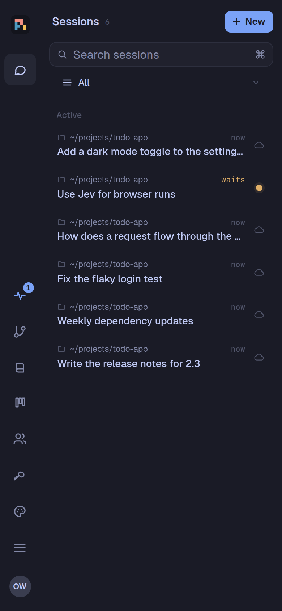
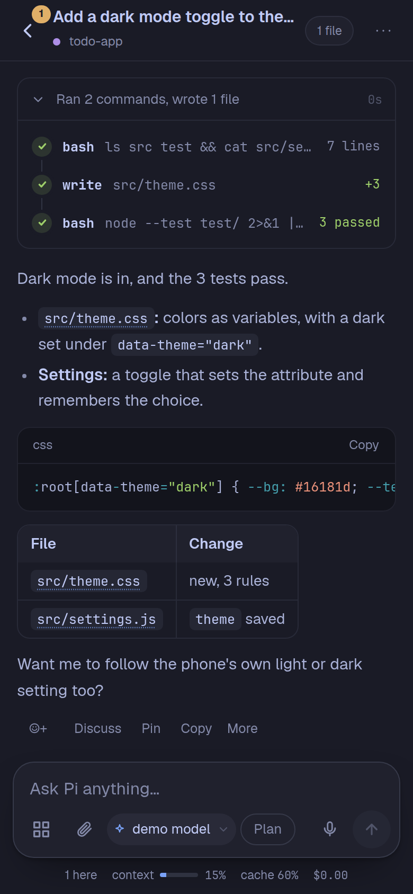
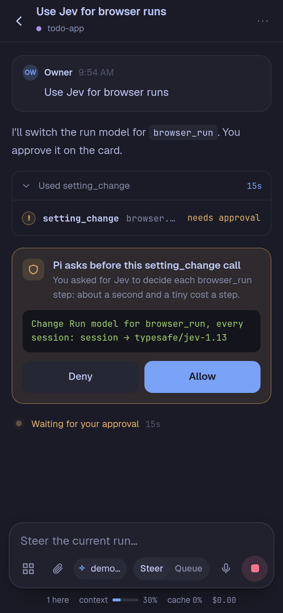
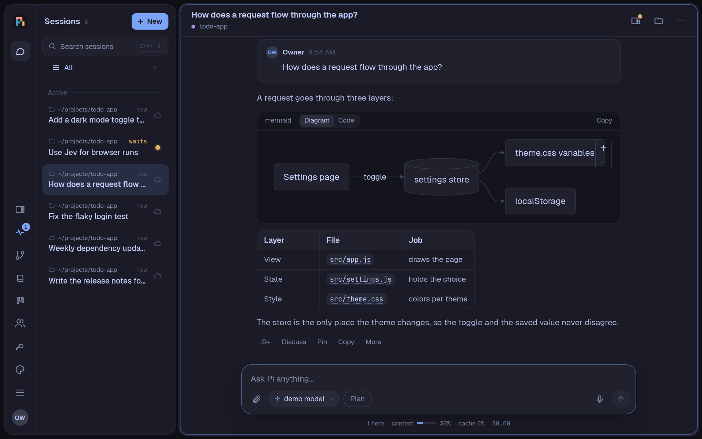
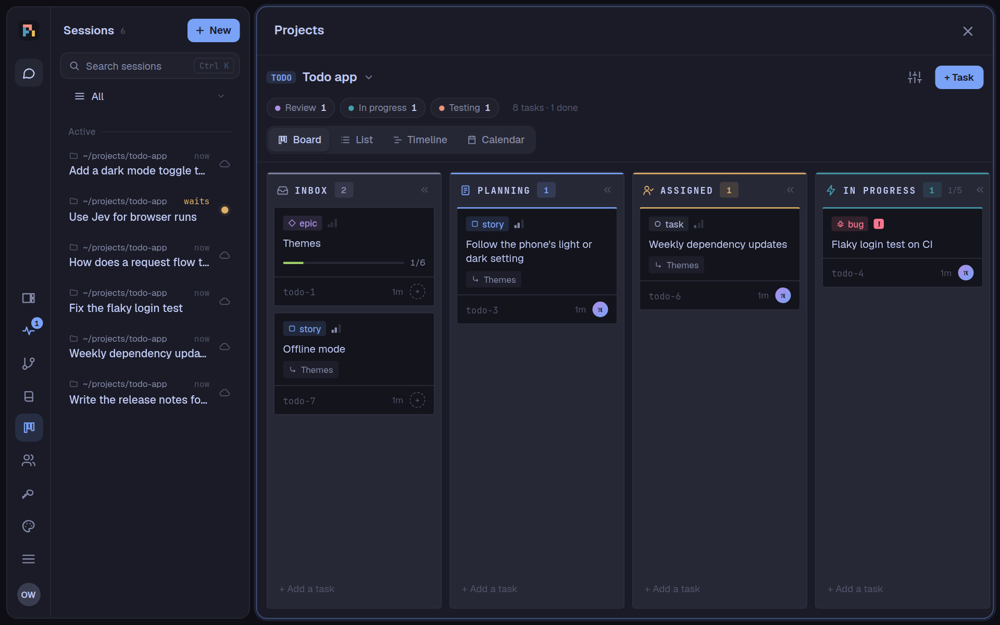
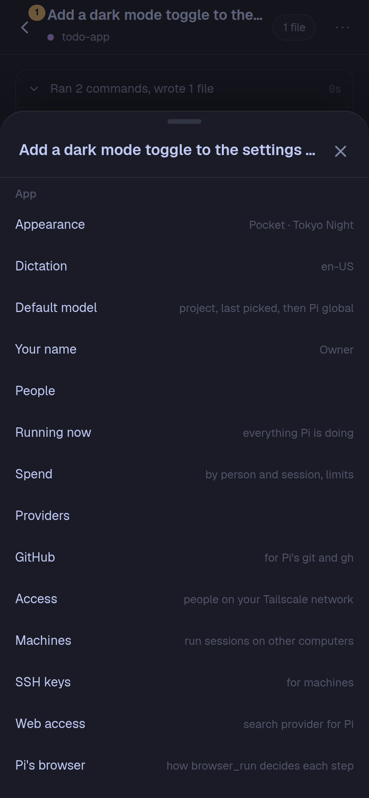

[English](README.md) | [简体中文](README.zh-CN.md) | Tiếng Việt

> Đây là bản dịch tiếng Việt của [README.md](README.md); bản tiếng Anh là bản gốc, và bản dịch có thể chậm hơn khi bản
> tiếng Anh được cập nhật. Cách dùng từ theo [web/i18n/vi.glossary.md](web/i18n/vi.glossary.md).

# pi-phone

Một coding agent sống trên điện thoại Android của bạn. pi-phone là một ứng dụng duy nhất: nó mang theo userland Linux
riêng (Node.js, bash, git, gh, ssh, ripgrep, fd, npm), chạy agent [Pi](https://github.com/earendil-works/pi) trên
[Pi Durable](https://github.com/earendil-works/pi/tree/main/packages/durable), và hiển thị giao diện web cho di động
trong một WebView. Không cần Termux, không cần laptop, không cần máy ảo trên cloud.

> **Tình trạng:** một dự án cá nhân, được xây dựng và thử trên Galaxy Z Fold 8 (Android 17). Chỉ cài thủ công
> (sideload; nhắm Android SDK 28, xem [DESIGN.md](DESIGN.md)). Có thể còn chỗ chưa trơn tru.

<p align="center">
  
  
  
</p>
<p align="center">
  
</p>

<sub>Tạo bằng một ứng dụng demo và một mô hình có kịch bản (`scripts/readme-shots.ts`): không có phiên, tài khoản hay
dự án thật.</sub>

## Nó làm được gì

### Agent
- **Một agent bền vững ngay trên điện thoại.** Phiên, subagent và lệnh gọi công cụ được lưu ngay khi chúng diễn ra
  (SQLite). Tắt ứng dụng hoặc cập nhật giữa chừng, công việc vẫn tiếp tục từ chỗ dừng.
- **Subagent trong nháy mắt.** Một ô xem nhanh liệt kê các subagent đang làm việc trong phiên của nó (tối đa 3, trên
  dải của điện thoại là 1; **N nữa** mở bảng ở đó), và bảng subagent có một ô con cho mỗi subagent (6 mỗi phiên, 3 trên
  điện thoại). Một yêu cầu duyệt trên ô sẽ nêu tên subagent đang hỏi. Phiên riêng của một subagent ghi mô hình của nó trên
  thanh trên cùng, cạnh “subagent của …” (trên điện thoại ô nhập ẩn nó khi Pi đang làm); chạm vào để mở bảng mô hình.
- **Pi đang làm gì, xem từ bất kỳ ứng dụng nào.** Thông báo pi luôn hiện giờ là bảng tiến độ: tiêu đề đếm số phiên đang
  chạy, đang chờ bạn và đã xong trong giờ qua; mở rộng ra, mỗi phiên một dòng với việc đang làm ("đang sửa …", "đang chạy
  npm test"), chạm để mở phiên đó, và nút Duyệt cho thẻ đơn giản. Bật bảng nổi (Điện thoại này › Bảng nổi trên ứng dụng
  khác; Android hỏi một lần để cho pi hiển thị trên ứng dụng khác): logo pi trong một bong bóng trên mọi ứng dụng, vòng
  quay khi Pi làm việc, số đếm và huy hiệu khi có việc chờ bạn; chạm để mở bảng. Chạm hai lần (hoặc nút Giọng nói trên bảng)
  để dùng Giọng nói của pi-phone ngay trên mọi ứng dụng: màn hình Giọng nói của app trong bảng nổi, thu nhỏ thành một
  chip Giọng nói (sóng âm, micrô, kết thúc), nói với phiên mà Menu › Trợ lý chọn, đổi được ở tiêu đề (pi phải là ứng dụng trợ lý kỹ thuật số của điện thoại, Android yêu cầu vậy để dùng
  micrô khi đang ở ứng dụng khác). Tab Xong liệt kê các phiên xong trong 24
  giờ qua kèm phần đầu câu trả lời cuối của Pi (hoặc lỗi), chấm xanh trên phiên bạn chưa mở, và số màu xanh trên bong bóng đếm những phiên
  xong từ lần bạn xem trước. Thanh trượt Độ đục của bảng (50 đến
  100%) cho ứng dụng bên dưới hiện xuyên qua bảng. Pi đổi được qua thẻ (`notifications.progress`, `notifications.bubble`,
  `notifications.bubbleHide`, `notifications.bubbleOpacity`). Từ GitHub issue #5.
- **Quyết định không thể bỏ sót.** Mọi thẻ đang chờ bạn (câu hỏi của Pi, một lệnh cần cho phép, một lần cài đặt, một cài đặt
  hay hành động cần duyệt, một drop-in do Pi làm đang chờ được bật hay giữ) được ghim trong một thanh màu hổ phách ở đầu
  phiên khi nó bị cuộn khuất. Chạm vào một dòng sẽ cuộn tới thẻ của nó và làm viền thẻ sáng lên một lúc; bạn trả lời trên
  thẻ. Nhiều hơn hai thẻ thì gộp thành một dòng “3 thẻ đang chờ bạn”, và giữ gộp hay mở như bạn để lại trong phiên đó.
  Danh sách phiên ghi "Pi hỏi bạn" cho một câu hỏi, và phạm vi Đang chờ bạn liệt kê các phiên đang chờ bạn. Điện
  thoại báo cho bạn như mọi yêu cầu duyệt.
- **Subagent chạy trên mô hình bạn chọn.** Menu › Subagent đặt mô hình và mức suy nghĩ Pi dùng khi tạo subagent, cho mọi
  phiên; menu của một phiên (Mô hình của subagent) đặt riêng cho phiên đó. Mô hình được chọn như chọn mô hình của phiên:
  mọi tài khoản kèm mức dùng gói (tài khoản sắp chạm giới hạn kèm giờ reset), tìm kiếm và yêu thích, với *Như mọi phiên*
  và *Của chính phiên* ở đầu. Pi chỉ dùng mô hình khác khi bạn yêu cầu trong
  chat: trong các mô hình bạn cho phép ở đó (thêm nhiều cái cùng lúc, mỗi cái hiện ngữ cảnh và hạn mức gói), hoặc sau khi
  bạn cho phép qua một thẻ. Công cụ `models` của Pi liệt kê các mô hình sẵn sàng, hạn mức và phần còn lại. Dòng tạo
  subagent ghi nó chạy trên gì và vì sao. Pi đổi được qua thẻ (`subagents.model`, `subagents.thinking`,
  `subagents.sessionModel`, `subagents.sessionThinking`). Dòng trạng thái của một subagent hiện chi phí của chính nó, không có
  giới hạn: giới hạn là của phiên.
- **Review code bằng subagent.** `/review` (hoặc "review PR này") cho một subagent với ngữ cảnh mới và công cụ chỉ đọc
  review các thay đổi chưa commit của thư mục, nhánh so với nhánh gốc, một commit, một pull request GitHub (theo số hoặc
  link: chỉ fetch, không checkout) hoặc các thư mục, theo bộ tiêu chí của pi-review (phát hiện P0 đến P3, kết luận, điều
  người cần kiểm tra) và `REVIEW_GUIDELINES.md` của dự án. `/review` không kèm gì mở một bảng có các pull request đang
  mở. Kết quả là một thẻ: Sửa những lỗi này đặt tin nhắn sửa vào ô nhập, chưa gửi; Đăng lên GitHub đăng review của pull
  request với bình luận theo dòng ("Request changes" khi có P0 hoặc P1, nếu không thì "Comment") sau khi bạn cho phép
  qua một thẻ.
- **Bình luận trong Review, và Từ lần review trước.** Trong Thay đổi, chạm số dòng (phía mới hoặc cũ) mở ô bình luận
  ngay dưới dòng, và nút ghi chú của tệp bình luận cho cả tệp. Gửi review đặt chúng vào ô nhập làm phản hồi cho Pi
  ("Please address the following review feedback: 1. path:line (current) …"), chưa gửi, và lưu mốc của thư mục: "Từ lần
  review trước" sau đó chỉ hiện những gì đổi sau mốc, còn so với HEAD đánh dấu các tệp không đổi từ đó là đã review.
  Bình luận và mốc đi theo phiên, trên mọi thiết bị và trên máy.
- **Danh sách phiên theo kiểu T3 Code.** Một bộ chọn phạm vi (Tất cả, từng dự án, từng thư mục, Đã lưu trữ) thay cho
  các tab; Đã ghim, Đang hoạt động (các phiên tác vụ đang chạy của một dự án nằm dưới phiên chính của nó), và một ngăn
  **Đã cất** thu gọn. Một phiên tự cất sau một ngày rảnh, khi lượt chạy tác vụ của nó kết thúc, hoặc khi nhánh của nó
  được gộp, và quay lại khi có hoạt động mới; cũng có thể Cất và Bỏ cất bằng tay (và `session_settle` cho Pi). Mỗi dòng
  cho biết nơi làm việc, thời gian (hoặc đã làm bao lâu), tiêu đề, nhánh hoặc tác vụ, và trạng thái. Phạm vi
  **Ưu tiên** xếp phiên theo việc chúng cần ở bạn: Cần bạn (một lệnh chờ trả lời, với Từ chối và Cho phép ngay trong
  dòng; một lượt chạy hoặc subagent thất bại, với Bỏ qua), Sẵn sàng để đọc (Đánh dấu tất cả đã đọc), Đang làm, và Yên
  tĩnh thu gọn; Bỏ qua và Đánh dấu đã đọc báo bằng một thông báo có thể hoàn tác, và nút Phiên trên thanh bên đếm số việc cần
  bạn. Giao diện › Danh sách phiên mở ở chọn cái hiện khi ứng dụng mở: chế độ xem dùng lần cuối trên thiết bị, Tất cả,
  hoặc Ưu tiên (`sessions.listOpens`).
- **Thay đổi có thể xem lại.** Pi sửa tệp bằng công cụ edit và write của nó, nên mọi thay đổi đều hiện thành diff; một
  lệnh bash ghi tệp dự án bằng script (`sed -i`, `cat > file`, `writeFileSync`, `tee`) vẫn chạy, kèm lời nhắc trong kết
  quả là hãy dùng edit; tệp tạm thì không có lời nhắc (dưới /tmp hoặc $TMPDIR, tên dạng `*.local.*`, hoặc bị git bỏ qua
  ở đó).
- **Tự nén khi bạn muốn.** Một phiên tự nén ngữ cảnh ngay trước giới hạn của mô hình; có thể sớm hơn, ở một tỉ lệ ngữ
  cảnh bạn chọn (10–95%), cho mọi phiên hoặc một phiên (Menu › Nén ngữ cảnh). Thước đo ngữ cảnh đánh dấu vị trí đó. Pi
  đổi được cả hai qua một thẻ (`sessions.compactAt`, `sessions.sessionCompactAt`).
- **Prompt không làm đầy ngữ cảnh.** Phần chữ trong prompt của Pi mà thay đổi sẽ được gửi lại, và mỗi bản ở lại cho
  tới khi phiên nén. Vì vậy mặc định chỉ mục của wiki không nằm trong prompt: một phần wiki ngắn, cố định, và Pi tự tìm
  trong wiki bằng `wiki_query` khi cần (hoặc, nếu bạn chọn relevant, các trang khớp với từng tin nhắn đi kèm tin nhắn
  đó); bí mật được tìm bằng `secrets_list` (có tìm kiếm) thay vì liệt kê trong prompt; danh sách kỹ năng chỉ
  gửi lại khi thêm hoặc bớt kỹ năng; và các công cụ ít dùng (tài liệu, nhóm phiên, thiết bị, công cụ màn hình của điều
  khiển điện thoại và máy tính, …) chỉ có khi Pi nạp chúng bằng `tool_search`, nhờ vậy phần công cụ mỗi yêu cầu mang
  theo giảm khoảng 45%. Mỗi thứ là một lựa chọn trong Menu › Nén ngữ cảnh, cho mọi phiên hoặc một phiên (wiki: tool,
  relevant, frozen, live; bí mật: tool, list; kỹ năng: frozen, live; công cụ: load, all), và Pi đổi được qua một thẻ
  (`context.wiki`, `context.sessionWiki`, `context.tools`, …).
- **Nhóm thư mục trong danh sách phiên.** Tự tạo nhóm (**+ Nhóm mới**) và chuyển các phiên vào: Chuyển vào nhóm… từ
  thao tác nhấn giữ một phiên, dòng của nó, menu của nó, hoặc **Di chuyển…** của một vùng chọn, hoặc kéo thả trên máy
  tính. Mỗi phiên nằm trong tối đa một nhóm; một nhóm có thể được ghim (dưới các phiên đã ghim), thu gọn, đổi tên, sắp
  xếp lại, hoặc xóa (các phiên của nó về lại Đang hoạt động). Nhóm là của riêng bạn, lưu trên máy chủ và giống nhau trên
  mọi thiết bị; dưới phạm vi một dự án hoặc thư mục, mỗi nhóm chỉ hiện các phiên của phạm vi đó, và tìm kiếm thấy phiên
  theo tên nhóm. Khi có nhiều nhóm: bảng Di chuyển tìm nhóm ngay khi bạn gõ (nhóm gần đây trước) hoặc tạo nhóm bạn vừa
  gõ, bộ chọn phạm vi hiện một nhóm, tiêu đề **Nhóm** thu gọn tất cả trên thiết bị này, và Thu gọn mọi nhóm / Mở mọi nhóm
  có trong menu của bất kỳ nhóm nào. Nhóm trống được ẩn cho đến khi bấm **Hiện {n} nhóm trống**, bên dưới các nhóm. Pi
  làm được tất cả (`session_groups`, `session_group_create`, `_rename`, `_pin`, `_fold`, `_order`, `_move`; xóa thì hỏi
  qua một thẻ).
- **Công cụ thật.** `bash`, `read` (văn bản và hình ảnh), `write`, `edit` và `codemode` (script gọi các công cụ), cùng
  git, gh, ssh, Node, npm, ripgrep và fd trong userland đi kèm. Menu › Nén ngữ cảnh › **Pi gọi công cụ thế nào** (mọi
  phiên; cài đặt `codemode.mode`): trực tiếp hoặc từ script (mặc định), hoặc chỉ từ script, khi đó Pi chỉ được đưa
  codemode và vài công cụ có thẻ đọc lệnh gọi của mình (artifact, subagent, ảnh, video, âm thanh, browser run, màn
  hình, Creator) và gọi phần còn lại từ script. Một bài kiểm tra giữ phần prompt của chính pi-phone trong phiên mới
  dưới 85.000 ký tự. Một hình Pi đọc (thường là hình bạn vừa gửi) chỉ hiện một lần, bên trong lệnh gọi `read` khi bạn mở
  nó; hình do một lệnh gọi tạo ra (ảnh chụp màn hình, hình của `fetch_content`) hiện dưới dòng của lệnh gọi đó.
- **Đăng nhập một lần.** Claude Pro/Max, OAuth của các nhà cung cấp khác, hoặc khóa API, từ bảng Nhà cung cấp. GitHub
  qua mã thiết bị (Cài đặt › GitHub), được `git` và `gh` của agent dùng.
- **Máy chủ tương thích OpenAI của riêng bạn.** Nhà cung cấp › **Thêm nhà cung cấp tương thích OpenAI**: tên, URL gốc
  (LM Studio, Ollama, vLLM, OpenRouter, một proxy), khóa API hoặc không có khóa cho máy chủ cục bộ, và header bổ sung.
  **Tìm mô hình** hỏi `/models` của máy chủ rồi bạn đánh dấu các mô hình cần dùng, hoặc gõ id; mỗi mô hình có cửa sổ ngữ
  cảnh, đầu ra tối đa, nhận hình ảnh và suy luận. Các mô hình của nó xuất hiện trong mọi bộ chọn mô hình. Khóa được lưu
  trong Bí mật: cấu hình mô hình của Pi chỉ ghi tên của nó. Sau này có thể sửa hoặc xóa ở đó; Pi cũng làm được, qua một
  thẻ duyệt, nhưng khóa luôn do bạn gõ.
- **Mô hình yêu thích.** Nhà cung cấp › **Mô hình yêu thích** liệt kê mọi mô hình bạn chọn được, mỗi cái có một ngôi sao:
  mô hình gắn sao đứng ngay sau mô hình hiện tại trong bộ chọn mô hình, và bộ chọn có bộ lọc **Yêu thích**. Sao là của bạn,
  trên mọi thiết bị; chúng không cho phép gì (mô hình của subagent nằm ở Menu › Subagent). Pi thấy chúng trong công cụ
  `models` (`favorites: true` chỉ liệt kê chúng) và đổi chúng qua một thẻ (`models.favorites`).
- **Nhiều hơn một tài khoản.** Thêm tài khoản Claude, Codex hoặc Copilot thứ hai (hay thứ ba) trong Nhà cung cấp; mỗi
  tài khoản có đăng nhập riêng, và mô hình của nó được liệt kê theo tài khoản ("Claude Opus · Work"). Một phiên dùng
  tài khoản của mô hình bạn chọn cho nó, nên bạn có thể mở phiên trên bất kỳ tài khoản nào hoặc chuyển phiên sang tài
  khoản khác.
- **Mức dùng gói.** Giới hạn của từng tài khoản Claude, Codex và Copilot đúng như ứng dụng của chính nó hiển thị: khoảng
  5 giờ và hàng tuần (Copilot: số yêu cầu cao cấp trong tháng), kèm thời điểm đặt lại, dưới dạng thanh trong Nhà cung
  cấp, trong menu mô hình, và một thước đo trên thanh trên cùng của phiên, mở ra để xem mọi khoảng. Ở 90% một khoảng,
  phiên sẽ báo, kèm **Chuyển sang** các tài khoản khác của bạn; một yêu cầu thất bại vì giới hạn sẽ đề nghị **Tiếp tục
  trên** tài khoản khác. pi-phone không bao giờ tự chuyển.
- **Chờ hết giới hạn của nhà cung cấp.** Một lượt chạy gặp lỗi 429, quá tải, hoặc khoảng gói Claude hay ChatGPT sẽ chờ
  ngay trong yêu cầu cho đến khi nhà cung cấp đặt lại (theo header của nó, nếu không thì thanh mức dùng của tài khoản,
  nếu không nữa thì giãn cách tăng dần), rồi tự tiếp tục, kể cả sau khi khởi động lại. Dòng trực tiếp cho biết giới hạn
  của ai và khi nào thử lại, kèm **Thử lại ngay** và **Dừng**; dòng của phiên, ô xem nhanh và bảng subagent hiện một ô
  vuông màu hổ phách. Khi các tài khoản khác của cùng nhà cung cấp còn hạn mức, danh sách thả xuống của thẻ liệt kê từng
  tài khoản, kèm mức đã dùng của khoảng vừa hết: của bạn trước, rồi đến tài khoản dùng chung của máy chủ nhóm, đánh dấu
  *(nhóm)* vì chúng tiêu gói thuê bao của nhóm, mỗi loại xếp tài khoản còn trống nhất lên đầu (tài khoản đầu tiên được
  chọn cho đến khi bạn chọn cái khác). Bạn quyết định: **Chuyển** gửi yêu cầu đang chờ sang tài khoản đã chọn (được kiểm
  tra lại ngay lúc đó; tài khoản đã đầy trong lúc chờ sẽ bị từ chối, kèm lý do, và thẻ được làm mới), và phiên dùng tài
  khoản đó từ đó trở đi; thẻ của một subagent sẽ chuyển subagent và phiên của nó. Hoặc **Chờ đến** lúc đặt lại. Khi thẻ
  đang hiện, biểu ngữ mức dùng trên ô nhập sẽ tạm lánh. Mốc đặt lại xa hơn (khoảng hàng tuần), lỗi thanh toán, hoặc đăng
  nhập hết hạn sẽ thất bại ngay, kèm thời điểm đặt lại. **Nhà cung cấp › Chờ hạn mức**: tắt, tối đa 1, 6 (mặc định), 12
  hoặc 24 giờ, và một thông báo trên điện thoại cho lần chờ từ 10 phút trở lên (bật trừ khi bạn tắt; thông báo đẩy của
  trình duyệt ghi giờ theo đồng hồ của trình duyệt đó). Việc đặt tiêu đề không bao giờ chờ. Từ pi-pocket 0.21.0
  (khoảng có tên: #128 của @piromagnus).
- **Chi tiêu.** Pi đã chi bao nhiêu, theo người và theo phiên, với giới hạn do chủ sở hữu đặt (vượt giới hạn, Pi không
  nhận tin nhắn mới ở đó). Tìm kiếm theo ngữ nghĩa của wiki có dòng riêng: embedding từ xa của nó (lập chỉ mục và truy
  vấn), kèm số yêu cầu và token, tính vào tổng và không tính vào giới hạn của ai.
- **Chế độ kế hoạch.** Nút Kế hoạch cạnh ô nhập: Pi đọc và lên kế hoạch trước khi thay đổi bất cứ gì (nó vẫn ghi quyết
  định và phát hiện vào wiki, và dùng đầy đủ trình duyệt của nó để xem ứng dụng đang chạy hoặc một trang web), và một
  kế hoạch dài sẽ đến dưới dạng trang HTML để xem xét.
- **Biểu mẫu.** Pi hỏi nhiều câu cùng lúc trong một biểu mẫu (lựa chọn kèm đề xuất của nó, văn bản, ảnh), và chờ câu
  trả lời, hoặc tiếp tục và nhận chúng sau. Câu hỏi then chốt có viền màu nhấn và nhãn Quyết định then chốt.
- **Lịch hẹn và mục tiêu.** Pi tự nhắn cho mình sau đó hoặc lặp lại (`schedule`), và một phiên có thể tiếp tục làm việc
  hướng tới một mục tiêu mà nó tự kiểm tra. Lưu trữ một phiên không hủy lịch hẹn nào của nó: một thông báo cho biết bao nhiêu
  lịch lặp lại vẫn chạy ở đó và mở chúng ra (`session_archive` của Pi cũng nói vậy), và Lịch hẹn của phiên đánh dấu từng cái
  “Phiên đã lưu trữ”.
- **Đang chạy.** Biểu tượng nhịp tim trên thanh bên mở mọi việc đang làm ở các phiên: mô hình, chi phí, lệnh đang chờ và tin
  nhắn phiên đang xử lý (chạm để xem đủ), mỗi tác vụ với thời gian đã chạy, và Dừng; rồi mọi tin nhắn đã lên lịch trên một
  dòng thời gian (24 giờ hoặc 8 ngày tới, mỗi phiên một làn, mỗi lần gửi một dấu), kèm đếm ngược, lặp lại, người đặt, Hủy,
  và tin đang giữ thì nói lý do và rằng đến giờ nó sẽ bị hủy trừ khi điều đó thay đổi trước. Thời gian chạy từng giây.
- **Phiên khác.** Pi có thể liệt kê, đọc, mở, nhắn tin, chờ và dừng các phiên khác của ứng dụng, với tư cách người mà
  nó làm việc cho. Nó cũng có thể gỡ kẹt một phiên, mỗi lần sau khi bạn đồng ý trên một thẻ: rẽ nhánh phiên đó ngay
  trước tin nhắn làm nó dừng (`session_fork`), mở ngữ cảnh mới ở đó (`session_new_context`), hoặc nén nó
  (`session_compact`). Không bao giờ với phiên của chính nó, trừ khi rẽ nhánh: Pi có thể tách nhánh công việc của mình
  và giao việc cho nhánh đó. Một phiên Pi mở được liên kết với phiên đã mở nó: nó hiện bên dưới phiên đó trong danh
  sách (một nhãn cho biết số lượng, bấm để thu gọn, có chấm khi một phiên đang chờ bạn hoặc thất bại), các liên kết
  "Bắt đầu từ" và "Phiên liên kết" phía trên bản ghi dẫn qua lại, và chi tiêu của nó tính vào giới hạn của phiên khởi
  tạo. Khi một phiên liên kết đang chạy (ở bất kỳ cấp nào), phiên đã mở nó cũng hiện là đang chạy: nó đang chờ báo cáo.
  Tin nhắn từ một phiên khác hiện thành thẻ của một agent, không phải tin của bạn: tên phiên đó, **Mở**, nội dung
  dạng Markdown, và tin dài được thu gọn với **Xem tất cả**.
- **Dự án** (một tiện ích, tắt cho đến khi bạn bật trong Cài đặt › Tiện ích): các bảng tác vụ để công việc không bị
  quên. Pi hỏi một lần trước khi theo dõi công việc của một phiên trên bảng ("Theo dõi việc này trên bảng?"), rồi cập
  nhật tác vụ bằng `task_create`, `task_update` và `task_comment`. Các bảng (và khóa SSH của ứng dụng) nằm trong
  `app.sqlite` của thư mục dữ liệu, tách khỏi cơ sở dữ liệu của các phiên, nên một thay đổi trên bảng không bao giờ phải chờ
  công việc của Pi ở đó (với Pi 1.5, nhiều lệnh cùng lúc từng lỗi "database is locked"); lỗi cơ sở dữ liệu của một công
  cụ được ghi vào log của máy chủ. Epic, Story, Tác vụ, Lỗi và Tác vụ con; Hộp thư đến →
  Lên kế hoạch → Đã giao → Đang làm → Đang kiểm thử → Xem xét → Xong, và Bị chặn. Chỉ con người duyệt tác vụ cần duyệt,
  và Pi không bao giờ tự duyệt việc của mình. Chia sẻ với những người bạn chọn. Trang Dự án (thanh bên) hiện bảng theo
  phong cách ACS: trên máy tính kéo thẻ giữa các trạng thái; trên điện thoại vuốt giữa các trạng thái và nhấn giữ một
  thẻ để chuyển nó. **Danh sách** nhóm tác vụ theo trạng thái, người làm, ưu tiên hoặc nhãn (bảng trên máy tính, dòng
  trên điện thoại); **Dòng thời gian** hiện các tác vụ mở có ngày dưới dạng thanh từ ngày bắt đầu đến hạn (nét đứt nếu
  không có ngày bắt đầu), theo tuần hoặc tháng, có đánh dấu hôm nay; **Lịch** hiện tác vụ theo hạn trong một tháng
  (các ngày của tháng thành danh sách trên điện thoại), với các tác vụ chưa lên lịch bên cạnh, và trên máy tính bạn kéo
  một tác vụ sang ngày khác. Một thẻ mở tác vụ của nó: trạng thái trong một nhãn, thẻ lượt chạy cho biết cần làm gì
  (xem xét và gộp kèm kích thước diff, mở phiên đang làm, chạy nó), các dòng thuộc tính gọn gàng, danh sách kiểm kèm
  tiến độ, quan hệ, các phiên đã dẫn dắt hoặc làm tác vụ, bình luận (hoặc toàn bộ hoạt động, mỗi lượt chạy một dòng),
  và ô bình luận ở cuối. Một lần gộp được ghi lại trên lượt chạy (ai, khi nào, commit), nên nhánh đã gộp không được đề
  nghị lại. Mục "Bảng cho phiên này" trong menu phiên bật hoặc tắt chế độ bảng, và đặt ai chuyển tác vụ sang Xong ở đó
  (bạn trên bảng, Pi sau khi bạn duyệt trong cuộc trò chuyện, hoặc Pi sau khi tự xác nhận công việc: chạy thật và đo
  đạc) cùng quy tắc bảng (theo dự án, Đầy đủ, hoặc Nhẹ; mỗi dự án cũng có Đầy đủ hoặc Nhẹ; `board_settings` và
  `project_update` cho Pi). Subagent của một phiên đang dùng bảng cũng làm việc trên bảng đó với cùng thiết lập. Liên
  kết `#task:PP-3` mở một tác vụ ở bất cứ đâu. **Một nhóm agent cho mỗi dự án:** phiên
  chính của nó dẫn dắt (lên kế hoạch, hỏi trước khi chạy tác vụ, xem xét, không bao giờ viết mã); một tác vụ giao cho Pi
  chạy trong phiên tác vụ riêng, trong git worktree trên `task/PP-12`, tại nơi (điện thoại hoặc một máy) còn chỗ, nhiều
  nhất bao nhiêu cùng lúc tùy mỗi nơi cho phép. Khi xong, nó báo về phiên chính, và về phiên đã chạy nó nếu đó là phiên khác; bạn xem diff của nhánh và gộp nó từ tác
  vụ. Phiên tác vụ và phiên chính không gửi thông báo lên điện thoại khi xong; yêu cầu duyệt và thất bại thì có. Nhóm
  kiểm tra các phiên tác vụ mỗi phút: một lần kết thúc bị lỡ (do khởi động lại) vẫn được báo, tác vụ có phiên bị xóa sẽ
  thất bại, và tác vụ làm quá 30 phút được báo cho phiên chính. **Review khi sang Review** (một công tắc trong cài đặt
  project, mặc định tắt; Pi dùng `reviews` của `project_update`): khi phiên tác vụ chuyển tác vụ sang Review, một phiên
  reviewer đọc nhánh so với chỗ bắt đầu, ở chế độ plan (chỉ đọc và báo cáo, không thay đổi gì), theo tiêu chí của
  `/review`, rồi bình luận kết luận và các lỗi trên tác vụ. Lỗi P0 hoặc P1 được gửi lại phiên tác vụ để sửa, rồi review
  lại, tối đa 2 vòng; phiên chính chỉ được báo khi review sạch, hoặc khi sau vòng thứ hai vẫn còn P0/P1 để bạn quyết.
  Pi có công cụ cho mọi thao tác (`project_create`,
  `project_update`, `project_share`, `project_team`, `task_create`, `task_update`, `task_comment`, `task_run`,
  `task_diff`, `task_link_session`, …); tạo bảng (từ bất kỳ phiên nào), xóa và gộp đều hỏi bạn qua một thẻ.

  

### Web, tài liệu và câu trả lời
- **Trình duyệt của Pi.** Pi mở trang trong trình duyệt riêng (một WebView của ứng dụng, điều khiển qua socket
  DevTools) và đọc chúng dưới dạng các ô điều khiển đánh số và văn bản hiển thị (biểu tượng được gọi theo tooltip,
  sprite, hình ảnh, hoặc nơi chúng dẫn tới; cả những thứ chỉ nhấp được nhờ giao diện, như nút của một hộp bật lên);
  nó nhấp, gõ, chọn, di chuột, cuộn, nhấn phím, quay lại, đọc cả trang, hoặc nhìn trang (`browser_open`,
  `browser_click`, …). Ô điều khiển bên trong khung (iframe: ô số thẻ của một biểu mẫu thanh toán, một khung đăng
  nhập nhúng, một thông báo cookie trong khung, cả khung của trang web khác) và bên trong shadow root mở của web
  component được đọc và dùng như của chính trang, mỗi ô ghi rõ khung của nó, và chữ của chúng có trong chữ của trang;
  thẻ đăng nhập và secret đã lưu dùng được ở đó, và những gì bạn gõ trên thẻ vẫn được giấu ở đó.
  `browser_drag` kéo một ô điều khiển thả vào ô khác hoặc theo một khoảng dời (thanh trượt, thẻ kanban, danh sách sắp xếp,
  bản đồ), con trỏ di chuyển từng bước và kéo-thả riêng của trang nhận đủ sự kiện kéo và dữ liệu; bản đọc trang ghi rõ cái gì
  kéo được, và `browser_run` cũng kéo được. `browser_press` cũng nhấn tổ hợp phím (Ctrl+A, Ctrl+Enter, Shift+Tab,
  Ctrl+K, Meta+K cho trang macOS), và không bao giờ gõ một ký tự vào ô mật khẩu. `browser_focus` đặt tiêu điểm vào một ô
  mà không nhấp, và bản đọc trang ghi rõ ô đang có tiêu điểm (cả trong khung). `browser_click` nhấp đúp, nhấp chuột
  phải (menu ngữ cảnh riêng của trang) và nhấn giữ bao lâu tùy ý (bằng ngón tay khi trang bày theo điện thoại, bằng chuột
  ở cỡ máy tính). `browser_select_text` bôi chọn một đoạn chữ trên trang (cả trong khung) hoặc trong một ô, toàn bộ một
  ô nhập, hoặc các ký tự theo vị trí, cho việc định dạng trong trình soạn thảo hay trang làm việc với vùng chọn; không dùng
  bảng tạm, và không bao giờ trong ô mật khẩu hay những gì bạn gõ trên thẻ. Danh sách do trang tự vẽ (một ô chọn có vùng cuộn riêng) cũng dùng được: mọi lựa chọn đều được
  liệt kê, một cú nhấp cuộn nó vào tầm nhìn, `browser_select` mở danh sách, chờ các lựa chọn trang vẽ ra
  chậm một chút (trong một portal ở cuối trang) rồi chọn theo tên, hoặc báo danh sách không mở, `browser_scroll` cuộn
  danh sách, và một chữ cái nhảy tới mục theo kiểu gõ trước. `browser_screenshot` có thể lưu hình dạng PNG hoặc
  JPEG vào thư mục của phiên (cho `doc_image` hoặc một báo cáo), và chỉ chụp hộp thoại, menu hoặc danh sách chứa
  một ô điều khiển, hoặc cả trang vượt ra ngoài phần đang hiển thị (`full_page`, 4.000 px CSS đầu tiên; trên trình duyệt
  của máy hoặc trình duyệt được gắn vào, vì trên điện thoại hình được lấy từ màn hình, từng khung nhìn một). Nó đánh dấu hình cho tài liệu hướng dẫn: một khung, một huy hiệu đánh số, một nhãn và mũi tên trên
  một ô điều khiển hoặc một đoạn chữ, phần còn lại làm tối, và che bí mật (khung đặc cho khóa và mật khẩu, làm mờ
  mạnh cho tên); `image_markup` làm tương tự trên bất kỳ tệp hình nào, và `screenshot` lưu hình của nó bằng `save`.
  Nó tải tệp lên từ nơi phiên làm việc (`browser_upload`, vào một ô tệp hoặc nút Upload của nó), lưu trang dạng PDF
  ở đó (`browser_save_pdf`). Tệp mà trang tải về trong trình duyệt trên máy (hoặc bản máy chủ) được lưu vào thư mục
  `downloads/` của phiên (trên máy đó, với phiên làm việc ở đó; tối đa 25 MB, tệp lớn hơn bị hủy) và câu trả lời nêu tên
  tệp; trình duyệt trên điện thoại không giữ tệp tải về (Pi sẽ nói vậy: hãy duyệt trên một máy), còn trình duyệt mà Pi gắn vào
  thì tự lưu như cách của nó. Nó giữ tối đa sáu tab (`browser_new_tab`, `browser_tabs`; khung hiện chúng thành một dải).
  Cửa sổ mà trang mở ra (cửa sổ đăng nhập như của Microsoft trên Teams, một liên kết mở cửa sổ mới) thành một tab ở
  trước, vẫn trao đổi được với trang đã mở nó, và Pi được báo; khi nó tự đóng, trang đó trở lại phía trước. **Cài đặt ›
  Trình duyệt của Pi › Cửa sổ trang mở ra** (`browser.popups`): *Cho phép*, *Hỏi* (một thẻ trước) hoặc *Tắt* (trang
  không mở được cửa sổ nào). Chrome trên một máy mở cửa sổ do một cú bấm mở, như Chrome vẫn làm.
  Trang xin vị trí, máy ảnh, micrô, thông báo hay đọc bảng tạm sẽ bị từ chối và Pi được báo; Pi có thể hỏi bạn trên một thẻ để
  cho phép một quyền với trang đó (`browser_permission`, đến khi trình duyệt đóng). **Cài đặt › Trình duyệt của Pi › Quyền**
  (`browser.permissions`): *Từ chối* (mặc định) hoặc *Hỏi* (một thẻ khi trang xin). Trên trình duyệt của máy hoặc trình
  duyệt được gắn vào; trình duyệt trên điện thoại không cho phép quyền nào.
  **`browser_eval`** chạy một biểu thức JavaScript đọc trang và trả giá trị dạng JSON (màu, phông chữ, khoảng cách đã
  tính của một thương hiệu, truy vấn DOM; tối đa khoảng 50 KB, tối đa 10 giây). Nó chạy trong một môi trường cô lập dùng
  chung DOM của trang nhưng không dùng chung script của trang, và chỉ đọc: ở đó không có cookie, bộ nhớ trang, mạng, hẹn
  giờ, trình nghe sự kiện, worker hay cửa sổ, không gì nó gán hay gọi làm thay đổi trang, và script của trang tạm dừng
  khi nó chạy. Ô mật khẩu và những gì bạn gõ trên thẻ đọc ra là rỗng, và giá trị bạn gõ trên thẻ bị lấy ra khỏi câu trả
  lời của nó. **Cài đặt › Trình duyệt của Pi › Đoạn mã** (`browser.eval`): *Bật* (mặc định) hoặc *Tắt*.
  **Mỗi phiên có các tab riêng**, và khung của nó chỉ hiện các tab đó; đăng nhập thì dùng chung cho mọi phiên trên
  điện thoại (hoặc trên một máy). Tab của một phiên đóng sau 30 phút không dùng (không đóng khi bạn đang xem hoặc đang
  tiếp quản), và đóng ngay khi phiên bị lưu trữ hoặc xóa; đăng nhập vẫn giữ. Trang được dàn trang như trên điện
  thoại, hoặc như trên máy tính (1280 px, Chrome máy tính, không cảm ứng) bằng **Điện thoại / Máy tính** trong khung hoặc
  `browser_size`. Mỗi cú nhấp được kiểm tra trước: phần tử đúng như đã đọc, vẫn trong tầm nhìn, không bị gì che; và
  kiểm tra cả ở chỗ trang nhận nó, nên bố cục xê dịch ngay trước đó (dữ liệu về từng đợt) không bao giờ làm nhấp nhầm
  thứ khác: Pi nhắm lại phần tử, hoặc báo nó cứ xê dịch và không nhấp gì. `browser_open` luôn tải lại trang từ đầu,
  kể cả khi địa chỉ chỉ khác phần # (một route của ứng dụng một trang), nên không bao giờ hiện trạng thái cũ của ứng dụng. Bạn
  xem trực tiếp trong khung Trình duyệt (bên cạnh cuộc trò chuyện trên màn hình rộng, nơi nó tự mở khi Pi bắt đầu
  duyệt web; trên điện thoại, một bản xem trước trực tiếp nhỏ phía trên ô nhập sẽ mở nó), và có thể **Tiếp quản**
  và **Trả lại**: khi tiếp quản, chạm vào trang và gõ trên bàn phím, phím của bạn đi thẳng vào trang; vuốt (hoặc
  dùng con lăn) để cuộn thứ nằm dưới ngón tay, kể cả vùng cuộn riêng của một danh sách đang mở. Không gì bạn gõ được
  giữ lại trong khung, và trên ô mật khẩu bàn phím ở chế độ mật khẩu, nên nó không học những gì bạn gõ. Nó không
  bao giờ mở điện thoại này hay mạng nội bộ của nó, giữ cookie và đăng nhập trong một hồ sơ WebView riêng (tách khỏi
  ứng dụng), và chỉ làm những gì chủ sở hữu yêu cầu. **`browser_run`** tự thực hiện trọn một mục tiêu, từng bước
  một: mỗi bước do mô hình chạy bạn chọn trong Cài đặt › Trình duyệt của Pi quyết định (mô hình riêng của phiên,
  hoặc Jev, mô hình quyết định của TypeSafe qua OpenRouter: khoảng một giây và $0.00003 mỗi bước), cho mọi phiên hoặc
  một phiên; Pi có thể chọn một trong hai cho một lượt chạy (`model`: `jev` hoặc `session`), và kết quả của lượt chạy
  nói mô hình nào đã quyết định và ai chọn nó. Mỗi bước gửi cho mô hình chạy: mục tiêu, các giá trị Pi đưa (bí mật chỉ bằng tên), địa chỉ, tiêu đề và
  văn bản hiển thị của trang, cùng các ô điều khiển và giá trị của chúng: với Jev, gửi tới OpenRouter bằng khóa OpenRouter
  của bạn; với mô hình của phiên, gửi tới nhà cung cấp của nó. Một lượt chạy tự nhấp và gõ mà không hỏi, trên các trang
  bạn có thể đang đăng nhập. Nó chỉ gõ các giá trị Pi cung cấp, dừng kèm lý do Pi xử lý được (cần một giá trị, bị
  chặn, bị kẹt, chưa thấy xong), và chi phí của Jev được tính vào Chi tiêu. Một thẻ trực tiếp trong cuộc trò chuyện hiện
  mục tiêu, từng bước khi nó diễn ra, thời gian và chi phí, kèm nút Xem. **Mật khẩu từ Bí mật:** một đăng nhập bạn đã
  lưu trong Bí mật (và cho phép trong thư mục đó), Pi gõ theo tên (`browser_type` với `secret`, hoặc giá trị
  `{ secret }` của `browser_run`): giá trị đi vào trang, không bao giờ tới Pi hay mô hình chạy, và bí mật “hỏi trước”
  vẫn hỏi bạn qua một thẻ. **Nếu không, việc đăng nhập vẫn là của bạn:** Pi không bao giờ gõ mật khẩu hay mã dưới
  dạng văn bản. `browser_sign_in` đặt một thẻ trong cuộc trò chuyện để bạn gõ tên người dùng và mật khẩu (hoặc dùng một
  đăng nhập đã lưu trong Bí mật với Ghi nhớ), và chúng đi thẳng vào trang (thẻ gọi tên các ô bằng từ ngữ riêng của
  nó, không bao giờ bằng chữ của trang); `browser_ask_code` làm tương tự cho mã dùng một lần. Những gì bạn gõ ở đó
  không bao giờ tới Pi: khi Pi đọc trang, nó hiện là `[typed by the person]`, hình chụp của Pi bôi đen các ô đó (và mọi
  chỗ giá trị hiện ra), và một giá trị quá ngắn để che (một hoặc hai ký tự) khiến Pi không nhận được trang nào cho
  đến khi gửi xong. `browser_ask_user` trao trang cho bạn để giải CAPTCHA hoặc duyệt trên điện thoại, và Pi tiếp tục khi
  bạn báo Xong. Passkey không dùng được ở đó (Android chỉ cho phép trong các trình duyệt nằm trong danh sách cho
  phép): Pi dùng cách khác của trang web, hoặc hỏi bạn.
- **Truy cập web.** `web_search` qua nhà cung cấp bạn chọn (37 nhà cung cấp, có cả DeepSeek), và `fetch_content` cho
  trang web, PDF và tệp Office, kho GitHub, issue và pull request.
- **Tài liệu.** `file_to_markdown` đọc PDF, Word, PowerPoint, Excel, EPUB, notebook và nhiều loại khác
  ([markit](https://github.com/picassio/markit)).
- **Tệp Office.** [OfficeCLI](https://github.com/iOfficeAI/OfficeCLI) có sẵn: Pi tạo và sửa `.docx`, `.xlsx` và
  `.pptx` từ bash, kèm skill cho bản trình chiếu, dashboard, mô hình tài chính, bài báo và biểu mẫu, và trình xem Tệp
  hiển thị trước chúng.
- **Câu trả lời phong phú.** Công thức toán (KaTeX), sơ đồ và biểu đồ Mermaid, artifact HTML trong sandbox (cùng các
  skill thiết kế của [effective-html](https://github.com/plannotator/effective-html)), và **câu trả lời tương tác**:
  một chuyến đi kèm bản đồ, một máy tính, một danh sách kiểm, được vẽ thành giao diện dùng được và giữ trạng thái.
- **Hệ thống thiết kế.** 152 phong cách từ [OpenDesign](https://github.com/nexu-io/open-design) (phong cách công khai của
  các thương hiệu như Stripe hay Linear, và các phong cách như editorial hay brutalist), mỗi cái là một DESIGN.md và
  các token CSS của nó: nêu tên một cái, hoặc chọn mặc định ở **Menu › Hệ thống thiết kế**, và Pi dùng màu, phông chữ và
  khoảng cách của nó cho trang, artifact, bản trình chiếu và tài liệu Office. **Của riêng bạn, từ một trang web:** đưa
  Pi địa chỉ một trang ("làm design system từ coral.example"), Pi mở trang đó trong Pi's browser, đo màu, phông chữ,
  thang cỡ chữ, khoảng cách, bo góc và đổ bóng bằng `browser_eval`, ghi hệ thống vào mục của bạn (hiện đầu danh sách),
  làm một trang mẫu để xem, và nói giá trị nào Pi tự chọn chứ không đo được.
- **Mẫu trình chiếu và chuyển động.** Năm mẫu bản trình chiếu HTML và các skill hoạt ảnh GSAP từ
  [OpenDesign](https://github.com/nexu-io/open-design), mỗi cái theo giấy phép MIT riêng: Pi bắt đầu một bản trình chiếu
  từ một mẫu và xuất bản nó thành artifact.
- **Phim chuyển động cho doanh nghiệp.** Skill của [Motion Video Kit](https://github.com/echris6/motion-video-kit) để
  làm quảng cáo ngắn kiểu phim ra mắt sản phẩm bằng chuyển động dựng từ mã (HTML, GSAP, Three.js), được các subagent
  phê bình mới hoàn toàn đánh giá; Pi dựng video trên một máy của bạn bằng công cụ máy HyperFrames (cần ffmpeg, numpy và
  scipy trên máy đó). Trước mỗi lần dựng, Pi chạy `hyperframes check` và vẽ cùng các thời điểm hai lần theo hai thứ tự
  xáo trộn, nên một khung hình phụ thuộc vào những gì đã vẽ trước nó bị phát hiện trước khi có ai xem phim.
- **Unslop.** Skill [unslop của heydamir](https://github.com/heydamir/unslop) (của Damir Sokolovsky, CC BY 4.0): nhờ Pi
  unslop, trau chuốt hoặc dọn lại một màn hình, Pi soát nó theo danh sách dấu hiệu của giao diện do AI làm (phát sáng,
  chữ gradient, nhãn emoji, khoảng cách lệch, lời lẽ phô trương), đề xuất một hướng trên một thẻ và chờ bạn trả lời, rồi
  sửa khoảng cách, màu, biểu tượng, chữ, kiểu chữ, bố cục, chi tiết, hình ảnh và chuyển động, và kiểm tra kết quả bằng
  `screenshot`. Mức sàn của nó gồm vùng chọn chữ, thanh cuộn và viền focus theo màu của trang, bóng đổ thật và khoảng
  trống phía trên tiêu đề nhiều hơn phía dưới. Pi cũng soát danh sách dấu hiệu đó trước khi coi một trang HTML hay artifact là xong.
- **Thiết kế & video.** Bốn mục trên là một tiện ích, bật sẵn: tắt nó trong **Tiện ích** (hoặc nhờ Pi), thì các
  phiên không mang skill nào của nó và Menu › Hệ thống thiết kế biến mất cho tới khi bật lại.
- **Kiểm chứng hình thức.** Skill [statechart](https://github.com/cursor/plugins/tree/main/pstack/skills/statechart)
  của pstack: Pi viết một mô hình TLA+ cho thứ chuyển qua lại giữa các trạng thái (một luồng thanh toán, một giao thức,
  một dịch vụ), TLC kiểm tra mọi quy tắc trong đó, và câu trả lời hiện nó thành một statechart Mermaid bằng lời của bạn,
  tô sáng đường ngắn nhất dẫn tới mỗi quy tắc bị vi phạm (exit 1 nghĩa là có quy tắc bị vi phạm, báo kèm đường đi đánh
  số). Nó chạy ở nơi có Java: một máy có công cụ máy **TLC**, hoặc bản server. Trên điện thoại Pi chỉ phác một biểu đồ
  chưa kiểm tra, nói rõ như vậy, và đề nghị kiểm tra trên một máy. Kèm bốn ví dụ mẫu (tiệm trà sữa của statechart-art).
  Là một tiện ích riêng, bật sẵn: tắt nó trong **Tiện ích** (hoặc nhờ Pi), thì không phiên nào liệt kê skill này.
- **Pi nhìn thấy việc mình làm.** `screenshot` dựng một artifact, một tệp HTML hoặc Office, hay một trang web trong
  WebView của chính điện thoại, ở độ rộng điện thoại, máy tính và màn hình lớn (390, 1280 và 1920 px), kể cả khi tắt
  màn hình, nên Pi kiểm tra trang trước khi coi là xong. Một tệp HTML tải stylesheet, script và hình ảnh từ chính thư mục của nó, nên trang liên kết tới CSS của
  ứng dụng sẽ hiện đúng kiểu. `localStorage` và `sessionStorage` của nó dùng được, trong bộ nhớ và trống ở mỗi lần chụp,
  nên một ứng dụng một tệp đọc chúng vẫn vẽ ra thay vì trang trắng, và các lỗi trang ném ra được liệt kê dưới ảnh. Trang
  của một ứng dụng cuộn trong vùng chính, không phải body, được chụp trọn (tới 4000 px), hoặc lượt kiểm tra nói ảnh bỏ
  sót bao nhiêu. Trong một phiên trên máy, `screenshot` và `redline` lấy tệp của máy đó, và địa chỉ `localhost` hay
  `127.0.0.1` ở đó là của máy: ứng dụng mở cổng đó về điện thoại cho lần chụp rồi đóng lại.
- **Ảnh chụp có số đo.** Mỗi độ rộng của `screenshot` đi kèm một lượt kiểm tra bố cục mà trang chạy trước khi vẽ: thứ
  gì tràn khỏi khung hoặc khung cha, và trang có rộng hơn màn hình không, kèm kích thước. Nó còn tìm những thứ khiến
  trang trông chưa hoàn thiện: chữ bị khung cắt (dấu ba chấm, dòng bị xén), phần tử đè lên chữ hoặc nút của phần tử
  khác, vùng chạm nhỏ hơn 40 px trên điện thoại (tính cả lớp chạm phủ rộng ra ngoài nút nhỏ, và liên kết
  phủ cả thẻ (stretched link) được tính bằng cả thẻ, chữ trong thẻ nằm dưới lớp đó không bị coi là bị đè; trang điện thoại rộng hơn
  màn hình vẫn được tính là trang điện thoại), padding, khoảng cách, bo góc và chiều cao nút lệch lưới 4 px hoặc
  không tròn điểm ảnh, chữ có độ tương phản dưới chuẩn WCAG AA (cả trên nền gradient, đo đúng chỗ chữ nằm) hoặc nhỏ hơn 12 px, emoji và ký hiệu dùng làm biểu
  tượng, chữ gradient, nhãn viết hoa, giãn chữ âm và dòng quá dài, cùng chín dấu hiệu lấy từ bộ dò của Impeccable (ảnh
  hỏng, nhảy cấp tiêu đề, thẻ lồng trong thẻ, sọc nhấn một bên, bóng phát sáng, chấm nhấp nháy, chữ căn đều trong cột
  hẹp, dòng chữ quá sát và cùng một chữ lặp trong một thẻ; biểu tượng xoay không tính là chấm nhấp nháy), và các luật
  auton-ui đã kiểm chứng: bo góc của khối lồng trong khối không đồng tâm hoặc
  lòi ra ngoài góc bo của khối cha không cắt nó (thanh tiến độ vuông trong thanh bo tròn), số trong ô bảng, đồng hồ và vùng cập nhật
  trực tiếp không dùng chữ số đều (tabular), nền gradient trên khối lớn (`data-allow-gradient` đánh dấu chỗ thiết kế
  cần), sọc một bên vẽ bằng bóng inset hoặc thanh `::before`/`::after`, và các dấu hiệu CSS tĩnh (`transition: all`,
  line-height 1 trên chữ xuống dòng, ô nhập chữ dưới 16 px trên điện thoại, hộp thoại cuộn thiếu
  `overscroll-behavior: contain`, viewport chặn phóng to, `tnum` thay vì `tabular-nums`), gom nhóm kèm số đo, và báo khi trang dùng quá nhiều
  cỡ chữ, màu chữ hoặc cỡ biểu tượng. Nội dung ẩn dành cho trình đọc màn hình (bảng dữ liệu của biểu đồ trong hộp 1 px)
  được bỏ qua. Trình duyệt của Pi cho cùng phép kiểm tra đó với `browser_screenshot`, và riêng
  bằng `browser_layout_check`. Pi dựa vào các con số.
- **Các bước trước khi chụp.** `screenshot` và `redline` nhận `steps` chạy trong trang trước ảnh và layout check của
  mỗi độ rộng (chạm một phần tử, gõ vào một ô, nhấn một phím, chờ một lúc hoặc chờ một phần tử), nên menu, bộ chọn hay
  hộp thoại chỉ hiện sau một lần chạm được chụp và đo khi đang mở; bước nào không làm được thì lệnh gọi thất bại, nói rõ
  bước nào và vì sao (không có gì khớp, không hiển thị).
- **So từng điểm ảnh.** Để làm giao diện chuẩn đến từng điểm ảnh, `image_compare` so một ảnh chụp mới với một hình
  mẫu (bản mockup, hoặc một ảnh chụp Pi giữ lại khi trang đã đúng): tỉ lệ điểm ảnh đổi, các vùng đổi kèm vị trí và kích
  thước, và một hình khác biệt lưu cạnh ảnh chụp, chỗ đổi tô đỏ, các vùng được đóng khung và đánh số. Viền khử răng cưa
  được bỏ qua trừ khi được yêu cầu; hai hình khác kích thước chỉ được so khi được yêu cầu, sau khi co về kích thước của
  hình mẫu.
- **Đo và vẽ số (redline).** `redline` đo một trang từ DOM của nó (artifact, tệp HTML, trang web hoặc chính app, render
  như `screenshot`) rồi vẽ số đo lên hình như redline của nhà thiết kế: padding là dải xanh lá, khoảng cách giữa các
  khối là dải hồng tím kèm số pixel, bo góc là nhãn xanh dương, kích thước nút màu cam (vùng chạm dưới 40 px trên điện
  thoại tô đỏ), kiểu chữ (cỡ, chiều cao dòng, độ đậm, màu) màu tím, và một bảng chú giải các giá trị đã dùng dưới hình.
  Nó đo các khối chính (khi đang mở một sheet hoặc hộp thoại thì chỉ đo lớp trên cùng đó), hoặc các phần tử một
  selector chọn; khi có spec (tokens.css của một design system, hoặc một danh
  sách như "padding 16, radius 24/12/20, font 22/13/12") nó tô đỏ chỗ lệch kèm giá trị của spec ("gap 23, spec 24") và
  liệt kê ra. `browser_redline` làm việc tương tự trên trang đang mở trong trình duyệt của Pi (trang điện thoại rộng hơn màn hình
  vẫn được tính là trang điện thoại). Một tệp ảnh không có DOM:
  hãy so nó bằng `image_compare`.
- **Kiểm tra giao diện trước khi xong.** Skill có sẵn `ui-verify` bắt Pi kiểm tra mọi artifact, trang HTML và màn hình
  của app bằng số đo trước khi nói là xong: layout check ở 390, 1280 và 1920 px, redline theo token của design system, theo
  mockup hoặc theo luật 4 px, `image_compare` với ảnh mẫu, sửa cho tới khi không còn chữ bị cắt, phần tử đè nhau, độ
  tương phản thấp, chữ dưới 12 px, icon emoji, vùng chạm nhỏ, ảnh hỏng, nhảy cấp tiêu đề hay thẻ lồng trong thẻ, rồi
  báo cáo kèm số đếm trước và sau cùng hình redline
  hoặc hình khác biệt. Các skill HTML, design-system và unslop đều kết thúc bằng nó.
- **Hook.** **Menu › Hook** liệt kê các bước kiểm tra pi-phone tự chạy quanh công việc của Pi, nên chúng vẫn diễn ra
  cả khi Pi quên, mỗi hook một công tắc (Pi bật hoặc tắt bằng `setting_change hooks.<id>`, sau khi bạn duyệt thẻ, và mở trang này
  cho bạn bằng `show_screen hooks`):
  **Kiểm tra artifact khi xuất bản**: khi Pi xuất bản một artifact HTML, SVG hoặc tương tác, app dựng nó ở 390, 1280 và
  1920 px và chính kết quả của công cụ artifact mang theo những gì layout check tìm thấy (chữ bị cắt, phần tử đè nhau,
  vùng chạm nhỏ, độ tương phản thấp), nên Pi thấy ngay trong lệnh gọi đó; độ rộng nào điện thoại không dựng được thì
  nói lý do, và artifact vẫn được xuất bản. **Nhắc kiểm tra giao diện trước khi xong**: khi Pi kết thúc một lượt mà
  đã sửa tệp giao diện (HTML, CSS, SVG, component, script trong thư mục `web/`) sau lần chụp màn hình hoặc redline cuối,
  app gửi Pi một tin nhắn tiếp theo nêu các tệp đó và yêu cầu kiểm tra ở 390, 1280 và 1920 px, hoặc nói vì sao không;
  mỗi lượt một lần, cả trong subagent, và phiên hiện tin đó là do hook gửi. Tệp dùng rồi bỏ không tính: tệp trong thư
  mục tạm (`/tmp`, `~/tmp`, và trên điện thoại `$TMPDIR`; trên máy, thư mục tạm của máy đó) hoặc trong thư mục
  `fixtures`, `__fixtures__` hay `test-fixtures`. Bên cạnh là các hành vi tự động có cài
  đặt riêng (ghi phiên không hoạt động vào wiki, nén ngữ cảnh đầy) cùng giá trị hiện tại của chúng.
- **Hình ảnh.** `image_generate` tạo và sửa hình ảnh (sửa tối đa năm hình một lần; tạo 1 đến 4 hình; 1:1, 16:9,
  9:16, 4:3 hoặc 3:4) bằng mô hình bạn chọn ở **Menu › Hình ảnh** (`image.model`): GPT Image 2.5 qua đăng nhập
  ChatGPT (tính vào gói, Chi phí đếm số hình), một mô hình hình ảnh của OpenRouter như Nano Banana
  (`google/gemini-*-image`; hiển giá theo triệu token hình ảnh, chi phí tính vào phiên), hoặc một mô hình của nhà
  cung cấp riêng được đánh dấu **Tạo hình ảnh** trong Nhà cung cấp. *Tự động* là của ChatGPT khi bạn đã đăng nhập,
  nếu không thì mô hình đầu tiên của OpenRouter. Pi có thể dùng mô hình khác cho một hình. Hình được lưu nơi phiên
  làm việc (cả trên máy khác) trong `images/`, đặt tên theo prompt, hình đầu còn là `images/latest.png`, và hiển thị
  trong cuộc trò chuyện; Pi chỉ nhận đường dẫn và chi phí, không nhận hình, nên không tốn ngữ cảnh. Hình về một
  người có thật (ảnh của ai đó, chân dung một người có tên) sẽ hỏi bạn trên một thẻ trước. Khi mô hình của phiên
  tự viết được hình ảnh, Pi được biết rằng cuộc trò chuyện chỉ hiển thị chữ của mô hình, nên vẫn tạo hình bằng
  `image_generate` (có thể nêu chính mô hình của nó).
- **Media.** Công cụ `media` của Pi xử lý hình ảnh và video bằng ffmpeg ở nơi phiên chạy. Trên điện thoại nó dùng bản
  gọn mà ứng dụng mang theo; trong bản máy chủ, bản của image; trên máy tính, công cụ ffmpeg của máy (Menu › Máy tính ›
  Cài công cụ) hoặc ffmpeg sẵn có. Nó cho biết một tệp là gì (dung lượng, độ dài, kích thước, codec); thu nhỏ vừa khung,
  cắt, xoay, lật, đổi định dạng (JPEG, PNG, WebP) và nén ảnh; lấy khung hình của video (tại các giây cho trước, mỗi vài
  giây, hoặc rải đều) hoặc một tờ ảnh tổng hợp; và cắt một đoạn mp4, rút gọn, thu về 720p và tắt tiếng nếu muốn. Thứ nó
  tạo ra nằm trong `media/` ở nơi phiên làm việc. `ffmpeg` và `ffprobe` cũng có trên PATH của các phiên trên điện thoại.
- **Tạo video.** `video_generate` tạo một video qua OpenRouter bằng khóa của bạn, từ một prompt hoặc từ ảnh mở đầu và
  kết thúc, với độ dài, khung hình, độ phân giải và âm thanh mà mô hình nhận (kiểm trước khi trả tiền). Mất một hai phút;
  video được lưu trong `videos/` ở nơi phiên làm việc và phát ngay trong cuộc trò chuyện, kèm độ dài và chi phí.
  Menu › Video chọn mô hình (`video.model`), mỗi mô hình kèm giá mỗi giây.
- **Chép lời âm thanh.** `audio_transcribe` chuyển lời nói trong một tệp âm thanh hoặc video ở nơi phiên làm việc (bản
  ghi cuộc họp, tin nhắn thoại, video) thành văn bản, phụ đề SRT hoặc VTT, hoặc JSON kèm thời gian từng câu, bằng đăng
  nhập ChatGPT (Codex) của bạn, không cần API key (mặc định gpt-4o-transcribe). Tệp dài được chia thành từng phần mười
  phút; bản chép lời lưu trong `transcripts/`. Ngôn ngữ và các từ cần nghe trong Cài đặt › Giọng nói giúp nó nghe đúng hơn.
- **Đọc thành tiếng.** `audio_speak` đọc một văn bản thành tệp âm thanh (m4a hoặc wav) bằng mọi ngôn ngữ, kể cả tiếng
  Việt, cũng bằng đăng nhập đó: lồng tiếng, đọc báo cáo, tóm tắt bằng giọng nói, với một giọng (marin, cedar và tám giọng
  khác) và một cách đọc (ôn tồn, vui vẻ, chậm...). Văn bản dài được đọc từng phần, mỗi phần được so với lời giọng đọc
  nói là đã đọc; phần đọc sai được đọc lại. Lưu trong `audio/`, phát ngay trong cuộc trò chuyện kèm dạng sóng; bản chép
  lời hiện vài dòng đầu kèm thời gian, nút Chép và Mở tệp. Menu › Âm thanh chọn mô hình chép lời, mô hình đọc và
  giọng mặc định (mỗi mục là một danh sách thả xuống; giọng có mẫu nghe thử bằng ngôn ngữ của bạn).
- **Xem video.** `video_ask` hỏi một mô hình xem được video về một tệp video ở nơi phiên làm việc, hoặc một địa chỉ
  YouTube, qua OpenRouter bằng khóa của bạn (mặc định Gemini 3.5 Flash-Lite, khoảng một xu mỗi phút): chuyện gì xảy ra,
  kèm thời điểm, nói gì. Video lớn hoặc cao được thu về mp4 720p trước. Menu › Video chọn mô hình (`video.askModel`);
  chi phí nằm trong Chi tiêu.

### Bí mật và wiki
- **Bí mật.** Khóa API và token trong Cài đặt › Bí mật, dùng theo tên (`$NPM_TOKEN`) và không bao giờ hiện ra: kết quả
  có chứa một bí mật sẽ hiện `[secret NAME]`. Pi xin bí mật còn thiếu qua một ô nhập ẩn. Để giữ một giá trị do lệnh tạo
  ra (`gh auth token`), Pi cho bạn xem toàn bộ lệnh trên một thẻ trước (**Chạy và lưu**); lệnh chạy ở nơi bash của
  phiên chạy (điện thoại, hoặc máy của phiên) với các bí mật lệnh có ghi tên, và lệnh thất bại chỉ hiện phần báo lỗi,
  đã che bí mật và các chuỗi trông như token. Trình duyệt của Pi đưa cho Pi văn bản của trang trong hàng rào “của trang”, không phải
  chỉ dẫn, và một lần đăng nhập bạn gõ sẽ che tên người dùng của bạn trong những gì Pi đọc sau đó, giống như mật khẩu.
- **Tiện ích drop-in.** Module tiện ích của riêng bạn, thêm bằng **Thêm drop-in…** trong Cài đặt › Tiện ích (một tệp
  `.ts`, hoặc tệp `.zip` chứa nó) hoặc do Pi thêm bằng `extension_install` khi bạn duyệt thẻ (hiện các tệp và những
  dòng đầu), mỗi cái tắt cho đến khi bạn bật. Chúng dùng được `host.ask` của pi-pocket 0.22 (một thẻ mà giá trị chỉ
  tới được tiện ích), `host.hide` và `host.commandEnv`, `host.roleOf` của pi-pocket 0.27 (vai trò của một người theo id), cùng
  `host.sessions.start` của pi-pocket 0.28 (một phiên thường
  mới cho người mà Pi đang làm việc cho, với các bước kiểm tra của họ, mỗi khóa một lần), chưa dùng được `host.browser`; một tiện ích có công cụ trùng
  tên công cụ có sẵn sẽ bị từ chối, kèm lý do. Schema công cụ được dựng bằng `@earendil-works/pi-schema` (`obj`, `str`,
  `opt`, …); một tiện ích dựng bằng `Type` của TypeBox (từ `@earendil-works/pi-ai` trước Pi 1.5, hoặc `typebox`) sẽ bị
  từ chối, kèm lý do. **Gỡ** để bỏ một drop-in (Cài đặt › Tiện ích, sau khi xác nhận ngay
  trong dòng của nó, hoặc nhờ Pi: `app_action extensions.remove` qua thẻ của bạn): nó bị tắt và các tệp của nó bị xóa
  (`<name>.ts`, `<name>.js`, `<name>/`); dữ liệu của nó trong `extension-data/<name>/` được giữ, trừ khi bạn muốn xóa cả.
  Ngoài nút ở thanh bên, dòng trong menu, hành động trong trình khởi chạy, trang và bảng, một drop-in còn có thể hiện
  một dải cao một dòng ngay trên ô nhập tin nhắn (ở mọi phiên hoặc những phiên nó chọn; tối đa hai drop-in, cái mới
  nhất), một bảng nhỏ nổi mà bạn kéo đi đâu cũng được và đóng bằng × (giữ chỗ bạn đặt; trên điện thoại thì tránh ô
  nhập tin nhắn và bàn phím), một thẻ trong bảng bên cạnh trình duyệt và máy tính của Pi (toàn màn hình trên điện
  thoại), một dòng trong menu của phiên, và màu riêng đè lên màu của ứng dụng khi nó bật (nếu hai drop-in cùng đặt một
  màu thì cái mới nhất thắng). Chế độ an toàn (`?noext=1`) và việc tắt nó đi đều gỡ bỏ tất cả.
- **Trình tạo tiện ích.** Nhờ Pi làm một trang, bảng, công cụ theo dõi hay công cụ mới ngay trong pi-phone, và Pi
  làm cho bạn một drop-in: một bản đầu nhỏ từ một trong bốn mẫu (một công cụ; một nút ở thanh bên kèm một trang; một
  dòng trong menu kèm một bảng; một công cụ và một trang dùng chung dữ liệu, để việc bạn làm trên trang thì Pi cũng
  làm được), được kiểm tra bằng script riêng của skill, cài khi bạn duyệt thẻ, do bạn bật, rồi được xem trong ứng
  dụng đang chạy ở độ rộng điện thoại và máy tính và sửa ngay tại chỗ. Nó giữ các quy tắc giao diện của bạn: biểu
  tượng nét và danh sách chọn của ứng dụng, trạng thái là một chữ và một chấm, không emoji, pixel nguyên, mọi chữ đều
  theo ngôn ngữ của bạn. Trang của drop-in cũng dùng được danh sách chọn nhiều của ứng dụng (`pocket.MultiChoice`).
  Pi kiểm tra việc mình làm bằng `extension_inspect`, công cụ chỉ đọc (dùng được cả ở chế độ lập kế hoạch): các tên mà
  API drop-in có (những gì một trang có thể thêm, các thành phần của `pocket`, biểu tượng, màu của giao diện) và những
  tên drop-in không được dùng, còn với một drop-in: nó đã tải chưa, vì sao bị từ chối hay lỗi, nó đã thêm gì, những
  trang và bảng tab của bạn thấy nó thêm, và lỗi mới nhất của nó trong một tab (mỗi tab báo cho máy chủ khi trang của
  một tiện ích bị lỗi), không bao giờ là nội dung tệp. Một phần chuyển thể từ skill plugin của DeepSeek Harness
  (MIT). Là một tiện ích riêng, bật sẵn: tắt nó trong **Tiện ích** (hoặc nhờ Pi), và không phiên nào còn liệt kê
  skill hay công cụ này.
- **Pi làm drop-in cho bạn (Creator).** Nhờ một thứ trong ứng dụng (“làm cho tôi đồng hồ pomodoro trên thanh bên”) và
  Pi hiện một thẻ trước, **Làm một drop-in: Pomodoro**, nói nó sẽ là gì và hiện ở đâu: **Làm đi** hoặc **Để sau**.
  Khi bạn chọn Làm đi, một subagent của phiên (chạy trên model dành cho subagent của bạn) viết nó với tên
  `made-pomodoro` và báo khi xong; pi-phone kiểm tra mà không chạy nó (một module, không gì nằm ngoài thư mục của nó,
  không trùng tên công cụ có sẵn, tối đa 1 MB và 200 tệp, cùng phép kiểm tra của skill), rồi bạn cài nó qua thẻ quen
  thuộc. Một thẻ trong cuộc trò chuyện theo dõi nó: đã viết, kiểm tra, đã cài ở trạng thái tắt, đang chờ bạn bật
  (**Bật nó**), đã kiểm tra trong ứng dụng ở độ rộng điện thoại và máy tính, kèm **Mở subagent**. Mỗi lần sửa là một bản
  mới trên cùng thẻ; cuối cùng là **Giữ**, **Hoàn tác** (lùi một bản, hoặc gỡ nếu đó là bản đầu) hay **Khôi phục…** bất kỳ
  bản nào đã giữ. Cài đặt › Tiện ích liệt kê các drop-in do Pi làm kèm các bản, Hoàn tác và Khôi phục…. Drop-in do Pi
  làm có cùng quyền như mọi drop-in: điều giữ an toàn cho bạn là bạn duyệt từng thẻ, nó được cài ở trạng thái tắt, và chỉ bạn
  bật nó. Tên bắt đầu bằng `made-` dành cho Creator. Là một phần của Trình tạo tiện ích: tắt cùng với nó.
  **`/make <cần làm gì>`** bắt đầu nó từ ô nhập (`/make đồng hồ pomodoro trên thanh bên`): cùng thẻ, subagent, phép kiểm
  tra và Giữ/Hoàn tác/Khôi phục; chỉ gõ `/make` thì nó ở lại trong ô kèm một ví dụ. Chủ sở hữu thấy lệnh này khi Trình
  tạo tiện ích đang bật.
- **Một wiki PARA** ([pi-para](https://github.com/picassio/pi-para)): Pi tra cứu và viết vào đó khi làm việc, với tìm
  kiếm của qmd, theo dõi các câu hỏi mở cho đến khi được trả lời, và ghi nhận các phiên rảnh vào đó. Khi đã
  đăng nhập OpenRouter, **Jev xếp hạng kết quả tìm** (Menu › Wiki › Xếp hạng bằng Jev): nó đọc từng trang tìm được
  (theo từ khóa, theo nghĩa, và các trang có các từ của tin nhắn, kể cả âm tiết tiếng Việt) và giữ những trang giúp ích
  cho tin nhắn của bạn hoặc `wiki_query` của Pi, tốt nhất trước; khoảng 0,5 giây và $0.0001 mỗi lần tìm, tính vào Chi
  tiêu. Tắt đi thì giữ thứ tự của tìm kiếm; khi Jev lỗi, thứ tự đó được giữ và nhật ký cùng câu trả lời của
  `wiki_query` nói lý do. Với `wiki_query`, Jev đọc thêm những dòng phía sau của một trang dài có chứa các từ trong câu
  hỏi, nên một mục thêm vào cuối trang vẫn được tính; tìm trong scope của phiên cũng nêu tên các trang phù hợp ở scope
  khác ("Also in other scopes").
- **Tài liệu** (thanh bên › Tài liệu): tài liệu của bạn trong các thư mục, là các trang markdown hiển thị như wiki.
  - **Trang:** nơi chứa (Của tôi, Nhóm, một bảng) là tiêu đề của nó, kèm **+ Trang** và một ⋯ cho thư mục mới, trang đã
    xóa và cài đặt; tìm kiếm có hàng riêng. Thư mục là các mục kèm số trang, mỗi mục có một ⋯ (trang hoặc thư mục bên
    trong, đổi tên, xóa). Trên màn hình rộng, thư mục và trang đang mở nằm cạnh nhau.
  - **Các trang:** `[[liên kết]]` giữa các trang, các trang liên kết ngược lại, mọi phiên bản đã lưu để xem và khôi phục,
    trang đã xóa để lấy lại, và tìm kiếm trên tất cả.
  - **Ở đâu:** Của tôi, và của từng bảng (**Tài liệu** của bảng mở chúng). Trên máy chủ nhóm còn có tài liệu Nhóm,
    do các vai trò có quyền “Sửa tài liệu nhóm” chỉnh sửa.
  - **Tìm theo ngữ nghĩa:** trang được tìm theo ý nghĩa, không chỉ theo từ, gộp với kết quả khớp từ khóa. Tài liệu
    của bạn dùng mô hình embedding của wiki với đăng nhập OpenRouter của bạn; của nhóm dùng mô hình và khóa OpenRouter
    do chủ sở hữu đặt trong trang Máy chủ của gateway. Chi phí hiện trong Chi tiêu (hoặc trong trang Máy chủ).
  - **Hình ảnh:** thêm PNG, JPEG, WebP hoặc GIF (tối đa 10 MB) bằng nút **Hình** của trình soạn thảo hoặc bằng cách
    dán. Vị trí, thông tin máy ảnh và các siêu dữ liệu khác bị xóa (ảnh vẫn giữ hướng xoay). Một mô hình thị giác bạn
    chọn trong Menu › Cài đặt › Tài liệu mô tả mỗi hình một lần, nên tìm kiếm thấy trang theo nội dung hình của nó; trên
    máy chủ nhóm, chủ sở hữu đặt mô hình của nhóm trong trang Máy chủ.
  - **Pi** tìm, đọc, viết, sửa và di chuyển tài liệu cho bạn, thêm hình từ tệp, và xóa hoặc khôi phục chúng qua một thẻ.

### Máy khác
- **Làm việc trên máy khác.** Thêm một khóa SSH và một máy (Cài đặt › Khóa SSH, Máy). Một phiên trên máy chạy công
  cụ của nó ở đó qua daemon nhỏ của [pi-env](https://github.com/earendil-works/pi/tree/main/packages/env); cuộc trò
  chuyện và các đăng nhập của bạn vẫn ở trên điện thoại. Khung Tệp, trình xem, Thay đổi và terminal theo phiên sang đó.
  Linux, macOS, Termux và **Windows** (qua OpenSSH Server và Git Bash của nó; ứng dụng đưa bạn một script PowerShell để
  thiết lập). Các skill của ứng dụng dùng được ở đó (html-plan và các skill HTML khác, ui-verify, và của Thiết kế & video
  trừ design-system và brand-extract) được chép sang `~/.pi/mobile/skills` ở yêu cầu đầu tiên của phiên và liệt kê tại
  chỗ đó, nên Pi đọc chúng, và chạy script của chúng, ngay trên máy.
- **Công cụ trên máy.** OfficeCLI, ripgrep, fd, Chrome (headless, cho trình duyệt của Pi khi máy không có Chrome), và
  Computer use (ocu, để Pi thao tác ứng dụng máy tính ở đó; trên Linux cần một phiên desktop) được cài lên máy từ ứng
  dụng (kể cả Windows), đối chiếu SHA-256. Chúng được liệt kê sẵn và được chọn khi bạn thêm máy, trong **Cài công cụ**,
  và trên thẻ `machine_add`. Hai công cụ nữa được liệt kê nhưng không chọn sẵn, vì chúng lớn: **ffmpeg** (kèm
  ffprobe; bản dựng tĩnh GPL, khoảng 350 MB) và **HyperFrames** (Linux và macOS), dựng bố cục HTML và GSAP thành
  MP4 ngay trên máy đó, cài kèm Chrome (headless) và ffmpeg (tổng khoảng 920 MB). Pi dựng bằng
  `hyperframes render <thư mục> -o film.mp4` và kiểm tra tệp bằng ffprobe; telemetry, kiểm tra cập nhật và việc tự
  cài đặt của HyperFrames luôn tắt. **TLC** (Linux, macOS, Windows x64; không chọn sẵn, khoảng 165 MB): Java 21 của
  Temurin và trình kiểm tra mô hình TLA+, cho Kiểm chứng hình thức; các phiên trên máy đó có `TLA2TOOLS` và `JAVA`, và
  skill statechart đi kèm. Pi cũng tự làm được bằng `machine_tools`: nó cho xem công cụ trên từng máy (phiên bản đã cài,
  phiên bản hiện hành, dung lượng), và cài, cập nhật hoặc gỡ chúng sau khi bạn duyệt một thẻ ghi máy, phiên bản từ và
  đến của từng công cụ cùng dung lượng, cài giống hệt Cài công cụ; nó báo dòng phiên bản của từng công cụ, hoặc bước bị
  lỗi, và đề nghị cập nhật khi một công cụ đã cũ.
- **Trình duyệt của Pi trên một máy.** Phiên trên máy duyệt web bằng Chrome headless ở đó (Chrome, Chromium hoặc Edge
  của máy, nếu không thì công cụ trên máy), xem trong cùng khung (“Trình duyệt của Pi trên <máy>”). Nó mở các địa
  chỉ của chính máy, nên Pi thử được ứng dụng web bạn chạy ở đó (`localhost:3000`), và việc tải lên cùng PDF dùng tệp
  của máy. Đăng nhập của nó nằm trong `~/.pi/mobile/browser` ở đó.
  - **Thành cửa sổ trên màn hình của máy**: **Cài đặt › Máy › Trình duyệt của Pi ở đây** (`browser.machineMode`:
    *Headless*, mặc định, hoặc *Một cửa sổ trên màn hình*) mở Chrome, Chromium hoặc Edge của máy có cửa sổ, cùng hồ
    sơ, để bạn xem và dùng nó ngay tại máy; nó vẫn vẽ khi bị che hay thu nhỏ. Trên Linux nó mở trong màn hình mà dòng
    thiết lập màn hình chỉ ra (Menu › Điều khiển máy tính, dòng đặt `DISPLAY`), và bị từ chối nếu không có; trên
    Windows nó mở trong phiên đã đăng nhập, không khóa, của bạn qua một tác vụ lên lịch dùng một lần với tài khoản của
    bạn (không mật khẩu, không quyền quản trị, xóa ngay khi Chrome chạy), và báo khi chưa ai đăng nhập hoặc màn hình
    đang khóa. Công cụ Chrome headless trên máy không có cửa sổ; macOS làm sau. Khi có người bấm, gõ hay cuộn trong
    cửa sổ đó (không phải Pi, không phải khung), khung báo cửa sổ đang được dùng trên máy, và Pi được báo.
  - **Từ một phiên trên điện thoại**: `browser_open` và `browser_new_tab` với `machine` (hoặc **Duyệt trên** trong
    khung) chuyển việc duyệt web của phiên sang một máy của bạn, hoặc về lại điện thoại; các thẻ vẫn là của phiên.
  - **Gắn vào trình duyệt đang chạy ở đó**: `browser_attach` (một cổng, hoặc đường dẫn tệp DevToolsActivePort) điều
    khiển một trình duyệt đã chạy trên máy với DevTools ở 127.0.0.1 của máy: của Playwright, agent-browser, một Chrome
    Pi mở bằng `--remote-debugging-port`, hoặc Chrome của chính bạn, qua ssh của ứng dụng (không máy nào khác). Với
    Chrome của bạn, bật remote debugging ở `chrome://inspect/#remote-debugging` (Chrome, Edge, Brave), Pi tự tìm thấy nó
    trong hồ sơ mà không cần cổng; nếu Chrome hỏi thì cho phép ở đó. Trừ khi đó là Chrome của pi-phone ở máy, bạn
    duyệt trước trên một thẻ ghi máy, cổng, phiên bản trình duyệt, hồ sơ của nó (mang theo các đăng nhập của hồ sơ
    đó) và những thẻ nào thuộc về Pi. Pi chỉ có các thẻ nó mở ở đó (mở ngầm, nên thẻ của bạn vẫn ở trước; ảnh chụp
    đưa thẻ của Pi lên trước) và cửa sổ do trang của chúng mở; các thẻ của bạn được để yên, trừ khi Pi xin cả các
    thẻ đang mở (`tabs: "all"`, cho trình duyệt nó tự mở). Thẻ nào của Pi được ghi nhớ khi trình duyệt đó còn chạy.
    Các thẻ đó hiện trong khung, và mọi công cụ trình duyệt, Tiếp quản, thẻ đăng nhập và mã cùng cửa sổ trang mở
    đều dùng được; Đóng chỉ đóng các thẻ Pi mở; `browser_detach` (hoặc **Tách ra** trong khung) buông nó ra và để nó
    chạy tiếp. Việc gắn kéo dài đến khi máy chủ khởi động lại.
- **Từ bất kỳ phiên nào.** `machine_run` và `machine_copy` chạy một lệnh hoặc chép một tệp trên máy (khi một máy
  được chọn **Pi hỏi trước mỗi lệnh** trong Cài đặt › Máy, mỗi `machine_run` ở đó chờ bạn cho phép trên một thẻ hiện
  lệnh; mặc định tắt, như bash trên điện thoại), và `pi-ssh` cho bash dùng ssh, rsync, scp và tunnel bằng khóa của ứng
  dụng, thứ không gì đọc ra được. Pi tự thêm máy bằng `machine_add` (ví dụ một máy ảo nó vừa tạo): một thẻ hiện
  địa chỉ, khóa SSH và host key, đối chiếu với khóa Pi đọc trên chính máy khi có thể, cùng các công cụ cần cài (được chọn
  sẵn, trừ ffmpeg, HyperFrames và TLC); **Duyệt và kết nối** thêm máy, cài pi-env, kết nối và cài các công cụ đã chọn; Từ chối thì không lưu gì.
- **Cổng** của một máy (một dev server ở đó) mở được trong trình duyệt của điện thoại.
- **Tiếp tục phiên Pi.** Tiếp tục một phiên từ Pi trên điện thoại này, một tệp `.jsonl`, hoặc `~/.pi/agent/sessions`
  của một máy, kèm lịch sử; hoặc gửi một phiên sang `pi` trên máy và mang về những gì đã làm ở đó. Pi tự làm được cả
  hai (`pi_sessions`, `pi_session_import`, `continue_in_pi`, `pi_bring_back`).

### Ứng dụng trên điện thoại này
- **Pi dùng ứng dụng của bạn.** Trong một phiên điều khiển bạn duyệt trên một thẻ (các ứng dụng thẻ nêu, và màn hình
  chính để mở chúng, trong 15 phút hoặc theo số trên thẻ, 5 đến 60), Pi đọc màn hình dưới dạng các phần tử đánh số và
  chạm, gõ, vuốt, cuộn, nhấn quay lại hoặc về màn hình chính, mở ứng dụng và chụp màn hình (`phone_control`,
  `phone_screen`, `phone_act`, `phone_screenshot`), qua dịch vụ trợ năng riêng của pi-phone: không cần chế độ nhà phát
  triển, không cần adb. Biểu ngữ và thông báo trên điện thoại cho biết Pi đang dùng máy, có nút **Dừng**, và một dòng
  trong phiên cũng vậy; phiên điều khiển cũng kết thúc khi hết giờ, và ngay sau khi lượt của Pi xong, nên biểu ngữ biến
  mất nghĩa là Pi đã xong. Ứng dụng khác cần một thẻ mới, trừ khi thẻ cho phép đi theo: khi đó một ứng dụng do các
  ứng dụng đã nêu mở ra (trên Samsung, Pin trong Cài đặt là Chăm sóc thiết bị, một ứng dụng riêng) được thêm vào khi
  xuất hiện, chỉ một bước, và thẻ ghi rõ điều đó. Ô mật khẩu được đọc là ẩn và Pi không bao giờ gõ vào: mật khẩu
  hay mã là do bạn tự gõ trên điện thoại. Chính pi-phone, ứng dụng ngân hàng và thanh toán, trình quản lý mật khẩu
  và các ứng dụng trong danh sách Không bao giờ của bạn không bao giờ bị đọc hay chạm vào. Thiết lập trong Menu ›
  Điều khiển điện thoại (Cho phép cài đặt bị hạn chế trên Android 13+, bật pi-phone trong Trợ năng, cho phép chạy nền),
  nơi bạn cũng quản lý danh sách Không bao giờ. Chỉ dành cho chủ sở hữu; không có trên máy chủ nhóm.

### Ứng dụng trên máy của bạn
- **Pi dùng ứng dụng máy tính trên máy của bạn** (Linux và Windows). Trong một phiên điều khiển bạn
  duyệt trên một thẻ (máy, các ứng dụng nêu theo cửa sổ, trong số phút Pi xin, 5 đến 60; cần thêm thì xin lại), Pi đọc
  một cửa sổ dưới dạng các phần tử đánh số và nhấp, đặt giá trị, gõ, nhấn phím và cuộn, và chụp hình cửa sổ
  (`computer_control`, `computer_screen`, `computer_act`, `computer_screenshot`, `computer_sign_in`), qua Computer use (ocu, một công cụ
  trên máy) chạy ở đó bằng ssh riêng của ứng dụng. Với một mục tiêu cụ thể trong một ứng dụng ("bật Dark mode trong
  Settings"), Pi có thể giao các bước cho `computer_run`, công cụ quyết định từng bước bằng cùng mô hình chạy với
  `browser_run` (Cài đặt › Pi's browser) và dừng lại kèm lý do khi không đi tiếp được. Một cửa sổ nhỏ trên máy cho biết Pi đang dùng nó, có nút **Dừng**;
  phiên kết thúc khi hết giờ, ngay sau khi lượt của Pi xong, hoặc khi bấm Dừng. Chế độ đi theo (khi Pi xin) cho phép một
  ứng dụng do các ứng dụng đã nêu mở ra tham gia. Ô mật khẩu được đánh dấu trong những gì Pi đọc, và Pi không bao giờ gõ
  mật khẩu dưới dạng văn bản: nó điền bằng một bí mật đã lưu theo tên (`computer_act` với `secret`, cùng quy tắc thư mục và
  hỏi trước như mọi nơi; giá trị đi vào ô, Pi đọc thấy `[secret NAME]`), hoặc nhờ bạn đăng nhập (`computer_sign_in`):
  một thẻ ghi ứng dụng, máy và các ô cố định (Tên đăng nhập, Mật khẩu, Mã), nơi bạn gõ (hoặc dùng thông tin đăng nhập
  đã lưu), mỗi giá trị đi thẳng vào ô Pi chỉ; **Để sau** không điền gì, và **Ghi nhớ trong Bí mật** lưu lại thông tin
  đăng nhập (hỏi trước mỗi lần dùng). Pi không bao giờ thấy những gì bạn gõ: nó đọc `[username for <app>]`,
  `[password for <app>]` v.v., ô đó bị bôi đen trong hình Pi nhận, và một giá trị quá ngắn để che sẽ khiến Pi không
  được xem cửa sổ khi nó còn hiện. Bạn cũng có thể tự gõ khi Tiếp quản.
  Pi đọc cả trạng thái của từng phần tử (đã đánh dấu, đang chọn, bị tắt…) và thao tác trên phần tử theo số của nó: nếu
  cửa sổ đã thay đổi từ lúc Pi đọc, sẽ không có gì được làm và Pi đọc lại. Những phần cửa sổ bị cửa sổ khác che sẽ màu
  đen trong hình; cửa sổ đang thu nhỏ hay bị che hết thì không có hình cho đến khi bạn đưa nó trở lại. Hiện chỉ có bạn
  mới nhấp vào một điểm trên hình, khi Tiếp quản. Chính pi-phone,
  ứng dụng ngân hàng và thanh toán, trình quản lý mật khẩu và trình xác thực, cùng các ứng dụng trong danh sách Không bao
  giờ của bạn không bao giờ bị đọc hay chạm vào.
- **Máy tính của Pi**, một khung giống trình duyệt của Pi: nút màn hình trên thanh trên cùng mở nó cạnh cuộc trò
  chuyện (trên điện thoại nó phủ cả màn hình, và một bản xem trước trực tiếp nhỏ nằm phía trên ô nhập khi Pi thao tác).
  Các cửa sổ của phiên là các tab; hình là cửa sổ như ocu thấy, sau mỗi thao tác của Pi và vài giây một lần, có khung
  quanh thứ Pi vừa thao tác (một dòng báo khi cửa sổ khác che một phần); chân khung có số phút còn lại và nút Dừng. **Tiếp quản**: Pi chờ; chạm vào hình để nhấp
  vào đó, và phím của bạn đi vào ô đang được chọn, kể cả ô mật khẩu (bàn phím ở chế độ mật khẩu tại đó, và những gì bạn
  gõ không bao giờ hiện cho Pi, không lưu trong khung, không ghi nhật ký), cho đến khi bạn **Trả lại**.
- **Điều khiển máy tính trên Windows.** ssh của Windows không có màn hình, nên ocu chạy trong màn hình bạn đã đăng nhập
  nhờ **tác vụ của pi-phone**: một tác vụ theo lịch dưới tên bạn, "pi-phone ocu", chỉ chạy khi bạn đã đăng nhập (không cần
  mật khẩu, không bao giờ với quyền quản trị hay SYSTEM), lúc bạn đăng nhập và khi một phiên bắt đầu. Nó chạy một cầu nối
  nhỏ (Windows PowerShell, trong `~/.pi/mobile/computer`) chỉ nghe trên 127.0.0.1, với một token ngẫu nhiên mới trong một
  tệp chỉ bạn đọc được; pi-phone tới được nó qua ssh riêng của ứng dụng. Cửa sổ báo Pi đang dùng máy, có nút **Dừng**, là
  của cầu nối, luôn nằm trên. **Thiết lập** và **Gỡ** nằm trong Menu › Điều khiển máy tính; Pi xin bằng
  `computer_control setup` (`task: install` hoặc `remove`) trên một thẻ cho thấy những gì được tạo. Một máy hiện là sẵn
  sàng, chưa thiết lập, hoặc chưa đăng nhập (không ai đăng nhập: hãy đăng nhập trên máy tính trước); khi màn hình khóa, ocu
  đọc được cửa sổ nhưng cú nhấp và phím không tới được chúng.
- **Chrome Remote Desktop: mở khóa và xem máy Windows từ điện thoại** (hiện cho Windows x64; Linux và macOS sau). Tính năng
  điều khiển máy tính của Pi không vượt qua được màn hình khóa của Windows; host Chrome Remote Desktop của Google, một
  dịch vụ, thì được. Chọn nó trong Cài đặt › Máy › Cài công cụ (hoặc trên thẻ `machine_add`; mặc định không được chọn):
  máy tự tải bộ cài của Google (pi-phone không phân phối lại), kiểm tra nó được Google ký (địa chỉ luôn trả về bản mới
  nhất, nên chữ ký là phép kiểm tra thay cho sha256 cố định), và cài im lặng bằng msiexec (tài khoản pi-phone ở đó phải
  là quản trị viên), nhật ký trong `~/.pi/mobile/crd`. Dòng của máy khi đó hiện chưa cài, đã cài nhưng chưa kết nối,
  hoặc đã kết nối. **Kết nối với tài khoản Google của bạn**: mở remotedesktop.google.com/headless trên điện thoại (một
  liên kết kèm **Sao chép liên kết**), chạm Bắt đầu, Tiếp theo, Ủy quyền, dán lệnh "Windows (PowerShell)" vào ô ẩn của
  thẻ và chọn PIN từ 6 chữ số, nhập hai lần. Chỉ mã và địa chỉ chuyển hướng (chỉ trên remotedesktop.google.com) được
  lấy ra; chúng và PIN đi tới máy, không được lưu hay ghi nhật ký, và Pi không bao giờ thấy. Mã hết hạn thì thẻ báo lấy
  mã mới. Sau đó mở khóa máy từ ứng dụng Chrome Remote Desktop bằng PIN. **Gỡ** dừng và gỡ cài đặt nó. Pi xin bằng
  `computer_control setup` (`crd: install`, `connect` hoặc `remove`), mỗi việc trên một thẻ; khi Pi thấy màn hình
  Windows bị khóa, nó nhờ bạn mở khóa theo cách này, hoặc đề nghị thiết lập.
- **Menu › Điều khiển máy tính**: từng máy và tình trạng của nó, một dòng chạy trước khi ocu khởi động cho máy Linux có
  màn hình cần thiết lập môi trường (kèm **Kiểm tra**, xem ocu đọc được gì ở đó), **Thiết lập** và **Gỡ** cho Windows,
  danh sách Không bao giờ, và cách thẻ hoạt động. Chỉ dành cho chủ sở hữu; không có trên máy chủ nhóm.

### Người dùng và thiết bị
- **Thiết bị và người khác** qua mạng Tailscale của bạn (Cài đặt › Truy cập): trình duyệt trên laptop của bạn đăng nhập
  là bạn (Mọi người › Đăng nhập là tôi), và người được mời có thể điều khiển hoặc xem các phiên, tất cả hoặc một phiên.
- **Ảnh đại diện.** Chạm vào avatar của bạn (thanh bên, hoặc Menu › tên của bạn) › **Thêm ảnh**: ảnh được cắt vuông và
  thu nhỏ ngay trên thiết bị, rồi hiện thay cho chữ cái đầu trên tin nhắn của bạn, trong Mọi người, khung chat và thanh bên, với
  mọi người thấy được bạn; **Bỏ ảnh** đưa chữ cái đầu trở lại. Mỗi người có ảnh riêng (cả trên máy chủ nhóm: mỗi tài
  khoản). Pi đặt hoặc bỏ ảnh từ một tệp trên điện thoại qua một thẻ (`people.photo`). Từ pi-pocket.
- **Cài đặt bằng công cụ.** Pi liệt kê cài đặt của ứng dụng kèm giá trị (`settings`), đổi một cài đặt (`setting_change`),
  hoặc thực hiện một thao tác một lần (`app_action`), mỗi lần sau khi bạn duyệt thẻ quen thuộc hiện giá trị hiện tại và giá
  trị mới, qua cùng mã với các màn hình của ứng dụng: mô hình, phê duyệt, trình duyệt của Pi, tìm kiếm web, wiki, giới
  hạn chi tiêu, chủ đề, tiện ích, bí mật (cờ của chúng; xóa một bí mật), máy (tên, công cụ, cổng, gỡ bỏ), khóa SSH, tài
  khoản nhà cung cấp, đăng xuất GitHub, sao lưu, khởi động lại, người được mời (vai trò, phiên, gỡ bỏ), Tailscale, bản
  vá tính phí Claude Code, thư mục yêu thích, và mô hình, hướng dẫn, tin cậy và giới hạn của một phiên. Một lệnh tìm
  cách thọc vào ứng dụng (API của nó, token của bạn trong cấu hình của nó, DevTools của WebView) sẽ bị từ chối, kèm tên
  các công cụ nên dùng.
- **Thiết bị.** Mỗi lần đăng nhập là một thiết bị riêng, nên Mọi người liệt kê mọi thiết bị đã đăng nhập (đang mở hay
  không, lần cuối thấy ở đâu) và đăng xuất được bất kỳ thiết bị nào; người được mời xem và đăng xuất thiết bị của chính
  họ. **Đăng xuất mọi thiết bị** đăng xuất cùng lúc mọi thiết bị khác của bạn. Một **mã khôi phục** (dùng khi khẩn
  cấp), chỉ tạo được trong Mọi người của ứng dụng trên điện thoại và cất ngoài điện thoại, đăng nhập một trình duyệt là bạn
  một lần khi không thiết bị nào làm được; điện thoại sẽ báo khi mã được dùng. Pi cũng liệt kê thiết bị (`devices`), và
  đăng xuất một hoặc tất cả (`device_sign_out`, `sign_out_everywhere`) sau khi bạn đồng ý trên một thẻ.
- **Nhập bằng giọng nói** với trình nhận dạng giọng nói của Android, bằng ngôn ngữ bạn chọn. Micrô cạnh nút Gửi
  mặc định tắt (nhập giọng nói của bàn phím cũng dùng được, và các nút của ô nhập giữ chỗ): bật **Nút micrô trong ô nhập**
  ở Menu › Nhập giọng nói, cho bạn trên mọi thiết bị. Alt+V luôn nhập giọng nói được. Pi có thể bật hoặc tắt nó
  (`dictation.micButton`).
- **Gọi thoại với Pi** bằng đăng nhập ChatGPT (Codex) của bạn: nút sóng âm cạnh nút Gửi bắt đầu cuộc gọi trong phiên,
  toàn màn hình trên điện thoại và là một khung bên phải trên màn hình rộng. Ở “Pi làm việc” (mặc định), giọng nói
  trò chuyện và giao việc thật cho Pi của phiên, rồi nói cho bạn câu trả lời của Pi; “Chỉ trò chuyện” chỉ trò chuyện; “Pi
  suy nghĩ” gửi nguyên văn điều bạn nói cho Pi và đọc nguyên văn lời của Pi, bằng giọng của mô hình trực tiếp hoặc giọng
  của thiết bị (chuyển văn bản thành giọng nói của Android trong ứng dụng, của trình duyệt ở nơi khác; xem người đọc trong
  Cài đặt › Giọng nói). Đặt trong cuộc gọi hoặc trong menu của nhãn mô hình. Nói bất cứ lúc nào (nói chen vào sẽ
  làm giọng nói dừng), chạm để nói (một lần chạm mở mic cho một lượt, và mic tự tắt khi bạn ngừng nói, nên người xung
  quanh không bị nghe thấy), hoặc giữ để nói; một nút Tắt mic lớn ghi “Mic đã tắt” màu đỏ khi tắt; kết thúc. Mic cũng
  có thể tự tắt sau một lúc im lặng kể từ khi giọng trả lời xong (rảnh tay), bật/tắt bằng nút tai nghe hoặc phím âm
  lượng, và tắt trừ khi điện thoại áp tai (Cài đặt › Giọng nói). Điều bạn nói với Pi hiện thành tin nhắn của bạn có
  đánh dấu giọng nói, phần trò chuyện còn lại hiện thành các dòng giọng nói nhạt. Phê duyệt vẫn là một lần chạm trong
  cuộc trò chuyện. Trong ứng dụng, cuộc gọi vẫn tiếp tục khi tắt màn hình hoặc khi ứng dụng khác ở phía trước, kèm thông
  báo cuộc gọi (Tắt mic, Kết thúc; chạm để hiện cuộc gọi); nhạc tạm dừng, và dùng tai nghe đang kết nối, nếu không thì
  loa ngoài. Lần đầu, pi sẽ xin Android quyền dùng micro.
- **Cài đặt › Giọng nói.** Các mô hình trực tiếp mà đăng nhập ChatGPT (Codex) của bạn có, đã kiểm tra với OpenAI
  (**Kiểm tra lại**), kèm cách cuộc gọi được thiết lập: khóa ngắn hạn, qua pi-phone, hoặc `gpt-live` riêng của Codex
  (endpoint không công khai của ChatGPT, chỉ khi bạn chọn). Còn có giọng và ngôn ngữ (kiểm tra khi chọn), giảm ồn trên
  mic (điện thoại sát mặt, loa ngoài hoặc trên bàn, hoặc tắt), nhận biết lượt nói (thông minh, theo nội dung bạn nói, kèm
  bao lâu thì lượt của bạn được coi là xong, chờ lâu hơn giúp khi ở nơi ồn; hoặc theo âm lượng, kèm cần nói to mức nào và
  khoảng ngừng trước khi trả lời, để người nói ở xa hơn không bắt đầu được lượt), từ cần nghe (gợi ý cho mô hình ghi âm:
  ngôn ngữ bạn nói, từ bạn chen vào, các tên; để trống cho tới khi bạn viết, kèm tên của phiên), ai suy nghĩ và cách luân phiên nói (rảnh
  tay, chạm để nói, giữ để nói) cho phiên mới, mic trong cuộc gọi (tắt sau bấy nhiêu giây im lặng, mặc định tắt; nút tai
  nghe, phím âm lượng, cả hai hoặc không dùng phím nào để tắt mic, mặc định nút tai nghe; tắt mic trừ khi điện thoại áp tai,
  mặc định tắt vì nó sẽ tắt mic trong cuộc gọi bật loa ngoài), giọng nói nói gì khi Pi đang làm (lời của Pi ngay khi có,
  hoặc chỉ câu trả lời, cùng một gợi ý ngắn về việc Pi đang chạy tối đa mỗi 20 giây), ai đọc câu trả lời của Pi trong “Pi suy
  nghĩ”, công cụ và mô hình nhập giọng nói, và giới hạn hàng ngày tùy chọn. Số phút giọng nói hiện trong Chi tiêu, tính
  trên gói ChatGPT của bạn. Token đăng nhập ở lại trên máy chủ.
- **Nhập giọng nói bằng Codex**: Cài đặt › Nhập giọng nói có thể để Codex (`gpt-4o-transcribe` qua đăng nhập ChatGPT của
  bạn) nghe micro thay cho trình nhận dạng của Android; chữ vẫn hiện trong ô nhập ngay khi nghe được, và không gì tự gửi đi.
  Ngôn ngữ của nó là của Cài đặt › Giọng nói, một cài đặt cho Giọng nói và nhập giọng nói: Tự động (Codex tự nghe ngôn ngữ
  bạn nói; trình nhận dạng của Android chọn trong các ngôn ngữ của điện thoại, Android 14 trở lên) hoặc một ngôn ngữ.
- **Trợ lý của điện thoại.** Chọn pi làm trợ lý kỹ thuật số (Menu › Trợ lý hướng dẫn từng bước), rồi giữ phím bên
  trong bất kỳ ứng dụng nào: một bảng pi hiện lên phía trên, đã sẵn sàng lắng nghe. Lời bạn nói hiện ra khi bạn nói, rồi chờ
  bạn bấm Gửi, hoặc tự gửi sau 3 giây. Chúng được gửi tới phiên bạn mở gần nhất, một phiên mới, hoặc một phiên bạn
  chọn (cho lần này từ bảng, hoặc cố định trong Menu › Trợ lý), kèm ghi chú ứng dụng bạn đang ở (“Từ Chrome”, một nhãn
  bạn có thể bỏ) để Pi có thể đề nghị điều khiển ứng dụng đó (duyệt ngay trong bảng, bảng sẽ tránh sang một bên khi Pi
  dùng ứng dụng). Câu trả lời hiện dần trong bảng và các yêu cầu duyệt được trả lời ngay ở đó; **Mở** đưa bạn tới phiên.
  Khi pi là trợ lý, các ứng dụng dùng trình nhận dạng giọng nói mặc định của điện thoại vẫn dùng trình của chính điện
  thoại: pi chỉ chuyển tiếp. Không dùng được từ màn hình khóa. Bảng cũng có thể bắt đầu **cuộc gọi thoại** với Pi của
  phiên (nút sóng âm, hoặc tự động khi Menu › Trợ lý đặt “Bắt đầu cuộc gọi thoại”); khi bạn rời bảng, cuộc gọi tiếp
  tục trong pi-phone, kèm thông báo.
- **Giọng nói cạnh nút Mới** trong danh sách phiên (và trên trang chủ máy tính): một phiên mới tên Giọng nói, mở ra
  là nói chuyện ngay.

### Ứng dụng
- **Một terminal.** Một shell thật trong ứng dụng, trên điện thoại hoặc trên một máy, có Esc, Tab, Ctrl và các phím
  mũi tên phía trên bàn phím.
- **Thay đổi** của thư mục phiên (chỉ của riêng nó, kể cả khi nằm trong một kho lớn hơn), kèm diff và hoàn tác.
  Mở lại một tệp trình xem đang hiện (một đường dẫn trong câu trả lời, nút Mở trên một lệnh gọi) sẽ đọc lại nó, nên bạn thấy nội dung
  hiện tại.
- **Thông báo** khi một phiên xong, thất bại, hoặc xin duyệt: từ ứng dụng trên điện thoại, và dưới dạng thông báo
  đẩy trong trình duyệt ở địa chỉ HTTPS (máy chủ nhóm, máy tính, iPhone có pi-phone trên Màn hình chính), kể cả khi
  không mở tab nào. Menu › **Thông báo** bật thông báo cho trình duyệt đó, liệt kê các trình duyệt khác, và gửi thử;
  trình duyệt đang mở pi-phone phía trước thì không nhận. **Tải xuống** bất kỳ tệp nào Pi đã tạo hoặc nhắc tới (chạm
  đường dẫn của nó, rồi Tải xuống), và bất kỳ hình nào trong cuộc trò chuyện (chạm vào hình, rồi Tải xuống): vào thư
  mục Download của điện thoại trong ứng dụng, hoặc tải xuống của trình duyệt ở nơi khác; **sao lưu và khôi phục** mọi
  thứ. Tin nhắn hẹn giờ và theo dõi CI ngủ một cách bền vững: chúng không giữ gì trong lúc chờ, và khởi động lại vẫn
  giữ đúng giờ.
- **Một bản sao an toàn trước khi nâng cấp một chiều.** Pi 1.4 chuyển cơ sở dữ liệu sang định dạng mới mà các bản
  dựng cũ không mở được. Ở lần khởi động đầu tiên của bản dựng có thay đổi này, pi-phone trước hết chép nguyên cơ sở
  dữ liệu sang `pocket.sqlite.before-pi-1.4` trong thư mục dữ liệu và kiểm tra bản sao; nếu không có bản sao tốt (thiếu
  dung lượng, ghi thất bại), nó không khởi động và nói lý do, dữ liệu của bạn giữ nguyên. Bản sao được xóa sau 14 ngày
  và không nằm trong bản sao lưu. Pi 1.5 cũng là nâng cấp một chiều, nhưng không có bản sao đó: khi một phiên đã chạy
  trên nó, bản pi-phone cũ hơn không mở được dữ liệu nữa (nó dừng khi khởi động với "has newer version 3 than 1").
  Trước khi cài bản dựng đầu tiên có Pi 1.5, hãy sao lưu (Menu › Điện thoại này › Sao lưu), và đừng quay lại bản dựng
  cũ với cùng dữ liệu. Từ đó, một drop-in có schema công cụ dùng `Type` của TypeBox sẽ bị từ chối: nhờ Pi viết lại
  bằng pi-schema (Extension builder làm việc này).
- **CI trong vòng lặp.** Công cụ `watch_ci` của agent theo dõi các lượt chạy GitHub Actions chạy nền và báo khi chúng
  xong, nên nó push, kết thúc lượt của mình, và được đánh thức bởi kết quả.
- **Tiếng Anh, tiếng Trung hoặc tiếng Việt.** Giao diện › Ngôn ngữ: *Tự động* theo điện thoại hoặc trình duyệt, hoặc
  chọn English, 简体中文 (tiếng Trung giản thể) hay Tiếng Việt. Lựa chọn được giữ theo bạn, nên mọi thiết bị của bạn đều
  theo, và Pi, khi biết ngôn ngữ ứng dụng của bạn, sẽ trả lời bằng ngôn ngữ đó cho đến khi bạn viết bằng ngôn ngữ khác.
  Pi cũng viết cho các phiên nó mở hoặc nhắn tin và cho các subagent bằng ngôn ngữ của bạn, và nhờ chúng trả lời bằng
  ngôn ngữ đó, nên một phiên Pi đã làm việc sẽ bằng ngôn ngữ của bạn khi bạn mở nó.
  Toàn bộ ứng dụng đã được dịch: danh sách phiên, cuộc trò chuyện, menu, trình khởi chạy, mọi bảng, các trang Dự án,
  Wiki, Tài liệu và Chia sẻ (tiện ích có `pocket.t` cho phần của mình), các trang đăng nhập và quản trị của máy chủ
  nhóm, lỗi và thông báo của máy chủ, và thông báo trên điện thoại (với Tự động, theo ngôn ngữ của điện thoại). README
  này có cả bản tiếng Anh ([README.md](README.md)) và tiếng Trung ([README.zh-CN.md](README.zh-CN.md)).
- **Trả lời một đoạn.** Chọn chữ trong một câu trả lời của Pi, nút **Trả lời** hiện ra: cạnh vùng chọn khi dùng chuột;
  trên điện thoại, ở mép dưới hoặc mép trên của cuộc trò chuyện, tránh vùng chọn, các tay nắm của nó và thanh công cụ
  chọn chữ của Android. Nút đặt đoạn đó vào một dải trích dẫn phía trên ô nhập (× để bỏ); tin nhắn tiếp theo gửi cho Pi
  với đoạn trích ở đầu dưới dạng trích dẫn Markdown (tối đa 1.500 ký tự), và hiện với một khối trích dẫn phía trên lời
  của bạn. Bật sẵn; Giao diện › Cuộc trò chuyện › Trả lời một đoạn tắt nó trên mọi thiết bị của bạn, và Pi đổi nó qua
  một thẻ (`appearance.quoteReply`). Từ pi-pocket.
- **Code trong tin nhắn của bạn.** Phần bạn viết trong dấu backtick (`` `npm test` ``) hiện dưới dạng code trong cuộc trò
  chuyện, và một khối ``` hiện thành khối code, có tô màu khi nó ghi tên ngôn ngữ; phần còn lại giữ nguyên như bạn gõ.
  Từ pi-pocket.
- **Nói rõ vì sao không khởi động được.** Khi một tệp của ứng dụng không tải được (trình chặn nội dung trong trình duyệt, mạng)
  hoặc bị lỗi khi chạy, màn hình khởi động dừng lại và ghi “không khởi động được” kèm lý do, bằng ngôn ngữ của bạn, thay vì
  đứng mãi ở “đang khởi động”. Trước đó, màn hình riêng của ứng dụng trên điện thoại cho biết máy chủ đang giải nén, đang khởi
  động hay đã lỗi.
- **Nhanh trên điện thoại.** Câu trả lời đang truyền chỉ vẽ lại khối cuối, và chỉ phần thay đổi được gửi đi; văn bản và
  luồng sự kiện được nén, còn tệp web được cache (ETag, 304) và tải cùng lúc (modulepreload). Ảnh bạn đính kèm
  được chuẩn bị cho mô hình ngay khi tải lên, từng ảnh một, nên tin nhắn đi ngay; ảnh HEIC hoặc HEIF của iPhone
  đến Pi dưới dạng JPEG, và dòng của nó trong tin nhắn ghi rõ điều đó.
- **Cập nhật từ GitHub.** Mỗi bản dựng đạt trên `master` là một bản phát hành, kèm ghi chú phát hành. Ứng dụng kiểm tra
  (khi khởi động, hoặc Cài đặt › Kiểm tra cập nhật ứng dụng): thay đổi về máy chủ và giao diện được thay trong vài giây;
  vỏ Android mới là một lần chạm để cài.
- **Nó tự xây dựng chính nó.** Agent làm việc trên một bản clone của kho này ngay trong ứng dụng, push, và CI phát hành
  bản mà ứng dụng sau đó cài.

## Cài đặt

1. Tải `pi-phone.apk` từ [bản phát hành mới nhất](https://github.com/picassio/pi-phone/releases/latest).
2. Mở nó trên một điện thoại Android arm64 và cho phép cài (sideload).
3. Lần khởi động đầu giải nén runtime (khoảng một phút), rồi tự đăng nhập.
4. Đăng nhập một nhà cung cấp mô hình: ⋯ (menu phiên) › Nhà cung cấp. Sau đó xem [Cách dùng](#cách-dùng).

Sau đó cập nhật đến qua ứng dụng; gỡ cài đặt sẽ xóa các phiên và đăng nhập của nó.

**Hoặc trên một máy chủ Linux:** cùng ứng dụng chạy trong Docker sau Caddy (HTTPS), với trình duyệt của Pi và
`screenshot` trên một Chrome headless bên trong, được dựng ngay trên máy đó; xem [deploy/README.md](deploy/README.md). Có
hai cách chạy:
- **Cho một chủ sở hữu.**
- **Cho một nhóm** (6 đến 15 người). Gồm có:
  - **Tài khoản:** qua lời mời, với passkey và xác thực hai bước.
  - **Mỗi người một pi-phone**, mỗi cái trong container riêng.
  - **Vai trò tùy chỉnh**, quy định tính năng, mô hình, chi tiêu hàng tháng, bộ nhớ và CPU.
  - **Nhật ký kiểm tra**, gồm cả các lần đăng nhập thất bại và bị chặn.
  - **Người dùng & tài khoản trong ứng dụng:** mục Người dùng & tài khoản trên thanh bên mở các trang nhóm (Tài khoản,
    Được chia sẻ với tôi, Mọi người, Vai trò, Nhật ký kiểm tra, Máy chủ) trong khung chính, theo chủ đề của ứng dụng; liên
    kết của một lời mời mới hiện tại chỗ, đã được sao chép.
  - **pi-phone rảnh sẽ dừng**, có tuỳ chọn **Luôn bật** cho từng người.
  - **Cập nhật cuốn chiếu**, giữ nguyên dữ liệu.
  - **Tải xuống:** dữ liệu của từng người, và bản sao lưu toàn máy chủ.
  - **Chia sẻ phiên** (⋯ › Chia sẻ phiên này): đồng đội mở một phiên của bạn từ Được chia sẻ với tôi, trong trình
    duyệt của họ, và xem hoặc viết (bằng nhà cung cấp của bạn; họ đọc được tệp của phiên, không bao giờ dùng terminal
    hay duyệt lệnh gọi, và Pi chỉ dùng máy và bí mật của bạn cho họ nếu bạn cho phép). Ngừng chia sẻ sẽ kết thúc ngay.
    **Tiếp tục trong pi-phone của tôi** chép một phiên được chia sẻ vào pi-phone của riêng họ. Pi cũng chia sẻ được,
    qua một thẻ.
  - **Tài khoản nhóm** (Nhà cung cấp › Thêm tài khoản nhóm, khi vai trò có “Thêm, đăng nhập và gỡ tài khoản nhà
    cung cấp của nhóm”): khóa hoặc đăng nhập gói thuê bao của một nhà cung cấp, thiết lập một lần cho cả nhóm. Nó nằm
    dưới nhà cung cấp của nó trong bảng Nhà cung cấp của mọi người, đánh dấu TEAM; khóa hoặc đăng nhập nằm trên máy chủ
    nhóm, không bao giờ nằm trong pi-phone của ai. Vai trò quy định người của nó được dùng tài khoản nhóm nào; mô hình của
    tài khoản hiện trong menu mô hình (“openrouter · Team Work account”), và mỗi câu trả lời đi qua máy chủ nhóm, được
    đối chiếu với vai trò của người dùng ở mỗi lần gọi. Mức chi tiêu của từng người trên đó được tính theo tài khoản và
    tháng: một vai trò có thể có giới hạn chi tiêu nhóm tách khỏi giới hạn riêng (trống là không giới hạn), và trang
    Máy chủ liệt kê chi tiêu tháng này theo người. Một gói Claude, Codex hay Copilot của nhóm hiện thanh mức dùng cho
    mọi người được dùng, và yêu cầu Claude được áp bản vá tính phí Claude Code trên máy chủ nhóm, theo cài đặt của từng
    người. Pi liệt kê chúng, và thêm một tài khoản, đặt vai trò nào được dùng hay gỡ nó qua một thẻ; việc đăng nhập vẫn
    do con người làm, trên dòng của tài khoản.
  - **Máy của nhóm** (Máy › Thêm máy của nhóm, khi vai trò có “Thêm, đổi và gỡ máy của nhóm”): một máy tính thêm một
    lần cho cả nhóm, truy cập từ mạng riêng của máy chủ. Khóa SSH của nó được tạo và giữ trên máy chủ nhóm, không bao
    giờ nằm trong pi-phone của ai; bạn đặt nửa công khai của nó vào `authorized_keys` của máy và chấp nhận host key. Vai
    trò quy định ai được dùng (Vai trò › Máy của nhóm họ được dùng). Nó hiện dưới Máy của nhóm trong bảng Máy của họ và
    trong bộ chọn thư mục, với mọi thứ một máy có: phiên, terminal, cổng, `machine_run`. Mỗi người bắt đầu trong một thư
    mục riêng ở đó (`~/team/<name>`), trên một tài khoản duy nhất của máy. Gỡ máy khỏi một vai trò sẽ đóng kết nối của
    những người đó ngay lập tức. Pi liệt kê chúng, và thêm một máy (đưa bạn nửa công khai của khóa), đặt vai trò nào được
    dùng hay gỡ nó qua một thẻ; chấp nhận host key vẫn là việc của bạn, trên dòng của máy.
  - **Được gia cố:** chỉ mở cổng 80 và 443, giới hạn đăng nhập mà container của người dùng không vượt qua được, không cho
    thay đổi từ trang khác, và có security header. Xem deploy/README.md › Security.

## Cách dùng

### Lần đầu tiên
pi-phone mới mở ra với một màn hình chào mừng ngắn gồm ba bước, bước nào cũng bỏ qua được: ngôn ngữ của ứng dụng; đăng nhập một mô
hình (Claude, ChatGPT, GitHub Copilot, OpenRouter, hoặc khóa API; trên máy chủ nhóm là các mô hình nhóm cấp cho bạn);
và quyền của điện thoại (thông báo, chạy khi tắt màn hình, micro, phím cạnh), còn trong trình duyệt là thông báo và cài
như ứng dụng. Nó không cần mô hình. Pi có thể hiện lại nó: cứ bảo Pi, hoặc đặt `onboarding.welcome`.
Sau đó là **Bắt đầu** (bước cuối của màn hình chào mừng, hoặc Menu › Bắt đầu bất cứ lúc nào): một phiên mà Pi hỏi
bạn muốn tìm hiểu gì (cơ bản, giao diện và ngôn ngữ, giọng nói, trình duyệt của Pi, máy tính, điều khiển điện thoại, bí
mật và sao lưu, bảng công việc và wiki), chỉ cho bạn đúng những phần đó, đổi cài đặt qua các thẻ bạn duyệt, và đánh dấu
một danh sách kiểm dưới đầu phiên. Chỗ nào bạn phải tự thao tác (Hỗ trợ tiếp cận của Android, micro, đăng nhập), Pi đặt
một thẻ có nút **Mở** trong cuộc trò chuyện; không gì mở ra nếu bạn chưa chạm. Sau một bản cập nhật lớn, thẻ **Có gì
mới** trên danh sách phiên (và màn hình chính khi màn hình rộng) mời bạn đi một vòng xem các điểm mới trong cùng phiên đó.

### Hằng ngày
- **Bắt đầu một phiên:** **+ Mới** trong danh sách phiên, rồi chọn một thư mục trên điện thoại hoặc trên một máy; trong
  một phiên, bộ chọn mở ngay thư mục của phiên đó, và **Phiên mới tại đây** của trình khởi chạy mở một phiên ở đó ngay
  lập tức. Menu mô hình dưới ô nhập chọn mô hình và mức suy nghĩ.
- **Nói với Pi** bằng cách gõ hoặc bằng micro (nhập giọng nói: nút micrô tắt cho đến khi bạn bật nó ở Menu ›
  Nhập giọng nói). Trên máy tính, Enter để gửi và Shift+Enter để xuống
  dòng, trên điện thoại hoặc máy tính bảng có bàn phím vật lý (Bluetooth) cũng vậy, ở đó Ctrl+Enter hoặc Alt+Enter cũng
  xuống dòng (cho các bộ gõ như Sogou vốn giữ phím Shift); Enter của bàn phím ảo để xuống dòng, và nút gửi để gửi. Đính
  kèm tệp và ảnh bằng nút kẹp giấy. Nút **⋯** bên trái nó mở một menu nhỏ: **Lệnh**
  (danh sách lệnh mà không cần gõ `/`: gõ tiếp để lọc, và lệnh được chọn vào ô nhập với con trỏ ngay sau nó, sẵn sàng
  cho tham số hoặc Gửi; bản nháp đang có vẫn giữ, nằm sau lệnh), rồi các nơi làm việc của phiên thành từng dòng (Tệp,
  Thay đổi, Artifact, Tìm và các mục khác của bảng Nơi làm việc) và menu phiên, mỗi mục một lần chạm. Phím mũi tên
  di chuyển trong menu, Escape đóng nó; vuốt lên từ ô nhập vẫn mở bảng Nơi làm việc.
  **Kế hoạch** khiến Pi đọc và lên kế hoạch trước, không thay đổi gì cho đến khi bạn
  duyệt. Khi Pi đang làm, một tin nhắn có thể **Điều hướng** (đọc giữa các bước), **Xếp hàng** (sau lượt chạy), hoặc
  **Ngắt** (dừng lượt chạy ngay, cả lệnh gọi công cụ, rồi gửi). Tin nhắn của bạn đang chờ trong hàng có nút **Sửa**:
  nó lấy tin nhắn về lại ô nhập cùng các tệp đính kèm, để sửa và gửi lại. Pi lấy lại tin nhắn nó đã gửi cho phiên khác bằng
  `session_unsend`.
- **Duyệt hoặc từ chối** các thẻ Pi đặt trong cuộc trò chuyện: lệnh rủi ro, thay đổi cài đặt, đăng nhập, câu hỏi.
- **Menu phiên** (⋯ trên thanh trên cùng của phiên) có những thứ riêng của phiên: đổi tên, thư mục, terminal, ngữ cảnh,
  hướng dẫn, lịch hẹn, bảng. Bên dưới, trong **Ứng dụng**, là cài đặt của ứng dụng, liệt kê ở phần sau.
- **Thanh bên** (cạnh trái trên màn hình rộng) mở Phiên, Dự án và Wiki. **Nơi làm việc** của một phiên mở Tệp, Thay
  đổi, Artifact, Tìm và Nhánh. **Khung Trình duyệt** mở khi Pi duyệt web: cạnh cuộc trò chuyện trên màn hình rộng, hoặc từ
  bản xem trước nhỏ phía trên ô nhập trên điện thoại.
- **Giữ artifact thành trang.** **`/page <cần làm gì>`** (`/page công cụ đổi tiền VND/USD`) nhờ Pi làm nó thành một
  artifact, kiểm tra, rồi đề nghị giữ nó thành trang qua một thẻ; chỉ gõ `/page` thì mở Cài đặt › Trang. Prompt template
  tên `make` hay `page` thắng lệnh của ứng dụng, như với `/review`.
  **Giữ thành trang** trên thẻ artifact trong cuộc trò chuyện (hoặc trong trình xem
  artifact) đưa nó lên thanh bên của bạn (trong ngăn kéo trên điện thoại) thành một trang riêng: trang mở ở chỗ của
  cuộc trò chuyện, trong cùng sandbox mà artifact chạy (không có dữ liệu ứng dụng, không cookie), và theo phiên bản mới
  nhất của artifact. Điều duy nhất trang làm được trong ứng dụng là đưa chữ vào ô nhập của phiên bạn đang ở, để bạn
  gửi (`parent.postMessage({ type: "pi-compose", text }, "*")`; artifact trong trình xem cũng vậy). **Cài đặt › Trang**
  liệt kê các trang của bạn, đổi thứ tự và gỡ chúng khỏi thanh bên. Trang của mỗi người là của riêng họ, và trang
  thuộc phiên bạn không xem được thì không hiện với bạn. **Tất cả artifact** (ô lưới trên thanh bên, hoặc trình khởi động)
  liệt kê mọi artifact trong mọi phiên bạn xem được, theo phiên, kèm phiên bản hiện tại: chạm vào để mở phiên bản đó
  trong phiên của nó, và Giữ thành trang ngay từ dòng của nó; Pi liệt kê chúng bằng `artifacts_list`.

### Cài đặt, và nhờ Pi làm thay
Mọi cài đặt dưới đây nằm trong menu phiên (⋯) mục **Ứng dụng**. Bạn cũng có thể chỉ cần nói với Pi, ví dụ “dùng Jev
cho browser run”: Pi đổi cài đặt bằng công cụ `setting_change` sau khi bạn chạm **Cho phép** trên một thẻ hiện giá trị
hiện tại và giá trị mới. Hỏi “bạn đổi được những gì?” và Pi sẽ liệt kê mọi cài đặt kèm giá trị (`settings`).

| Cái gì | Ở đâu | Nhờ Pi? |
|---|---|---|
| Nhà cung cấp mô hình (Claude, Codex, Copilot, OpenRouter, …) | **Nhà cung cấp**: đăng nhập, hoặc **Khóa API**; **Thêm tài khoản** cho tài khoản thứ hai | Không với việc đăng nhập, đó là việc của bạn. Có với việc gỡ một tài khoản phụ hoặc đăng xuất |
| Máy chủ tương thích OpenAI (LM Studio, Ollama, vLLM, một proxy) | **Nhà cung cấp › Thêm nhà cung cấp tương thích OpenAI**: tên, URL gốc, khóa (lưu trong Bí mật) hoặc không có, header, **Tìm mô hình** | “Thêm LM Studio của tôi ở http://192.168.1.20:1234/v1 với qwen3-coder”. Pi nhờ bạn gõ khóa trên thẻ bí mật |
| Mô hình mặc định cho phiên mới | **Mô hình mặc định** | “Đặt mô hình mặc định là anthropic/claude-opus-… high” |
| Chờ hạn mức của nhà cung cấp | **Nhà cung cấp › Chờ hạn mức**: thời gian chờ lâu nhất, và thông báo khi chờ lâu; **Thử lại ngay**, **Dừng** và thẻ tài khoản của một phiên đang chờ | “Chờ hạn mức tối đa 12 giờ”, “Thử lại phiên 12 ngay”, “Chuyển phiên 12 sang tài khoản Work” |
| GitHub cho `git` và `gh` của Pi | **GitHub**: một mã thiết bị | Không với việc đăng nhập. Có với việc đăng xuất |
| **OpenRouter** (cần cho Jev, tìm kiếm theo ngữ nghĩa của wiki, và tìm kiếm web qua OpenRouter) | **Nhà cung cấp › OpenRouter**: đăng nhập, hoặc **Khóa API** | Không, đăng nhập là việc của bạn |
| **Jev** làm mô hình cho `browser_run` | **Trình duyệt của Pi › Mô hình chạy**: *Jev*, id `typesafe/jev-1.13`, cho mọi phiên hoặc chỉ phiên này (*Mô hình của phiên* dùng mô hình riêng của từng phiên) | “Dùng Jev cho browser run” (hoặc “…chỉ trong phiên này”) |
| Đoạn mã đọc trang trong trình duyệt của Pi (`browser_eval`) | **Trình duyệt của Pi › Đoạn mã**: *Bật* (mặc định) hoặc *Tắt* | “Tắt đoạn mã trong trình duyệt” |
| Artifact giữ thành trang trên thanh bên | **Trang**: các trang của bạn (thứ tự, *Gỡ khỏi thanh bên*); chủ sở hữu *Bật* (mặc định) hoặc *Tắt* trang cho mọi người | “Giữ paper reader thành trang”, “Đưa trang budget lên đầu”, “Tắt trang” |
| Quyền mà trang xin trong trình duyệt của Pi (vị trí, máy ảnh, micrô, thông báo, bảng tạm) | **Trình duyệt của Pi › Quyền**: *Từ chối* (mặc định; Pi được báo và có thể hỏi bạn) hoặc *Hỏi* (một thẻ khi trang xin) | “Hỏi tôi khi trang muốn biết vị trí của tôi” |
| Cửa sổ trang mở ra trong trình duyệt của Pi trên điện thoại (cửa sổ đăng nhập) | **Trình duyệt của Pi › Cửa sổ trang mở ra**: *Cho phép* (một tab ở trước, mặc định), *Hỏi* (một thẻ trước), *Tắt* | “Hỏi tôi trước khi trang mở cửa sổ” |
| Tìm kiếm theo ngữ nghĩa của **Wiki** | **Wiki** (hoặc *Cài đặt wiki* từ trình khởi chạy tìm kiếm) **› Tìm theo ngữ nghĩa**: chọn một mô hình embedding của OpenRouter, ví dụ `openai/text-embedding-3-small`. Tắt nghĩa là chỉ tìm theo từ khóa | “Đặt mô hình embedding của wiki là openai/text-embedding-3-small” |
| Ghi nhận wiki và ngữ cảnh prompt | **Wiki**: số phút rảnh trước khi ghi nhận một phiên, mô hình viết phần ghi nhận (chọn như chọn mô hình của phiên: mọi tài khoản kèm mức dùng gói, nên tài khoản đã chạm giới hạn hiện ra trước khi chọn, và *Mô hình mặc định cho phiên mới*), số token wiki trong mỗi prompt, tùy chọn lint | “Ghi nhận phiên rảnh sau 30 phút”, “dùng claude-haiku để ghi nhận wiki” |
| Tìm kiếm web | **Truy cập web**: một nhà cung cấp, và khóa của nó (gõ ở đó hoặc lưu trong Bí mật) | “Chuyển tìm kiếm web sang exa”. Khóa thì bạn tự gõ |
| Hệ thống thiết kế Pi dùng | **Hệ thống thiết kế**: tìm, chọn một cái, hoặc *Không* | “Từ giờ thiết kế theo phong cách Stripe”, “Bỏ hệ thống thiết kế mặc định” |
| Mô hình `image_generate` dùng để tạo hình | **Hình ảnh**: *Tự động*, GPT Image 2.5 của ChatGPT, một mô hình hình ảnh của OpenRouter (kèm giá), hoặc mô hình của nhà cung cấp riêng được đánh dấu *Tạo hình ảnh* | “Từ giờ tạo hình bằng Nano Banana”, “Dùng gpt-image-2.5 cho hình này” |
| Khóa API và token | **Bí mật**. Pi xin bí mật còn thiếu qua một ô ẩn trên thẻ, không bao giờ trong cuộc trò chuyện | Pi có thể xin một bí mật, đổi cờ của bí mật, hoặc xóa nó. Giá trị thì bạn tự gõ |
| Máy tính khác | **Khóa SSH**, rồi **Máy** (**Cài công cụ** ở đó thêm OfficeCLI, ripgrep, fd, Chrome, Computer use, ffmpeg, HyperFrames, TLC) | Có với đổi tên, cài công cụ, cổng, hoặc gỡ máy. Chấp nhận host key mới là việc của bạn |
| Tiện ích (Dự án, Wiki, Trình duyệt của Pi, Thiết kế & video, Kiểm chứng hình thức, Trình tạo tiện ích, …) | **Tiện ích** | “Bật Dự án”, “Tắt Thiết kế & video” |
| Chi tiêu và giới hạn | **Chi tiêu** | “Giới hạn phiên này ở $5” |
| Khi nào phiên tự nén | **Menu › Nén ngữ cảnh**, cho phiên này hoặc mọi phiên | “Nén phiên này ở 60%” |
| Wiki, bí mật và kỹ năng nào vào prompt | **Menu › Nén ngữ cảnh** | “Đưa lại chỉ mục wiki vào prompt của phiên này” |
| Thiết bị và người khác | **Truy cập** (Tailscale), **Mọi người** (thiết bị, lời mời, mã khôi phục) | Có với liệt kê thiết bị, đăng xuất một hoặc tất cả, hoặc đổi vai trò của một người. Mã khôi phục là việc của bạn |
| Thông báo đẩy trong trình duyệt | **Thông báo**: Bật, Gửi thử, Gỡ trình duyệt khác | Không: trình duyệt tự hỏi bạn, trên thiết bị đó |
| Thông báo, tắt màn hình, sao lưu | **Điện thoại này** | Có với việc tạo bản sao lưu. Khôi phục là việc của bạn |
| Ngôn ngữ ứng dụng (Tự động, English, 简体中文, Tiếng Việt) | **Giao diện › Ngôn ngữ**, giữ theo bạn trên mọi thiết bị | “Đổi ứng dụng sang tiếng Việt”, “Đổi ứng dụng sang tiếng Trung” |
| Giao diện, ngôn ngữ nhập giọng nói | **Giao diện** và **Nhập giọng nói**, theo từng tab trình duyệt | Chỉ chủ đề mà trình duyệt mới bắt đầu với (“đặt lantern làm chủ đề mặc định”) |
| Nút micrô trong ô nhập (mặc định tắt) | **Nhập giọng nói**, theo bạn trên mọi thiết bị | “Hiện nút micrô trong ô nhập của tôi” |
| Trợ lý phím bên | **Trợ lý**: lời bạn nói đi đâu, có chờ bấm Gửi không, có ghi chú ứng dụng bạn đang ở không | “Để trợ lý tự gửi”. Chọn pi làm trợ lý của điện thoại là việc của bạn, trong cài đặt Android |
| Cuộc gọi thoại và nhập giọng nói Codex | **Giọng nói** (và công cụ của **Nhập giọng nói**): mô hình trực tiếp và mô hình nhập giọng nói, giọng, ngôn ngữ, giảm ồn, rảnh tay trả lời sớm hay muộn, ai suy nghĩ, luân phiên nói, tiến độ, người đọc, số phút mỗi ngày; chế độ giọng nói của một phiên trong menu mô hình | “Dùng gpt-realtime-mini cho giọng nói”, “Để Codex nghe micro”, “Kiểm tra các mô hình giọng nói”, “Tôi đang bật loa ngoài trong phòng ồn”, “Cho tôi chạm để nói”, “Tắt mic sau 10 giây im lặng”, “Chỉ nghe khi tôi nói to và gần”. Mô hình, giọng và ngôn ngữ được kiểm tra với OpenAI trước |
| Cập nhật ứng dụng | **Kiểm tra cập nhật ứng dụng**. Bản dựng mới cũng tự hiện trong bảng cập nhật. Chạm **Cài** | Không |

Những việc vẫn là của bạn: gõ bí mật và mật khẩu, đăng nhập nhà cung cấp và GitHub, mã khôi phục, chấp nhận host key
của một máy, khôi phục bản sao lưu, và bật chế độ kế hoạch. Pi sẽ nói rõ và chỉ cho bạn nơi làm.

<p align="center"></p>

## Cách nó được xây dựng

```
android/   Vỏ Android (Java): WebView, dịch vụ tiền cảnh chạy node, trình cài runtime, trình cập nhật
src/server Máy chủ của pi-pocket, đã lược bớt, cùng các phần của pi-phone (máy, nơi làm việc, khóa SSH, bí mật,
           truy cập web, tài liệu, biểu mẫu, wiki, ảnh chụp màn hình, theo dõi CI, đăng nhập GitHub, bản vá tính phí
           Claude Code)
web/       Ứng dụng web của pi-pocket (Preact + htm, không có bước build)
scripts/   Đóng gói rootfs Termux và runtime, OfficeCLI, phiên bản, ghi chú phát hành, kiểm tra import web, hình trong
           README (readme-shots.ts: chụp một ứng dụng demo trong Chrome, chạy trên máy tính)
test/      node:test
```

[DESIGN.md](DESIGN.md) giải thích thiết kế và các quyết định của nó; [HANDOVER.md](HANDOVER.md) là tình trạng hiện tại và các
bước tiếp theo; [AGENTS.md](AGENTS.md) là quy tắc khi làm việc trên dự án (cho cả con người và agent).

```bash
npm install --ignore-scripts
npm run check   # tsc + kiểm tra import web
npm test        # node:test; test giao diện cần Chromium
node src/server/main.ts --port 8788 --data /tmp/pi-data --cwd /tmp   # máy chủ, không có vỏ Android
```

APK chỉ được dựng bằng GitHub Actions ([.github/workflows/build-apk.yml](.github/workflows/build-apk.yml)).

## Ghi công

pi-phone phần lớn là công sức của người khác, được ghép lại cho điện thoại. Cảm ơn tất cả mọi người dưới đây.

### Xây dựng từ

- **[Pi Pocket](https://github.com/TannerMidd/pi-pocket)** của Tanner Middleton (MIT). Máy chủ và toàn bộ giao diện web
  bắt đầu từ pi-pocket 0.14 (commit `e5456a8`) và được lược bớt cho một ứng dụng điện thoại một người dùng. Thiết kế, kiến
  trúc đặt tính bền vững lên đầu, và phần lớn giao diện bạn thấy là của pi-pocket. Giấy phép:
  [LICENSE-pi-pocket](LICENSE-pi-pocket).
- **[pi-termux-mobile](https://github.com/badlogic/pi-termux-mobile)** của Mario Zechner (badlogic). Ý tưởng và phiên bản
  chạy được đầu tiên của một ứng dụng Android nhúng các bản dựng Termux và chạy Pi: vỏ Android (WebView, dịch vụ tiền cảnh,
  trình cài runtime), trình phân giải gói Termux đằng sau `scripts/package-rootfs.ts`, và quy trình dựng APK đều bắt đầu
  từ đó (commit `a36765b`). Kho này không có tệp giấy phép; mã của nó được dùng ở đây kèm ghi công, và cần xác nhận
  quyền dùng với tác giả.
- **[Pi](https://github.com/earendil-works/pi)** của Earendil (MIT): `pi-durable` (harness bền vững, công cụ, codemode, đọc
  hình ảnh), `pi-ai` (mô hình và nhà cung cấp), `pi-coding-agent` (đăng nhập, cài đặt, phiên, skill), `pi-codemode`
  (sandbox QuickJS), `pi-env` (thực thi từ xa qua SSH), và `chord`. pi-phone là một ứng dụng bao quanh chúng. Biểu
  tượng ứng dụng là logo của Pi ([pi.dev/logo.svg](https://pi.dev/logo.svg)), thuộc về dự án Pi; pi-phone là ứng dụng không
  chính thức, không liên kết với hay được Earendil hoặc dự án Pi bảo trợ.
- **[pi-para](https://github.com/picassio/pi-para)** và **[qmd-engine](https://github.com/picassio/qmd-1)** (MIT): wiki
  PARA, công cụ và ngữ cảnh của nó, cùng tìm kiếm.
- **[pi-cc-patch](https://github.com/picassio/pi-cc-patch)** (MIT): phép biến đổi tính phí Claude Code, được chuyển sang
  `src/server/cc-patch.ts` cùng các test của nó.
- **[pi-codex-imagegen](https://github.com/IgorWarzocha/howaboua-pi-stuff/tree/main/packages/pi-codex-imagegen)** của
  Igor Warzocha (MIT, Copyright (c) 2026 Igor Warzocha): đường ChatGPT (Codex) của `image_generate`, endpoint hình ảnh,
  yêu cầu và header của nó, được chuyển sang `src/server/image-gen.ts`; xem `third_party/pi-codex-imagegen/`.
- **[sim-use](https://github.com/lycorp-jp/sim-use)** của LY Corporation (Apache-2.0, Copyright 2026 LY Corporation): bản
  phác màn hình của điều khiển điện thoại (`src/server/phone-outline.ts`, từ `AndroidOutlineRenderer` và các bộ phân loại của
  nó) và dịch vụ trợ năng (`PiAccessibility.java`, `PhoneControl.java`, từ các trình xử lý cây, cử chỉ, nhập liệu và
  chụp của device bridge), được chuyển và chỉnh sửa; xem `third_party/sim-use/` (giấy phép và NOTICE của nó).
- **[jev-ultrafast](https://github.com/browser-use/jev-ultrafast)** của Browser Use (MIT, Copyright (c) 2026 Browser Use):
  trình duyệt của Pi đọc trang bằng `snapshot.js` của nó (đã chỉnh trong `src/server/browser/snapshot.js`), và thao tác với
  các kiểm tra lúc hành động của nó (phần tử đúng như đã quan sát, trong tầm nhìn, không bị che). Ý tưởng cũng từ
  [jev-ra](https://github.com/brnyxx/jev-ra) (MIT) và [browser-use](https://github.com/browser-use/browser-use) (MIT);
  thiết kế khung trình duyệt từ [Kuvo Code](https://github.com/serhatandic/kuvo-code) (chỉ ý tưởng, không dùng mã).

### Đóng góp

- **[@yichan002](https://github.com/yichan002)** ([#3](https://github.com/picassio/pi-phone/pull/3)): ý tưởng và phiên bản đầu
  tiên của pi-phone làm trợ lý kỹ thuật số của điện thoại, mở ra với ô nhập đang lắng nghe. Bảng trợ lý phát triển từ đó.

### Đi kèm và được dùng

- **[Termux](https://termux.dev)**: mọi tệp chạy trong userland của ứng dụng đều là bản dựng
  [termux-packages](https://github.com/termux/termux-packages) (Node.js, bash, coreutils, git, gh, OpenSSH, ripgrep, fd,
  npm, và các thư viện của chúng), tải từ kho Termux và đối chiếu với chỉ mục SHA-256 của nó;
  [termux-exec](https://github.com/termux/termux-exec) giúp các script của chúng chạy được. Mỗi gói giữ giấy phép riêng;
  `termux-packages.json` của bản dựng liệt kê chính xác các gói và phiên bản.
- **[xterm.js](https://github.com/xtermjs/xterm.js)** (MIT): terminal.
- **[Preact](https://preactjs.com)** (MIT), **[htm](https://github.com/developit/htm)** (Apache-2.0),
  **[marked](https://github.com/markedjs/marked)** (MIT), **[DOMPurify](https://github.com/cure53/DOMPurify)**
  (MPL-2.0 hoặc Apache-2.0), **[node-qrcode](https://github.com/soldair/node-qrcode)** (MIT): ứng dụng web.
- **[OfficeCLI](https://github.com/iOfficeAI/OfficeCLI)** của iOfficeAI (Apache-2.0): tệp Office, dựng cho Android
  (NativeAOT) trong bản fork [picassio/OfficeCLI](https://github.com/picassio/OfficeCLI), với các skill của nó trong
  `third_party/officecli/`.
- **[effective-html](https://github.com/plannotator/effective-html)** của plannotator (MIT): các skill thiết kế HTML trong
  `third_party/effective-html/`.
- **[OpenDesign](https://github.com/nexu-io/open-design)** của nexu-io (Apache-2.0): các hệ thống thiết kế và năm mẫu
  trình chiếu (của Zara Zhang, MIT) cùng các skill GSAP (của GreenSock, MIT), trong `third_party/open-design/` kèm giấy
  phép của chúng.
- **[motion-video-kit](https://github.com/echris6/motion-video-kit)** của echris6 (MIT): skill `business-motion-film`
  trong `third_party/motion-video-kit/`.
- **[unslop](https://github.com/heydamir/unslop)** của Damir Sokolovsky ([@heydamir](https://x.com/heydamir), CC BY
  4.0): skill `unslop` trong `third_party/heydamir-unslop/`, với một ghi chú pi-phone thêm vào.
- **[Impeccable](https://github.com/pbakaus/impeccable)** của Paul Bakaus (Apache 2.0): chín luật trong bộ dò của nó,
  viết lại trong phép kiểm tra bố cục của ảnh chụp, và ba dòng trong mức sàn tay nghề (craft floor), chuyển thể vào
  ghi chú của unslop; giấy phép và danh sách trong `third_party/impeccable/`.
- **[jakubkrehel/skills](https://github.com/jakubkrehel/skills)** của Jakub Krehel (MIT): các phép kiểm của better-ui
  và better-typography (bo góc đồng tâm, chữ số đều, dấu hiệu CSS tĩnh) mà auton-ui đã kiểm chứng, viết lại trong phép
  kiểm tra bố cục của ảnh chụp cùng các dấu hiệu sọc và gradient của unslop; giấy phép và danh sách trong
  `third_party/jakubkrehel-skills/`.
- **[pi-review](https://github.com/earendil-works/pi-review)** của Earendil (MIT): bộ tiêu chí review của nó, giữ nguyên, trong
  `third_party/pi-review/`, mà subagent của `/review` làm theo.
- **[pstack](https://github.com/cursor/plugins/tree/main/pstack)** của Lauren Tan ([@poteto](https://github.com/poteto),
  MIT): skill `statechart` trong `third_party/pstack-statechart/`, với bốn mô hình tiệm trà sữa của
  **[statechart-art](https://github.com/kevintngo/statechart-art)** của Kevin T. Ngo (MIT) làm ví dụ.
- **[TLA+ tools](https://github.com/tlaplus/tlaplus)** (MIT): TLC, và **[Eclipse Temurin](https://adoptium.net)** (GPLv2
  kèm Classpath Exception): Java của nó, cài lên các máy từ bản phát hành của chúng và có sẵn trong image của bản server.
- **[ripgrep](https://github.com/BurntSushi/ripgrep)** (MIT hoặc Unlicense) và **[fd](https://github.com/sharkdp/fd)**
  (MIT hoặc Apache-2.0): được cài lên các máy từ bản phát hành của chính chúng.
- **[FFmpeg](https://ffmpeg.org)** (các bản dựng này theo GPL): cài lên các máy, mỗi máy tự tải về từ
  [FFmpeg-Builds của BtbN](https://github.com/BtbN/FFmpeg-Builds) (Linux, Windows; GPLv3) và
  [bản dựng của Martin Riedl](https://ffmpeg.martin-riedl.de) (macOS; GPL, dựng với `--enable-nonfree`, nên chỉ để
  máy đó tự dùng). pi-phone không mang theo hay phân phối lại chúng.
- **[HyperFrames](https://github.com/heygen-com/hyperframes)** của HeyGen (Apache-2.0): dựng HTML thành video, cài lên
  các máy từ npm theo lockfile đã ghim trong `third_party/hyperframes/`, chạy bằng **[Node.js](https://nodejs.org)**
  (MIT) từ nodejs.org.
- **[libheif-js](https://github.com/catdad-experiments/libheif-js)** của Kiril Vatev (LGPL-3.0; libheif của Dirk Farin và
  struktur AG, LGPL-3.0): giải mã ảnh HEIC và HEIF thành JPEG, bằng WebAssembly. Nó không phải MIT: nó đi kèm như một
  gói npm riêng (`node_modules/libheif-js`, giấy phép nằm bên cạnh), được nạp từ đó và không bị sửa, nên có thể thay bằng
  một bản dựng khác; mã nguồn ở đường dẫn trên. Cùng với **[heic-convert](https://github.com/catdad-experiments/heic-convert)**
  và heic-decode của Kiril Vatev (ISC), **[jpeg-js](https://github.com/jpeg-js/jpeg-js)** (BSD-3-Clause) và
  **[pngjs](https://github.com/pngjs/pngjs)** (MIT).
- **[open-computer-use](https://github.com/iFurySt/open-computer-use)** của Leo (iFurySt) (MIT, Copyright (c) 2026 Leo):
  computer use trên các máy (ocu), dựng trong bản fork [picassio/open-computer-use](https://github.com/picassio/open-computer-use)
  (ô mật khẩu được đánh dấu và từ chối) và cài dưới dạng công cụ trên máy; giấy phép và các thông báo của nó trong
  `third_party/open-computer-use/`.
- **agent-board** và **ACS (agent-crew)** của Picassio (MIT): các loại tác vụ, trạng thái và giao thức tác vụ của Dự án,
  cùng thiết kế bảng.
- **[pi-web-access](https://github.com/nicobailon/pi-web-access)** của Nico Bailon (MIT): `web_search` và `fetch_content`,
  cùng 37 nhà cung cấp tìm kiếm được chuyển từ đó sang `src/server/web/providers/`.
- **[markit](https://github.com/shift-labs-ai/markit)** của Shift Labs (MIT): chuyển tài liệu sang Markdown, qua bản fork
  [picassio/markit](https://github.com/picassio/markit) (npm `markit-engine`), thêm bản dựng cho Android.
- **[Readability](https://github.com/mozilla/readability)** (Apache-2.0), **[linkedom](https://github.com/WebReflection/linkedom)**
  (ISC) và **[Turndown](https://github.com/mixmark-io/turndown)** (MIT): chuyển trang web sang Markdown.
- **[pi-interview](https://github.com/nicobailon/pi-interview-tool)** của Nico Bailon (MIT): định dạng câu hỏi của công cụ
  `interview`, các kiểm tra và câu trả lời gửi cho Pi, được chuyển sang `src/server/interviews.ts`; biểu mẫu là của riêng
  pi-phone.
- **[KaTeX](https://katex.org)** (MIT): công thức toán trong câu trả lời và trang wiki.
- **[Open Intelligent UI](https://github.com/thesysdev/open-intelligent-ui)** của Thesys (MIT): thư viện thành phần cho
  câu trả lời tương tác, trong `third_party/open-intelligent-ui/`, dựa trên **[OpenUI](https://github.com/thesysdev/openui)**
  (`@openuidev/react-lang`, MIT), **[React](https://react.dev)** (MIT), **[MapLibre GL JS](https://maplibre.org)**
  (BSD-3-Clause), **[Lucide](https://lucide.dev)** (ISC) và **[Zod](https://zod.dev)** (MIT). Bản đồ dùng tile của
  [OpenFreeMap](https://openfreemap.org) với dữ liệu [OpenStreetMap](https://www.openstreetmap.org/copyright) và máy chủ
  [OSRM](https://project-osrm.org) công khai; ảnh lấy từ Wikipedia và Wikimedia Commons, theo giấy phép riêng của chúng.
- **[pele](https://github.com/obsidianmd/pele)** của kepano (MIT): sơ đồ và biểu đồ Mermaid trong câu trả lời và trang wiki.
- **[Photon](https://github.com/silvia-odwyer/photon)** (Apache-2.0): đổi cỡ hình ảnh, bằng WebAssembly.
- **[quickjs-wasi](https://github.com/vercel-labs/quickjs-wasi)** (MIT): sandbox của codemode.
- **[jiti](https://github.com/unjs/jiti)**, **[undici](https://github.com/nodejs/undici)**,
  **[ws](https://github.com/websockets/ws)** (MIT).
- Phông chữ: **[JetBrains Mono](https://github.com/JetBrains/JetBrainsMono)** và **[Geist](https://vercel.com/font)**
  (SIL Open Font License 1.1; xem `web/fonts/`).

### Học hỏi từ

- **[pi-subagent](https://github.com/badlogic/pi-subagent)** của Mario Zechner: được nhắc trong thiết kế ban đầu là trải
  nghiệm subagent cần theo (subagent ở đây là của pi-pocket).
- **[pi-browser](https://github.com/IgorWarzocha/howaboua-pi-stuff/tree/main/packages/pi-browser)** của Igor Warzocha
  (howaboua, MIT): cách `browser_attach` giữ quyền sở hữu thẻ (thẻ của Pi mở ngầm, cửa sổ chúng mở thuộc về Pi theo
  opener của Chrome, thẻ của chủ máy được để yên), việc dùng kết nối riêng của trình duyệt, và việc tìm trình duyệt đã bật
  remote debugging ở `chrome://inspect/#remote-debugging` (chỉ thiết kế, không chép mã).
- **[pstack](https://github.com/cursor/plugins/tree/main/pstack)** (interrogate) của Lauren Tan: quy tắc của bảng việc
  rằng một phát hiện chỉ được tính khi một lần chạy chứng minh nó (chỉ lấy cách diễn đạt).

## Giấy phép

Mã riêng của pi-phone theo giấy phép [MIT](LICENSE). Các phần kể trên giữ giấy phép riêng: mã của pi-pocket ở đây vẫn
theo giấy phép MIT của nó ([LICENSE-pi-pocket](LICENSE-pi-pocket)), và các gói Termux đi kèm theo giấy phép của chúng. Logo
của Pi, dùng làm biểu tượng, thuộc về dự án Pi và không nằm trong phạm vi giấy phép của pi-phone.
