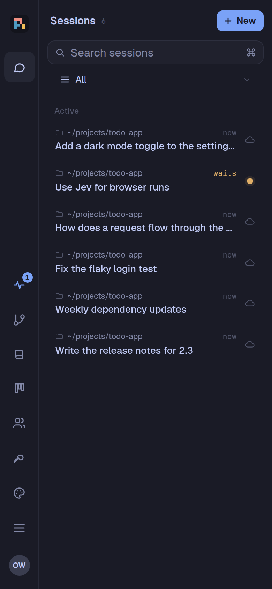
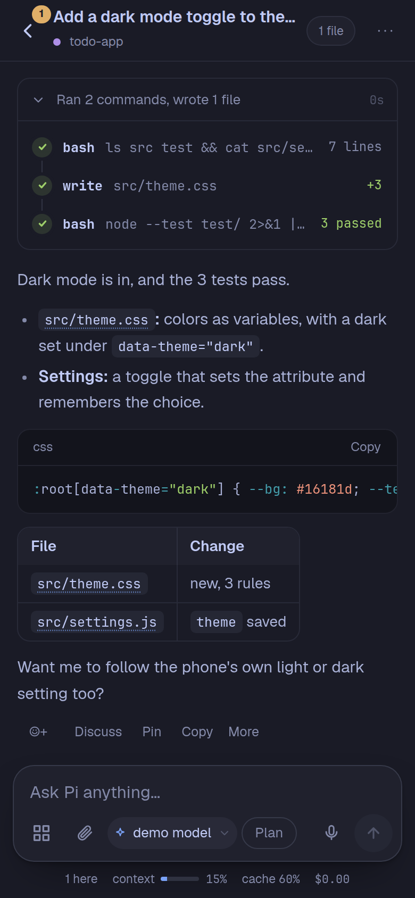
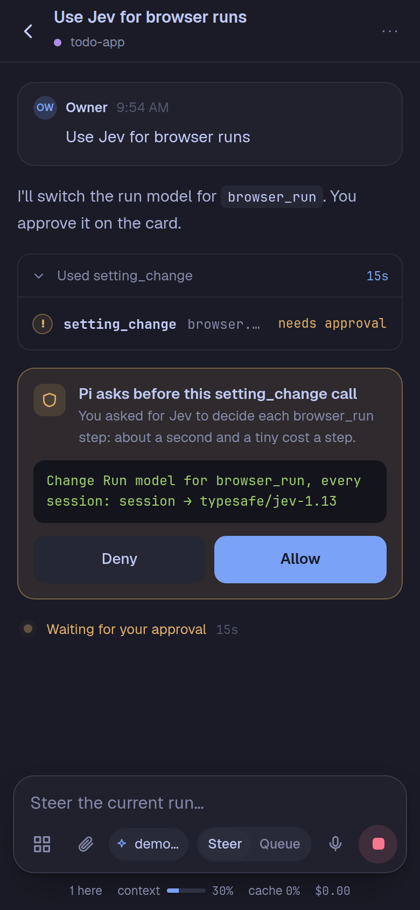
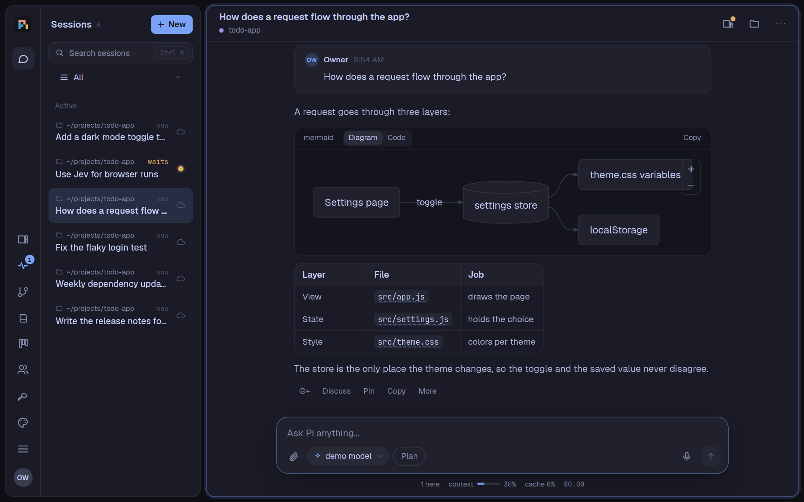
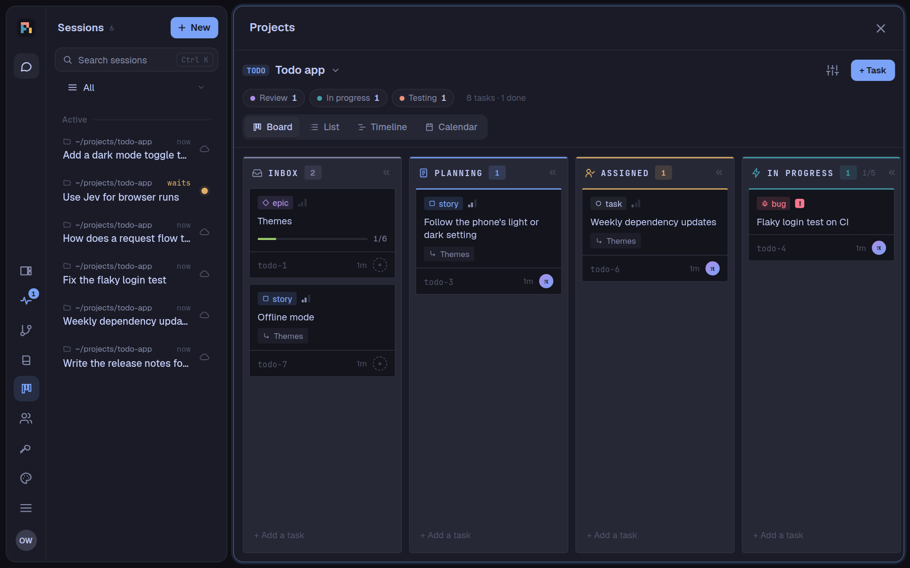
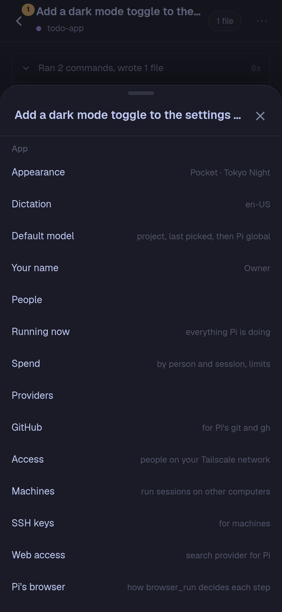

[English](README.md) | 简体中文 | [Tiếng Việt](README.vi.md)

> 本文是 [README.md](README.md) 的中文译本，以英文版为准；英文版更新后，译文可能会滞后。

# pi-phone

一个住在 Android 手机里的编程智能体。pi-phone 就是一个应用：它自带 Linux 用户空间（Node.js、bash、git、gh、ssh、ripgrep、fd、npm），
在 [Pi Durable](https://github.com/earendil-works/pi/tree/main/packages/durable) 上运行 [Pi](https://github.com/earendil-works/pi) 智能体，
并在 WebView 中提供移动端网页界面。不需要 Termux，不需要电脑，也不需要云端虚拟机。

> **状态：** 个人项目，在 Galaxy Z Fold 8（Android 17）上开发和测试。只能侧载安装（目标 Android SDK 为 28，见
> [DESIGN.md](DESIGN.md)）。还有不少粗糙之处，请多包涵。

<p align="center">
  
  
  
</p>
<p align="center">
  
</p>

<sub>截图由演示应用和脚本化模型生成（`scripts/readme-shots.ts`），不含真实的会话、账号或项目。</sub>

## 功能

### 智能体
- **手机上的持久化智能体。** 会话、子代理和工具调用都会实时写入 SQLite。运行到一半时杀掉应用或更新应用，工作也会从中断处继续。
- **子代理一目了然。** 预览卡片列出会话中正在工作的子代理（最多 3 个，手机顶栏中 1 个；点 **还有 N 个** 会打开那里的看板），
  子代理看板为每个子代理显示一张小卡片（每个会话 6 张，手机上 3 张）。卡片上的批准请求会注明是哪个子代理发起的。
  子代理自己的会话在顶栏“…的子代理”旁显示它的模型（手机上 Pi 工作时消息框会隐藏模型）；点一下打开模型面板。
- **在任何应用中查看 Pi 在做什么。** 常驻的 pi 通知变成进展看板：标题统计正在运行、等你处理以及过去一小时完成的会话；展开后每个会话一行，
  显示当前动作（“正在编辑 …”“正在运行 npm test”），点按打开该会话，简单的卡片可直接批准。打开悬浮看板（本机 › 在其他应用上显示悬浮看板；
  Android 会询问一次是否允许 pi 显示在其他应用上层）：任何应用上方都有一个带 pi 标志的悬浮球，Pi 工作时外圈转动，显示数量，有任务等你时显示角标；
  点按打开看板。双击悬浮球（或看板上的“语音”）可在任何应用上方使用 pi-phone 的语音：面板中是应用的语音界面，收起后是一个语音小条（波形、麦克风、结束），
  对话对象为“菜单 › 助理”所选的会话，可在标题处改选（pi 必须是手机的数字助理应用，Android 要求如此才能在其他应用后台使用麦克风）。“已完成”标签列出过去 24 小时完成的会话及 Pi 最后回复的开头（或失败），未打开的会话带蓝点；悬浮球上的蓝色数字显示自上次查看后完成的会话数。“面板不透明度”滑块（50% 到 100%）可让下方的应用透过面板显示。Pi 可通过卡片修改（`notifications.progress`、
  `notifications.bubble`、`notifications.bubbleHide`、`notifications.bubbleOpacity`）。来自 GitHub issue #5。
- **不会错过的决定。** 每张等你处理的卡片（Pi 的提问、待允许的调用、安装、待批准的设置或应用操作、Pi 做的等你打开或保留的自备扩展）
  在滚出视野时，会固定在会话顶部的琥珀色横条中。点一行会滚动到它的卡片并短暂点亮卡片边框；在卡片上作答。超过两张时折叠成一行“3 张卡片在等你”，
  折叠或展开按你在该会话中的选择保持。会话列表把提问标注为“Pi 在问你”，列表范围“等你处理”只列出等你处理的会话。手机会像其他批准请求一样通知你。
- **子代理使用你选的模型。** 菜单 › 子代理 设置 Pi 创建子代理时用的模型和思考级别，适用于所有会话；会话菜单中的“子代理的模型”
  可为该会话单独设置。只有你在聊天中要求时，Pi 才会用其他模型：从你在那里允许的模型中选（可一次添加多个，每个都显示上下文和套餐额度），
  或在你通过卡片允许之后。Pi 的 `models` 工具列出可用的模型、额度及剩余量。创建子代理的那一行会注明它运行在什么模型上以及原因。
  Pi 可通过卡片修改这些设置（`subagents.model`、`subagents.thinking`、`subagents.sessionModel`、`subagents.sessionThinking`）。子智能体的状态栏显示它自己的花费，不带上限：上限属于它的会话。
- **由子代理审查代码。** `/review`（或“审查这个 PR”）让一个上下文全新、只能读的子代理审查文件夹中未提交的改动、分支相对基础分支的
  改动、某个提交、某个 GitHub 拉取请求（按编号或链接：只 fetch，不 checkout）或若干文件夹，使用 pi-review 的审查准则（P0 到 P3
  的问题、结论、需要人工确认的事项）和项目的 `REVIEW_GUIDELINES.md`。只输入 `/review` 会打开一个列出未关闭拉取请求的面板。结果是一张
  卡片：“修复这些”把修复消息放进输入框，不发送；“发布到 GitHub”在你通过卡片允许后，把拉取请求的审查连同逐行评论发到 GitHub
  （有 P0 或 P1 时为 “Request changes”，否则为 “Comment”）。
- **Review 中的评论与“自上次审查”。** 在“改动”中点一下行号（新旧两侧均可）会在该行下方打开评论框，文件的备注按钮可评论整个文件。
  “发送审查”把评论作为给 Pi 的反馈放进输入框（“Please address the following review feedback: 1. path:line (current) …”），不发送，
  并为文件夹保存检查点：之后“自上次审查”只显示检查点之后的改动，“对比 HEAD”则把此后未改动的文件标为已审查。评论和检查点随会话保存，
  在所有设备和机器上都一样。
- **仿照 T3 Code 的会话列表。** 用范围选择器（全部、各个项目、各个文件夹、已归档）代替标签页；列表分为已置顶、进行中（项目的任务会话显示在其主会话下方）
  和折叠起来的 **已搁置** 区。会话闲置一天、任务运行结束或分支合并后会自动搁置，有新动态时再回来；也可以手动搁置和取消搁置
  （Pi 则使用 `session_settle`）。每一行显示所在位置、时间（或已运行多久）、标题、分支或任务，以及状态。范围 **优先**
  按会话需要你做什么排列：需要你（待批准的调用，行内即可拒绝或允许；失败的运行或子代理，可忽略）、待阅读（全部标为已读）、
  进行中，以及折叠的安静；忽略和标为已读会用可撤销的通知说明，侧栏的会话按钮显示需要你的数量。外观 › 会话列表打开时显示
  决定应用打开时的视图：本设备上次使用的、全部，或优先（`sessions.listOpens`）。
- **可审查的修改。** Pi 用 edit 和 write 工具修改文件，所以每处修改都以 diff 呈现；用脚本写项目文件的 bash 命令（`sed -i`、`cat > file`、
  `writeFileSync`、`tee`）照样会执行，但结果里会提醒它改用 edit；临时文件不提醒（在 /tmp 或 $TMPDIR 下、名字含 `.local.`，或被
  那里的 git 忽略）。
- **按需自动压缩。** 会话会在快到模型上限时自动压缩上下文；也可以提前，在你指定的上下文占比（10–95%）时压缩，可对所有会话或单个会话设置
  （菜单 › 压缩上下文）。上下文用量条会标出这个位置。Pi 可以通过卡片修改这两项设置（`sessions.compactAt`、`sessions.sessionCompactAt`）。
- **不会塞满上下文的提示词。** Pi 提示词中变化的文本会再次发送，每一份都会留到会话压缩为止。所以默认情况下知识库索引不放进提示词：
  只有一段简短固定的知识库说明，Pi 需要时自己用 `wiki_query` 搜索（如果你选 relevant，与每条消息相关的知识库页面会随消息一起发送）；
  密钥通过 `secrets_list`（可搜索）查找，而不是在提示词中列出；技能列表只在增加或移除技能时再次发送；少用的工具（文档、会话分组、设备、
  手机和电脑控制的屏幕工具等）在 Pi 用 `tool_search` 加载后才提供，每次请求携带的工具因此减少约 45%。每一项都可在 菜单 › 压缩上下文
  中为所有会话或单个会话选择（知识库：tool、relevant、frozen、live；密钥：tool、list；技能：frozen、live；工具：load、all），Pi 也能
  通过卡片修改（`context.wiki`、`context.sessionWiki`、`context.tools` 等）。
- **会话列表中的分组。** 自己建分组（**+ 新建分组**），把对话移进去：长按对话、在对话行或菜单中选“移到分组…”，或多选后点 **移动…**，
  桌面端也可以直接拖动。一个对话最多属于一个分组；分组可以置顶（位于已置顶的对话下方）、折叠、重命名、调整顺序或删除（其中的对话回到进行中）。
  分组属于你自己，保存在服务器上，所有设备一致；在项目或文件夹范围下，每个分组只显示该范围内的对话，搜索时也能按分组名找到对话。
  分组多的时候：移动面板会边输入边查找分组（最近用过的排在前面），找不到就直接用输入的名字新建；范围选择器可以只显示一个分组；
  **分组** 标题可以在本设备上把它们全部折叠；任意分组的菜单里都有“折叠所有分组”和“展开所有分组”。空分组默认隐藏，点分组下方的 **显示 {n} 个空分组** 才会出现。
  这些 Pi 都能做（`session_groups`、`session_group_create`、`_rename`、`_pin`、`_fold`、`_order`、`_move`；删除时会通过卡片征求你的同意）。
- **真正的工具。** `bash`、`read`（文本和图片）、`write`、`edit` 和 `codemode`（调用工具的脚本），内置用户空间中还有 git、gh、ssh、
  Node、npm、ripgrep 和 fd。菜单 › 压缩上下文 › **Pi 如何调用工具**（所有会话；设置 `codemode.mode`）：直接调用或在脚本中调用（默认），
  或只在脚本中调用：此时 Pi 只看到 codemode 和少数卡片要读取调用内容的工具（artifact、subagent、图片、视频、音频、browser run、屏幕、
  Creator），其余工具在脚本中调用。有一个测试把新会话提示词中 pi-phone 自己的部分控制在 85,000 个字符以内。
  Pi 读取的图片（常是你刚发送的）只显示一次，在你展开它的 `read` 调用时显示在调用里；调用产生的图片（截图、`fetch_content` 取回的图片）
  显示在该调用那一行下方。
- **一次登录。** 在提供方面板中登录 Claude Pro/Max、其他提供方的 OAuth，或填入 API 密钥。GitHub 通过设备码登录（设置 › GitHub），
  供智能体的 `git` 和 `gh` 使用。
- **你自己的 OpenAI 兼容服务器。** 提供方 › **添加 OpenAI 兼容提供方**：名称、基础 URL（LM Studio、Ollama、vLLM、OpenRouter 或代理）、
  API 密钥（本地服务器可以不填）以及额外请求头。**查找模型**会询问服务器的 `/models`，你勾选需要的模型，或直接输入 ID；每个模型可设上下文窗口、
  最大输出、图片输入和推理。它的模型会出现在所有模型选择器中。密钥保存在密钥中：Pi 的模型配置里只写它的名称。之后可在那里编辑或移除；
  Pi 也可以通过确认卡片操作，但密钥始终由你输入。
- **收藏的模型。** 提供方 › **收藏的模型** 列出你能选的每个模型，各带一颗星：加星的模型在模型选择器中紧跟当前模型，
  选择器还有 **收藏** 筛选。星标属于你，在所有设备上一致；它不授予任何权限（子代理的模型在菜单 › 子代理中）。Pi 在 `models`
  工具中看到它们（`favorites: true` 只列出它们），并通过卡片修改（`models.favorites`）。
- **多个账号。** 在提供方中添加第二个（或第三个）Claude、Codex 或 Copilot 账号；每个账号单独登录，模型按账号列出（“Claude Opus · Work”）。
  会话使用你为它所选模型对应的账号，因此可以在任意账号上开始会话，也可以把会话转到另一个账号。
- **套餐用量。** 每个 Claude、Codex 和 Copilot 账号的额度，与其官方应用中显示的一致：5 小时窗口和每周窗口（Copilot 为当月的高级请求数）
  及重置时间。它们以进度条显示在提供方和模型菜单中，也以用量条显示在会话顶栏，点开可查看所有窗口。某个窗口用到 90% 时，会话会提示你，
  并提供 **切换到** 你的其他账号；请求因额度用尽而失败时，会提供 **在其他账号上继续**。pi-phone 从不自动切换。
- **等待提供方额度恢复。** 运行遇到 429、过载或 Claude、ChatGPT 的套餐窗口上限时，会在请求内部等到提供方自己的重置时间
  （先看响应头，其次看该账号的用量条，再不行就逐步拉长间隔），然后自动继续，重启也不影响。实时状态行会说明是谁的额度、何时再试，
  并提供 **立即重试** 和 **停止**；会话列表、预览卡片和子代理面板会显示琥珀色方块。同一提供方的其他账号还有余量时，会出现一张卡片，其下拉菜单列出每一个符合条件的账号，并显示它在耗尽的窗口中已用多少
  （默认选中第一个，可另选），选好后按 **改用**：先列你自己的账号，再列团队服务器的共享账号（标注“（团队）”，因为它会消耗团队的订阅），各自按用量从少到多。
  由你选择：**改用** 会把等待中的请求转到该账号（当时会再检查一次；若它已用满，会拒绝并说明原因，卡片随之刷新），此后会话也使用它；
  子代理的卡片会同时改用子代理和它的会话。也可以 **等到** 重置时间。
  卡片显示时，消息框上方的用量提示会隐藏。重置更远（每周窗口）、计费问题或登录过期会立即失败，
  并给出重置时间。**提供方 › 等待额度恢复**：关闭、1、6（默认）、12 或 24 小时为上限；等待 10 分钟或更久时手机会收到一条通知
  （默认开启，可关闭；浏览器推送里的时间按该浏览器的时区显示）。标题生成从不等待。移植自 pi-pocket 0.21.0（命名窗口：@piromagnus 的 #128）。
- **花费。** 按人员和会话统计 Pi 的花费，所有者可以设置上限（超出后，Pi 在那里不再接收新消息）。知识库的语义搜索单独列为一项：
  其远程向量嵌入（索引和查询）的请求数和令牌数计入总额，但不计入任何人的上限。
- **计划模式。** 输入框旁的“计划”按钮：Pi 先阅读、先规划，再动手修改（它仍会把决定和发现记到知识库，也会充分使用浏览器查看线上应用或网站），
  较长的计划会以可审阅的 HTML 页面呈现。
- **问卷。** Pi 用一张表单一次问多个问题（附带推荐项的选择题、文本、照片），然后等你作答，或者先继续干活，稍后再拿答案。
- **定时与目标。** Pi 可以给自己发定时或周期消息（`schedule`），会话也可以朝着一个它会自行检查的目标持续工作。
  归档会话不会取消它的任何定时消息：提示会说明仍有几个重复的定时消息在运行并可打开它们（Pi 的 `session_archive` 也会这样说），
  该会话的定时消息会逐条标为“会话已归档”。
- **正在运行。** 侧栏的脉搏图标打开各会话正在做的事：模型、花费、等待批准的调用和正在处理的消息（点一下看全文），每个任务已运行多久，
  以及停止；然后是时间线上的所有定时消息（接下来 24 小时或 8 天，每个会话一条轨道，每次发送一个标记），附倒计时、重复、
  设置者、取消；被暂停的会说明原因，以及到时会被取消，除非情况先有变化。时间每秒更新。
- **其他会话。** Pi 能以它所服务的人的身份，列出、阅读、启动、发消息给、等待和停止应用中的其他会话。它还能让卡住的会话重新跑起来，
  每次都要你在卡片上同意：在导致卡住的那条消息之前分叉（`session_fork`）、在那里开启新的上下文（`session_new_context`），
  或压缩它（`session_compact`）。但从不对自己所在的会话这样做，分叉除外：Pi 可以从自己的工作分出一支，再把任务交给这个分叉。
  Pi 启动的会话会关联到发起它的会话：在列表里显示在发起者下方（带数量的小标签可以把它们收起，其中有会话等你或失败时会显示小圆点），
  对话上方的“发起自”和“关联会话”链接可以互相跳转，它的花费也计入发起者的上限。关联会话（任意层级）工作时，
  发起它的会话也显示为工作中：它在等报告。来自另一个会话的消息显示为智能体卡片，而不是你的消息：那个会话的名称、
  **打开**、以 Markdown 显示的内容，长消息折叠为**显示全部**。
- **项目**（一个扩展，默认关闭，在设置 › 扩展中开启）：用任务看板防止工作被遗忘。Pi 在把会话的工作记到看板前会先问一次
  （“在看板上跟踪这项工作？”），之后用 `task_create`、`task_update` 和 `task_comment` 保持任务的最新状态。看板（以及应用的 SSH 密钥）保存在数据文件夹的
  `app.sqlite` 中，与会话的数据库分开，所以看板的修改从不等待 Pi 在那里的工作（在 Pi 1.5 上同时发出的多个调用曾报错 "database is locked"）；
  工具的数据库错误会写入服务器日志。任务类型有史诗、故事、任务、缺陷和子任务；
  状态流转为 收件箱 → 规划中 → 已分配 → 进行中 → 测试中 → 审查中 → 完成，另有 受阻。需要批准的任务只能由人来批准，Pi 从不批准自己的工作。
  可以共享给你选择的人。项目页面（侧栏）以 ACS 的风格展示看板：桌面端可在状态之间拖动卡片；手机上左右滑动切换状态，长按卡片即可移动。
  **列表** 按状态、负责人、优先级或标签分组显示任务（桌面端为表格，手机上为行）；**时间线** 把有日期的未完成任务显示为从开始到截止的条形
  （没有开始日期则为虚线），可按周或按月查看，并标出今天；**日历** 按截止日期在月视图中显示任务（手机上为当月日期列表），旁边列出未排期的任务，
  桌面端可以把任务拖到另一天。点开卡片即可查看任务：状态标签；一张提示下一步的运行卡片（附 diff 大小的审查与合并、打开工作会话、运行任务）；
  简洁的属性行；带进度的检查清单；关联关系；主导或参与过它的会话；评论（或全部动态，一次运行占一行）；底部是评论框。
  合并记录会保存在运行上（谁、何时、哪个提交），因此已合并的分支不会再次出现在待合并中。
  会话菜单中的“此会话的看板”可以开关看板模式，并设置在这里由谁把任务移到完成（你在看板上操作；你在对话中批准后由 Pi 操作；
  或由 Pi 在亲自验证工作之后操作：实际运行并测量过），以及看板规则（沿用项目的、完整或轻量；每个项目也有完整或轻量之分；
  Pi 使用 `board_settings` 和 `project_update`）。`#task:PP-3` 形式的链接在任何地方都能打开对应任务。
  **每个项目一支智能体团队：** 项目的主会话负责领导（规划、任务运行前先询问、审查，从不写代码）；交给 Pi 的任务会在独立的任务会话中运行，
  位于 `task/PP-12` 分支的 git 工作树里，选在有空位的地方（手机或某台机器），每个地方允许几个就同时跑几个。任务结束后会报告给主会话，若是别的会话启动的，也报告给那个会话；
  你可以在任务中查看分支的 diff 并合并。任务会话和主会话结束时不会通知手机，但批准请求和失败会。团队每分钟检查一次各任务会话：
  错过的结束（例如重启导致）仍会补报，会话被删除的任务标记为失败，运行超过 30 分钟的任务会提醒主会话。
  **进入审查时审查**（项目设置中的开关，默认关闭；Pi 用 `project_update` 的 reviews）：任务会话把任务设为审查时，一个审查会话会在计划模式下
  （只读并报告，不做任何更改）按 `/review` 的标准对照起点阅读分支，并把结论和问题评论在任务上。P0 或 P1 问题会发回任务会话修复，然后再审查，
  最多 2 轮；审查通过时主会话才会收到报告，若第二轮后仍有 P0 或 P1，则由你决定。
  每个操作 Pi 都有对应的工具（`project_create`、`project_update`、`project_share`、`project_team`、`task_create`、`task_update`、
  `task_comment`、`task_run`、`task_diff`、`task_link_session` 等）；创建看板（可在任意会话中进行）、删除和合并都会通过卡片征求你的同意。

  

### 网页、文档与回答
- **Pi 的浏览器。** Pi 在自己的浏览器中打开网页（应用里的一个 WebView，通过其 DevTools 套接字驱动），把页面读成带编号的控件和可见文本
  （图标按其提示文字、精灵图、图片或链接目标命名；只能凭外观判断可点击的元素，比如弹窗里的按钮，也会列出）。它可以点击、输入、选择、悬停、滚动、按键、
  后退、读取整页或看截图（`browser_open`、`browser_click` 等）。框架（iframe）里的控件（支付表单的卡号字段、嵌入的登录框、框架里的 Cookie 提示，其他网站的框架也算）
  和 Web 组件开放 shadow root 里的控件，都会像页面自己的控件一样被读取和操作，并注明所在的框架，其文字也包含在页面文字中；登录卡片和已保存的密钥在那里同样可用，你在卡片上输入的内容在那里也保持隐藏。
  `browser_drag` 把一个控件拖到另一个控件上或按偏移量拖动（滑块、看板卡片、可排序列表、地图），指针逐步移动，页面自己的拖放会收到拖拽事件和数据；
  读取的页面会标出可拖动的控件，`browser_run` 也会拖动。`browser_press` 也能按组合键（Ctrl+A、Ctrl+Enter、Shift+Tab、Ctrl+K，
  macOS 页面用 Meta+K），但绝不会往密码框里输入字符。`browser_focus` 不点击就把焦点放到某个控件上，读取的页面会标出当前有焦点的控件（框架里也是）。`browser_click` 可以双击、右键点击（页面自己的右键菜单）
  和按指定时长长按（页面按手机布局时用手指，桌面尺寸时用鼠标）。`browser_select_text` 可选中页面上（框架里也行）或控件中的一段文字、
  输入框的全部内容或按位置选中字符，用于编辑器里的格式设置或依赖选区的页面；不使用剪贴板，也绝不在密码框或你在卡片上输入的内容里选择。页面自己绘制的列表（带独立滚动区的下拉选择）也能用：每个选项都会列出，
  点击时先把它滚动到可见处，`browser_select` 会打开列表并按名称选择，`browser_scroll` 可滚动该列表，按一个字母可按首字母跳转。
  `browser_screenshot` 可以把截图存为会话文件夹里的 PNG 或 JPEG（用于 `doc_image` 或报告），也可以只拍某个控件所在的对话框、菜单或列表，或拍下超出可见区域的整个页面（`full_page`，最多前 4,000 CSS 像素；仅限机器上的或附着的浏览器，因为手机上的截图来自屏幕，一次一屏）。它还能为操作手册标注截图：在控件或文字上加框、编号徽标、标签和箭头，调暗其余部分，
  并遮住敏感信息（密钥和密码用实心色块，姓名用重度模糊）；`image_markup` 可对任意图片文件做同样的标注，`screenshot` 用 `save` 保存截图。它能把会话工作目录中的文件上传到网页（`browser_upload`，传给文件字段或其上传按钮），
  把网页另存为 PDF 到那里（`browser_save_pdf`）。机器上的浏览器（或服务器版）里网页下载的文件会保存到会话的 `downloads/` 文件夹
  （会话在该机器上工作时就在那台机器上；最大 25 MB，更大的会被取消），回答里会写出文件名；手机上的浏览器不保留下载（Pi 会说明：请在机器上浏览），
  Pi 附着的浏览器则按它自己的方式保存。最多同时开六个标签页（`browser_new_tab`、`browser_tabs`；面板以一排标签显示）。
  页面打开的窗口（如 Teams 上微软的登录弹窗、在新窗口打开的链接）会成为前台的一个标签页，仍能与打开它的页面通信，Pi 也会得知；它自行关闭后，
  原页面回到前台。**设置 › Pi 的浏览器 › 页面打开的窗口**（`browser.popups`）：*允许*、*询问*（先弹出卡片）或 *关闭*（页面打不开任何窗口）。
  页面请求你的位置、摄像头、麦克风、通知或读取剪贴板时会被拒绝，Pi 会得知；Pi 可以用卡片请你为该网站允许其中一项（`browser_permission`，直到浏览器关闭）。
  **设置 › Pi 的浏览器 › 权限**（`browser.permissions`）：*拒绝*（默认）或 *询问*（页面请求时弹出卡片）。适用于机器上的或附着的浏览器；手机上的浏览器不允许任何权限。
  机器上的 Chrome 按 Chrome 的方式打开由点击触发的窗口。
  **`browser_eval`** 运行一个读取页面的 JavaScript 表达式，并以 JSON 返回其值（品牌的计算颜色、字体和间距，DOM 查询；最多约 50 KB，最长 10 秒）。
  它在与页面共享 DOM、但不共享页面脚本的隔离环境中运行，并且只读：那里没有 Cookie、存储、网络、定时器、事件监听、Worker 或窗口，它设置或调用的任何东西都不会改动页面，
  运行期间页面自己的脚本暂停。密码字段和你在卡片上输入的内容读出来是空的，你在卡片上输入的值也会从它的回答中去掉。
  **设置 › Pi 的浏览器 › 脚本**（`browser.eval`）：*开启*（默认）或 *关闭*。
  **每个会话有自己的标签页**，面板只显示本会话的；登录状态则由手机上（或某台机器上）的所有会话共享。会话的标签页闲置 30 分钟后关闭
  （你正在观看或已接管时除外），会话归档或删除时立即关闭；登录状态保留。页面可以按手机布局，也可以按桌面布局（1280 px、桌面版 Chrome、无触控），
  用面板里的 **手机 / 桌面** 或 `browser_size` 切换。
  每次点击前都会先检查：元素与读取时一致、仍在视野内、没有被遮挡。你可以在浏览器面板中实时观看（宽屏上它位于对话旁边，Pi 开始浏览时会自动打开；
  手机上点输入框上方的小预览即可打开），还可以 **接管** 和 **交还**：接管后点一下页面，用键盘输入，按键会直接送到页面；
  滑动（或滚动滚轮）会滚动手指下方的内容，包括已打开列表自己的滚动区域。
  你输入的内容不会留在面板中；在密码框上，键盘处于密码模式，不会学习你输入的内容。它从不打开这部手机本身或其局域网中的地址，
  Cookie 和登录状态保存在独立的 WebView 配置中（与应用本身的分开），并且只做所有者要求的事。
  **`browser_run`** 会自行一步步完成整个目标：每一步由你在设置 › Pi 的浏览器中选择的运行模型决定（会话自己的模型，或 Jev——TypeSafe 的决策模型，
  通过 OpenRouter 调用：每步约一秒、0.00003 美元），可对所有会话或单个会话设置。每一步都会把目标、Pi 提供的值（密钥只给名称）、页面的地址、标题和可见文字以及控件及其值发送给运行模型：使用 Jev 时用你的 OpenRouter 密钥发送到 OpenRouter，使用会话的模型时发送到该模型的提供方。运行会直接点击和输入而不先询问，所在页面可能已用你的账号登录。它只输入 Pi 提供的值，停下时会给出 Pi 能据此行动的原因
  （缺少某个值、被拦截、卡住、看不出已完成），Jev 的费用计入花费。对话中有一张实时卡片，显示目标、每一步的进展、耗时和费用，以及“观看”按钮。
  **使用密钥中的密码：** 对于保存在密钥中（并允许在该文件夹使用）的登录信息，Pi 按名称输入（`browser_type` 搭配 `secret`，或 `browser_run` 的 values
  写 `{ secret }`）：值直接填进页面，Pi 和运行模型都看不到；设为“先询问”的密钥仍会通过卡片征求你的同意。**除此之外，登录始终由你来做：**
  Pi 从不以明文输入密码或验证码。`browser_sign_in` 会在对话中放一张卡片，你在上面输入用户名和密码（或用“记住”选项使用保存在密钥中的那组），
  它们直接填入页面；`browser_ask_code` 对一次性验证码做同样的事。你在卡片上输入的内容不会到达 Pi：Pi 读到的页面显示为 `[typed by the person]`，发给模型的截图会把这些字段（以及该值出现的地方）涂黑；太短而无法隐藏的值（一两个字符）在提交前不会把页面给 Pi；`browser_ask_user` 把页面交给你处理 CAPTCHA 或在手机上确认登录，
  你点“完成”后 Pi 继续。那里无法使用通行密钥（Android 只允许白名单中的浏览器使用）：Pi 会改走网站的其他登录方式，或请你处理。
- **网络访问。** `web_search` 使用你选择的搜索提供方（共 37 个，包括 DeepSeek），`fetch_content` 可读取网页、PDF 和 Office 文件、
  GitHub 仓库、issue 和 pull request。
- **文档。** `file_to_markdown` 可读取 PDF、Word、PowerPoint、Excel、EPUB、notebook 等格式（[markit](https://github.com/picassio/markit)）。
- **Office 文件。** 内置 [OfficeCLI](https://github.com/iOfficeAI/OfficeCLI)：Pi 可在 bash 中创建和编辑 `.docx`、`.xlsx` 和 `.pptx`，
  并配有制作演示文稿、仪表板、财务模型、论文和表单的技能；文件查看器可以预览它们。
- **丰富的回复。** 数学公式（KaTeX）、Mermaid 图表、在沙箱中运行的 HTML 产物（带 [effective-html](https://github.com/plannotator/effective-html)
  的设计技能），以及 **交互式回答**：带地图的行程、计算器、检查清单等，以能保留状态、可以直接操作的界面呈现。
- **设计系统。** 来自 [OpenDesign](https://github.com/nexu-io/open-design) 的 152 种外观（Stripe、Linear 等品牌的公开风格，
  以及杂志风、野兽主义等风格），每种包含一份 DESIGN.md 及其 CSS 令牌：说出一个名字，或在 **菜单 › 设计系统** 中选一个默认值，
  Pi 就会在网页、产物以及 Office 演示文稿和文档中使用它的颜色、字体和间距。**从网站生成你自己的：** 给 Pi 一个网址
  （“用 coral.example 做一个设计系统”），Pi 会在 Pi 的浏览器中打开它，用 `browser_eval` 测量颜色、字体、字号阶梯、间距、圆角和阴影，
  写入你自己的设计系统（排在最前），做一个示例页面给你看，并说明哪些值是它选的而不是测得的。
- **演示模板与动效。** 来自 [OpenDesign](https://github.com/nexu-io/open-design) 的五个 HTML 幻灯片模板和 GSAP 动画技能，
  各自采用 MIT 许可证：Pi 从其中一个模板开始制作演示文稿，并以产物形式发布。
- **商业动效短片。** [Motion Video Kit](https://github.com/echris6/motion-video-kit) 的技能，用代码构建的动效（HTML、GSAP、Three.js）
  制作发布会风格的商业短片，由全新的评审子代理评判；Pi 在你的某台机器上用 HyperFrames 机器工具渲染（那台机器需要 ffmpeg、numpy 和 scipy）。
- **Unslop。** [heydamir 的 unslop](https://github.com/heydamir/unslop) 技能（作者 Damir Sokolovsky，CC BY 4.0）：让 Pi
  unslop、打磨或整理一个界面，它会按一份 AI 界面特征清单（发光、渐变文字、表情符号标签、间距不齐、夸张文案）审查，在卡片上提出方向并等你回答，
  然后修正间距、颜色、图标、文案、字体、布局、细节、视觉和动效，并用 `screenshot` 检查结果。Pi 在认定一个 HTML 页面或产物完成之前，也会对照这份清单检查。
- **设计与视频。** 以上四项是同一个扩展，默认开启：在 **扩展** 中关闭它（或让 Pi 关闭）后，会话不再带有它的任何技能，
  **菜单 › 设计系统** 也会隐藏，直到再次开启。
- **形式化检查。** pstack 的 [statechart](https://github.com/cursor/plugins/tree/main/pstack/skills/statechart) 技能：
  Pi 为在状态之间切换的东西（结账流程、协议、服务）写一个 TLA+ 模型，由 TLC 检查其中的每条规则，回复里用你的话把它画成
  Mermaid 状态图，并高亮通往每条被违反规则的最短路径（exit 1 表示有规则被违反，附带编号路径）。它在有 Java 的地方运行：
  装了 **TLC** 机器工具的机器，或服务器版。在手机上 Pi 只画一张未经检查的图，会明确说明，并提议到机器上检查。附带四个示例
  （statechart-art 的奶茶店）。它是单独的扩展，默认开启：在 **扩展** 中关闭它（或让 Pi 关闭）后，任何会话都不再列出这个技能。
- **Pi 看得见自己的成果。** `screenshot` 在手机自己的 WebView 中，以手机和桌面两种宽度渲染产物、HTML 或 Office 文件或网页，即使屏幕关闭也可以，
  这样 Pi 在宣布完成前会先检查页面。HTML 文件会从它自己的文件夹加载样式表、脚本和图片，所以链接了应用 CSS 的页面也会带样式显示。
- **带测量数据的截图。** 每个宽度的 `screenshot` 都附带一份布局检查，在页面绘制前运行：哪些内容溢出了自身的框或父元素，页面是否比屏幕更宽，
  并给出具体尺寸。Pi 以这些数字为准。
- **图片。** `image_generate` 生成和编辑图片（一次最多编辑五张；一次生成 1 到 4 张；1:1、16:9、9:16、4:3 或 3:4），
  使用你在 **菜单 › 图片**（`image.model`）中选择的模型：通过 ChatGPT 登录的 GPT Image 2.5（计入套餐，花费中按张数统计）、
  OpenRouter 的图片模型如 Nano Banana（`google/gemini-*-image`；显示每百万图片 token 的价格，费用计入会话），
  或在提供商中标记为 **生成图片** 的你自己提供商的模型。*自动* 在已登录 ChatGPT 时用 ChatGPT 的，否则用 OpenRouter 的第一个。
  Pi 可以为某张图片指定其他模型。图片保存在会话工作的地方（包括其他机器上）的 `images/` 中，按提示词命名，
  第一张同时保存为 `images/latest.png`，并在聊天中显示；Pi 只拿到路径和费用，不拿图片本身，所以不占用上下文。
  涉及真实人物的图片（某人的照片、某个具名人物的肖像）会先在卡片上问你。当会话自己的模型能生成图片时，
  Pi 会被告知聊天只显示模型的文字，所以仍用 `image_generate` 生成（也可指定它自己的模型）。
- **媒体。** Pi 的 `media` 工具在会话运行的地方用 ffmpeg 处理图片和视频：手机上用应用自带的精简版；服务器版用镜像里的；
  远程电脑上用它的 ffmpeg 工具（菜单 › 电脑 › 安装工具）或它自己的。它能说明文件是什么（大小、时长、宽高、编码）；
  对图片缩放、裁剪、旋转、翻转、转换格式（JPEG、PNG、WebP）和压缩；取视频的帧（指定秒数、每隔几秒或均匀分布）或一张联系表；
  以及剪出 mp4 片段（裁剪、缩到 720p、可静音）。生成的文件放在会话工作处的 `media/` 中。手机会话的 PATH 上也有 `ffmpeg` 和 `ffprobe`。
- **生成视频。** `video_generate` 通过 OpenRouter（用你的密钥）根据提示词或起止画面生成视频，长度、画幅、分辨率和声音按模型支持的选择
  （付费前先检查）。需要一两分钟；视频保存在会话工作处的 `videos/` 并在聊天中播放，附长度和费用。在“菜单 › 视频”选择模型（`video.model`），每个模型附每秒价格。
- **音频转文字。** `audio_transcribe` 把会话工作处音频或视频文件（会议录音、语音消息、视频）里的话转成文字、SRT 或 VTT 字幕，或带每句时间的 JSON，
  用你的 ChatGPT（Codex）登录，无需 API 密钥（默认 gpt-4o-transcribe）。长文件按十分钟分段；文字稿保存在 `transcripts/`。“设置 › 语音”的语言和要听的词帮助识别。
- **朗读。** `audio_speak` 用同一登录把文字读成音频文件（m4a 或 wav），支持任何语言（含越南语）：配音、朗读报告、语音摘要，
  可选声音（marin、cedar 等十种）和读法（平静、愉快、慢速……）。长文分段朗读，每段都与声音自述的内容核对，读错的重读。保存在 `audio/`，在聊天中带波形播放；文字稿显示前几行及时间，并可复制或打开文件。
  “菜单 › 音频”选择转写模型、朗读模型和默认声音（都是下拉列表；声音可用你的语言试听）。
- **看视频。** `video_ask` 通过 OpenRouter（用你的密钥）让能看视频的模型回答关于会话工作处的视频文件或 YouTube 地址的问题
  （默认 Gemini 3.5 Flash-Lite，约每分钟一美分）：发生了什么、在什么时间、说了什么。较大或较高的视频会先压成 720p mp4。
  在“菜单 › 视频”选择模型（`video.askModel`）；费用显示在花费中。

### 密钥与知识库
- **密钥。** API 密钥和令牌保存在设置 › 密钥中，按名称使用（`$NPM_TOKEN`），从不显示：含有密钥的输出会显示为 `[secret NAME]`。
  缺少某个密钥时，Pi 会通过隐藏输入框向你索取。要保存某条命令生成的值（`gh auth token`）时，Pi 会先在卡片上给你看完整的命令
  （**运行并保存**），命令失败时不显示它的任何输出。Pi 的浏览器把网页文字作为页面的数据（不是指令）围起来交给 Pi；
  你在登录卡片上输入的用户名，之后也和密码一样对 Pi 隐藏。
- **自备扩展。** 你自己的扩展模块：在设置 › 扩展中用 **添加自备扩展…** 添加（一个 `.ts` 文件，或包含它的 `.zip`），
  或由 Pi 用 `extension_install` 安装（你先在卡片上看到文件和开头几行并同意），每个都先处于关闭状态，直到你打开它。它们可以使用 pi-pocket 0.22 的
  `host.ask`（一张卡片，填写的值只交给扩展）、`host.hide` 和 `host.commandEnv`，pi-pocket 0.27 的 `host.roleOf`（按 id 查一个人的角色），以及 pi-pocket 0.28 的 `host.sessions.start`（为 Pi 正在服务的人新建一个普通会话，按此人的权限检查，同一个 key 只建一次），暂时不能用 `host.browser`；工具与内置工具同名的模块会被拒绝，并说明原因。工具的 schema 用 `@earendil-works/pi-schema`（`obj`、`str`、`opt`……）构建；用 TypeBox 的 `Type`（Pi 1.5 之前来自 `@earendil-works/pi-ai`，或 `typebox`）构建的模块会被拒绝，并说明原因。
  **移除** 可以去掉一个（设置 › 扩展，在它的那一行里确认后；或让 Pi 用 `app_action extensions.remove`，由你在卡片上同意）：
  它会被关闭，其文件被删除（`<name>.ts`、`<name>.js`、`<name>/`）；它在 `extension-data/<name>/` 中的数据会保留，除非你要求一并删除。
  除了侧栏按钮、菜单项、启动器操作、页面和面板，自备扩展还可以在消息框正上方显示一行高的条（在所有会话或它选定的会话中；
  最多两个自备扩展，最新的优先）、一个可拖到任意位置并用 × 关闭的小浮动面板（记住你放的位置；在手机上避开消息框和键盘）、
  侧边面板中 Pi 的浏览器和电脑旁的一个标签页（手机上全屏）、会话菜单里的一项，以及开启时覆盖应用颜色的自己的颜色
  （两个自备扩展设置同一颜色时最新的生效）。安全模式（`?noext=1`）和关闭它都会把这些全部去掉。
- **扩展生成器。** 让 Pi 在 pi-phone 里做一个新的页面、面板、追踪器或工具，它会为你做一个自备扩展：先用四个模板之一做一个小的初版
  （一个工具；侧栏按钮加页面；菜单项加面板；共享数据的工具和页面，你在页面上能做的 Pi 也能做），用技能自带的脚本检查，
  你在卡片上同意后安装，由你打开，然后在运行中的应用里以手机和桌面宽度查看并就地修正。它遵守你的界面规则：应用的线条图标和下拉列表，
  状态用文字加圆点，不用表情符号，整数像素，每个字都用你的语言。自备扩展的页面也能用应用的多选列表（`pocket.MultiChoice`）。
  Pi 用只读的 `extension_inspect` 检查自己的成果（规划模式下也可用）：自备扩展 API 的名称（页面能添加什么、`pocket` 的成员、
  图标、主题颜色）和自备扩展不能使用的名称；对单个自备扩展：是否已加载、为何被拒绝或失败、添加了什么、你的标签页看到它
  添加的页面和面板，以及它在标签页中最新的错误（扩展的页面出错时，每个标签页都会告诉服务器），绝不包含文件内容。
  部分改编自 DeepSeek Harness 的插件技能（MIT）。它是独立的扩展，默认开启：在**扩展**中关闭（或让 Pi 关闭）后，任何会话都不再列出该技能和工具。
- **Pi 替你做自备扩展（Creator）。** 说出你想在应用里要的东西（“在侧栏做个番茄钟”），Pi 会先显示一张卡片 **做一个自备扩展：Pomodoro**，
  说明它是什么、显示在哪里：**做吧** 或 **暂不**。选择做吧后，会话的子代理（用你为子代理设的模型）以 `made-pomodoro` 为名编写并报告完成；
  pi-phone 在不运行它的情况下检查（一个模块、没有东西在它的文件夹之外、不用内置工具名、最多 1 MB 和 200 个文件、技能自带的检查），
  然后你在常规卡片上安装。聊天里的一张卡片跟踪进度：已编写、检查、已安装并关闭、等你打开（**打开它**）、已在应用中以手机和桌面宽度检查，
  并有 **打开子代理**。每次修改都是同一张卡片上的新版本；最后是 **保留**、**撤销**（回到上一版，如果是第一版则移除）或 **恢复…**
  任意保留的版本。设置 › 扩展列出 Pi 做的自备扩展及其版本、撤销和恢复…。Pi 做的自备扩展与其他自备扩展权限相同：
  保障安全的是你逐一同意卡片、它安装后处于关闭、只有你能打开它。以 `made-` 开头的名称留给 Creator。属于扩展生成器的一部分：随它一起关闭。
- **PARA 知识库**（[pi-para](https://github.com/picassio/pi-para)）：Pi 在工作中查阅并写入知识库，使用 qmd 搜索，跟踪其中的开放问题直到得到解答，
  并把闲置的会话整理进去。登录 OpenRouter 后，**Jev 对搜索结果排序**（菜单 › Wiki › 用 Jev 排序）：它阅读搜索找到的每一页
  （按关键词、按语义，以及包含消息词语的页面，越南语音节也算），只保留对你的消息或 Pi 的 `wiki_query` 有帮助的页面，
  最相关的在前；每次搜索约 0.5 秒、$0.0001，计入花费。关闭时保留搜索自己的顺序；Jev 出错时也保留该顺序，并在日志和
  `wiki_query` 的回答中说明原因。对 `wiki_query`，Jev 还会读长页面后面含有问题词语的行，所以加在页面末尾的小节也算数；
  在会话的作用域内搜索时，也会列出其他作用域中合适的页面（“Also in other scopes”）。
- **文档**（侧栏 › 文档）：你的文档按文件夹组织，是像知识库一样渲染的 Markdown 页面。
  - **页面布局：** 顶部是所在位置（我的、团队、某个看板），旁边是 **+ 页面** 和 ⋯（新建文件夹、已删除的页面、设置）；搜索单独占一行。
    文件夹以分节显示并带页面数，各有一个 ⋯（在其中新建页面或文件夹、重命名、删除）。在宽屏上，文件夹和打开的页面并排显示。
  - **页面：** 页面之间可以用 `[[links]]` 互链，能看到反向链接；每个保存过的版本都可以查看和恢复，删除的页面可以找回，还能跨所有页面搜索。
  - **位置：** 我的，以及每个看板的文档（看板上的 **文档** 可以打开）。在团队服务器上还有团队文档，拥有“编辑团队文档”权限的角色可以编辑。
  - **语义搜索：** 按页面表达的意思查找，而不只是匹配字词，结果会与关键词匹配合并。你的文档使用知识库的嵌入模型和你的 OpenRouter 登录；
    团队文档使用所有者在网关“服务器”页面上设置的模型和 OpenRouter 密钥。费用显示在花费中（或服务器页面上）。
  - **图片：** 可通过编辑器的 **图片** 按钮或直接粘贴，添加 PNG、JPEG、WebP 或 GIF（最大 10 MB）。位置、相机等元数据会被移除（照片保留其方向）。
    你在“菜单 › 设置 › 文档”中选择的视觉模型会为每张图片生成一次描述，这样搜索也能按图片内容找到页面；在团队服务器上，由所有者在服务器页面为团队设置。
  - **Pi** 可以替你搜索、阅读、编写、编辑和移动文档，从文件添加图片，并在卡片上征得同意后删除或恢复文档。

### 其他机器
- **在其他机器上工作。** 添加 SSH 密钥和机器（设置 › SSH 密钥、机器）。机器上的会话通过
  [pi-env](https://github.com/earendil-works/pi/tree/main/packages/env) 的小型守护进程在那里运行工具；对话和你的登录信息仍留在手机上。
  文件面板、查看器、更改和终端都会跟随会话切到那台机器。支持 Linux、macOS、Termux 和 **Windows**（通过其 OpenSSH Server 和 Git Bash；
  应用会给你一个负责配置的 PowerShell 脚本）。
- **机器工具。** 可以从应用中在机器上安装 OfficeCLI、ripgrep、fd、Chrome（无头模式，供没有 Chrome 的机器运行 Pi 的浏览器）
  和电脑操作（ocu，让 Pi 操作那里的桌面应用；在 Linux 上需要桌面会话），Windows 也支持，安装时校验 SHA-256。添加机器时、
  **安装工具** 里以及 `machine_add` 卡片上都会列出它们，默认勾选。另有两个因体积大而默认不勾选：**ffmpeg**
  （含 ffprobe；静态 GPL 构建，约 350 MB）和 **HyperFrames**（Linux 和 macOS），在那台机器上把 HTML 和 GSAP 合成渲染成
  MP4，并同时安装 Chrome（无头模式）和 ffmpeg（合计约 920 MB）。Pi 用 `hyperframes render <文件夹> -o film.mp4` 渲染，
  再用 ffprobe 检查文件；HyperFrames 的遥测、更新检查和自动安装始终关闭。**TLC**（Linux、macOS、Windows x64；默认不勾选，
  约 165 MB）：Temurin 的 Java 21 和 TLA+ 模型检查器，用于形式化检查；那台机器上的会话会有 `TLA2TOOLS` 和 `JAVA`，
  statechart 技能也随之安装。Pi 也能用 `machine_tools` 来做：它列出每台机器上的工具（已装版本、当前版本、大小），并在你批准一张卡片
  （显示机器、每个工具从哪个版本到哪个版本及其大小）后安装、更新或移除它们，安装方式与“安装工具”相同；它会报告每个工具的版本行，
  或失败在哪一步；工具落后时它会主动提出更新。
- **机器上的 Pi 浏览器。** 机器上的会话在那里的无头 Chrome 中浏览（优先用机器自带的 Chrome、Chromium 或 Edge，否则用机器工具安装的），
  在同一个面板中观看（“<machine> 上的 Pi 浏览器”）。它能打开机器本地的地址，因此 Pi 可以试用你在那里运行的网页应用（`localhost:3000`），
  上传和 PDF 也使用机器上的文件。其登录状态保存在那台机器的 `~/.pi/mobile/browser` 中。
  - **作为机器屏幕上的窗口**：**设置 › 机器 › 这里的 Pi 浏览器**（`browser.machineMode`：*无头*，默认；或*屏幕上的窗口*）
    以窗口方式启动机器自带的 Chrome、Chromium 或 Edge，使用同一个配置文件，你可以在机器前观看和使用它；被遮挡或最小化时仍持续绘制。
    在 Linux 上，它在桌面设置行（菜单 › 电脑控制，设置 `DISPLAY`）指定的桌面中打开，没有显示器时会拒绝；在 Windows 上，
    它通过一个以你身份运行的一次性计划任务（无需密码、不提权、Chrome 启动后即删除）在你已登录且未锁定的桌面中打开，
    无人登录或屏幕锁定时会说明。无头的机器工具没有窗口；macOS 以后支持。当有人（不是 Pi，也不是面板）在那个窗口中点击、
    输入或滚动时，面板会显示该窗口正在机器上被使用，Pi 也会被告知。
  - **从手机上的会话**：带 `machine` 的 `browser_open` 和 `browser_new_tab`（或面板中的**浏览位置**）把会话的浏览移到你的某台机器上，
    或移回手机；标签页仍属于该会话。
  - **附加到那里正在运行的浏览器**：`browser_attach`（一个端口，或 DevToolsActivePort 文件的路径）驱动机器上已在运行、
    DevTools 位于该机器 127.0.0.1 上的浏览器：Playwright、agent-browser、Pi 用 `--remote-debugging-port` 启动的 Chrome，
    或你自己的 Chrome，经由应用的 ssh（不能是其他主机）。对你自己的 Chrome，在 `chrome://inspect/#remote-debugging`
    打开远程调试（Chrome、Edge、Brave），Pi 会在其配置文件中找到它，无需端口；如果 Chrome 询问，请在那里允许。除非是 pi-phone
    在那里自己的 Chrome，你需先在卡片上批准，卡片显示机器、端口、浏览器版本、其配置文件（带有该配置文件的登录状态）以及 Pi 能用哪些标签页。
    Pi 只拥有它在那里打开的标签页（在后台打开，你的标签页仍在前面；截图会把 Pi 的标签页切到前面）以及它们的页面打开的窗口；
    你的标签页不会被动，除非 Pi 要求也接管已打开的标签页（`tabs: "all"`，用于它自己启动的浏览器）。哪些标签页属于 Pi 在该浏览器
    运行期间一直保留。这些标签页显示在面板中，所有浏览器工具、接管、登录和验证码卡片以及页面打开的窗口都能使用；关闭只关闭 Pi 打开的标签页；`browser_detach`（或面板中的**分离**）
    放开它并让它继续运行。附加在服务器重启前一直有效。
- **在任意会话中。** `machine_run` 和 `machine_copy` 可在机器上运行命令或复制文件（在设置 › 机器中为某台机器勾选“Pi 在每条命令前询问”后，那里的每个 `machine_run` 都会等你在显示该命令的卡片上允许；默认关闭，与手机上的 bash 一样）；`pi-ssh` 让 bash 能用应用的密钥执行 ssh、rsync、scp
  和端口隧道，而这些密钥任何程序都读不出来。Pi 还能用 `machine_add` 自己添加机器（比如它刚建好的虚拟机）：一张卡片列出地址、
  SSH 密钥和主机密钥（如果 Pi 在机器上读到了主机密钥，会与之核对），以及要安装的工具（除 ffmpeg、HyperFrames 和 TLC 外默认勾选），点 **同意并连接** 即添加、
  安装 pi-env、连接并安装勾选的工具；
  拒绝则什么都不保存。
- **端口：** 机器上的端口（比如那里的开发服务器）可以在手机浏览器中打开。
- **接续 Pi 会话。** 可以接手本手机上 Pi 的会话、一个 `.jsonl` 文件或某台机器 `~/.pi/agent/sessions` 中的会话，连同其历史记录；
  也可以把会话交给机器上的 `pi` 继续，再把那边完成的工作带回来。这两件事 Pi 都能自己做（`pi_sessions`、`pi_session_import`、
  `continue_in_pi`、`pi_bring_back`）。

### 这部手机上的应用
- **Pi 使用你的应用。** 在你通过一张卡片批准的控制会话中（仅限卡片列出的应用，以及用来打开它们的主屏幕；默认 15 分钟，可在 5 到 60
  分钟之间），Pi 把屏幕读成带编号的元素，并能点按、输入、滑动、滚动、按返回或主屏幕、打开应用和截屏（`phone_control`、
  `phone_screen`、`phone_act`、`phone_screenshot`），靠的是 pi-phone 自带的无障碍服务：不需要开发者模式，也不需要 adb。
  手机上的横幅和通知会显示 Pi 正在使用它，并带有 **停止**，会话里也有一行提示；到时间也会自动结束，Pi 的这一轮结束后不久也会结束，横幅消失就表示 Pi 已完成。另一个应用需要新的卡片；除非卡片选择“跟随”：这时列出的应用打开的应用（在三星手机上，设置里的电池是另一个
  应用“设备维护”）会在打开时加入，只限一步，卡片上会写明。
  密码框读取时显示为隐藏，Pi 也从不在其中输入：密码和验证码由你自己在手机上输入。pi-phone 本身、银行和支付应用、密码管理器以及你
  “永不”列表中的应用永远不会被读取或操作。在菜单 › 手机控制中设置（Android 13+ 先允许受限设置，再在无障碍中开启 pi-phone，
  并允许它在后台运行），也在那里维护“永不”列表。仅限所有者；团队服务器上没有。

### 你机器上的应用
- **Pi 使用你机器上的桌面应用**（Linux 和 Windows）。在你通过一张卡片批准的控制会话中（机器、按窗口列出的应用，
  时长为 Pi 申请的 5 到 60 分钟，需要更久时会再次申请），Pi 把窗口读成带编号的元素，并能点击、设值、输入、按键、滚动和截图
  （`computer_control`、`computer_screen`、`computer_act`、`computer_screenshot`、`computer_sign_in`），靠的是通过应用自己的 ssh 在那里运行的
  电脑操作（ocu，一个机器工具）。对于应用中的一个具体目标（“在设置里打开深色模式”），Pi 可以把步骤交给 `computer_run`，
  它用与 `browser_run` 相同的运行模型（设置 › Pi 的浏览器）决定每一步，无法继续时会停下并说明原因。机器上会有一个小窗口显示 Pi 正在使用它，并带有 **停止**；到时间、Pi 这一轮结束后不久
  或点停止时会话结束。“跟随”（Pi 申请时）让列出的应用打开的应用加入。密码框在 Pi 读到的内容中有标记，Pi
  从不以明文输入密码：它按名称填入保存的密钥（`computer_act` 搭配 `secret`，遵循与其他地方相同的文件夹和“每次先问”规则；
  值只进入输入框，Pi 读到的是 `[secret NAME]`），或请你登录（`computer_sign_in`）：一张卡片写明应用和机器，字段名固定
  （用户名、密码、代码），你在上面输入（或使用已保存的登录信息），每个值直接填入 Pi 指定的输入框；**暂不** 什么都不填，
  **保存到密钥** 会保存这次登录（每次使用前先问）。Pi 看不到你输入的内容：它读到的是 `[username for <app>]`、
  `[password for <app>]` 等，Pi 拿到的截图里该输入框被涂黑，过短无法遮盖的值在显示期间不会把窗口给 Pi。你也可以在接管时自己输入。Pi 还会读到每个元素的状态（已勾选、焦点、已禁用……），并按编号操作元素：如果窗口在 Pi 读取后已经变化，就什么都不做，由 Pi 重新读取。被其他窗口遮住的部分在画面中是黑色的；最小化或被完全遮住的窗口在你把它恢复之前没有画面。目前只有你能在接管时点击画面上的某个点。pi-phone 本身、银行和支付应用、密码管理器和验证器，以及你“永不”列表中的应用永远不会被读取或操作。
- **Pi 的电脑**，一个像 Pi 的浏览器那样的面板：顶栏的显示器按钮在会话旁打开它（在手机上它铺满屏幕，Pi 操作时消息框上方
  会有一个小的实时预览）。会话的窗口是它的标签页；画面是 ocu 看到的窗口，在 Pi 每次操作后和每隔几秒更新，并框出 Pi 操作的元素（被其他窗口部分遮住时会有一行提示）；
  底部显示剩余分钟和「停止」。**接管**：Pi 会等待；点按画面即在那里点击，你的按键进入当前焦点的输入框，密码框也可以
  （在密码框上，键盘处于密码模式，你输入的内容不会显示给 Pi、不会留在面板中，也不会记入日志），直到你点 **交还**。
- **Windows 上的电脑控制。** Windows 的 ssh 没有桌面，所以 ocu 通过 **pi-phone 的任务** 在你已登录的桌面中运行：一个以你的身份
  运行的计划任务「pi-phone ocu」，只在你登录时运行（不需要密码，从不以管理员或 SYSTEM 身份运行），在你登录时和会话开始时启动。
  它运行一个小的桥接程序（Windows PowerShell，位于 `~/.pi/mobile/computer`），只监听 127.0.0.1，并把新的随机令牌写入只有你能读
  的文件；pi-phone 通过应用自己的 ssh 连接它。显示 Pi 正在使用电脑并带 **停止** 的窗口由桥接程序显示，置顶。**设置** 和
  **移除** 在菜单 › 电脑控制中；Pi 用 `computer_control setup`（`task: install` 或 `remove`）在一张列出所建内容的卡片上申请。
  机器显示为就绪、未设置或未登录（没有人登录：请先在电脑上登录）；屏幕锁定时，ocu 能读取窗口，但点击和按键到不了它们。
- **Chrome Remote Desktop：从手机解锁并查看 Windows 电脑**（目前仅 Windows x64；Linux 和 macOS 以后支持）。Pi 的电脑控制
  过不了 Windows 锁屏；Google 的 Chrome Remote Desktop 主机程序是一个服务，可以。在 设置 › 机器 › 安装工具 中勾选它（或在
  `machine_add` 卡片上；默认不勾选）：机器自己从 Google 下载安装程序（pi-phone 不转发），检查它由 Google 签名（地址总是给出
  最新版本，所以用签名而不是固定的 sha256 校验），再用 msiexec 静默安装（pi-phone 在那里的账号须是管理员），日志在
  `~/.pi/mobile/crd`。机器那一行随后显示未安装、已安装未连接或已连接。**连接到你的 Google 账号**：在手机上打开
  remotedesktop.google.com/headless（链接旁有 **复制链接**），点 开始、下一步、授权，把「Windows (PowerShell)」命令粘贴到
  卡片的隐藏输入框，并输入两次至少 6 位数字的 PIN。只取出其中的授权码和跳转地址（只允许 remotedesktop.google.com）；它们和
  PIN 只发送到机器，不保存、不记日志，Pi 也看不到。授权码过期时会提示重新获取。之后用 PIN 在 Chrome Remote Desktop 应用里
  解锁机器。**移除** 停止并卸载它。Pi 用 `computer_control setup`（`crd: install`、`connect` 或 `remove`）申请，每项都在卡片
  上确认；Pi 发现 Windows 屏幕锁定时，会请你这样解锁，或提议设置它。
- **菜单 › 电脑控制**：每台机器及其状态，Linux 桌面需要先设置环境时在 ocu 启动前运行的一行（「检查」显示 ocu 在那里读到什么），
  Windows 的 **设置** 和 **移除**，“永不”列表，以及卡片如何运作。仅限所有者；团队服务器上没有。

### 人员与设备
- **其他设备和人员**，通过你的 Tailscale 网络（设置 › 访问）：笔记本电脑的浏览器可以以你的身份登录（人员 › 以我的身份登录），
  受邀的人可以引导或观看会话，范围可以是全部会话或某一个。
- **头像照片。** 点你的头像（侧栏，或菜单 › 你的名字）› **添加照片**：照片会在你的设备上裁成方形并缩小，然后在你的消息、
  人员、聊天和侧栏中代替你的姓名缩写，所有能看到你的人都能看到；**移除照片** 会恢复缩写。每个人都有自己的照片（团队服务器上也是每个账户各自一张）。
  Pi 可以通过卡片用手机上的文件设置或移除照片（`people.photo`）。来自 pi-pocket。
- **用工具改设置。** Pi 可以列出应用的设置及其当前值（`settings`）、修改某项设置（`setting_change`）或执行一次性操作（`app_action`），
  每次都要你在常见的卡片上批准，卡片会显示当前值和新值；它们与应用界面走的是同一套代码。涵盖：模型、批准、Pi 的浏览器、网页搜索、知识库、花费上限、
  主题、扩展、密钥（其标记；删除密钥）、机器（名称、工具、端口、移除）、SSH 密钥、提供方账号、退出 GitHub、备份、重启、受邀人员（角色、会话、移除）、
  Tailscale、Claude Code 计费补丁、常用文件夹，以及单个会话的模型、指令、信任和上限。如果命令绕开这些工具直接触碰应用（它的 API、配置中你的令牌、
  它 WebView 的 DevTools），会被拒绝，并告知应使用哪些工具。
- **设备。** 每次登录都算作一台独立的设备，所以人员页面会列出所有已登录的设备（当前是否打开、最后出现的位置），并可让其中任意一台退出登录；
  受邀的人可以查看并退出自己的设备。**让所有设备退出登录** 会一次性让你的其他设备全部退出。**恢复码**（应急用）只能在手机应用的人员页面生成，
  并应保存在手机之外；在没有任何设备能登录时，它可以让一个浏览器以你的身份登录一次，使用时手机会通知你。Pi 也能列出设备（`devices`），
  并在你于卡片上同意后让一台或全部设备退出登录（`device_sign_out`、`sign_out_everywhere`）。
- **语音输入**，使用 Android 的语音识别，语言可选。
- **与 Pi 语音通话**，使用你的 ChatGPT（Codex）登录：麦克风旁的波形按钮会在当前会话中发起通话，手机上全屏，宽屏上是右侧面板。
  “Pi 干活”（默认）时语音负责交谈，把实际工作交给会话里的 Pi，再告诉你 Pi 的回答；“只闲聊”只是聊天；“Pi 思考”把你说的话交给 Pi，
  并照原文朗读 Pi 的回答，由实时模型的声音或你设备自己的声音朗读（应用中是 Android 的文字转语音，其他地方是浏览器的；见
  设置 › 语音 的朗读者）。可在通话中或模型菜单里设置。随时可说（开口即可打断语音）、点按说话（点一下为一轮打开麦克风，你说完它就自动关闭，身边的人说话不会被听到）或按住说话；
  大号静音按钮，关闭时以红色写明“麦克风已关”；结束。免提时麦克风还可在语音回答完、安静一段时间后自动静音，可用耳机按键或音量键开关，
  也可设为手机不在耳边时保持静音（设置 › 语音）。交给 Pi 的话显示为带语音标记的你的消息，
  其余对话显示为淡色的语音行。审批仍需在聊天中点一下。在应用中，息屏或切到其他应用时通话继续，
  并显示通话通知（静音、结束；点按显示通话）；音乐会暂停，连着耳机时用耳机，否则用扬声器。第一次使用时 pi 会向 Android 申请麦克风。
- **设置 › 语音。** 列出你的 ChatGPT（Codex）登录可用的实时模型（已向 OpenAI 核实，**再次检查**），以及每个模型的通话如何建立：
  短时密钥、经由 pi-phone，或 Codex 自己的 `gpt-live`（ChatGPT 的非公开接口，只在你选中时使用）。还有声音和语言（选择时核实）、麦克风降噪（手机贴近脸、外放或放桌上、关闭）、话轮检测（智能：按你说的内容，可设多久算你说完，嘈杂时“多等一会”更好；
  或按音量：可设需要多大声和回答前的停顿，远处说话的人不会开启一轮）、要听的词（给听写模型的提示：你说的语言、夹杂的词、名字；你写之前为空，并加入会话名称）、
  新会话的思考方式和轮流方式（免提、点按说话、按住说话）、通话中的麦克风（安静多少秒后自动静音，默认关闭；用耳机按键、音量键、两者或都不用来开关，默认耳机按键；
  手机不在耳边时静音，默认关闭，因为它会让扬声器通话静音）、Pi 工作时语音说什么（Pi 的话或只说答案，以及最多每 20 秒一次的简短提示）、“Pi 思考”中由谁朗读、
  听写引擎和模型，以及可选的每日上限。语音分钟数显示在花费中，按你的 ChatGPT 套餐计算。登录令牌只留在服务器上。
- **Codex 听写**：设置 › 听写 可以让 Codex（你 ChatGPT 登录下的 `gpt-4o-transcribe`）代替 Android 识别器来听麦克风；
  文字仍边说边显示在输入框中，不会自动发送。其语言就是“设置 › 语音”的语言，语音和听写共用一个设置：自动（Codex 自己听出你说的语言；
  Android 识别器在手机的语言中选择，Android 14 及以上）或指定一种语言。
- **手机的助手。** 把 pi 设为数字助理（菜单 › 助手会一步步带你设置），然后在任意应用中长按侧键：一个 pi 面板会出现在它上方，
  并已开始聆听。你说的话边说边显示，然后等你点发送，或 3 秒后自动发出。它们会发到你上次所在的会话、一个新会话，
  或你选定的某个会话（在面板上只改这一次，或在菜单 › 助手中长期设置），并注明你当时所在的应用（“来自 Chrome”，
  可以去掉的标签），这样 Pi 可以提出对它使用手机控制（在面板里批准后，Pi 使用该应用时面板会让开）。回复在面板中实时显示，审批也在那里完成；**打开** 会带你到该会话。
  pi 作为助手时，请求手机默认语音识别的应用仍会用到手机自己的识别器：pi 只是转交。锁屏时不可用。面板也可以与会话中的 Pi
  **语音通话**（点波形按钮，或在 菜单 › 助手 中选“开始语音通话”后自动开始）；离开面板后，通话在 pi-phone 中继续，并显示通知。
- **“新建”旁的语音**（会话列表中，以及桌面的主页）：新建一个名为“语音”的会话，并直接开始通话。

### 应用
- **终端。** 应用内的真正 shell，可在手机或机器上使用，键盘上方有 Esc、Tab、Ctrl 和方向键。
- **更改：** 显示会话所在文件夹的改动（只看它自己的，即使位于更大的仓库中），附带 diff 和撤销。再次打开查看器已在显示的文件
  （回复中的路径、调用上的打开）会重新读取它，让你看到它现在的内容。
- **通知：** 会话完成、失败或请求批准时通知你：手机上由应用通知；在 HTTPS 地址的浏览器中（团队服务器、电脑、
  把 pi-phone 添加到主屏幕的 iPhone）则是推送通知，即使没有打开任何标签页也能收到。菜单 › **通知** 可为该浏览器开启、
  查看其他设备并发送测试；pi-phone 正显示在前台的浏览器不会收到。**下载：** Pi 生成或提到的任何文件（点它的路径，再点下载），以及对话中的任何图片
  （点图片，再点下载）：在应用内保存到手机的下载目录，在其他地方则作为浏览器下载；**备份与恢复：** 可备份和恢复全部数据。
  定时消息和 CI 监视以持久方式休眠：等待期间不占用任何资源，重启后仍保留各自的时间。
- **单向升级前的安全副本。** Pi 1.4 会把数据库迁移到旧版本无法打开的新格式。新版本首次启动时，pi-phone 会先把整个数据库
  复制到数据文件夹中的 `pocket.sqlite.before-pi-1.4` 并检查副本；如果无法得到完好的副本（空间不足、写入失败），它不会启动并说明原因，
  你的数据保持不变。副本 14 天后删除，且不会放入备份。Pi 1.5 同样是单向升级，但不会做这份副本：会话一旦在它上面运行过，旧版 pi-phone
  就再也打不开这些数据（启动时停下并提示 "has newer version 3 than 1"）。安装第一个带 Pi 1.5 的版本之前，先做一次备份（菜单 › 这部手机 › 备份），
  并且不要带着同一份数据退回旧版本。从那时起，工具 schema 使用 TypeBox `Type` 的 drop-in 会被拒绝：请让 Pi 用 pi-schema 重写（Extension builder 会处理）。
- **CI 闭环。** 智能体的 `watch_ci` 工具在后台监视 GitHub Actions 运行，结束时报告结果，因此它可以推送后结束本轮，等结果出来再被唤醒。
- **中英文及越南语界面。** 外观 › 语言：选 *自动* 则跟随手机或浏览器，也可以选 English、简体中文或 Tiếng Việt（越南语）。这个选择跟着你走，你的所有设备都会照此设置；
  Pi 得知你的应用语言后，也会用该语言回答，直到你改用其他语言书写。Pi 给它启动或发消息的会话以及子智能体写的内容也用你的语言，
  并让它们用该语言回复，所以你之后打开 Pi 工作过的会话时，它也是你的语言。整个应用都已翻译：会话列表、对话、菜单、启动器、每个面板，
  以及项目、知识库、文档和共享页面（扩展可以用 `pocket.t` 翻译自己的界面）。团队服务器自身的页面和服务器消息也会跟随。
- **回复一段文字。** 在 Pi 的回复中选中文字，会出现 **回复** 按钮：用鼠标时在选区旁边；在手机上停靠在对话区的底边或顶边，
  避开选区、选区手柄和 Android 的选择工具栏。它把这段文字放进消息框上方的引用条（点 × 移除）；你的下一条消息发给 Pi 时，
  这段文字以 Markdown 引用放在最前面（最多 1,500 个字符），并在对话中以引用块显示在你的文字上方。默认开启；外观 › 对话 ›
  回复一段文字可在你的所有设备上关闭它，Pi 也可以通过卡片更改（`appearance.quoteReply`）。来自 pi-pocket。
- **你消息里的代码。** 你用反引号写的内容（`` `npm test` ``）在对话中显示为代码，``` 围栏显示为代码块，注明语言时带语法着色；
  消息的其余部分保持你输入的样子。来自 pi-pocket。
- **说明为什么没能启动。** 应用的某个文件未能加载（浏览器中的内容拦截器、网络）或运行时出错时，启动画面会停下，用你的语言显示
  “无法启动”及原因，而不是一直停在“正在启动”。在此之前，手机应用自己的画面会说明服务器正在解包、正在启动或已失败。
- **手机上也流畅。** 流式回答只重绘最后一个块，而且只传输其中变化的部分；文本和事件流经过压缩传输，网页文件会被缓存（ETag、304）
  并提前一次性获取（modulepreload）。你附上的图片在上传时就为模型准备好（一次一张），所以消息可以立即发出；iPhone 的 HEIC 或
  HEIF 照片以 JPEG 形式交给 Pi，消息中它那一行会注明。
- **从 GitHub 更新。** `master` 上每次通过的构建都是一个带发布说明的版本。应用会检查更新（启动时，或设置 › 检查应用更新）：
  服务器和界面的改动几秒内就能替换上；新的 Android 外壳只需点一下即可安装。
- **它能构建自己。** 智能体在应用内的本仓库克隆中工作并推送，CI 发布新版本，应用随后安装它。

## 安装

1. 从 [最新版本](https://github.com/picassio/pi-phone/releases/latest) 下载 `pi-phone.apk`。
2. 在 arm64 架构的 Android 手机上打开它，并允许安装（侧载）。
3. 首次启动会解压运行环境（约一分钟），之后自动登录。
4. 登录一个模型提供方：⋯（会话菜单）› 提供方。然后参阅 [使用方法](#使用方法)。

之后的更新都通过应用完成；卸载应用会删除其中的会话和登录信息。

**也可以部署在 Linux 服务器上：** 同一个应用在 Docker 中运行，前面由 Caddy 提供 HTTPS，Pi 的浏览器和 `screenshot` 使用容器内的无头 Chrome，
直接在服务器上构建；详见 [deploy/README.md](deploy/README.md)。有两种运行方式：
- **个人使用**，只有一个所有者。
- **团队使用**（6 到 15 人）。提供：
  - **账号：** 通过邀请加入，支持通行密钥和两步验证。
  - **每人一个 pi-phone**，各自运行在独立容器中。
  - **自定义角色**，可设置功能、模型、每月花费、内存和 CPU。
  - **审计日志**，包括失败和被拦截的登录。
  - **应用内的人员与账户：** 侧栏的「人员与账户」在主面板中打开团队页面（账户、与我共享、人员、角色、审计日志、服务器），使用应用的主题；
    新邀请的链接直接显示在原处并已复制。
  - **闲置的 pi-phone 会自动停止**，可按人员设置 **始终运行**。
  - **滚动更新**，数据保留。
  - **下载：** 每个人的数据，以及整台服务器的备份。
  - **共享会话**（⋯ › 共享此会话）：队友在“共享给我的”中用浏览器打开你的某个会话，可以只看，也可以发消息
    （使用你的提供方；他们能读取会话的文件，但不能使用终端，也不能批准调用；只有你同意，Pi 才会为他们使用你的机器和密钥）。取消共享立即生效。
    **在我这里继续** 会把共享的会话复制到他们自己的 pi-phone 中。Pi 也能共享会话，同样需要在卡片上确认。
  - **团队账号**（提供方 › 添加团队账号，角色中需具备“添加、登录和移除团队的提供方账号”权限）：为整个团队设置一次的提供方密钥或订阅登录。
    它显示在每个人提供方面板中对应提供方的下方，标为 TEAM；密钥或登录信息只保存在团队服务器上，不会进入任何人的 pi-phone。
    角色决定其成员可以使用哪些团队账号；这些账号的模型显示在模型菜单中（“openrouter · Team Work account”），每次回答都经由团队服务器，
    且每次调用都会对照该成员的角色检查。每人在团队账号上的花费按账号和月份统计：角色可以在自身上限之外另设团队花费上限（留空表示不限），
    服务器页面会按人员列出本月花费。团队的 Claude、Codex 或 Copilot 订阅会向所有可使用它的人显示套餐用量条；Claude 请求会在团队服务器上
    按每个人的设置应用 Claude Code 计费补丁。Pi 可以列出团队账号，也可以在卡片上确认后添加账号、设置哪些角色可用或将其移除；
    登录则始终由人在该账号所在行完成。
  - **团队机器**（机器 › 添加团队机器，角色中需具备“添加、修改和移除团队的机器”权限）：为整个团队添加一次的电脑，由服务器所在的网络访问。
    它的 SSH 密钥在团队服务器上生成并只保存在那里，不会进入任何人的 pi-phone；你把公钥放进该机器的 `authorized_keys`，并接受它的主机密钥。
    角色决定谁可以使用它（角色 › 可使用的团队机器）。它显示在这些人的机器面板和文件夹选择器中的“团队机器”下，
    机器的全部功能都可用：会话、终端、端口、`machine_run`。每个人在那里都从自己的文件夹开始（`~/team/<名字>`），
    使用该机器的同一个账户。从角色中去掉一台机器时，其成员已有的连接会立即断开。Pi 可以列出团队机器，
    也可以在卡片上确认后添加机器（并给你它的公钥）、设置哪些角色可用或将其移除；接受主机密钥则始终由你在它所在行完成。
  - **安全加固：** 只开放 80 和 443 端口，登录频率限制无法从个人容器绕过，禁止跨站修改，并启用安全响应头。详见 deploy/README.md › Security。

## 使用方法

### 第一次打开
新的 pi-phone 打开时会有一个简短的欢迎页，共三步，每一步都可以跳过：应用的语言；登录一个模型（Claude、ChatGPT、GitHub Copilot、
OpenRouter 或 API 密钥；在团队服务器上则是团队提供给你的模型）；手机的权限（通知、熄屏后继续运行、麦克风、侧键），在浏览器中则是通知和安装为应用。
它不需要模型。可以让 Pi 再次显示它：直接告诉 Pi，或设置 `onboarding.welcome`。
之后是 **入门引导**（欢迎页的最后一步，或随时从 菜单 › 入门引导 打开）：在一个会话里，Pi 问你想了解哪些内容
（基础用法、应用外观与语言、语音、Pi 的浏览器、机器、手机控制、密钥与备份、看板与知识库），只讲你选的部分，
通过你批准的卡片修改设置，并在会话顶栏下方的清单里逐项打勾。需要你亲自操作的地方（Android 的无障碍、麦克风、登录），
Pi 会在对话里放一张带 **打开** 按钮的卡片；不点按就不会打开任何东西。重大更新之后，会话列表（宽屏时还有主页）会出现一张
**新功能** 卡片，可以在同一个会话里让 Pi 带你看看更新的内容。

### 日常使用
- **开始会话：** 在会话列表中点 **+ 新建**，然后选择手机或某台机器上的一个文件夹；在会话内打开选择器时，会定位到该会话的文件夹，
  启动器中的 **在此新建会话** 则直接在那里开一个。输入框下方的模型菜单用来选择模型和思考强度。
- **和 Pi 对话：** 打字或用麦克风（语音输入）。在电脑上，以及接了实体键盘（蓝牙键盘）的手机或平板上，Enter 发送，Shift+Enter 换行；
  手机或平板上用实体键盘时，Ctrl+Enter 或 Alt+Enter 也可换行（适用于搜狗等占用 Shift 的输入法）；屏幕键盘的 Enter 换行，用发送按钮发送。点回形针可以附加文件和照片。**计划** 让 Pi 先阅读和规划，在你批准之前不做任何修改。
  Pi 工作时，新消息可以选择 **引导**（在步骤之间读取）、**排队**（本次运行结束后再处理）或 **打断**（立即停止本次运行，包括正在进行的工具调用，然后发送）。
  你在队列中等待的消息有 **编辑**：把它连同附件取回到消息框，修改后再发送。Pi 用 `session_unsend` 取回它发给其他会话的消息。
- **批准或拒绝** Pi 放在对话中的卡片：有风险的命令、设置修改、登录、提问。
- **会话菜单**（会话顶栏中的 ⋯）包含会话自己的内容：重命名、文件夹、终端、上下文、指令、定时任务、看板。下方的 **应用** 分组中是应用的设置，见下一节。
- **侧栏**（宽屏时位于左侧）可打开会话、项目和知识库。会话的 **位置** 可打开它的文件、更改、产物、查找和分支。Pi 浏览网页时会打开
  **浏览器面板**：宽屏时位于对话旁边，手机上则从输入框上方的小预览打开。
- **将产物保留为页面。** 在对话中产物的卡片上（或产物查看器中）点 **保留为页面**，它就会作为你自己的页面出现在侧栏中
  （手机上在抽屉里）：在对话的位置打开，运行在与产物相同的沙盒中（无应用数据、无 cookie），并始终显示产物的最新版本。
  页面在应用里唯一能做的是把文字放进你所在会话的输入框，由你发送
  （`parent.postMessage({ type: "pi-compose", text }, "*")`；查看器中的产物也可以）。**设置 › 页面** 列出你的页面，
  可调整顺序或从侧栏移除。每个人的页面只属于自己，你看不到的会话中的页面不会显示给你。**全部产物**（侧栏的网格图标，
  或启动器）按会话列出你能看到的所有会话中的每个产物及其当前版本：点一下在其会话中打开该版本，也可在行内保留为页面；
  Pi 用 `artifacts_list` 列出它们。

### 设置，或者直接让 Pi 来改
下面所有设置都在会话菜单（⋯）的 **应用** 分组中。你也可以直接告诉 Pi，比如“浏览器运行用 Jev”：它会用 `setting_change` 工具修改设置，
前提是你在显示当前值和新值的卡片上点了 **允许**。问它“你能改哪些设置？”，Pi 会列出所有设置及其当前值（`settings`）。

| 内容 | 位置 | 能让 Pi 来做吗？ |
|---|---|---|
| 模型提供方（Claude、Codex、Copilot、OpenRouter 等） | **提供方**：登录，或填写 **API 密钥**；用 **添加账号** 添加第二个账号 | 登录不行，必须你自己来。移除多余账号或退出登录可以 |
| OpenAI 兼容服务器（LM Studio、Ollama、vLLM、代理） | **提供方 › 添加 OpenAI 兼容提供方**：名称、基础 URL、密钥（保存在密钥中）或不填、请求头、**查找模型** | “添加我在 http://192.168.1.20:1234/v1 的 LM Studio，用 qwen3-coder”。Pi 会请你在密钥卡片上输入密钥 |
| 新会话的默认模型 | **默认模型** | “把默认模型设为 anthropic/claude-opus-… high” |
| 等待提供方额度恢复 | **提供方 › 等待额度恢复**：最长等待时间和长时间等待的通知；等待中会话的 **立即重试**、**停止** 和账号卡片 | “额度最多等 12 小时”“让会话 12 立即重试”“把会话 12 改用 Work 账号” |
| 供 Pi 的 `git` 和 `gh` 使用的 GitHub | **GitHub**：设备码 | 登录不行。退出登录可以 |
| **OpenRouter**（Jev、知识库语义搜索和 OpenRouter 网页搜索都需要它） | **提供方 › OpenRouter**：登录，或填写 **API 密钥** | 不行，登录必须你自己来 |
| 用 **Jev** 作为 `browser_run` 的模型 | **Pi 的浏览器 › 运行模型**：*Jev*，id 为 `typesafe/jev-1.13`，可用于所有会话或仅当前会话（*会话模型* 表示使用各会话自己的模型） | “浏览器运行用 Jev”（或“……只在这个会话里”） |
| Pi 的浏览器中读取页面的脚本（`browser_eval`） | **Pi 的浏览器 › 脚本**：*开启*（默认）或 *关闭* | “关闭浏览器脚本” |
| 保留在侧栏中的产物页面 | **页面**：你的页面（顺序、*从侧栏移除*）；所有者为所有人 *开启*（默认）或 *关闭* 页面 | “把 paper reader 保留为页面”、“把 budget 页面放到最前”、“关闭页面” |
| Pi 的浏览器中页面请求的权限（位置、摄像头、麦克风、通知、剪贴板） | **Pi 的浏览器 › 权限**：*拒绝*（默认；Pi 会得知并可以问你）或 *询问*（页面请求时弹出卡片） | “页面想知道我的位置时先问我” |
| 手机上 Pi 的浏览器中页面打开的窗口（登录弹窗） | **Pi 的浏览器 › 页面打开的窗口**：*允许*（前台的一个标签页，默认）、*询问*（先弹出卡片）、*关闭* | “页面打开窗口前先问我” |
| **知识库** 语义搜索 | **知识库**（或在搜索启动器中点 *知识库设置*）**› 按语义搜索**：选择一个 OpenRouter 嵌入模型，如 `openai/text-embedding-3-small`。关闭则只用关键词搜索 | “把知识库的嵌入模型设为 openai/text-embedding-3-small” |
| 知识库整理与提示上下文 | **知识库**：会话闲置多少分钟后整理、负责整理的模型、每次提示中放入多少令牌的知识库内容、lint 选项 | “会话闲置 30 分钟后整理”“知识库整理用 claude-haiku” |
| 网页搜索 | **网络访问**：选择提供方并填写其密钥（直接输入或保存在密钥中） | “把网页搜索换成 exa”。密钥本身要你自己输入 |
| Pi 使用的设计系统 | **设计系统**：搜索、选一个，或选 *无* | “以后都用 Stripe 风格设计”、“不要默认设计系统” |
| `image_generate` 生成图片所用的模型 | **图片**：*自动*、ChatGPT 的 GPT Image 2.5、OpenRouter 的图片模型（附价格），或标记为 *生成图片* 的你自己提供商的模型 | “以后用 Nano Banana 生成图片”、“这张用 gpt-image-2.5” |
| API 密钥和令牌 | **密钥**。缺少某个密钥时，Pi 会通过卡片上的隐藏输入框向你索取，从不在聊天中索要 | Pi 可以索取密钥、修改密钥的标记或删除密钥。值由你输入 |
| 其他电脑 | 先 **SSH 密钥**，再 **机器**（在那里点 **安装工具** 可安装 OfficeCLI、ripgrep、fd、Chrome、电脑操作、ffmpeg、HyperFrames、TLC） | 重命名、安装工具、端口或移除都可以。接受新的主机密钥要你自己来 |
| 扩展（项目、知识库、Pi 的浏览器、设计与视频、形式化检查、扩展生成器等） | **扩展** | “打开项目功能”、“关闭设计与视频” |
| 花费与上限 | **花费** | “这个会话最多花 5 美元” |
| 会话何时自动压缩 | **菜单 › 压缩上下文**，可针对当前会话或所有会话 | “这个会话在 60% 时压缩” |
| 知识库、密钥和技能如何进入提示词 | **菜单 › 压缩上下文** | “把知识库索引放回这个会话的提示词” |
| 其他设备和人员 | **访问**（Tailscale）、**人员**（设备、邀请、恢复码） | 列出设备、让一台或全部设备退出登录、修改某人的角色都可以。恢复码要你自己处理 |
| 浏览器中的推送通知 | **通知**：开启、发送测试、移除其他浏览器 | 不行：浏览器会在那台设备上亲自询问你 |
| 通知、熄屏、备份 | **这部手机** | 创建备份可以。恢复备份要你自己来 |
| 应用语言（自动、English、简体中文、Tiếng Việt） | **外观 › 语言**，跟着你的账号，所有设备通用 | “把我的应用换成中文” |
| 外观、语音输入语言 | **外观** 和 **语音输入**，每个浏览器标签页单独设置 | 只能设置新浏览器默认使用的主题（“把 lantern 设为默认主题”） |
| 侧键助手 | **助手**：你的话发到哪里、是否等你点发送、是否注明你所在的应用 | “让助手自动发送”。把 pi 设为手机的助手要你在 Android 设置里自己来 |
| 语音通话与 Codex 听写 | **语音**（以及 **听写** 的引擎）：实时模型与听写模型、声音、语言、降噪、免提何时回应、由谁思考、轮流方式、进度、朗读者、每日分钟数；会话的语音模式在其模型菜单中 | “语音用 gpt-realtime-mini”、“让 Codex 听麦克风”、“检查语音模型”、“我要点按说话”、“安静 10 秒后静音麦克风”、“只听我大声贴近说的话”。模型、声音和语言会先向 OpenAI 核实 |
| 应用更新 | **检查应用更新**。有新构建时也会弹出更新面板。点 **安装** | 不行 |

始终由你自己做的事：输入密钥和密码、登录提供方和 GitHub、恢复码、接受机器的主机密钥、恢复备份，以及开启计划模式。遇到这些时，
Pi 会说明，并告诉你去哪里操作。

<p align="center"></p>

## 架构与构建

```
android/   Android shell (Java): WebView, foreground service running node, runtime installer, updater
src/server pi-pocket's server, cut down, plus pi-phone's parts (machines, places, SSH keys, secrets, web access,
           documents, interview, wiki, screenshots, CI watch, GitHub login, Claude Code billing patch)
web/       pi-pocket's web app (Preact + htm, no build step)
scripts/   Termux rootfs and runtime packaging, OfficeCLI, versions, release notes, web import check, the README's
           pictures (readme-shots.ts: a demo app shot in Chrome, run on a computer)
test/      node:test
```

各目录的用途：
- `android/`：Android 外壳（Java）：WebView、运行 node 的前台服务、运行环境安装器、更新器。
- `src/server`：精简后的 pi-pocket 服务器，加上 pi-phone 自己的部分（机器、位置、SSH 密钥、密钥、网络访问、文档、问卷、知识库、截图、
  CI 监视、GitHub 登录、Claude Code 计费补丁）。
- `web/`：pi-pocket 的网页应用（Preact + htm，无需构建）。
- `scripts/`：Termux rootfs 和运行环境打包、OfficeCLI、版本、发布说明、网页导入检查，以及 README 的配图（`readme-shots.ts`：在电脑上运行，
  用 Chrome 给演示应用截图）。
- `test/`：node:test 测试。

[DESIGN.md](DESIGN.md) 说明设计及其中的取舍；[HANDOVER.md](HANDOVER.md) 记录当前状态和后续步骤；[AGENTS.md](AGENTS.md)
是参与开发的规则（适用于人和智能体）。

```bash
npm install --ignore-scripts
npm run check   # tsc + web import check
npm test        # node:test; UI tests need Chromium
node src/server/main.ts --port 8788 --data /tmp/pi-data --cwd /tmp   # the server, without the Android shell
```

上面依次是：安装依赖；`npm run check` 运行 tsc 和网页导入检查；`npm test` 运行 node:test 测试（界面测试需要 Chromium）；
最后一条不带 Android 外壳单独启动服务器。

APK 只由 GitHub Actions 构建（[.github/workflows/build-apk.yml](.github/workflows/build-apk.yml)）。

## 致谢

pi-phone 大部分是别人的成果，只是为手机把它们组合在了一起。感谢以下每一位。

### 基于

- **[Pi Pocket](https://github.com/TannerMidd/pi-pocket)**，作者 Tanner Middleton（MIT）。服务器和整个网页界面都始于 pi-pocket 0.14（提交 `e5456a8`），
  并为单用户手机应用做了精简。它的设计、持久化优先的架构，以及你看到的大部分界面都来自 pi-pocket。许可证：[LICENSE-pi-pocket](LICENSE-pi-pocket)。
- **[pi-termux-mobile](https://github.com/badlogic/pi-termux-mobile)**，作者 Mario Zechner（badlogic）。它提出了这个想法，并做出了第一个可用版本：
  嵌入 Termux 构建的二进制文件并运行 Pi 的 Android 应用。Android 外壳（WebView、前台服务、运行环境安装器）、`scripts/package-rootfs.ts`
  背后的 Termux 包解析器以及 APK 工作流都从它开始（提交 `a36765b`）。该仓库没有许可证文件；这里在注明出处的前提下使用其代码，
  仍需向作者确认授权。
- **[Pi](https://github.com/earendil-works/pi)**，作者 Earendil（MIT）：`pi-durable`（持久化运行框架、工具、codemode、图片读取）、
  `pi-ai`（模型和提供方）、`pi-coding-agent`（登录、设置、会话、技能）、`pi-codemode`（QuickJS 沙箱）、`pi-env`（基于 SSH 的远程执行）
  和 `chord`。pi-phone 是围绕它们构建的应用。
  应用图标是 Pi 的标志（[pi.dev/logo.svg](https://pi.dev/logo.svg)），归 Pi 项目所有；pi-phone 是非官方应用，
  与 Earendil 或 Pi 项目没有关联，也未获得其背书。
- **[pi-para](https://github.com/picassio/pi-para)** 和 **[qmd-engine](https://github.com/picassio/qmd-1)**（MIT）：PARA 知识库及其工具、
  上下文和搜索。
- **[pi-cc-patch](https://github.com/picassio/pi-cc-patch)**（MIT）：Claude Code 计费转换，连同测试一起移植到 `src/server/cc-patch.ts`。
- **[pi-codex-imagegen](https://github.com/IgorWarzocha/howaboua-pi-stuff/tree/main/packages/pi-codex-imagegen)**，作者
  Igor Warzocha（MIT，Copyright (c) 2026 Igor Warzocha）：`image_generate` 的 ChatGPT（Codex）路线、其图片端点、请求和请求头，
  移植到 `src/server/image-gen.ts`；见 `third_party/pi-codex-imagegen/`。
- **[sim-use](https://github.com/lycorp-jp/sim-use)**，作者 LY Corporation（Apache-2.0，Copyright 2026 LY Corporation）：
  手机控制的屏幕大纲（`src/server/phone-outline.ts`，来自它的 `AndroidOutlineRenderer` 和分类器）与无障碍服务（`PiAccessibility.java`、
  `PhoneControl.java`，来自它的设备桥的树、手势、输入和截屏处理），经移植并修改；见 `third_party/sim-use/`（其许可证和 NOTICE）。
- **[jev-ultrafast](https://github.com/browser-use/jev-ultrafast)**，作者 Browser Use（MIT，Copyright (c) 2026 Browser Use）：
  Pi 的浏览器用它的 `snapshot.js` 读取页面（改编为 `src/server/browser/snapshot.js`），并采用它的操作前检查（元素与观察时一致、在视野内、未被遮挡）。
  另有部分思路来自 [jev-ra](https://github.com/brnyxx/jev-ra)（MIT）和 [browser-use](https://github.com/browser-use/browser-use)（MIT）；
  浏览器面板的设计参考了 [Kuvo Code](https://github.com/serhatandic/kuvo-code)（只借鉴思路，未使用代码）。

### 贡献

- **[@yichan002](https://github.com/yichan002)**（[#3](https://github.com/picassio/pi-phone/pull/3)）：把 pi-phone 作为手机数字助理、
  打开时消息框即在聆听的想法和第一版实现。助手面板由此而来。

### 内置与使用

- **[Termux](https://termux.dev)**：应用用户空间中的每个二进制文件都来自 [termux-packages](https://github.com/termux/termux-packages)
  的构建（Node.js、bash、coreutils、git、gh、OpenSSH、ripgrep、fd、npm 及其依赖库），从 Termux 仓库下载，并对照其 SHA-256 索引校验；
  [termux-exec](https://github.com/termux/termux-exec) 让它们的脚本得以运行。各软件包保留各自的许可证；构建产出的 `termux-packages.json`
  列出了确切的软件包及版本。
- **[xterm.js](https://github.com/xtermjs/xterm.js)**（MIT）：终端。
- **[Preact](https://preactjs.com)**（MIT）、**[htm](https://github.com/developit/htm)**（Apache-2.0）、
  **[marked](https://github.com/markedjs/marked)**（MIT）、**[DOMPurify](https://github.com/cure53/DOMPurify)**
  （MPL-2.0 或 Apache-2.0）、**[node-qrcode](https://github.com/soldair/node-qrcode)**（MIT）：网页应用。
- **[OfficeCLI](https://github.com/iOfficeAI/OfficeCLI)**，作者 iOfficeAI（Apache-2.0）：Office 文件处理，在我们的分叉
  [picassio/OfficeCLI](https://github.com/picassio/OfficeCLI) 中为 Android（NativeAOT）构建，其技能位于 `third_party/officecli/`。
- **[effective-html](https://github.com/plannotator/effective-html)**，作者 plannotator（MIT）：位于 `third_party/effective-html/` 的 HTML 设计技能。
- **[OpenDesign](https://github.com/nexu-io/open-design)**，作者 nexu-io（Apache-2.0）：其设计系统、五个演示模板（作者 Zara Zhang，MIT）
  和 GSAP 技能（作者 GreenSock，MIT），连同各自的许可证位于 `third_party/open-design/`。
- **[motion-video-kit](https://github.com/echris6/motion-video-kit)**，作者 echris6（MIT）：位于 `third_party/motion-video-kit/` 的 `business-motion-film` 技能。
- **[unslop](https://github.com/heydamir/unslop)**，作者 Damir Sokolovsky（[@heydamir](https://x.com/heydamir)，CC BY 4.0）：位于 `third_party/heydamir-unslop/` 的 `unslop` 技能，pi-phone 加了一条注释。
- **[pi-review](https://github.com/earendil-works/pi-review)**，作者 Earendil（MIT）：它的审查准则，原样保存在 `third_party/pi-review/`，`/review` 的子代理按它审查。
- **[pstack](https://github.com/cursor/plugins/tree/main/pstack)**，作者 Lauren Tan（[@poteto](https://github.com/poteto)，
  MIT）：位于 `third_party/pstack-statechart/` 的 `statechart` 技能，以 Kevin T. Ngo 的
  **[statechart-art](https://github.com/kevintngo/statechart-art)**（MIT）中的四个奶茶店模型为示例。
- **[TLA+ tools](https://github.com/tlaplus/tlaplus)**（MIT）：TLC，以及 **[Eclipse Temurin](https://adoptium.net)**
  （GPLv2 附 Classpath Exception）：它的 Java，从各自的发布版安装到机器上，并内置于服务器版镜像中。
- **[ripgrep](https://github.com/BurntSushi/ripgrep)**（MIT 或 Unlicense）和 **[fd](https://github.com/sharkdp/fd)**
  （MIT 或 Apache-2.0）：从它们各自的发布版安装到机器上。
- **[FFmpeg](https://ffmpeg.org)**（这些构建为 GPL）：安装到机器上，由各机器自行从
  [BtbN 的 FFmpeg-Builds](https://github.com/BtbN/FFmpeg-Builds)（Linux、Windows；GPLv3）和
  [Martin Riedl 的构建](https://ffmpeg.martin-riedl.de)（macOS；GPL，以 `--enable-nonfree` 构建，因此仅供该机器自用）下载。
  pi-phone 不携带也不再分发它们。
- **[HyperFrames](https://github.com/heygen-com/hyperframes)**，作者 HeyGen（Apache-2.0）：把 HTML 渲染成视频，按
  `third_party/hyperframes/` 中固定的 lockfile 从 npm 安装到机器上，由来自 nodejs.org 的 **[Node.js](https://nodejs.org)**（MIT）运行。
- **[libheif-js](https://github.com/catdad-experiments/libheif-js)**，作者 Kiril Vatev（LGPL-3.0；libheif 作者 Dirk Farin 和
  struktur AG，LGPL-3.0）：以 WebAssembly 把 HEIC 和 HEIF 照片解码为 JPEG。它不是 MIT：它作为独立的 npm 包随附
  （`node_modules/libheif-js`，许可证在旁），从那里加载且未经修改，因此可以换成它的其他构建；源代码见链接。一同使用的还有
  **[heic-convert](https://github.com/catdad-experiments/heic-convert)** 和 heic-decode（Kiril Vatev，ISC）、
  **[jpeg-js](https://github.com/jpeg-js/jpeg-js)**（BSD-3-Clause）和 **[pngjs](https://github.com/pngjs/pngjs)**（MIT）。
- **[open-computer-use](https://github.com/iFurySt/open-computer-use)**，作者 Leo（iFurySt）（MIT，Copyright (c) 2026 Leo）：
  机器上的电脑操作（ocu），在我们的分叉 [picassio/open-computer-use](https://github.com/picassio/open-computer-use) 中构建
  （标出并拒绝密码框），作为机器工具安装；其许可证和声明见 `third_party/open-computer-use/`。
- **agent-board** 和 **ACS（agent-crew）**，作者 Picassio（MIT）：项目功能的任务类型、状态和任务协议，以及看板的设计。
- **[pi-web-access](https://github.com/nicobailon/pi-web-access)**，作者 Nico Bailon（MIT）：`web_search` 和 `fetch_content`，
  以及从它移植到 `src/server/web/providers/` 的 37 个搜索提供方。
- **[markit](https://github.com/shift-labs-ai/markit)**，作者 Shift Labs（MIT）：把文档转为 Markdown，通过我们的分叉
  [picassio/markit](https://github.com/picassio/markit)（npm 包 `markit-engine`）使用，该分叉增加了 Android 构建。
- **[Readability](https://github.com/mozilla/readability)**（Apache-2.0）、**[linkedom](https://github.com/WebReflection/linkedom)**
  （ISC）和 **[Turndown](https://github.com/mixmark-io/turndown)**（MIT）：把网页转为 Markdown。
- **[pi-interview](https://github.com/nicobailon/pi-interview-tool)**，作者 Nico Bailon（MIT）：`interview` 工具的问题格式、校验以及回传给 Pi 的答案，
  移植到了 `src/server/interviews.ts`；表单界面是 pi-phone 自己的。
- **[KaTeX](https://katex.org)**（MIT）：回复和知识库页面中的数学公式。
- **[Open Intelligent UI](https://github.com/thesysdev/open-intelligent-ui)**，作者 Thesys（MIT）：交互式回答的组件库，位于
  `third_party/open-intelligent-ui/`，基于 **[OpenUI](https://github.com/thesysdev/openui)**（`@openuidev/react-lang`，MIT）、
  **[React](https://react.dev)**（MIT）、**[MapLibre GL JS](https://maplibre.org)**（BSD-3-Clause）、**[Lucide](https://lucide.dev)**（ISC）
  和 **[Zod](https://zod.dev)**（MIT）。地图使用 [OpenFreeMap](https://openfreemap.org) 提供的 [OpenStreetMap](https://www.openstreetmap.org/copyright)
  数据瓦片和公共 [OSRM](https://project-osrm.org) 服务器；照片来自维基百科和维基共享资源，遵循各自的许可。
- **[pele](https://github.com/obsidianmd/pele)**，作者 kepano（MIT）：回复和知识库页面中的 Mermaid 图表。
- **[Photon](https://github.com/silvia-odwyer/photon)**（Apache-2.0）：基于 WebAssembly 的图片缩放。
- **[quickjs-wasi](https://github.com/vercel-labs/quickjs-wasi)**（MIT）：codemode 沙箱。
- **[jiti](https://github.com/unjs/jiti)**、**[undici](https://github.com/nodejs/undici)**、
  **[ws](https://github.com/websockets/ws)**（MIT）。
- 字体：**[JetBrains Mono](https://github.com/JetBrains/JetBrainsMono)** 和 **[Geist](https://vercel.com/font)**
  （SIL Open Font License 1.1；见 `web/fonts/`）。

### 借鉴

- **[pi-subagent](https://github.com/badlogic/pi-subagent)**，作者 Mario Zechner：最初的设计中指定以它的子代理体验为蓝本
  （这里的子代理实现来自 pi-pocket）。
- **[pi-browser](https://github.com/IgorWarzocha/howaboua-pi-stuff/tree/main/packages/pi-browser)**，作者 Igor Warzocha
  （howaboua，MIT）：`browser_attach` 的标签页归属（Pi 的标签页在后台打开，它们打开的窗口按 Chrome 的 opener 归 Pi，所有者的标签页不动）、
  使用浏览器自己的连接，以及找到在 `chrome://inspect/#remote-debugging` 打开了远程调试的浏览器（仅借鉴设计，未复制代码）。
- **[pstack](https://github.com/cursor/plugins/tree/main/pstack)**（interrogate），作者 Lauren Tan：看板规则“一项发现只有
  在一次运行证明它之后才算数”（仅借鉴措辞）。

## 许可证

pi-phone 自身的代码采用 [MIT](LICENSE) 许可证。上述各部分保留各自的许可证：本仓库中 pi-pocket 的代码仍遵循其 MIT 许可证
（[LICENSE-pi-pocket](LICENSE-pi-pocket)），内置的 Termux 软件包遵循各自的许可证。用作图标的 Pi 标志归 Pi 项目所有，不受 pi-phone 许可证约束。
